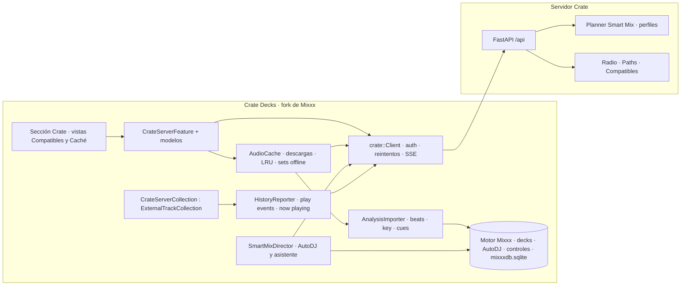
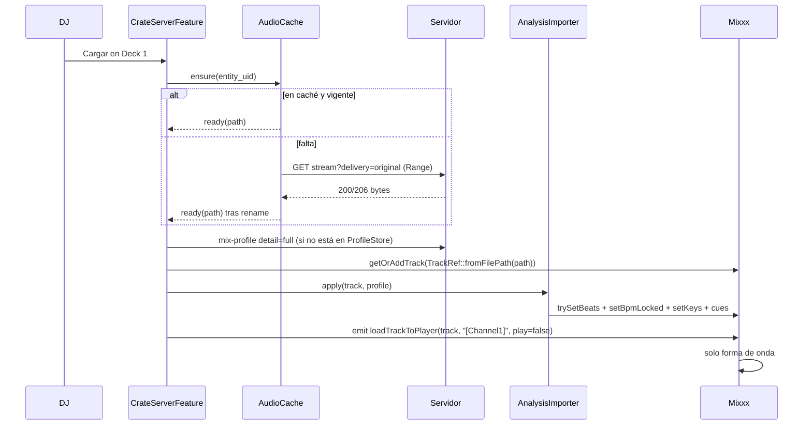

# Crate Decks — Documento de diseño

> **Para agentes:** este documento fija el *qué* y el *por qué*. El *cómo* y el orden están en
> [2026-11-02-crate-decks-implementation-plan.md](2026-11-02-crate-decks-implementation-plan.md).
> Ninguna decisión marcada como **(pendiente G0)** se implementa sin aprobación explícita de Diego.

**Fecha:** 2026-11-02. **Estado:** propuesta para revisión; no implementada.
**Base inspeccionada:**
- Mixxx `main` en `bc49961` (2026-10-30, 2.7-alpha, Qt6, Qt5 recién eliminado), clon superficial en `/tmp/crate-decks/mixxx`.
- Crate `main` en `7460a43eb` (release 3.0.4), revalidado contra `17a30a936` (release 3.1.1): solo cambian las tres cosas de la API anotadas en §3.2, y la identidad visual del admin (§14.1).

Hay que revalidar rutas y números de línea al empezar cada fase: ambos proyectos se mueven.

---

## 1. Objetivo

Crate Decks es un software de mezcla de escritorio, fork de Mixxx, que trata a un servidor Crate como
su biblioteca y su cerebro:

- **Biblioteca:** navegar, buscar y cargar en un deck cualquier pista del servidor sin importar ficheros a mano.
- **Análisis:** usar el análisis de Crate (BPM, beatgrid, tonalidad/Camelot, intro/outro, LUFS) en lugar de reanalizar en cada máquina.
- **Recomendaciones:** pistas compatibles en vivo para lo que suena, más Radio, Music Paths y bliss.
- **Smart Mix:** ejecutar en los decks las transiciones planificadas por el servidor (beatmatch, intercambio de bajos, ajuste de ganancia) en un modo de AutoDJ y como asistente para quien mezcla a mano.
- **Escritura de vuelta:** historial de reproducción, now playing, likes, valoraciones, playlists y, más adelante, cues.
- **Identidad visual:** la interfaz habla el mismo lenguaje visual que el admin de Crate (capas sólidas casi negras, un único acento cian usado como línea, líneas finas, rótulos en JetBrains Mono, títulos en Bricolage Grotesque y cuerpo en Roboto), no el de Mixxx (D11 y §14).

**Criterio de éxito:** un DJ con un servidor Crate abre Crate Decks, inicia sesión, carga dos pistas
de su biblioteca y mezcla con beatgrid y tonalidad correctos sin esperar a ningún análisis local salvo
la forma de onda. Además, deja una sesión de AutoDJ haciendo transiciones beatmatched con intercambio
de bajos que suenan como las de Smart Mix en Android.

## 2. Por qué Mixxx y no seguir solo con VirtualDJ

El plugin de VirtualDJ (`tools/vdj-plugin/`, diseño en `docs/technical/smart-mix-design.md` §6) funciona,
pero VirtualDJ impone límites que no se pueden resolver desde un plugin:

| Limitación de VirtualDJ | Consecuencia | En Mixxx |
|---|---|---|
| Licencia Pro obligatoria | El usuario paga a un tercero para usar Crate | Gratis y libre |
| Un solo nivel de carpetas y sin paginación | Navegación pobre y playlists partidas en bloques de 500 | Árbol de barra lateral arbitrario y modelos de tabla propios |
| `GetStreamUrl` síncrono, solo URL y sin cabeceras | El ticket tiene que viajar en la URL | Cliente HTTP propio con cabeceras |
| VDJ gestiona la descarga y no hay caché propia | Sin control de caché ni de prefetch | Caché propia, prefetch y sets offline |
| El SDK no tiene álbum, energía, Camelot ni cues | Todo va metido en `comment` | Columnas y datos propios |
| VDJ hace su propio análisis de BPM, grid, tonalidad y POI | El análisis de Crate se ignora | Se inyecta y se bloquea el BPM |
| Sin eventos ni timers; hay que hacer polling | Integración frágil | Señales Qt, timers y controles |
| "Crate Automix" solo puede encolar | Las transiciones de Smart Mix no se ejecutan | Control total de tempo, sincronía, EQ, ganancia y crossfader |

Mixxx aporta lo que sería inviable reescribir: motor de audio, timestretch y keylock, sincronía,
efectos, mapeos de cientos de controladoras, vinilo de control, grabación y broadcasting.
Escribir un software de DJ desde cero no es una alternativa realista, y Rekordbox, Serato,
Traktor o Engine DJ son cerrados.

**El plugin de VDJ no se abandona.** Sigue siendo la integración para quien ya usa VirtualDJ. Crate
Decks es el cliente de DJ de primera clase.

## 3. Datos de partida

### 3.1. Mixxx

| Aspecto | Valor | Referencia |
|---|---|---|
| Licencia | GPL-2.0-or-later | `LICENSE` |
| Tamaño | Unas 343.000 líneas en `src/`, de ellas unas 54.500 en `src/library`; unas 38.000 de tests | — |
| Stack | C++ y Qt ≥ 6.4, CMake con ficheros listados explícitamente (sin glob) | `CMakeLists.txt` |
| UI | QWidget por defecto (skins XML y QSS en `res/skins/`). Hay **dos** UIs QML: `res/qml` (`--new-ui`, "the highly unstable 3.0 Mixxx interface", exige un perfil nuevo) y `res/skins/LateNightQML` (port de LateNight del GSoC, solo con `--developer`). Detalle en §14.2 | `cmdlineargs.cpp:293-303`, `qmlapplication.cpp:193-221`, `skinloader.cpp:258-264` |
| Biblioteca externa | `LibraryFeature` y `BaseExternalLibraryFeature`; los modelos externos usan tablas SQLite propias y vistas TEMPORARY | `libraryfeature.h`, `rekordboxfeature.cpp` |
| Colección externa | `ExternalTrackCollection`. Nadie la registra: en el constructor de `TrackCollectionManager` pone `// TODO: Add external collections` | `trackcollectionmanager.cpp:59` |
| Audio | **Solo ficheros locales**: `SoundSource` exige `url.isLocalFile()`, y el deck falla si el fichero no existe al cargar | `soundsource.cpp:16-24`, `cachingreaderworker.cpp:204-215` |
| AutoDJ | Cinco modos (intro/outro y tiempos fijos), **solo mueve el crossfader**. Descarta de la cola las entradas sin fichero | `autodjprocessor.cpp:1473`, `1001-1010` |
| Inyección de análisis | `Beats::fromBeatPositions`/`fromConstTempo`, `trySetBeats`, `setBpmLocked`, `setKeys`, `createAndAddCue`, `importCueInfos`. Rekordbox hace exactamente esto | `track.h`, `rekordboxfeature.cpp:946-951`, `1301` |
| Evitar reanálisis | Con el BPM bloqueado el analizador de beats no reanaliza; la clave no se recalcula si ya es válida; silencio se salta si existen Intro, Outro y N60dBSound | `analyzerbeats.cpp:131-191`, `analyzerkey.cpp`, `analyzersilence.cpp` |
| Controles | `[ChannelN]` (`play`, `rate`, `bpm`, `sync_enabled`, `beatsync`, `pregain`, `volume`, `keylock`), `[EqualizerRack1_[ChannelN]_Effect1]` (`parameter1..3`, `button_parameter1..3`), `[QuickEffectRack1_[ChannelN]],super1`, `[Master],crossfader` | `src/mixer/`, `src/engine/` |
| Red | `WebTask` y `JsonWebTask` (en MusicBrainz). QtKeychain disponible | `src/network/` |
| Build Linux | `tools/debian_buildenv.sh setup`. CI en Ubuntu 24.04 produce DEB; en Ubuntu 22.04, AppImage | `.github/workflows/build.yml` |
| Colisión de nombres | Mixxx ya tiene "Crates" (`src/library/trackset/crate/*`, tabla `crates`) | — |

### 3.2. Crate (lo que ya existe para un cliente de DJ)

| Necesidad | Endpoint o dato | Referencia |
|---|---|---|
| Identidad de pista | `entity_uid` (UUID por pista local), canónico para stream y Smart Mix. Para federación, `global_track_uid` | `library_catalog.py` |
| Búsqueda de DJ | `GET /api/search?fields=dj` con filtros `bpm:`, `key:`, `energy:` y `analyzed:`. Máximo 50 resultados. Con token de acceso solo vale `scope=local`, y una consulta DJ válida se trata como `fields=dj` aunque no se pida (3.1.x) | `browse_media.py`, `browse_media_search.py` |
| Audio original | `GET /api/tracks/by-entity/{uid}/stream?delivery=original` con Range | `browse_media.py` |
| Perfil de mezcla | `GET /api/tracks/by-entity/{uid}/mix-profile?detail=full`: `beatGridMs`, `bpm`, `camelot`, `introCueMs`/`outroCueMs`, `intro/outroBeatMs`, `integratedLufs`, `truePeakDbfs`, `quality`… | `api/smart_mix.py`, `schemas/smart_mix.py` |
| Compatibles | `GET /api/tracks/by-entity/{uid}/compatible?context=auto\|beatmatch\|smooth` con `scoreBreakdown`. Desde la 3.1.x cada elemento trae `duration`, `bpm`, `camelot`, `energy`, `year`, `genre`, `coverUrl` (`/api/vdj/albums/{id}/cover?size=512`) y `albumId`, así que la vista Compatibles no necesita lecturas extra | `api/smart_mix.py`, `schemas/smart_mix.py` |
| Plan de transición | `POST /api/playback/transition-plans` (de 1 a 32 aristas): `mode`, `durationMs`, cues, `incomingTempoRatio`, `beatPhaseOffsetMs`, `handoffProgress`, ganancias, `curve`, `bassHandoff`, `confidence`, `fallbackReason` | `api/smart_mix.py` |
| Radio y Paths | `/api/radio/start\|next\|feedback` y `/api/paths` | `radio.py`, `paths.py` |
| Escritura | `POST /api/me/play-events`, `/api/me/now-playing`, `/api/me/likes`, `/api/track/rate` y edición de playlists | `me.py`, `browse_media.py`, `playlists.py` |
| Tiempo real | SSE `/api/cache/events` para invalidaciones | `cache_events.py` |
| Capacidades | `GET /api/capabilities` (`smart_mix`, `vdj` —con `listen_url` desde la 3.1.x—, `access_token`) | `capabilities.py` |

### 3.3. Huecos del servidor (bloquean partes de Decks)

1. **Autenticación:** un token de acceso (`crv_`) solo alcanza 13 rutas (`auth.py`, lista de rutas permitidas). Las sesiones con refresh y el OAuth nativo solo se conceden a apps `listen*` (`_is_listen_request`, `native_oauth_auth.py`).
2. **Cues:** no hay almacenamiento de cues ni loops del usuario, ni forma de subir correcciones de BPM, grid o tonalidad.
3. **Lecturas en lote:** no hay lectura en lote de perfiles de mezcla (uno por pista) ni feed de sincronía o delta de biblioteca para clientes.
4. **Planner atado a Android:** el intercambio de bajos lo controla una flag de Android, y `capabilities` no tiene sección `decks`.
5. **Crates:** no tienen carpeta de VDJ y son de álbumes, no de pistas.
6. **Now playing:** no lleva contexto de deck. Tampoco hay ReplayGain ni un endpoint de forma de onda (no hace falta: Mixxx la calcula).

## 4. Decisiones

**D1. Fork delgado de Mixxx en un repositorio aparte.** (repo creado por decisión de Diego el 2026-11-03; el resto, G0)
- **Repo:** `thecrateapp/crate-decks` (público, como todo fork de un repo público), fork de `mixxxdj/mixxx` con historial completo, para poder sincronizar con upstream. Rama de trabajo inicial: `spike/crate-decks`.
- **Fuera del monorepo de Crate:** el build, el CI y la licencia son distintos.
- **Código propio aislado** en `src/crate/` (cliente, caché, director de Smart Mix) y `src/library/crateserver/` (feature y modelos).
- **Parches a ficheros de Mixxx** mínimos y enumerados en `CRATE_PATCHES.md`. Cada parche lleva su motivo y si se intentará subir upstream.
- **Hooks genéricos** (registro de colecciones externas, modos de AutoDJ extensibles): se intentan proponer upstream de forma manual. El `AGENTS.md` de Mixxx prohíbe PRs autónomos de agentes en su repo.

**D2. Licencia y marca.**
- El fork queda **GPL-2.0-or-later**, y el código nuevo propio se publica GPL-2.0-or-later para no complicar la sincronía con upstream.
- **Relación con el servidor:** el servidor Crate (AGPL-3.0) y Decks son programas distintos que hablan HTTP, así que no hay obligación cruzada.
- **Marca:** no se usa el nombre ni el logo de Mixxx. Habrá créditos visibles ("Basado en Mixxx") en About y en la documentación.
- **Distribución:** los binarios llevan el código fuente correspondiente (enlace al tag del repo), como exige la GPL.

**D3. Identidad de aplicación separada de Mixxx.**
- **Nombre:** "Crate Decks".
- **Identificadores:** organización `cratemusic.app` y bundle ID `app.cratemusic.decks`. Flatpak, cuando exista, `app.cratemusic.Decks`.
- **Ajustes:** directorio propio (`~/.cratedecks/` en Linux y el equivalente derivado de `QStandardPaths` en macOS y Windows). Así nunca pisa la base de datos ni la configuración de un Mixxx instalado.

**D4. Audio: caché local completa; reproducción progresiva opcional (D14).**
- **Descarga:** por `GET /api/tracks/by-entity/{uid}/stream?delivery=original` con `Authorization: Bearer` y Range para reanudar. **No se usa `/download`**, que reescribe tags y no es idéntico byte a byte.
- **Ruta de caché estable:** `<cache>/<server_id>/<entity_uid[0:2]>/<entity_uid>.<ext>`. Al ser estable no hace falta relocalizar nada: Mixxx no tiene API pública de relocalización.
- **Revisión del fichero:** se guarda la del servidor (`byte_length` y `ETag`, y `source_revision` cuando el servidor la exponga, S3). Si cambia, se invalida.
- **Carga:** se escribe en `.part`, se hace `rename` atómico y solo entonces se llama a `getOrAddTrack` y se carga en el deck.
- **Prefetch:** de la cola de AutoDJ (las N siguientes) y de las pistas que el DJ marque. Hay **sets offline**: descargar una playlist o un contenedor entero antes de un bolo.
- **Espacio:** límite de caché configurable (por defecto 20 GiB) con LRU que nunca expulsa pistas cargadas, en cola, de un set offline o reproducidas en la sesión actual.
- **Reproducir mientras descarga:** no forma parte de la base. Es una fase opcional (D14, F4b) que reutiliza esta misma ruta de caché.

**D5. Identidad local de pistas.**
- **Clave Crate:** `(server_id, entity_uid)`. `global_track_uid` se guarda cuando existe.
- **Clave Mixxx:** `TrackId`, vía `getOrAddTrack(TrackRef::fromFilePath(cachePath))`. Cada pista Crate acaba como una fila normal de `library`/`track_locations` apuntando a su fichero de caché.
- **Mapa** en la tabla propia `crateserver_tracks` (§6).
- **Biblioteca local:** las pistas Crate no aparecen en "Tracks" (la biblioteca local de Mixxx) salvo que el usuario lo active. Su directorio de caché no se añade nunca a los directorios del escáner.

**D6. El análisis de Crate es la fuente de verdad.**
- **Qué se inyecta tras `getOrAddTrack`** (patrón de `RekordboxPlaylistModel::getTrack`):
  - **Beatgrid:** `Beats::fromBeatPositions` con `beatGridMs`, o `fromConstTempo` si la estabilidad de tempo es alta, con `subVersion = "crate-mix-profile-<profileRevision>"`, más `setBpmLocked(true)`.
  - **Tonalidad:** `setKeys(KeyFactory::makeBasicKeys(...))`.
  - **Cues:** Intro, Outro y N60dBSound con `createAndAddCue`, desde `introCueMs`, `outroCueMs` y el rango activo.
  - **Ganancia** opcional a partir de `integratedLufs`.
- **Resultado:** Mixxx solo calcula la forma de onda.
- **Calidad del perfil:** si es `partial`, `legacy` o `unavailable`, o no hay perfil, se deja analizar a Mixxx y se marca la pista como "analizada localmente". Esos datos no se suben al servidor hasta la fase de correcciones (F8).
- **BPM bloqueado:** si el usuario lo desbloquea y ajusta, la corrección es local y se ofrece subirla (F8).
- **Cues del usuario:** no se sobrescriben. `importCueInfos` ya se salta tipos de cue existentes; las cues de Crate se reaplican solo si cambia `profileRevision` y el usuario no las editó.

**D7. Un tipo de cliente "decks" en el servidor.** (pendiente G0)
- **Problema:** con un token `crv_` no se puede navegar la biblioteca, ni usar radio, paths, likes, playlists o SSE.
- **Propuesta:** tratar a Decks como cliente nativo de primera clase, con sesión interactiva y refresh:
  - `X-Crate-App: decks/<versión>` y app ID `crate-decks`.
  - Login con email y contraseña, y OAuth nativo con PKCE y bucle a `http://127.0.0.1:<puerto>/callback` (RFC 8252), porque un esquema `cratemusic://` es frágil en Linux.
  - Refresh tokens con la misma política que Listen.
- **Alternativa descartada:** ampliar la lista de rutas de los tokens de acceso con alcances `decks.*`. Duplica la política de autorización ruta a ruta y el cliente seguiría sin SSE.
- Los tokens `crv_` se mantienen para VDJ y automatizaciones.
- **Almacenamiento:** el refresh token se guarda en QtKeychain (Keychain, Secret Service o Credential Manager); nunca en `mixxx.cfg`.

**D8. Smart Mix en los decks.**
- **El planner sigue en el servidor.** Decks pide planes por adelantado (1 a 32 aristas) para la cola de AutoDJ y los ejecuta en local con controles de Mixxx. Hay una sola fuente de verdad para la política de mezcla y Android y Decks suenan igual.
- **Nuevo modo de AutoDJ "Crate Smart Mix",** implementado en un `SmartMixDirector` propio. AutoDJ sigue cargando pistas y gestionando la cola; el director gobierna la transición:
  - **Tempo:** `rate` del deck entrante según `incomingTempoRatio`, o `sync_enabled` con la fase de `beatPhaseOffsetMs`.
  - **Arranque:** el entrante empieza en `incomingCueMs`, alineado al beat.
  - **Ganancia:** `pregain` según `outgoing/incomingGainDb`.
  - **Bajos:** con `bassHandoff`, cambio de `[EqualizerRack1_[ChannelN]_Effect1],parameter1` (graves; verificar en F0) en `handoffProgress`.
  - **Crossfader:** curva `equal-power` o `dj-blend`.
  - Si el plan llega con `fallbackReason`, el director aplica el fallback indicado (por ejemplo, un crossfade de 3 s).
- **Modo asistente** para mezcla manual: muestra el plan sugerido (punto de entrada, tempo, momento de bajos) y deja ejecutarlo con un botón o mapearlo a controladora. No mueve nada que el DJ esté tocando.
- **El servidor añade contexto `decks`:**
  - `source: "decks"`.
  - Capacidades `decks.beatmatch` y `decks.bass_handoff`, independientes de Android.
  - Opción de transiciones más largas en mezcla manual. Los límites actuales se mantienen en AutoDJ salvo decisión en G0: `incomingTempoRatio` de 0,94 a 1,06 (tempo ≤4 % por política), de 1 a 12 s, o hasta 48 s en beatmatch largo.

**D9. Recomendaciones.**
- **Panel "Compatibles":** una vista propia de biblioteca que sigue a la pista del deck "maestro", o a la seleccionada. Usa `compatible?context=auto` y muestra puntuación, relación armónica, Δ BPM y Δ energía.
- **Radio y Music Paths como fuentes de AutoDJ:** se crea una sesión de radio o un path y sus pistas entran en la cola con prefetch. Las acciones de like y dislike del DJ alimentan `radio/feedback`.
- **Búsqueda DJ:** el buscador de la sección Crate usa `fields=dj`, así que funcionan `bpm:120-128 key:8A`.

**D10. Escritura de vuelta.**
- **Eventos de reproducción:** un evento por pista realmente reproducida, a partir de `PlayerInfo::currentPlayingTrackChanged`, el mismo criterio que el Setlog de Mixxx. Lleva `device_type: "decks"`, `play_source_type: "decks"` y `client_event_id` para deduplicar.
- **Now playing** con contexto de deck. Requiere ampliar el esquema (S6).
- **Likes, valoraciones y playlists:** like con un atajo, valoración a 5 estrellas sincronizada, y playlists de Crate editables desde Decks (añadir, quitar, reordenar).
- **Cues e hot cues en el servidor:** fuera de las primeras fases. Necesitan almacenamiento y contrato nuevos (§8, S7).

**D11. Rediseño visual con el lenguaje del admin, en dos etapas.** (pendiente G0 y GU1)
- **Etapa 1, ahora:** skin QWidget propia `CrateDecks`, derivada de LateNight y predeterminada en el fork.
  - **Estructura:** reescribe los estilos QSS, las variables de la skin, los SVG (botones, knobs, faders, iconos) y los colores de forma de onda. Conserva la ergonomía y los controles de LateNight; la maquetación se adapta donde haga falta (barra superior, barra lateral).
  - **Estilo de diálogos y preferencias:** se reescribe el `res/skins/default.qss` del fork.
  - **Integración con la sección Crate:** sigue siendo una `LibraryFeature`. Compatibles, el asistente de Smart Mix y la caché son vistas registradas con `WLibrary::registerView`.
- **Tokens en un único fichero:**
  - **Fuente:** `res/crate-design/tokens.json`, una copia de los tokens del admin (`app/shared/ui/tokens/`) con las adaptaciones DJ de §14.3.
  - **Salidas:** un generador produce el QSS, las variables de la skin y los SVG coloreados, y también un `Theme.qml`. Así el día que se migre a QML no se rehace el diseño.
- **Lógica de Crate separada de la interfaz:** los modelos (contenedores, compatibles, plan sugerido, estado de caché) son `QAbstractItemModel` u objetos con propiedades Qt, sin dependencias de widgets. Las vistas QWidget de hoy son solo una capa, y podrán exponerse a QML con `QML_NAMED_ELEMENT` sin reescribir la lógica.
- **Etapa 2, después y con gate (GU2):** migración a QML cuando upstream la haga viable (criterios en §14.4). El camino previsto es partir de `LateNightQML`, no de `res/qml`.
- **Por qué no QML ahora** (análisis completo en §14.2):
  - La biblioteca QML no muestra features propias y no hay vista de AutoDJ.
  - Las preferencias de AutoDJ, grabación, broadcast y analizador son marcadores vacíos.
  - Hay muestras y efectos comentados en `res/qml`.
  - Upstream la marca como "highly unstable" y avisa de que puede corromper el perfil.
  - El hito 3.0-beta tiene 33 issues abiertos y no tiene fecha. Casi toda la actividad viene de un único contribuidor del GSoC.

**D12. Plataformas y orden.**
1. **Linux primero:** desarrollo, AppImage y `.deb`.
2. **macOS:** DMG firmado ad-hoc, como el desktop de Crate.
3. **Windows:** MSI.

Android e iOS quedan fuera (Mixxx tiene un target Android experimental; no se toca).

**D14. Reproducción progresiva (empezar a sonar mientras descarga), opcional.** (pendiente G3b)
- **Qué es:** el comportamiento de las fuentes online de VirtualDJ. La pista se carga y puede sonar antes de terminar la descarga, y el overview muestra las zonas ya descargadas.
- **Cuándo se activa:** solo si F0 Q10 no cumple el presupuesto de carga en WAN, o si Diego lo decide en G3b. La base (D4) no depende de ella.
- **Por qué es viable sin tocar el motor** (comprobado en Mixxx `bc49961`):
  - El hilo de audio solo consume bloques ya decodificados de 8.192 frames (`cachingreaderchunk.h:26`). Los decodifica un `CachingReaderWorker` por deck, en su propio `QThread` (`engineworker.h:15`). Si ese hilo espera bytes, solo ese deck sufre un fallo de caché y suena en silencio; ni el motor ni los otros decks se bloquean.
  - Mixxx admite fuentes de audio con prioridad (`SoundSourceProviderPriority::Highest`, `soundsourceprovider.h:17-23`) y prueba la siguiente si una devuelve `OpenResult::Aborted` (`soundsourceproxy.cpp:475-511`). Una fuente `CrateProgressive` reclama solo las pistas de Crate en descarga y deja pasar el resto. El parche en Mixxx es una línea de registro.
  - La ruta estable de D4 sirve tal cual: el fichero en descarga es el definitivo, sin relocalización.
  - El servidor ya sirve Range en `/stream?delivery=original`.
- **Diseño:**
  - **`ProgressiveDownload`:**
    - Reserva el fichero completo (tamaño de `byte_length`) y mantiene un mapa de rangos descargados, persistido en `crateserver_cache` (columna `ranges`) para reanudar.
    - **Orden de descarga:**
      1. Cabecera (256 KiB) y cola (1 MiB). La cola importa porque MP3 puede tener ID3v1 al final, M4A suele tener el `moov` al final y en OGG/Opus la duración está en la última página.
      2. Descarga secuencial desde la cabeza de lectura.
      3. Un seek a una zona no descargada lanza un Range prioritario.
    - Máximo 2 conexiones por pista.
  - **`SoundSourceCrateProgressive`:**
    - FFmpeg con un `AVIOContext` propio: `read` y `seek` sobre el fichero reservado, que **esperan** a que el rango esté descargado.
    - **Nunca devuelve lecturas cortas:** Mixxx encoge para siempre el rango legible de la pista ante una lectura corta (`cachingreaderworker.cpp:66-75`).
    - **La espera es cancelable:** al expulsar la pista, al cerrar la app o si falla la descarga. Solo falla de verdad si la descarga falla definitivamente.
    - La duración, la sample rate y los canales vienen del servidor. No se fía de la estimación de un fichero incompleto.
  - **Metadatos:** las pistas de Crate en descarga no pasan por la importación de tags de TagLib (los metadatos vienen de Crate), para no leer un fichero a medias.
  - **Análisis:** el analizador de forma de onda lee al ritmo de la descarga, y Mixxx ya pinta la onda de forma progresiva. Beats, tonalidad y cues siguen llegando de Crate (D6), así que no dependen de la descarga.
  - **Reglas de reproducción:**
    - **Play habilitado:** con ≥ 10 s descargados por delante de la cabeza y una velocidad medida ≥ 1,2× el bitrate de la pista. Si no, el deck muestra `BUFFERING` (MonoLabel) y el play pide confirmación.
    - **Hot cue o seek a una zona no descargada:** Range prioritario y `BUFFERING` hasta que llega.
    - **Overview:** pinta las zonas descargadas con la gramática de StackMap (carril de 1 px en `accentHi` bajo el overview).
    - **AutoDJ:** solo usa pistas completas (D4). La progresiva es para carga manual.
- **Formatos:**
  - FLAC, WAV, AIFF y MP3 con cabecera Xing/LAME: directos.
  - M4A/ALAC/AAC y OGG/Opus: dependen de la descarga de la cola.
  - Si FFmpeg no puede abrir el fichero con cabecera y cola, la fuente devuelve `Aborted` y la pista espera a la descarga completa (comportamiento D4).
- **Plataformas:** la opción `FFMPEG` de CMake solo se activa si encuentra FFmpeg (`CMakeLists.txt:2766`). F0 Q17 comprueba que los builds de Linux, macOS y Windows lo incluyen; donde no, la plataforma usa solo D4.

**D15. AI Assisted Mixing (consume Smart Mix 3).** (pendiente SG3/SG4 del plan smart-mix-3)
- **Dónde se hace:** todo el trabajo de servidor está en el plan paralelo smart-mix-3 ([diseño](2026-11-02-smart-mix-3-design.md), [plan](2026-11-02-smart-mix-3-implementation-plan.md)): análisis estructural, planner `smart-mix-v3` con menú de candidatos, refinamiento con LLM (DeepSeek, Kimi, Qwen en la nube o Qwen en local) en una cola propia, tabla de planes refinados y capacidad `smart_mix.ai_assisted`. Decks solo lo consume.
- **Qué hace Decks:**
  - Usa `smart-mix-v3` cuando `capabilities.smart_mix.planner_versions` lo incluye, y v2 si no.
  - **Opción del usuario "AI Assisted Mixing"**, visible solo si `smart_mix.ai_assisted.available`. Activa `context.aiRefinement=true` en las peticiones de planes y envía `context.setHistory` (las 3 transiciones anteriores de la sesión).
  - **AutoDJ:** pide el refinamiento en cuanto la arista entra en la cola (minutos de margen) y recoge el resultado volviendo a pedir la arista como mucho cada 5 s, o por SSE si el servidor lo anuncia.
  - **Asistente manual:** lo pide al cargar el otro deck.
  - **El refinado se usa solo si llega antes de que el director entre en `Preparing`** (≥ 8 s antes de `outgoingCueMs`). Nunca se cambia de plan durante `Preparing` o `Running`. Si no llega, se usa el determinista sin avisos molestos.
  - **Vista del plan:** muestra el origen con MonoLabel (`SMART MIX` o `AI · <MODELO>`), el motivo del refinamiento y la confianza. En el asistente, el DJ puede alternar entre el refinado y el determinista antes de ejecutar.
- **Lo que Decks no hace:** no llama a ningún LLM ni guarda claves de IA; la configuración es del admin del servidor (SM3-D10, D11).

**D13. Cambios de servidor aditivos y anunciados por capacidades.**
- **Capacidad:** `GET /api/capabilities` gana una sección `decks{available, min_client_version, contract_version, features[...]}`, y Decks degrada funcionalidades según lo que anuncie.
- **Endpoints nuevos** bajo `/api/decks/*` cuando el contrato sea específico. Se reutilizan los generales cuando ya sirven.
- **Sin cambios incompatibles** para Listen, VDJ ni OpenSubsonic.

## 5. Arquitectura

### 5.1. Componentes del fork

| Componente | Responsabilidad | Hilo |
|---|---|---|
| `crate::Client` (`src/crate/client/`) | `QNetworkAccessManager` propio, cabeceras (`Authorization`, `X-Crate-App`), refresh automático ante 401, reintentos con backoff y `Retry-After`, cancelación y deduplicación de peticiones idénticas | Principal (async Qt); el parseo pesado va a `QtConcurrent` |
| `crate::Session` | Perfiles de servidor (origen, cuenta), login, refresh, logout, almacenamiento en QtKeychain | Principal |
| `crate::Capabilities` | Lee `/api/capabilities` y expone flags tipados; `min_client_version` bloquea con un aviso claro | Principal |
| `crate::AudioCache` | Cola de descargas (concurrencia 2 por defecto), `.part` y `rename`, reanudación por Range, verificación de longitud, índice SQLite propio, LRU con pines, sets offline, progreso | Hilo propio; notifica con señales |
| `crate::AnalysisImporter` | Traduce perfiles a `Beats`, `Keys` y cues; decide si se deja analizar a Mixxx; aplica `setBpmLocked` | Principal (Track y TrackDAO lo exigen) |
| `crate::ProfileStore` | Caché de perfiles de mezcla (JSON por `entity_uid` y `profileRevision`) con lectura en lote cuando el servidor la ofrezca | Principal y SQLite |
| `CrateServerFeature` (`src/library/crateserver/`) | Árbol de la barra lateral (servidores, Biblioteca, Playlists, Crates, Géneros, Moods, Recientes, Likes, Radio, Paths), búsqueda DJ, menú contextual (cargar en deck, a AutoDJ, descargar, like, añadir a playlist) | Principal; las cargas de datos en `QtConcurrent` |
| Modelos `CrateServerTrackModel` / `CrateServerPlaylistModel` | Sobre `BaseExternalTrackModel` y `BaseExternalPlaylistModel` con tablas `crateserver_*` y vistas TEMPORARY; columnas extra (Camelot, energía, estado de caché, calidad del perfil) | Principal |
| `CrateServerCollection` | `ExternalTrackCollection`. Recibe `saveTrack`, que sirve de base para valoraciones y cues, y aporta la feature con `newLibraryFeature` | Principal; delega el trabajo de red |
| `crate::CompatiblesView` | Vista de biblioteca con la lista de compatibles para la pista activa; se actualiza al cambiar el deck maestro (con debounce) | Principal |
| `crate::SmartMixDirector` | Pide planes por adelantado, alinea, ejecuta y cancela transiciones sobre `ControlProxy`; gestiona fallbacks; modo asistente | Principal; timer de precisión, nunca el hilo del motor |
| `crate::HistoryReporter` | Escucha `PlayerInfo::currentPlayingTrackChanged`, construye play events y now playing, cola persistente para cuando no hay red | Principal y SQLite |
| `DlgPrefCrate` | Página de preferencias: servidores, cuenta, tamaño y ruta de caché, comportamiento de AutoDJ y Smart Mix | Principal |

### 5.2. Parches en ficheros de Mixxx (lista cerrada; cualquier otro necesita justificación)

| Fichero | Cambio | ¿Upstream? |
|---|---|---|
| `src/library/trackcollectionmanager.cpp` | Registrar `CrateServerCollection` en el `TODO` de la línea 59, detrás de la opción de build `CRATE` | Sí: un mecanismo de registro genérico |
| `src/library/library.cpp` | Nada si la feature llega por `newLibraryFeature`; si no, `addFeature` con la clave `[Library],ShowCrateServerLibrary` | — |
| `src/library/autodj/autodjprocessor.{h,cpp}`, `dlgautodj.cpp` | Valor `TransitionMode::CrateSmartMix` y puntos de enganche: delegar el cálculo y la ejecución a un `TransitionDirector` externo cuando ese modo está activo | Sí: una interfaz de modos de transición enchufables |
| `src/library/autodj/autodjprocessor.cpp` (~1001-1010) | No descartar entradas sin fichero si pertenecen a Crate y están descargándose; esperar a que termine | Sí: un hook "pending track" |
| `src/analyzer/analyzerbeats.cpp` (~159-162) | Tratar `subVersion` `crate-mix-profile-*` como importado (igual que Rekordbox) respetando `[BPM],ReanalyzeImported` | Quizá |
| `CMakeLists.txt` | Fuentes de `src/crate` y `src/library/crateserver`, opción `CRATE` (activada por defecto en el fork), nombre, identificadores y CPack | No |
| `src/util/versionstore.cpp`, `main.cpp`, `res/linux/*`, `packaging/*` | Nombre, organización, ruta de ajustes, iconos, `.desktop` y metainfo | No |
| `src/preferences/dialog/dlgpreferences.cpp` | Registrar `DlgPrefCrate` | No |
| `src/sources/soundsourceproxy.cpp` (`registerProviders`) | Registrar `SoundSourceCrateProgressive` con prioridad `Highest`; solo en F4b (D14) | Quizá: un hook genérico de fuentes progresivas |
| Importación de metadatos al añadir la pista (localizar en F4b: `TrackCollectionManager` / `SoundSourceProxy::updateTrackFromSource`) | Saltar la lectura de tags de pistas Crate en descarga; solo en F4b | No |
| `res/skins/CrateDecks/` (nuevo, derivado de LateNight) | Skin propia; no se modifica LateNight | No |
| `res/skins/default.qss` | Estilo de diálogos y preferencias con los tokens de Crate | No |
| `res/fonts/` | Roboto, Bricolage Grotesque y JetBrains Mono (OFL 1.1), copiadas de `app/shared/fonts/` con sus licencias | No |
| Skin por defecto (`src/skin/skinloader.cpp` o la constante que la define) | `CrateDecks` en lugar de `LateNight` | No |

## 6. Datos locales

`mixxxdb.sqlite` es de Mixxx; las tablas propias llevan el prefijo `crateserver_`. Hay dos formas de
crearlas: una revisión propia de `res/schema.xml`, que obliga a rebasar contra las revisiones de upstream,
o creación idempotente al arrancar, como hace Rekordbox. **Se elige la segunda** para no chocar con las
revisiones de esquema de upstream.

| Tabla | Columnas | Uso |
|---|---|---|
| `crateserver_servers` | `id`, `origin`, `account_id`, `display_name`, `last_capabilities_json`, `created_at` | Perfiles de servidor (sin secretos) |
| `crateserver_tracks` | `server_id`, `entity_uid` (PK compuesta), `global_track_uid`, `mixxx_track_id`, `title`, `artist`, `album`, `duration_ms`, `bpm`, `camelot`, `energy`, `genre`, `format`, `bitrate`, `sample_rate`, `bit_depth`, `byte_length`, `source_revision`, `profile_revision`, `profile_quality`, `cover_url`, `updated_at` | Catálogo visible y mapa a `TrackId` |
| `crateserver_containers` | `id`, `server_id`, `kind` (`playlist`, `crate`, `genre`, `mood`, `recent`, `likes`, `radio`, `path`, `search`), `remote_id`, `name`, `parent_id`, `position`, `etag`, `fetched_at` | Árbol de la barra lateral |
| `crateserver_container_tracks` | `container_id`, `position`, `entity_uid` | Contenido ordenado |
| `crateserver_cache` (SQLite propio en el directorio de caché) | `server_id`, `entity_uid`, `path`, `bytes`, `etag`, `source_revision`, `state` (`pending`, `downloading`, `ready`, `failed`), `ranges` (rangos descargados; solo D14), `pinned_reason`, `last_used_at` | Índice de la caché de audio |
| `crateserver_profiles` | `server_id`, `entity_uid`, `profile_revision`, `json`, `fetched_at` | Perfiles de mezcla |
| `crateserver_outbox` | `id`, `server_id`, `kind` (`play_event`, `now_playing`, `like`, `rating`, `playlist_op`), `payload`, `attempts`, `next_attempt_at` | Escritura diferida cuando no hay red |

Por qué hay tablas y no solo modelos en memoria: la búsqueda local, el orden y los filtros de Mixxx
(`BaseTrackCache`, `buildIndex`) funcionan sobre tablas SQL.

## 7. Flujos

### 7.1. Primer arranque e inicio de sesión
1. El asistente pide la URL del servidor. `GET /api/capabilities` comprueba que existe `decks` y que `min_client_version` encaja.
2. Login con email y contraseña, o OAuth con PKCE en el navegador del sistema y bucle a `127.0.0.1`. Se obtienen tokens; el refresh token va a QtKeychain.
3. `GET /api/auth/me`, alta en `crateserver_servers` y primera sincronía del árbol de la barra lateral.

### 7.2. Navegar y buscar
- Abrir un contenedor carga una página del servidor en `crateserver_container_tracks`, sustituye la vista TEMPORARY y llama a `buildIndex`.
- Paginación: cursor, cuando S3 exista; límites actuales mientras tanto.
- La búsqueda de la sección Crate usa `GET /api/search?fields=dj` con debounce de 250 ms. Los resultados se muestran como un contenedor efímero (`kind=search`).
- Las invalidaciones por SSE (`/api/cache/events`, con `Last-Event-ID`) marcan contenedores como sucios y se recargan al verlos.

### 7.3. Cargar una pista en un deck

- **Progreso:** mientras descarga, la fila muestra el progreso y el deck no se toca.
- **Pista nueva en un deck que está sonando:** se pide confirmación, como hace Mixxx.
- **Tiempos objetivo:** en LAN, menos de 1,5 s del clic a la pista cargada para un FLAC de 40 MB. En WAN depende del enlace, y se muestra el tiempo estimado.

### 7.4. AutoDJ con Crate Smart Mix
1. La cola de AutoDJ se llena desde un contenedor, un resultado de Radio o un path.
2. Al entrar una pista, la caché la descarga si está entre las 3 siguientes.
3. El director pide planes en lote para las aristas `(sonando → siguiente)` y `(siguiente → siguiente+1)` y los refresca si la cola cambia.
4. Al acercarse `outgoingCueMs`, el director prepara el deck entrante: cue, tempo, ganancia y EQ neutra. En el instante previsto, arranca y ejecuta la curva.
5. Si el DJ toca algo, se cancela la automatización de ese control y se registra la interrupción.
6. Al terminar, AutoDJ retira la pista saliente como hoy.
7. Si el plan no llega a tiempo, o llega con `fallbackReason`, se usa la transición de respaldo indicada. Si no hay plan, `FullIntroOutro` de Mixxx.

### 7.5. Compatibles en vivo
- Cambia el deck maestro, o la selección si el panel está fijado a selección, y tras 400 ms de debounce se pide `compatible?context=auto&limit=50`.
- Las filas muestran Camelot, Δ BPM, relación armónica y puntuación. Doble clic carga la pista en el deck libre.
- La caché se precalienta para las 5 primeras si hay espacio. Se puede desactivar.

### 7.6. Historial y now playing
- **Play event:** cuando Mixxx marca una pista como reproducida (mismo criterio que el Setlog). Se descarta si se reprodujo menos del umbral configurado.
- **Now playing:** con el deck maestro, cada 60 s mientras suena (la TTL del servidor es mayor).
- **Sin red:** todo se encola en `crateserver_outbox` y se reintenta con backoff. `client_event_id` evita duplicados.

## 8. Cambios necesarios en el servidor Crate

| ID | Cambio | Por qué | Fase |
|---|---|---|---|
| S1 | **Cliente nativo `decks`**: reconocer `X-Crate-App: decks/*`, emitir refresh tokens y admitir el app ID `crate-decks` en OAuth nativo con bucle `http://127.0.0.1:<puerto>/callback` (con PKCE y `state`) | Sesión completa, D7 | F2 |
| S2 | **`capabilities.decks`**: `available`, `min_client_version`, `contract_version` y `features` (`beatmatch`, `bass_handoff`, `long_beatmatch`, `cues`, `profiles_batch`, `library_cursor`) | Degradación ordenada, D13 | F2 |
| S3 | **Navegación paginada para clientes**: contenedores (`playlists`, `crates` expandidos a pistas, `genres`, `moods`, `recent`, `likes`) con cursor y ETag, y campos de DJ por pista (`camelot`, `energy`, `profile_quality`, `byte_length`, `source_revision`) | Barra lateral rica sin N+1 ni 500 pistas por bloque | F3 |
| S4 | **Perfiles en lote**: `POST /api/decks/mix-profiles` con hasta 200 `entity_uid`, `detail=full` y una sola consulta con `ANY(:uids)` | Cargar una playlist sin 200 peticiones | F4 |
| S5 | **Contexto de planner `decks`**: `context.source="decks"`, intercambio de bajos según la capacidad de decks (no la flag de Android) y, si G0 lo aprueba, duraciones o rampas distintas en el modo asistente | Smart Mix en los decks, D8 | F6 |
| S6 | **Now playing con deck**: campos opcionales `deck` y `mix_session_id`, `device_type="decks"` válido en play events y `transition_source` opcional (`ai`, `deterministic` o `none`, D15) | Historial correcto, D10 | F7 |
| SM3 | **Plan smart-mix-3** (externo): estructura, planner v3, refinamiento con LLM, `refinement` en transition plans y `smart_mix.ai_assisted` en capacidades. Ver [plan](2026-11-02-smart-mix-3-implementation-plan.md); Decks F6b depende de su fase SM4 | AI Assisted Mixing, D15 | F6b |
| S7 | **Cues y correcciones del usuario**: tablas de cues, loops y correcciones de grid/BPM/tonalidad por usuario y `entity_uid` con revisión; endpoints de lectura en lote y escritura idempotente | Cues entre dispositivos y no perder correcciones | F8 |

Todas siguen las reglas del monorepo:
- Las escrituras van por los repositorios de `app/crate/db/`.
- Las lecturas usan `read_scope` con `ANY(:ids)`.
- Nada de `COUNT` sobre `library_tracks` en un request.
- Los tests van con el código, y la documentación canónica en `docs/technical/`.

## 9. Presupuestos

| Área | Presupuesto |
|---|---|
| UI | El hilo principal nunca bloquea más de 16 ms por red, disco o parseo: el parseo JSON de más de 1.000 filas va a `QtConcurrent`; las escrituras SQLite, en lote dentro de una transacción |
| Barra lateral | Abrir un contenedor de 500 pistas ya sincronizado en menos de 150 ms; desde red, en menos de 1 s en LAN |
| Carga en deck | LAN y FLAC de 40 MB: menos de 1,5 s del clic a la forma de onda empezando. Con la pista en caché: igual que una pista local de Mixxx |
| Red | Concurrencia máxima de 4 peticiones API y 2 descargas por servidor; respetar `Retry-After`; sin polling por debajo de 60 s salvo now playing |
| Smart Mix | Plan disponible al menos 20 s antes de `outgoingCueMs`; desviación de arranque del entrante menor de 10 ms respecto al beat previsto (medida en F6); ningún control actualizado a más de 60 Hz |
| Servidor | Endpoints nuevos con p95 ≤ 150 ms y como máximo 3 consultas acotadas; perfiles en lote ≤ 200 por petición |
| Disco | Caché por defecto de 20 GiB, configurable; nunca por debajo de 2 GiB libres en el volumen de destino |
| Skin | Scroll de la tabla de biblioteca con 10.000 filas a 60 fps sin caídas visibles. Las reglas QSS de vistas de elementos (`QTableView::item`, selectores por propiedad) se mantienen al mínimo y los chips (calidad, estado de caché, Camelot) se pintan en delegates, no con QSS. Carga de la skin ≤ 1,5 s, igual que LateNight en la misma máquina (medido en F0) |
| Forma de onda | Sin coste añadido: solo cambian colores de `<Visual>`; ni filtros de imagen ni capas translúcidas sobre los widgets GL |
| Reproducción progresiva (D14) | En LAN, del clic a poder dar play ≤ 1 s con cualquier tamaño de fichero; en WAN de 20 Mbit/s, ≤ 3 s para un FLAC de 40 MB. Ningún hilo del motor espera nunca: solo el `CachingReaderWorker` del deck afectado. Expulsar una pista en `BUFFERING` libera el deck en ≤ 200 ms |
| Widgets pintados (rueda Camelot, plan de Smart Mix, anillos de nivel) | Repintado solo cuando cambia su modelo. El plan durante una transición, a 30 fps como máximo, y solo la región que cambia. Escalas y marcas en un pixmap cacheado al cambiar el tamaño. Nada de efectos `QGraphicsEffect`. Con 4 decks y la vista Compatibles abierta, menos de 1 ms de CPU por frame en el hilo principal |

## 10. Seguridad y privacidad

- **Secretos:** solo en QtKeychain. Si no hay keychain disponible (Linux sin Secret Service), se avisa y se pide la contraseña en cada arranque; no se escribe en texto plano.
- **Red:** HTTPS obligatorio salvo `localhost` y redes privadas RFC 1918, que piden confirmación explícita.
- **Media:** no hay tickets en URL. Las descargas usan la cabecera `Authorization`.
- **Caché de audio:** son ficheros de la biblioteca del propio usuario en su máquina. Sin cifrado en las primeras fases; queda anotado como mejora.
- **Telemetría:** ninguna fuera de los play events, que son funcionalidad de Crate y se pueden desactivar en preferencias.

## 11. Riesgos

| Riesgo | Impacto | Mitigación |
|---|---|---|
| Deriva respecto a upstream (unas 343.000 líneas, muy activo) | Rebases costosos | Código aislado, parches enumerados, sincronía mensual programada (F1) e intentar subir upstream los hooks |
| Mixxx 2.7 sigue en alpha | Bugs del motor | Basar las releases en un tag estable de 2.6/2.7 cuando exista; el spike decide la base |
| Numeración de los parámetros de EQ sin verificar (`parameter1` = graves se infiere del manifiesto) | Intercambio de bajos sobre la banda equivocada | Verificar en F0 con una prueba de audio y un test |
| Pista no descargada a tiempo en AutoDJ | Silencio o pista saltada | Prefetch de 3, parche del "pending track" y fallback a la siguiente descargada |
| Perfiles `partial` o ausentes | Grid malo y beatmatch fallido | Política D6 (análisis local) y planner con `fallbackReason` |
| Autenticación de cliente nuevo en el servidor (S1) | Superficie de seguridad | Reutilizar el flujo nativo de Listen (PKCE, `state`, lista de app IDs) con tests de contrato |
| Disco en el equipo del DJ | Caché llena | Límite y LRU con pines; los sets offline avisan del tamaño antes de descargar |
| Licencia o marca | Conflicto con Mixxx | Fork GPL y créditos; sin usar la marca Mixxx; revisión de la política de marca en F1 |
| La skin propia diverge de LateNight upstream (controles nuevos que no adoptamos) | Funciones nuevas de Mixxx sin interfaz en Decks | La sincronía mensual lista los cambios en `res/skins/LateNight/` y se portan a mano; un test comprueba que la skin carga sin avisos del parser |
| La migración a QML se retrasa o upstream cambia de rumbo | Etapa 2 bloqueada | La etapa 1 es completa por sí misma; los tokens y los modelos sin widgets mantienen barata la migración |
| QSS no anima ni recorta contenido con `border-radius` | Sin pestañas con muelle ni pop-ins; esquinas de 14 px imperfectas en paneles con contenido | El admin actual ya es sólido y casi sin sombras, así que el impacto es pequeño; esquinas grandes solo en contenedores sin contenido que desborde |
| JetBrains Mono a 10,5–11 px y Roboto en tablas densas | Legibilidad en cabina oscura | Probar en F0 (Q15) a distancia de cabina; suelo de 11 px para la mono en Decks |
| Las políticas de color del admin (solo cian, ámbar y rojo) chocan con convenciones DJ (decks de colores, VU verde) | Decks menos legibles o fuera del lenguaje | Adaptaciones explícitas de §14.3 aprobadas en GU1; nada fuera de esa tabla |
| Reproducción progresiva (D14): deadlock al expulsar o cerrar con una lectura esperando | App colgada en cabina | Espera cancelable con un único punto de despertar; tests de expulsión y cierre con una descarga detenida; timeout de diagnóstico que solo registra, nunca devuelve lecturas cortas |
| Reproducción progresiva: seek o hot cue a una zona no descargada en directo | Silencio en directo | Range prioritario, `BUFFERING` visible, zonas descargadas en el overview, regla de 10 s y 1,2× para dar play, AutoDJ solo con pistas completas |
| El refinamiento llega tarde o cambia el plan en mal momento (D15) | Transición distinta de la mostrada, o cambio a mitad | Solo se acepta antes de `Preparing`; nunca se cambia en `Preparing` ni en `Running`; el determinista siempre está |
| Contrato Mixxx `Beats` en ms frente a frames | Grid desplazado | Conversión con la sample rate real tras abrir el fichero (`tryImportBeats` difiere hasta conocerla), test con fixtures |

## 12. Fuera de alcance

- UI QML en la primera release: queda como etapa 2 con gate (D11, §14.4). Apps móviles.
- Temas claros, skins alternativas o acentos configurables: el admin es solo oscuro y Decks también.
- Cifrado de caché.
- Grabación o broadcast específicos de Crate.
- Stems.
- Jam multi-DJ en tiempo real.
- Subir a Mixxx nada que no sean hooks genéricos.
- Sustituir el plugin de VDJ.

## 13. Gates humanos

| Gate | Cuándo | Qué decide Diego |
|---|---|---|
| G0 | Tras la fase 0 (spike) | Si se sigue; base de upstream (tag o `main`); D1, D7, límites de D8; repo y nombre |
| G1 | Tras F1 | Branding, identificadores y canal de distribución en Linux |
| GU1 | Tras V1 (tokens y maquetas), antes de construir la skin | Las adaptaciones DJ de §14.3 todavía abiertas (color por deck y Solar al 100 % ya decididos: rueda Camelot, knobs y faders de instrumento, vista del plan de Smart Mix, simplicidad, densidad, VU, paleta de forma de onda) y las maquetas de pantalla principal, biblioteca y preferencias |
| GU2 | Cuando se cumplan los criterios de §14.4, nunca antes de la primera release | Si se migra a QML y con qué base |
| G2 | Tras F2 | Contrato de autenticación del cliente `decks` (S1 y S2) antes de desplegarlo en el servidor |
| G3 | Tras F4 | Experiencia de carga y caché en un set real |
| G3b | Tras G3, con el dato de F0 Q10 en WAN | Si se construye la reproducción progresiva (D14, F4b); y tras F4b, si se activa por defecto |
| G4 | Tras F6 | Calidad de las transiciones de Smart Mix en los decks frente a Android (prueba de escucha) |
| G4b | Tras F6b | AI Assisted Mixing en cabina: prueba de 1 h con AutoDJ y asistente, con el refinamiento activo y la conexión elegida en SG3 de smart-mix-3. La activación por defecto la decide SG4 de ese plan |
| G5 | Tras F8 | Contrato de cues y correcciones (S7) |
| G6 | Antes de la primera release pública | Empaquetado, firma y notas |

## 14. Rediseño visual

### 14.1. El lenguaje del admin

Fuente: `origin/main` en `17a30a936` (release 3.1.1), exportado a `/tmp/crate-main-ui`. No hay documento de
sistema de diseño vigente: `docs/technical/08-frontends-admin-and-listen.md:64-90` todavía describe modos
claros y la skin "crateRed", que ya no existen.

**Fuentes de verdad:**
- Los tokens de `app/shared/ui/tokens/`. `themes.css` se importa después de `semantic.css` y gana donde discrepan.
- Los tests de política del admin, que fijan las reglas: `font-role-policy.test.ts`, `admin-consistency-policy.test.ts`, `status-colour-policy.test.ts`, `admin-icon-policy.test.ts` y `runtime-contract.test.ts`.

**Identidad:** el admin es **solo oscuro y sólido**:
- `applyCrateIdentity()` fija `data-crate-identity="v3"` y `color-scheme: dark` (`lib/crate-identity.ts:3-40`).
- El glass se eliminó como sistema: un test prohíbe `data-surface` y las variables `glass` (`runtime-contract.test.ts:22-28,73`).

**Carácter:**
- **Lienzo casi negro con tinte azul y capas sólidas casi sin separación:** `#0a0a0f` → `#0d0e14` → `#0f1016` → `#111218` → `#15161d`.
- **Un único acento cian, usado como línea y nunca como bloque.** `#06b6d4` para acción y foco; `#67e8f9` (`accentHi`) para lo activo, seleccionado, pestañas, interruptores y medidores.
- **Todo en líneas finas:** carriles de 1 px, listas con reglas, barras de 2 px para lo activo y casi ninguna sombra. Las tarjetas y los toasts no llevan sombra.
- **Voz de panel de instrumentos:** rótulos en JetBrains Mono, en mayúsculas, con tracking ancho (0,14 em) y números tabulares.
  - La navegación lateral entera son rótulos mono de 11 px.
  - Las cabeceras de tabla son mayúsculas espaciadas.
- **Títulos de display:** Bricolage Grotesque pesada y apretada (800, −0,045 em) contra un cuerpo de texto en Roboto sobrio.
- **Lenguaje de estado sobrio, impuesto por test** (`status-colour-policy.test.ts:7-15`, decisión del 2026-10-26):
  - Cian = correcto.
  - Ámbar = problema.
  - Rojo solo para lo destructivo.
  - Verde y azul prácticamente prohibidos.
- **Radios:** 2–6 px en controles y 14 px en contenedores (tarjetas, overlays, toasts); pastillas en insignias y chips.
- **Densidad:** alta pero apta para tacto, con controles de 40–44 px.
- **Botones:** el predeterminado es con borde y texto cian, **no relleno**.

**Reglas tipográficas del admin** (`font-role-policy.test.ts:77-102`, `admin-consistency-policy.test.ts:26-34`):
- Títulos en display o mono.
- Todo texto en mayúsculas va en mono.
- La mono nunca va en negrita ni seminegrita.
- Los números de lectura no usan `font-display tabular-nums`.

**Tokens que se portan** (`res/crate-design/tokens.json`):

| Token | Valor admin (`main`) | Uso en Decks |
|---|---|---|
| `bgApp` | `#0a0a0f` | Fondo de ventana |
| `bgPanel` | `#0d0e14` | Decks, mezclador, biblioteca, tarjetas |
| `bgRaised` | `#0f1016` | Franjas elevadas (toolbar, cabeceras) |
| `bgPopover` | `#111218` | Menús, diálogos, campos |
| `bgSecondary` | `#15161d` | Relleno secundario y hover fuerte |
| `border` / `borderSubtle` / `borderHover` | `#f1f5f9` al 10 % / 6 % / 20 % | Líneas finas entre zonas; separadores; hover |
| `hoverBg` / `hoverBgStrong` | `#f1f5f9` al 5 % / 10 % | Hover de controles |
| `textPrimary` / `textSecondary` | `#f1f5f9` / `#f1f5f9` al 78 % | Texto principal y secundario |
| `textMuted` / `textSubtle` / `textFaint` | `#999ca0` / `#7e8084` / `#4a4c52` | Descripciones, rótulos, deshabilitado |
| `accent` / `onAccent` | `#06b6d4` / `#0a0a0f` | Botón de acción (borde y texto), foco (anillo de 2 px sin offset) |
| `accentHi` | `#67e8f9` | Estado activo: play, sync, fila seleccionada (barra izquierda de 2 px), pestañas, medidores |
| `accentBg` / `accentBorder` / `rowHover` | cian al 10 % / 30–40 % / 4 % | Chip seleccionado; borde activo; hover de fila |
| `warning` | `#fbbf24` (texto ≈ `#f8c95a`) | Problemas: perfil parcial, descarga fallida, sin red |
| `danger` | `#ef4444` | Solo lo destructivo (quitar de la caché, cerrar sesión) y el clip de VU (§14.3) |
| `success` / `info` | `#22c55e` / `#3b82f6` | **No se usan**, igual que en el admin |
| `radiusSm` / `radiusMd` / `radiusLg` / `radiusXl` | 2 / 4 / 6 / 8 px | Controles |
| `radiusPanel` | 14 px | Paneles grandes, diálogos, toasts |
| `fontBody` | Roboto variable 100–900 (`app/shared/fonts/roboto/`, OFL 1.1) | Texto de interfaz, base de 15 px; títulos de pista en tabla |
| `fontDisplay` | Bricolage Grotesque variable 200–800 con eje `opsz` (OFL 1.1) | Títulos de sección y diálogo; números grandes (BPM y tiempo del deck) |
| `fontMono` | JetBrains Mono 400 (OFL 1.1; solo se empaqueta el peso 400) | Rótulos en mayúsculas, BPM, tonalidad, duración y metadatos de tabla |
| Tamaños | contador 8, insignia 10, meta 10,5, rótulo 11, eyebrow 11,5, insignia de info 12, caption 13, cuerpo 15 px | Tabla en meta y rótulo; cuerpo en preferencias |
| Tracking | mayúsculas 0,14 em; kicker 0,16; eyebrow 0,18; títulos −0,045 em; numerales −0,05 em | Rótulos y títulos |
| Alturas | controles 40 (sm 32, xs 24, lg o táctil 44); celda de tabla 44; fila de pista 56 (compacta 52); cabecera 32 | Preferencias y diálogos; la biblioteca se adapta en §14.3 |
| Barra lateral / barra superior | 240 px (144 px plegada) / 64 px + 1 px de borde | Árbol de biblioteca / toolbar |
| Carriles | progreso y medidor 1 px; slider 2 px con punto de 8 px; scrollbar 8 px | Progreso de descarga, medidores de perfil |
| Movimiento | rápido 150 ms, normal 250 ms; `easeSnap` `cubic-bezier(.22,1,.36,1)` | Solo donde Qt lo permita (QSS no anima) |
| Iconos | Solar (`@solar-icons/react`): contorno por defecto, relleno en Play, Pause y Heart; 10–24 px (18 por defecto). El admin aún conserva algunos glifos de lucide en migración | **Solar al 100 %** (§14.3), con su escala de tamaños |
| Logo | `app/ui/public/assets/logo.svg`, gradiente `#67e8f9` → `#0e7490` con sombreado `#0e4f5c` | About, primer arranque, icono de la app |

**Restos que no se portan:**
- Hay 7 usos de `backdrop-blur` que quedan en el admin (`DecisionBar.tsx:24`, `UserMap.tsx:296`, `shadcn/table.tsx:9`); son deuda.
- Hay clases de Tailwind sueltas.
- Hay comentarios desfasados sobre `[data-surface]` en `app/ui/src/index.css:13-20`.

**Componentes de referencia: GenreWheel, StackMap y MonoLabel.** Son el modelo a seguir en Decks. Se respetan
al máximo: la interfaz se construye con su gramática de instrumento, no con la de LateNight.

**MonoLabel** (`app/shared/ui/primitives/MonoLabel.tsx`):
- **Texto:** JetBrains Mono 400 en mayúsculas con `tabular-nums`. Tamaño `label` (11 px, tracking 0,14 em) o `eyebrow` (11,5 px, 0,16 em).
- **Tono:** `subtle` por defecto, o `accent` (`#67e8f9`).
- **Partes opcionales:**
  - `accent`: un prefijo en cian.
  - `meta`: partes separadas por ` · `, por ejemplo `DECK A · 8A · 124.00 BPM`.
- **Hover:** pasa a cian cuando está dentro de un enlace.
- **Es la voz de toda la interfaz:** secciones, cabeceras, metadatos y leyendas.

**GenreWheel** (`app/ui/src/components/genres/GenreWheel.tsx`, `genre-wheel.css`):
- **Lienzo:** SVG en un lienzo de 760 × 760 (centro en 380).
- **Anillos guía:** de 1 px en `--color-border` al 45 %.
- **Nodos:**
  - Círculos de radio 3,5 (hoja), 4,5 (hermano), 5,5 (raíz o directo) y 8 (seleccionado).
  - **En reposo:** huecos (relleno de fondo) con trazo de 1,25 px en el color del texto.
  - **Activos:** relleno `#06b6d4` con trazo `#67e8f9` de 1,75 px; 2,25 px si están seleccionados.
  - **Hermanos:** rellenos de `accentHi` al 65 %.
  - **Contexto:** baja a opacidad 0,25 cuando no está relacionado.
- **Aristas:**
  - En reposo: 0,8–1 px al 12 %.
  - Activas: 1,6–2,25 px en `accentHi`, con flechas (`markerUnits="strokeWidth"`, trazo de 1,4).
- **Etiquetas:** en mono de 10 px (raíz 11,5 px en mayúsculas con 0,1 em), giradas sobre el radio; `textMuted` en reposo y `textPrimary` en el camino activo.
- **Centro:** cifra en display 40 / 800 / −0,04 em con un subtítulo mono.
- **Transiciones:** de 300 ms sobre trazo, grosor y radio, desactivadas con `motion-reduce`.
- **Leyendas:** a un lado, en mono de 9–10 px en mayúsculas.
- **Selector:** chips en pastilla de 32 px, mono de 11 px; el activo es relleno cian.

**StackMap** (`app/ui/src/components/admin/StackMap.tsx`, `stack-map.css`):
- **Escala de cada campo:** elipses concéntricas y un anillo de 48 marcas (una de cada 4 mide 7 px, el resto 3 px), con cruz de ejes discontinua `1 7`.
- **Líneas:** de 1 px en `border-quiet`, siempre con `vector-effect: non-scaling-stroke`.
- **Conexiones:** de 1 px en `textMuted` al 34 %. El tipo se codifica con el **patrón de trazo, no con color**: `request` continua, `data` `9 4`, `queue` `3 4`, `telemetry` `1 5`.
  - **Activas:** `accentHi`, 1,4 px, opacidad 0,9, con flecha.
  - **Silenciadas:** opacidad 0,07–0,16.
- **Nivel de actividad:** anillo alrededor del nodo (r 16 o 24) en `accentHi`, 1,5 px, con extremos redondeados y `stroke-dasharray` proporcional al valor (`pathLength=100`).
- **Pulsos en vivo:** con un brillo mínimo (`drop-shadow` de 3 px en `accentHi` al 70 %).
- **Texto:** título en display de 26–38 px, cifras en mono de 26 px tabulares o display 40 / 800, y rótulos con `MonoLabel`. Los estados usan `InfoBadge` (accent, warning, danger).
- **Transiciones:** de 220–300 ms sobre opacidad, trazo y patrón.

**Gramática resultante para Decks:**
1. Líneas finas de 1 px que no escalan, y un trazo más grueso solo para lo activo.
2. Cian solo en lo activo. Lo inactivo va en neutros con opacidad, y el contexto baja al 25 %.
3. Los tipos se distinguen por patrón de trazo, forma o tamaño, no por color.
4. Escalas y marcas de instrumento (anillos de marcas, ejes discontinuos) en lugar de controles dibujados.
5. Toda etiqueta es un MonoLabel; las cifras importantes, en display grande.
6. **Interfaz simple:** sin cajas dentro de cajas. Separadores de 1 px y espacio en lugar de paneles con fondo, y solo lo necesario a la vista.

### 14.2. Viabilidad: QWidget, QML o mixto

**Interfaz QML oficial (`res/qml`, `--new-ui`):**
- **Cubre:** decks 1–4 en un "designer mode", ondas, mezclador (EQ, ganancia, VU, crossfader, mic/aux) y biblioteca nativa (árbol, tabla, búsqueda, deck de preescucha).
- **Le falta lo que Crate Decks necesita:**
  - **Features de biblioteca propias:** el modelo de la barra lateral solo contiene las fuentes declaradas en QML, y la única concreta es "All…" (`qmlsidebarmodelproxy.cpp:65-79`, `qmllibrarysource.h:94-106`). Las features con vistas propias (AutoDJ, análisis) no encajan en ese diseño.
  - **Vista de AutoDJ:** no existe. El menú llama a `Library::showAutoDJ()`, pero nada lo pinta.
  - **Preferencias:** las de AutoDJ, grabación, broadcast y analizador son marcadores vacíos (`Settings/AutoDJ.qml`). El diálogo de preferencias QWidget sigue construyéndose siempre.
  - **Muestras y efectos:** comentados en `MainWindow.qml:627-644`.
  - **Menú contextual:** crear playlist o crate y reanalizar están `enabled: false // TODO`.
- **Estabilidad:** la marcan como "highly unstable" y exige un perfil nuevo o `--allow-dangerous-data-corruption-risk` (`qmlapplication.cpp:193-221`).

**LateNightQML (`--developer`):**
- **Mucho más completa:** decks completos y compactos, efectos, muestras, mic/aux, toolbar con grabación y broadcast, y stems.
- **Su biblioteca es la `WLibrary` QWidget incrustada** (`qmllegacylibraryitem.cpp:102-205`), que se dibuja fuera de pantalla con `QWidget::render` en un `QQuickPaintedItem` y reenvía ratón y teclado a mano.
- **Ventaja del puente:** al ser la biblioteca de verdad, muestra cualquier feature registrada, AutoDJ incluido.
- **Problemas del puente:** fija el QSS y el color de fondo de LateNight (`:59`, `:61-83`, `:1576-1578`) y está marcado para borrarse cuando se porte la biblioteca ("TODO(GSoC)").

**Ondas:** paridad real. Los renderers `allshader` funcionan en QOpenGL y en el scene graph de Qt Quick
(`src/rendergraph`, `qmlwaveformdisplay.cpp:354-428`), así que la QML corre sobre RHI (Metal/D3D/Vulkan). Falta
el renderer "Textured" (#14990). Los overviews QML son `QQuickPaintedItem` con QPainter: bien para los decks,
demasiado lentos para las filas de la biblioteca.

**Temas en QML:**
- **`res/qml`:**
  - El singleton `Theme` (`res/qml/Theme/Theme.qml`, unas 80 propiedades) convive con unos 419 colores literales y 136 `pixelSize` sueltos.
  - Mezcla SVG, `Shape` y `Rectangle`.
  - Esquinas, paneles planos y colores propios son fáciles; reemplazar el tema globalmente es un esfuerzo medio.
- **LateNightQML:** `LateNightTheme.qml` (480 líneas) más un `ColorScheme`, y está mucho mejor centralizado: solo unos 71 colores sueltos.
- **Sin recompilar:** la QML se carga desde disco con recarga automática (`qmlapplication.cpp:353-361`), lo que agiliza iterar el diseño.

**Exponer C++ a QML:** con `QML_NAMED_ELEMENT` y `QML_SINGLETON`, registrados en `qt_add_qml_module(mixxx-qml-lib URI Mixxx …)`
(`CMakeLists.txt:3880-3950`). Un fork puede añadir su propio módulo `CrateDecks`.

**Hoja de ruta:**
- No hay fecha para que la QML sea la predeterminada.
- El hito `3.0-beta` tiene 33 issues abiertos y 29 cerrados, sin fecha. Pendientes, entre otros: preferencias, búsqueda y columnas de biblioteca, overlays de deck, muestras, efectos y un hilo de trabajo para la biblioteca.
- Hay 76 issues abiertos con la etiqueta `qml`.
- Desde mayo de 2026, el 85–90 % de los commits en `res/qml`, `src/qml` y LateNightQML son de un único contribuidor del GSoC.
- La opción de CMake `QML` está activa por defecto: compila siempre, aunque quede oculta.

**Techo de la skin QWidget:**
- **Lo que se controla por completo:**
  - Colores, maquetación, esquinas e iconos, con XML, plantillas y QSS por esquema. Es lo que hacen las variantes PaleMoon y Classic de LateNight (`skin.xml:124-299`).
  - Colores de onda, overview y arcos de knob, como variables.
  - Biblioteca y barra lateral, con QSS.
  - Fuentes, si se instalan en `res/fonts/` (se registran al arrancar).
- **Límites duros:**
  - Las ondas solo aceptan atributos de color de `<Visual>`; no admiten paneles redondeados ni translúcidos.
  - Los knobs son SVG más un arco pintado en C++.
  - Solo existe el conjunto fijo de elementos de skin.
  - Cabeceras y delegates (estrellas, color, carátula) se pintan en C++.
  - Sin animaciones ni blur, y `border-radius` no recorta el contenido.
- **Diálogos y preferencias:** solo reciben `res/skins/default.qss`. En el fork lo podemos reescribir.

**Conclusión:**

| Opción | Esfuerzo | Riesgo | Resultado |
|---|---|---|---|
| (a) Skin QWidget propia | 4–8 semanas-persona | Bajo: camino estable y predeterminado; features propias y AutoDJ funcionan desde el primer día | Un 85–90 % del aspecto del admin: el admin actual es sólido, plano y de líneas finas, lo que encaja bien con QSS. Faltan las animaciones y algo de pulido en diálogos |
| (b) Interfaz QML | 4–8 meses-persona | Alto: interfaz inestable, riesgo de corrupción del perfil, árbol muy móvil, un solo contribuidor | Aspecto completo, pero hay que construir biblioteca, AutoDJ, preferencias, muestras y efectos |
| **(c) Mixto (elegida)** | (a) + 6–10 semanas en la etapa 2 | Bajo ahora, acotado después | (a) en la primera release; QML cuando se cumplan los criterios de §14.4, sin rehacer diseño ni lógica |

### 14.3. Adaptaciones DJ del lenguaje del admin (color por deck y Solar decididos; el resto, en GU1)

El admin es una consola de operaciones; Decks es un instrumento en una cabina oscura. Algunas convenciones
DJ chocan con las políticas del admin (un solo acento, sin verde, sin color fuera de cian, ámbar y rojo).
Se proponen estas desviaciones, que se deciden en GU1:

| Tema | Admin | Propuesta para Decks | Motivo |
|---|---|---|---|
| Color por deck | Un único acento; otros tonos prohibidos | **Decidido (Diego, 2026-11-02):** deck 1 y 3 en `accentHi` cian; deck 2 y 4 en `textPrimary` (blanco frío). Siempre con la letra del deck (A/B/C/D) en mono, en la cabecera MonoLabel y en los controles asignados (EQ, fader, VU). Sin segundo tono | Distinguir los decks de un vistazo sin inventar colores ni romper la política de un solo acento |
| Tonalidad | Mono de 10,5 px en una columna fija; sin Camelot ni color | Camelot (`8A`) en mono en la columna fija. Además, una **rueda Camelot con la gramática de GenreWheel**: dos anillos (A interior, B exterior) de 12 nodos; la tonalidad del deck maestro como nodo activo relleno en cian; las compatibles (±1, cambio A/B, +7 energía) como nodos con trazo `accentHi` y aristas activas con flecha; el resto en reposo y las no relacionadas al 25 %. Sin rueda de colores por tono | Smart Mix y la búsqueda DJ hablan Camelot; la armonía se lee por forma y posición, no por color |
| Knobs (EQ, ganancia, filtro, efectos) | No existen | Escala de instrumento como la StackMap: anillo de 1 px en `border-quiet` con marcas (una larga cada 4), arco de valor de 1,5 px en `accentHi` con extremos redondeados, punto indicador de 3 px y MonoLabel debajo. Sin volumen, sombras ni texturas | Mismo idioma que el anillo de nivel de la StackMap |
| Faders, pitch y crossfader | Slider de 2 px con punto de 8 px | Carril de 1 px con marcas cada 10 % (centro más largo), tirador de contorno de 1 px de 10 × 18 px. Al moverse o con sync activo, el tirador se rellena de `accentHi` | La lectura del valor está en las marcas, no en el tirador |
| Plan de Smart Mix (asistente y AutoDJ) | No existe | Vista con la gramática de StackMap. Dos líneas de tiempo horizontales de 1 px (saliente arriba, entrante abajo) con marcas de beat; puntos de cue como nodos; la ventana de transición como conexión activa con flecha. Cada aspecto del plan es un patrón de trazo: tempo continuo, intercambio de bajos `3 4`, ganancia `9 4`, beatmatch largo `1 5`. Leyenda con MonoLabel y cifras en display | Explica el plan sin colores nuevos |
| Caché y descargas | Carriles de 1 px | Anillo de nivel como en StackMap (r 6–8, 1,5 px, extremos redondeados) en la fila de la pista y en la vista de caché | Mismo idioma de progreso en todas partes |
| Simplicidad de la interfaz | Listas con reglas, sin cajas anidadas | Por defecto: 2 decks, mezclador y biblioteca. Efectos, muestras, mic y aux se pliegan y aparecen con un botón. Sin fondos de panel dentro de paneles; separadores de 1 px y MonoLabel como cabecera de cada zona. Los controles poco usados de LateNight (botones de vinilo, slip, extras de bucle) se mueven a menús o desaparecen de la vista por defecto | "Diseño de UI simple" es un requisito, no un acabado |
| Densidad de biblioteca | Filas de pista de 56 px (compactas 52); celdas de 44 | Densidad "cabina": filas de 28–32 px. Preferencias y diálogos con las alturas del admin | En un set se ven muchas pistas a la vez |
| VU y clip | Medidores de 1 px en cian, con ámbar como aviso | VU en `accentHi` → `warning` (≥ −6 dBFS) → `danger` (clip). Barras de 3–4 px por legibilidad a distancia | El rojo de clip es universal y avisa de algo destructivo para el sonido |
| Forma de onda | No existe en el admin | Paleta "filtered" de 3 bandas derivada del logo: graves `#0e7490`, medios `#06b6d4`, agudos `#67e8f9`. Fondo `bgApp`, cabeza de lectura `textPrimary`, beats al 20 % de `#f1f5f9`, downbeats al 40 %, cues de intro y outro en el color del deck. En el deck 2/4, variante neutra en grises fríos (graves `#4a4c52`, medios `#999ca0`, agudos `#f1f5f9`), según el color por deck decidido | Coherencia con el logo y con la distinción de decks |
| Estados de Crate | Cian correcto, ámbar problema | Perfil `full`: sin marca. `partial`: punto ámbar. Ausente: rótulo mono "SIN PERFIL" en `textSubtle`. Caché lista: punto `accentHi`. Descargando: carril de 1 px. Fallo: ámbar. Rojo solo para acciones destructivas | Respeta la política del admin |
| Botones de transporte | Botones con borde y texto cian | Play, cue y sync con borde y estado activo en relleno `accentHi` con texto `onAccent`, que es lo que hacen los chips activos del admin | En cabina, el estado activo tiene que leerse sin esfuerzo |
| Números grandes del deck | `StatNumber` en display con `tabular-nums`; la política prohíbe display en lecturas numéricas pequeñas | BPM y tiempo restante del deck en Bricolage 700 con cifras tabulares, si la fuente las tiene (verificar en F0 Q15); si no, JetBrains Mono 400 a tamaño grande | Lectura a distancia |
| Fuentes en tabla | Títulos en Roboto; meta en mono de 10,5 px | Igual. Comprobar en F0 Q15 si 10,5 px se lee en cabina; el suelo propuesto es 11 px | Legibilidad con brillo bajo |
| Iconos | Solar (contorno), lucide solo para glifos auditados | **Decidido (Diego, 2026-11-02): Solar al 100 %.** Ningún icono de lucide, ni siquiera chevrons, X o loader; el equivalente Solar sustituye a cada uno. Contorno por defecto y relleno para Play, Pause y Heart, como el admin; exportados a SVG por el generador. **Licencia:** el set Solar se publica como CC BY 4.0. Se añade su atribución en About, en `CRATE.md` y en el paquete. En V1 se comprueba la licencia exacta del paquete del que se extraen los SVG, solo para cumplirla, no para elegir otro set | Coherencia total con la dirección de iconos de Crate |
| Movimiento | Pestañas con muelle, pop-in de 200 ms | Sin animaciones en la skin QWidget (QSS no anima), salvo las del propio Mixxx | Límite técnico; se recupera en la etapa QML |

### 14.4. Criterios para la etapa 2 (QML, GU2)

Se propone migrar solo si se cumplen **todos**:
1. Decks ya ha tenido su primera release y es estable con la skin QWidget.
2. Upstream ha publicado la 3.0-beta, o la interfaz QML ya no exige un perfil nuevo ni avisa de corrupción.
3. La biblioteca QML soporta features externas, o el puente `LegacyLibraryItem` sigue existiendo y se puede tematizar sin parches grandes.
4. Existen vistas QML de AutoDJ y preferencias completas, o el coste de hacer las nuestras está acotado (≤ 3 semanas).
5. Más de un contribuidor activo mantiene la QML en upstream durante los 6 meses previos.

**Camino previsto:**
- Derivar `LateNightQML` en `res/skins/CrateDecksQML`, y que el generador de tokens produzca su `Theme.qml`.
- Exponer los modelos de Crate en un módulo QML `CrateDecks`.
- Usar el puente de biblioteca apuntando su QSS (`qmllegacylibraryitem.cpp:1576`) y su fondo (`:59`) a los de la skin `CrateDecks`.

### 14.5. Generador de tokens

`tools/crate-design/` en el fork. Lee `res/crate-design/tokens.json` y produce:

| Salida | Destino | Contenido |
|---|---|---|
| QSS | `res/skins/CrateDecks/style.qss` y `res/skins/default.qss` | A partir de plantillas `*.qss.in` con marcadores `{{token}}`. El QSS no admite variables, así que se genera |
| Variables de skin | `res/skins/CrateDecks/generated/vars.xml` | `<SetVariable>` para colores de onda, overview, arcos y VU |
| SVG | `res/skins/CrateDecks/generated/icons/` y `…/controls/` | Iconos Solar y controles (knob, fader, botones) coloreados por estado (idle, hover, activo, deshabilitado) |
| Tema QML | `res/skins/CrateDecks/generated/Theme.qml` | Solo para la etapa 2; se genera desde el principio para que no se desincronice |

**Tokens de geometría** (además de los de color y tipografía):
- **Trazos:** `strokeHairline` 1, `strokeNode` 1,25, `strokeActive` 1,5, `strokeSelected` 2,25.
- **Nodos:** `nodeLeaf` 3,5, `nodeSibling` 4,5, `nodeRoot` 5,5, `nodeSelected` 8.
- **Escalas:** `tickCount` 48, `tickEvery` 4, `tickLong` 7, `tickShort` 3.
- **Patrones de trazo:** `dashData` "9 4", `dashQueue` "3 4", `dashTelemetry` "1 5", `dashAxis` "1 7".
- **Opacidades:** `opacityContext` 0,25, `opacityRest` 0,34, `opacityMuted` 0,12, `ringGuide` 0,45.
- **Brillo:** `glowPulse` 3 px de `accentHi` al 70 %.

Se copian de GenreWheel y StackMap. El PR que los cambie cita el commit de origen.

**Cómo se implementa en Qt:**
- **Knobs:** `WKnobComposed`, con un SVG de fondo estático (anillo y marcas, generado) y el arco pintado en C++. Hay que comprobar en F0 qué atributos de arco acepta la skin (color, grosor, radio, extremos redondeados); si falta alguno, se añade como parche pequeño al widget.
- **Faders:** `WSliderComposed`, con carril y marcas en SVG y el tirador en SVG por estado.
- **Rueda Camelot, plan de Smart Mix y anillos de nivel de caché:** widgets propios en `src/crate/ui/widgets/`, pintados con `QPainter`.
  - **Líneas finas:** con plumas cosméticas (`QPen::setCosmetic(true)`), el equivalente de `non-scaling-stroke`. Las líneas de 1 px se alinean a medio píxel para que salgan nítidas en HiDPI.
  - **Lógica:** sale de modelos sin widgets, de modo que en la etapa QML se dibujan con `Shape` o `Canvas` sin tocarla.
- **Brillo de los pulsos:** solo en widgets propios y con `QPainter` (un segundo trazo ancho y translúcido). **Nunca `QGraphicsDropShadowEffect`**, que fuerza un render fuera de pantalla en cada repintado.

**Reglas:**
- Las salidas se commitean, y el CI regenera y falla si hay diferencias (un enfoque aburrido y revisable).
- `tokens.json` se sincroniza a mano con `app/shared/ui/tokens/` del monorepo. El PR que lo cambia cita el commit de origen.
