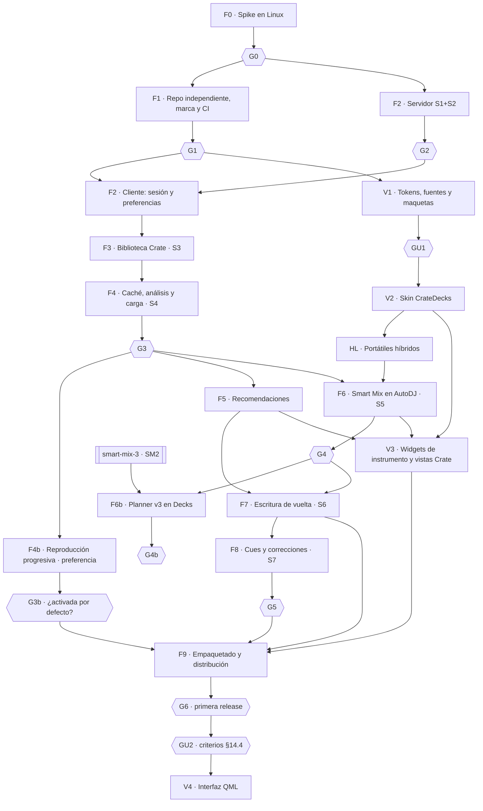

# Crate Decks — Plan de implementación

> **Para agentes:** ejecuta las fases en orden. Cada fase acaba en un gate o en PRs revisables.
> **No pases un gate humano (§13 del diseño) sin aprobación explícita de Diego.** Nada de
> producción sin autorización específica: los cambios de servidor se despliegan con el proceso de
> release normal de Crate y solo cuando Diego lo pida.
>
> Diseño: [2026-11-02-crate-decks-design.md](2026-11-02-crate-decks-design.md). Las decisiones D1–D13
> y los cambios de servidor S1–S7 se citan por su ID.

**Fecha:** 2026-11-02. **Máquina de desarrollo:** Linux (no el Mac de Diego, que va justo de disco).

---

## 0. Convenciones para todas las fases

### 0.1. Repositorios y ramas

| Repo | Contenido | Ramas |
|---|---|---|
| `thecrateapp/crate-decks` (independiente, basado en `mixxxdj/mixxx`, fuera de la red de forks de GitHub) | Cliente de escritorio | `main` = `upstream` + código de Crate. `upstream` solo sirve para traer cambios de Mixxx (AGENTS.md §9) |
| `thecrateapp/crate` (monorepo) | Cambios de servidor S1–S7 y documentación canónica | `feat/decks-server-<tema>` desde `main` en un worktree propio (`worktrees/decks-server-<tema>`) |

### 0.2. Reglas

- **Commits:** conventional commits sin atribución de IA, con la primera línea de menos de 72 caracteres y el cuerpo con el porqué.
- **Fork, estilo:** el de Mixxx. `pre-commit` con clang-format 19 (`.pre-commit-config.yaml` de upstream), C++20, Qt6, `parented_ptr`/`make_parented` para QObjects con padre y `kLogger` por fichero.
- **Fork, tests:** GoogleTest en `src/test/crate/`, añadidos a la lista de fuentes de `mixxx-test` en `CMakeLists.txt`. Red simulada con `src/test/mock_networkaccessmanager.h` (o un `QNetworkAccessManager` inyectado). Nunca dependas de un servidor real en los tests unitarios.
- **Monorepo:** todas las reglas de `AGENTS.md`:
  - `read_scope` y `transaction_scope` solo en `app/crate/db/`, y nada de `from crate.db import`.
  - `ANY(:ids)` y sin agregados sobre `library_tracks` en requests.
  - pytest por función pública cambiada, y documentación en `docs/technical/`.
- **Cada PR** declara qué parches de Mixxx toca y actualiza `CRATE_PATCHES.md` (desde F1).
- **TDD:** cada tarea empieza por el test en rojo indicado. Si algo no se puede testear, va con un `TEST_GAP:` y su motivo.
- **Interfaz (D11):**
  - La lógica de Crate vive en modelos (`QAbstractItemModel` u objetos con `Q_PROPERTY`) sin incluir `QWidget`, y las vistas QWidget son una capa fina por encima. Así la etapa QML (V4) no reescribe la lógica.
  - Desde que existe V1, ningún color, tamaño, radio ni fuente se escribe a mano en QSS, XML de skin ni C++: todo sale de `res/crate-design/tokens.json`.

### 0.3. Requisitos de la máquina Linux

Estimaciones a confirmar en F0:

| Recurso | Mínimo | Recomendado | Motivo |
|---|---|---|---|
| SO | Ubuntu 24.04 LTS (igual que el CI de Mixxx) | — | `tools/debian_buildenv.sh` asume Debian/Ubuntu |
| CPU | 4 núcleos | 8 o más | Compilar unas 343.000 líneas de C++ |
| RAM | 8 GB | 16 GB o más | Enlazado y tests |
| Disco libre | 30 GB | 60 GB | Unos 3 GB de dependencias, 8–12 GB del directorio de build con tests, 5 GB de ccache, el stack dev de Crate y `test-music`, y la caché de audio de Decks |
| Audio | Salida de audio real (ALSA, PipeWire o JACK) | Tarjeta con dos salidas o auriculares para PFL | Pruebas de escucha de F0, F4 y F6 |
| Pantalla | Escritorio X11 o Wayland | — | Mixxx es una app QWidget |

---

## Cambios tras el spike (2026-11-03)

El [informe del spike](2026-11-03-crate-decks-spike-report.md) mide Q1, Q3–Q5, Q8–Q12 y Q17 (Q17 sin motor). **Decisión de Diego:** Crate Decks sigue adelante pase lo que pase con las medidas. Las decisiones concretas de G0 siguen siendo suyas. Este cuadro resume lo que cambia en el plan; el detalle está en cada tarea.

| Fase | Cambio | Origen | Estado |
| --- | --- | --- | --- |
| F1.PR2 | Carpeta de ajustes por `MIXXX_SETTINGS_PATH`, ID de Wayland propio | Q12 | Aplicado |
| F1.PR2 | Prefijo del keychain de emisión: `"Crate - "` en vez de `"Mixxx - "` | Q12 | Decidido en G0 |
| F2.C-PR2 | `SecretStore` asíncrono, con límite de 3 s y alternativa en memoria | Q11 | Aplicado |
| F3.C-PR2 | Registro por `library.cpp`; sin `ExternalTrackCollection` | Q9 | Aplicado |
| F3/F4 | Hook de carga asíncrona en `WTrackTableView` y `WTrackMenu` | Q9 | Aprobado en G0 (parche nuevo) |
| F4.C-PR2 | Solo perfiles `full`. Grid con control de calidad; tonalidad y N60dBSound de Mixxx; sin parche en `analyzerbeats.cpp` | Q3–Q5 | Aplicado |
| F4b | Solo FLAC, AAC, ALAC y Opus; cola primero; banderas de aborto; nunca bloquear en el hilo de la interfaz | Q17 | Aplicado (parches nuevos) |
| F6.C-PR2 | Director con las correcciones de la revisión del spike | Q7 (código) | Aplicado |
| F6.C-PR3 | Hook mínimo de AutoDJ medido | Q8 | Aplicado |
| Servidor | S8 (calidad del análisis) y S9 (disponibilidad del audio), nuevos en el diseño (§8) | Q3–Q5, Q10 | Aplicado; hay que llevarlos al monorepo |

**Pruebas de F0.4 que quedan** (necesitan a Diego), y la fase que no debe empezar sin ellas:

| Antes de | Pruebas |
| --- | --- |
| F4 | Q3 y Q5 en la forma de onda (qué grid va con la música) y Q10 en la LAN. **Decided (Diego, 2026-11-11):** F4 went ahead without them; they run in the G3 session (see the G3 gate at the end of F4) |
| F6 | Q7 (10 transiciones con audio). Q6 (EQ) quedó medido sin escuchar en F6.C-PR2: ver el resultado bajo la tabla de F0.1 |
| V1/V2 y GU1 | Q13–Q16 |

F1–F3 no dependen de ellas.

## Mapa de fases



La línea V corre en paralelo con F2–F8. Las vistas de F3–F6 se construyen con el estilo de LateNight
mientras V2 no esté lista y V3 las alinea. V2 tiene que estar terminada antes de F9: la primera release sale
con la skin `CrateDecks`.

| Fase | Resultado | PRs aproximados | Tamaño estimado |
|---|---|---|---|
| F0 | Informe del spike con respuestas medidas; código desechable | 0 (rama `spike/crate-decks` sin merge) | 7–10 días |
| F1 | Repo independiente con marca propia, ajustes separados y CI Linux verde | 5 | 3–4 días |
| F2 | Cliente `decks` en el servidor; inicio de sesión y Keychain en Decks | 2 servidor + 3 cliente | 5–7 días |
| F3 | Sección Crate navegable y búsqueda DJ | 1 servidor + 3 cliente | 6–8 días |
| F4 | Cargar cualquier pista Crate en un deck con el análisis de Crate | 1 servidor + 4 cliente | 7–10 días |
| F4b | Reproducción progresiva (D14) como preferencia; G3b decide si va activada por defecto | 3 | 15–25 días |
| F5 | Compatibles, Radio y Paths | 3 cliente | 4–6 días |
| HL | Portátiles híbridos ([plan](2026-11-14-crate-decks-hybrid-laptops-plan.md)): preferencia de GPU dedicada, comprobación del sistema y ayudante del límite de potencia; antes de F6 (Diego, 2026-11-15) | 1 | 3–5 días |
| F6 | Modo AutoDJ "Crate Smart Mix" y asistente | 1 servidor + 4 cliente | 10–14 días |
| F6b | Planner v3 in Decks: the v3 candidate menu and limits the server serves (AI refinement dropped after SG3) | 1 | 2–4 días |
| F7 | Historial, now playing, likes, valoraciones y playlists | 1 servidor + 3 cliente | 5–7 días |
| F8 | Cues y correcciones sincronizadas | 2 servidor + 2 cliente | 7–10 días |
| F9 | AppImage, `.deb`, DMG y MSI; aviso de actualización; documentación | 3–4 | 5–8 días |
| V1 | `tokens.json`, generador, fuentes y maquetas para GU1 | 2 | 4–6 días |
| V2 | Skin `CrateDecks` completa (decks, mezclador, efectos, muestras, biblioteca, toolbar, diálogos) | 5 | 20–30 días |
| V3 | Widgets de instrumento (rueda Camelot, plan de Smart Mix, anillo de nivel) y vistas de Crate con la skin | 3 | 8–12 días |
| V4 | Interfaz QML (etapa 2, solo tras GU2) | 4–6 | 30–50 días |

Tamaños en días de agente con revisión; sirven para ordenar, no son un compromiso.

---

## F0 · Spike en Linux

**Objetivo:** responder con medidas, no con lectura de código, las preguntas que deciden si Crate Decks
es viable tal como está diseñado. **Todo el código del spike es desechable**; lo que se entrega es el informe.

**Rama:** `spike/crate-decks` en el fork `thecrateapp/crate-decks` (creado el 2026-11-03). La rama lleva estos planes en `docs/plans/`; el código del spike se commitea encima y **nunca se mergea** a `main`.
**Servidor:** stack dev de Crate en la misma máquina Linux (`make dev`) con `test-music/`, o un
servidor de pruebas que Diego indique. **Nunca producción.**
**Restricción:** no se toca el servidor Crate. El spike usa un token `crv_`, cuyas rutas permitidas ya
cubren todo lo necesario: búsqueda, `mix-profile`, `compatible`, `stream`, `transition-plans` y `play-events`.

### F0.1. Preguntas que debe contestar el spike

| ID | Pregunta | Cómo se mide | Criterio de "sí" |
|---|---|---|---|
| Q1 | ¿Compila y pasa los tests en la máquina? ¿Cuánto tarda y ocupa? | `time` de build limpio y con ccache; `du -sh build ~/.ccache`; `mixxx-test` | Build y tests verdes; anotar tiempos y GB |
| Q2 | ¿Qué base usar: `main` (2.7-alpha) o la rama estable más reciente (2.6)? | Estado de ramas y tags, y fallos en una sesión de 30 min de uso en cada una | Recomendación argumentada |
| Q3 | ¿Se puede inyectar el beatgrid de Crate (`beatGridMs`) y bloquear el BPM sin que Mixxx reanalice? | Cargar 10 pistas con perfil `full`; revisar el log del analizador; comparar el grid visual con el de Crate | 10/10 sin reanálisis de beats; grid alineado (error ≤ 5 ms en 5 beats muestreados) |
| Q4 | ¿Se respeta la tonalidad inyectada? | `[ChannelN],key` y columna Key frente a `camelot` de Crate | 10/10 coinciden; `AnalyzerKey` no recalcula |
| Q5 | ¿Funcionan las cues de intro, outro y N60dBSound inyectadas, y evitan el análisis de silencio? | Cues visibles en la forma de onda; log de `AnalyzerSilence` | Cues en su sitio (±1 beat) y sin análisis de silencio |
| Q6 | ¿`[EqualizerRack1_[ChannelN]_Effect1],parameter1` son los graves? ¿`button_parameter1` es el kill de graves? | Tono de prueba de 60 Hz y de 5 kHz; mover el parámetro y medir el nivel de salida (o escuchar con auriculares) | Mapa de parámetros confirmado y escrito en el informe |
| Q7 | ¿Se puede ejecutar una transición de Smart Mix desde el hilo principal con `ControlProxy` y precisión suficiente? | Timer de 60 Hz ejecutando un plan real de `/api/playback/transition-plans`; registrar en cada tick la posición real de los decks frente a la prevista | Desviación de arranque del entrante ≤ 10 ms (p95) y sin clics audibles |
| Q8 | ¿Qué punto de enganche de AutoDJ es el mínimo para un modo de transición externo? | Prototipo de `TransitionMode::CrateSmartMix` en `autodjprocessor.cpp` | Lista de funciones tocadas y número de líneas del parche |
| Q9 | ¿`ExternalTrackCollection` o `library.cpp` para registrar la feature? | Probar ambas | Recomendación y tamaño de cada parche |
| Q10 | ¿Cuánto tarda descargar y cargar una pista por LAN con Range? | 20 descargas de FLAC (de 30 a 60 MB) y 20 de MP3; medir del clic al primer pintado de forma de onda | Mediana ≤ 1,5 s en LAN con FLAC de 40 MB |
| Q11 | ¿Funciona QtKeychain con Secret Service en el escritorio de la máquina, y qué pasa sin él? | Guardar y leer un secreto en GNOME o KDE, y en una sesión sin keyring | Comportamiento documentado |
| Q12 | ¿Se puede separar la configuración de un Mixxx instalado solo con nombre y organización, o hace falta tocar más? | Cambiar `applicationName` y `organizationName` y comprobar la ruta de `mixxx.cfg` y `mixxxdb.sqlite` | Ruta propia sin tocar `~/.mixxx` |
| Q13 | ¿Cuánto del aspecto del admin se consigue con QSS y SVG sobre LateNight? | Prototipo de 1 día: copiar LateNight a `res/skins/CrateSpike`, sustituir la paleta por los tokens de §14.1 del diseño (tokens de `main`, no de ramas viejas), cargar Roboto, Bricolage Grotesque y JetBrains Mono desde `res/fonts/`, y recolorear 5 iconos Solar. Hacer un knob con la gramática de StackMap: anillo de 1 px con 48 marcas y arco de 1,5 px; comprobar qué atributos de arco acepta `WKnobComposed`. Cabecera de deck con MonoLabel (`DECK A · 8A · 124.00 BPM`). Capturas de biblioteca, un deck y el mezclador junto a GenreWheel y StackMap del admin | Capturas que Diego reconozca como "admin"; lista de lo que no se pudo |
| Q14 | ¿Rinde la skin restilizada? | Scroll de la biblioteca con 10.000 pistas (contador de fps de Mixxx o `QSG_RENDER_TIMING`/`perf`) y tiempo de carga de la skin, frente a LateNight | Sin caída visible frente a LateNight; carga ≤ 1,5 s |
| Q15 | ¿Se leen JetBrains Mono a 10,5–11 px (metadatos y MonoLabel) y Roboto a 12–13 px (títulos de pista) en una cabina oscura? ¿Tiene Bricolage Grotesque cifras tabulares para el BPM y el tiempo del deck? | Pantalla a 1,5 m con el brillo bajo; probar 10,5, 11 y 12 px; comprobar `font-feature-settings: tnum` en Bricolage con `QFont::setFeature` (Qt ≥ 6.7) o con una muestra renderizada | Tamaño mínimo y fuente de las cifras grandes argumentados para GU1 |
| Q16 | ¿En qué estado real están las dos interfaces QML? | Arrancar con `--new-ui --settingsPath /tmp/qml-spike` y con `--developer` + skin LateNightQML. Comprobar si la feature del spike (S0.2) y AutoDJ aparecen en el puente `LegacyLibraryItem`. Medir fps de ondas en ambas y anotar fallos en 20 min de uso | Informe de estado con capturas, para tener una base real en GU2 |
| Q17 | ¿Es viable la reproducción progresiva (D14)? | Prototipo de `SoundSourceCrateProgressive`: FFmpeg con `AVIOContext` propio sobre un fichero que otro hilo rellena a velocidad limitada (1,5× y 0,8× el bitrate). Cargar en deck con 10 s descargados, dar play, hacer seek a una zona no descargada, expulsar a mitad de espera y cerrar la app a mitad de espera. Probar FLAC, MP3, M4A y Opus con la cola descargada primero. Comprobar con `ldd`/`otool -L` que los builds de Linux, macOS y Windows (artefactos del CI de upstream) incluyen FFmpeg | Sin cuelgues al expulsar o cerrar, ninguna lectura corta (ni truncado de la pista), los 4 formatos abren con cabecera y cola, y lista de plataformas con FFmpeg |

**Resultado de Q6 (medido en F6.C-PR2, 2026-11-15).** Diego no tiene equipo de DJ ni puede escuchar, así que Q6 se mide en vez de escucharse: `src/test/crate/eqmap_test.cpp` carga en el deck 1 un seno de 60 Hz o de 5 kHz a -12 dBFS, pasa el audio por el motor real (`EngineMixer`, con el EQ por defecto, "Biquad Full Kill Equalizer", cargado en el rack del deck y los cruces de la app: 246 Hz y 2484 Hz) y mide el RMS de la salida principal con cada control movido frente al EQ neutro.

| Control de `[EqualizerRack1_[Channel1]_Effect1]` | 60 Hz | 5 kHz |
| --- | --- | --- |
| `parameter1` = 0 | -49,1 dB | -0,03 dB |
| `button_parameter1` = 1 | -49,1 dB | -0,03 dB |
| `parameter2` = 0 / `button_parameter2` = 1 | -0,6 dB | — |
| `parameter3` = 0 / `button_parameter3` = 1 | -0,8 / -0,01 dB | -28,2 dB |

- **Mapa confirmado:** `parameter1` es la ganancia de graves (1 neutro, 0 el corte más hondo, hasta 4 de realce) y `button_parameter1` su kill; `parameter2`/`button_parameter2` los medios y `parameter3`/`button_parameter3` los agudos. Todos los EQ de mezcla declaran los parámetros en ese orden (`EqualizerUtil::createCommonParameters`). Queda en `src/crate/smartmix/eqmap.h`.
- **El knob no es la ganancia de la banda por debajo de 1:** a 60 Hz, `parameter1` = 0,5 corta 4,2 dB, 0,25 corta 8,1 dB (no 12) y 0,075 corta 22,8 dB; por debajo de 0,25 el EQ funde con el kill del aislador. Para el intercambio de bajos de Android (un shelf de -24 dB a 150 Hz) el director usa la curva medida (`eqmap::lowGainForCutDb()`, -24 dB ≈ 0,067), y el test comprueba que cada corte pedido (-3, -6, -12, -18 y -24 dB) sale con ±1 dB.
- **El kill de agudos no es tan hondo** como el de graves (-28 dB frente a -49 dB). Smart Mix no lo usa.

### F0.2. Preparación

```bash
# Máquina Linux (Ubuntu 24.04)
sudo apt update && sudo apt install -y git ccache
mkdir -p ~/src && cd ~/src
git clone git@github.com:thecrateapp/crate-decks.git
cd crate-decks
git remote add upstream https://github.com/mixxxdj/mixxx.git
git switch spike/crate-decks
tools/debian_buildenv.sh setup       # dependencias del sistema; revisar lo que instala antes de confirmar

# Build (comprobar antes si existe CMakePresets.json y usar el preset de Linux si lo hay)
cmake -S . -B build -G Ninja \
  -DCMAKE_BUILD_TYPE=RelWithDebInfo \
  -DBUILD_TESTING=ON \
  -DCMAKE_C_COMPILER_LAUNCHER=ccache -DCMAKE_CXX_COMPILER_LAUNCHER=ccache
time cmake --build build -j"$(nproc)"
time build/mixxx-test                 # anotar fallos preexistentes (base de referencia)
build/mixxx --settingsPath /tmp/spike-settings   # comprobar que arranca sin tocar ~/.mixxx
```

En el monorepo de Crate (en la misma máquina, si se usa el stack dev):

```bash
make dev
# Iniciar sesión en el admin local con admin@cratemusic.app / admin y crear un token:
curl -s -X POST http://localhost:8585/api/auth/access-tokens \
  -H "Authorization: Bearer <session-jwt>" -H 'Content-Type: application/json' \
  -d '{"name":"decks-spike","scopes":["vdj.catalog.read","vdj.media.read","vdj.smart_mix.read","vdj.play_events.write"]}'
```

Revisa el cuerpo exacto que espera `POST /api/auth/access-tokens` en `app/crate/api/access_tokens.py` y su
esquema (`app/crate/api/schemas/access_tokens.py`) antes de lanzarlo.

**Si la base dev no tiene los ficheros de audio** (por ejemplo, una copia de otra máquina), Crate borra
las pistas al arrancar y al sincronizar. Antes de arrancar los workers, desactiva `library_pipeline` y
`repair_duplicate_tracks` en `schedules`. Importa el audio de prueba con artistas propios, sin etiquetas
MusicBrainz. El procedimiento está en el [informe del spike](2026-11-03-crate-decks-spike-report.md). Comprueba también que el análisis y los perfiles de mezcla de `test-music/`
están completos: el admin muestra la cobertura de Smart Mix. Si no lo están, lanza el backfill de perfiles
desde el admin y espera a que termine.

### F0.3. Código del spike

Todo vive en `src/crate/spike/`. Se registra con un parche de pocas líneas en `library.cpp` y se
configura solo con variables de entorno (`CRATE_URL`, `CRATE_TOKEN`). Sin preferencias ni Keychain.

| Paso | Fichero | Qué hace | Pregunta |
|---|---|---|---|
| S0.1 | `src/crate/spike/cratespikeclient.{h,cpp}` | `QNetworkAccessManager` con `Authorization: Bearer $CRATE_TOKEN`; `search(q)` (siempre con `scope=local`: con token de acceso, `auto` y `federated` dan 403), `mixProfile(uid)`, `download(uid, path)` con Range y `transitionPlans(edges)` | Q10 |
| S0.2 | `src/crate/spike/cratespikefeature.{h,cpp}` | `LibraryFeature` mínima: nodo "Crate (spike)" con un buscador; resultados en un `QStandardItemModel` o un `BaseExternalTrackModel` con tabla `crateserver_spike` | Q9 |
| S0.3 | `src/crate/spike/cratespikeloader.{h,cpp}` | Cargar en deck: descargar a `~/.cache/crate-decks-spike/<uid>.<ext>`, después `getOrAddTrack`, después inyectar y emitir `loadTrackToPlayer` | Q3–Q5, Q10 |
| S0.4 | `src/crate/spike/cratespikeanalysis.{h,cpp}` | Conversión de `beatGridMs` a frames con la sample rate real, `Beats::fromBeatPositions`, `trySetBeats`, `setBpmLocked`, `setKeys` y `createAndAddCue` (Intro, Outro y N60dBSound) | Q3–Q5 |
| S0.5 | `src/crate/spike/cratespikedirector.{h,cpp}` | Botón "Smart Mix 1→2" que pide el plan de la arista Deck1→Deck2 y lo ejecuta con `ControlProxy` a 60 Hz (rate, play, pregain, EQ de graves y crossfader). Registra un CSV de tiempos previstos frente a reales | Q6, Q7 |
| S0.6 | `src/library/autodj/autodjprocessor.cpp` (parche del spike) | Modo `CrateSmartMix` que delega en S0.5 | Q8 |
| S0.7 | `src/util/versionstore.cpp`, `main.cpp` | Probar `applicationName` y `organizationName` propios | Q12 |
| S0.8 | `src/crate/spike/cratespikekeychain.cpp` | Escritura y lectura de un secreto con QtKeychain | Q11 |
| S0.9 | `src/crate/spike/cratespikeprogressive.{h,cpp}` | Fuente FFmpeg con `AVIOContext` que espera bytes de un fichero que otro hilo rellena a velocidad limitada; registrada con prioridad `Highest` y `Aborted` para cualquier otra ruta | Q17 |

**Notas de implementación para el spike:**

- **Momento de la inyección:** inyecta el análisis en el `Track` antes de emitir `loadTrackToPlayer`. Si la sample rate no se conoce todavía (pista nueva), usa `tryImportBeats` con un `BeatsImporter` propio, igual que los importadores de Serato y Rekordbox. Así la conversión ms→frames se hace cuando Mixxx abre el fichero.
- **`subVersion` del grid:** `crate-mix-profile-<rev>`. Comprueba en `analyzerbeats.cpp` (~131-191) qué hace `shouldAnalyze` con un grid bloqueado y con un `subVersion` desconocido.
- **Modo del timer:** los timers del director van en `Qt::PreciseTimer`. Para arrancar el entrante, programa con el *beat* del saliente leyendo `[ChannelN],beat_distance`, no con el reloj de pared.
- **Ruta del fichero:** la extensión del fichero de caché sale de `format` o de `Content-Type`. Mixxx elige el decoder por extensión.

### F0.4. Pruebas manuales del spike

1. **Q3–Q5:** busca `bpm:120-130`, carga 10 pistas variadas (house, techno, hip-hop con swing, pistas en vivo) y anota el grid, el BPM, la tonalidad, las cues y los logs del analizador.
2. **Q10:** con la caché vacía, carga 20 pistas FLAC y 20 MP3 midiendo los tiempos. Repite con la caché llena.
3. **Q6:** carga un tono de 60 Hz en Deck 1, mueve `parameter1`, `parameter2` y `parameter3` y `button_parameter1..3`, y anota cuál atenúa los graves. Repite con 5 kHz.
4. **Q7:**
   - Ejecuta 10 transiciones de pares beatmatch (Δ BPM ≤ 4 %).
   - Guarda los CSV y calcula la desviación p50 y p95 entre el arranque previsto y el real, más el error de fase en el primer downbeat compartido.
   - Escucha cada transición y anota clics, saltos de tempo y choques de bajos.
5. **Q8:** deja AutoDJ en modo `CrateSmartMix` con una cola de 8 pistas descargadas. Anota cualquier interferencia con la lógica de AutoDJ (fades dobles, saltos, pistas que vuelven a la cola).
6. **Q11–Q12:** según la tabla.
7. **Q13–Q15:** prototipo `CrateSpike`.
   - Capturas a 1920×1080 de la biblioteca (playlist Crate), un deck con onda y el mezclador.
   - Al lado, capturas de la tabla de pistas y la barra lateral del admin (`app/ui`), para comparar.
   - Anota cada elemento del admin que la skin no puede reproducir: animaciones (pestañas con muelle, transiciones de 300 ms de GenreWheel), recorte redondeado, el brillo de los pulsos.
8. **Q17:** prototipo de reproducción progresiva (desechable, en `src/crate/spike/cratespikeprogressive.{h,cpp}`).
   - Limitar la velocidad con un hilo que copia el fichero a trozos.
   - Registrar en un CSV los fallos de caché del motor (`CachingReader`) y el tiempo de cada espera.
   - Repetir la expulsión y el cierre 20 veces con la descarga detenida.
9. **Q16:** sesión con `--new-ui` y otra con LateNightQML.
   - Prueba concreta: ¿se ve "Crate (spike)" en la barra lateral del puente? ¿Abre AutoDJ?
   - Ten en cuenta el aviso de corrupción: usa siempre `--settingsPath` desechable.

### F0.5. Entregable

- **Informe:** `docs/plans/2026-11-XX-crate-decks-spike-report.md` en `crate-v3`, con:
  - Una respuesta por pregunta Q1–Q12 con datos (tablas y tiempos) y capturas de forma de onda, grid y cues.
  - El diff del spike resumido por fichero, con número de líneas tocadas en ficheros de Mixxx.
  - La recomendación de base de upstream (Q2) y de punto de registro (Q9).
  - La lista de sorpresas y riesgos nuevos.
  - Las propuestas de cambio al diseño (si las hay).
- **Diff del spike:** `git diff main...spike/crate-decks > crate-decks-spike.diff`, adjunto o enlazado. Push de la rama `spike/crate-decks` al fork, sin abrir PR.

### F0.6. Gate G0 (Diego)

Decide:
- Si se sigue.
- La base de upstream.
- D1: repo y nombre.
- D7: tipo de cliente `decks`.
- Los límites de D8 para Decks.
- D14: con el resultado de Q17, si la reproducción progresiva sigue siendo una opción (la decisión de construirla es G3b).
- D11: confirmar la estrategia mixta (skin QWidget ahora, QML con GU2) a la vista de Q13–Q16.
- Si se ajusta alguna fase según el informe.

**Decidido (Diego, 2026-11-03):** se sigue; base `main` (2.7-alpha); D1, repositorio independiente; prefijo `"Crate - "` en el keychain de emisión. Después, también: D7 como se propone; D8 con los límites de Android en AutoDJ y transiciones más largas solo en el modo asistente (cifra en F6, escuchando); D11 aprobado (detalles en GU1); D14 se construye (F4b) como preferencia del usuario; el hook de carga asíncrona (diseño §5.2). G0 queda cerrado.

**No empieces F1 ni F2 sin un "adelante" explícito.**

---

## F1 · Repo independiente, marca y CI

**Objetivo:** un repositorio independiente que compila, arranca como "Crate Decks" sin tocar una instalación
de Mixxx, pasa el CI de Linux y sabe traer cambios de Mixxx cuando convenga.

### F1.PR1 · Repositorio independiente y cómo traer cambios de Mixxx

- **Salir de la red de forks:**
  1. Antes: recortar los workflows de Mixxx (abajo), para que el repositorio independiente no los ejecute.
  2. Diego pulsa *Settings → General → Danger Zone → Leave fork network* en `thecrateapp/crate-decks`. Es permanente y se conserva todo el historial; hoy no hay issues, PRs ni forks que perder.
- **Ramas:**
  - `upstream`, que sigue a `mixxxdj/mixxx` en la base elegida en G0 y solo sirve para traer cambios.
  - `main` = `upstream` + código de Crate. Los planes y `AGENTS.md` llegan a `main` desde `docs/decks-post-spike`.
- **Ficheros nuevos:**
  - `CRATE_PATCHES.md`: tabla de parches a ficheros de Mixxx (fichero, motivo, PR de origen, ¿hook genérico?, estado). Al principio está vacía.
  - `CRATE.md`: qué es Crate Decks, su relación con Mixxx (código de origen, GPL y créditos), cómo compilar, cómo traer cambios de Mixxx y a quién reportar los fallos (a nosotros, nunca a Mixxx).
  - `docs/mixxx-merges.md`: cómo traer un tag o un arreglo de Mixxx (`git fetch upstream`, merge o cherry-pick en una rama `merge/mixxx-<ref>`, compilar, `mixxx-test` y la prueba humana si toca audio). Sin job automático: se hace cuando Diego decide.
- **Recortar los workflows de Mixxx:** publicación en el PPA de Mixxx, subida a downloads.mixxx.org, firma de Azure y cualquiera con secretos de Mixxx. Se dejan solo el build y los tests.
- **AGENTS.md:** sin la copia de la política de IA de Mixxx, porque no se le envía nada (AGENTS.md §9).

**Tests:** el CI de Linux en verde sobre el repositorio independiente.

### F1.PR2 · Marca e identidad (D2, D3)

| Fichero | Cambio |
|---|---|
| `src/crate/appidentity.{h,cpp}` (nuevo) | La identidad en un solo sitio: nombre, organización, dominio, ID de aplicación, prefijo del keychain, versión de producto y enlace al código fuente. Los parches de Mixxx de esta tabla la leen de aquí. Se compila siempre, también con `CRATE=OFF` |
| `src/util/versionstore.cpp` | `applicationName()` = "Crate Decks". La versión de producto (`0.1.0`, `crate::kApplicationVersion`) va aparte y la muestran *About* y `--version`, con la de Mixxx de base en *About*. `VersionStore::version()` sigue siendo la de Mixxx: `upgrade.cpp` la guarda en `mixxx.cfg` como versión de los ajustes y la compara con versiones de Mixxx |
| `src/main.cpp` | `crate::applyApplicationIdentity()`: organización `Crate`, dominio `cratemusic.app`, nombre de escritorio y versión de producto. `src/mixxxapplication.cpp` no cambia |
| `CMakeLists.txt` (`MIXXX_SETTINGS_PATH`) | Carpeta de ajustes propia. En Linux sale de `MIXXX_SETTINGS_PATH`, fijado al compilar (`.mixxx/`, `CMakeLists.txt:2060`), y no del nombre de la aplicación (F0 Q12, medido): pasa a `.cratedecks/`, sin tocar `src/util/cmdlineargs.cpp`. En Windows `AppLocalDataLocation` sigue a la organización y al nombre (`Crate/Crate Decks`). En macOS no basta: ver F9.PR2. Respeta `--settingsPath` |
| `src/main.cpp` (`setDesktopFileName`) y el `.desktop` de Linux | ID de Wayland `app.cratemusic.decks` (el ID de aplicación de D3) en vez de `org.mixxx.Mixxx` (`main.cpp:229`), igual que el nombre base del `.desktop` y del metainfo (F0 Q12) |
| `src/preferences/broadcastprofile.cpp` | Prefijo de los servicios del keychain (línea 64): `"Crate - "` en vez de `"Mixxx - "`, decidido en G0, para que los perfiles de emisión no compartan servicio con un Mixxx instalado. Es un identificador de Mixxx: excepción aprobada a AGENTS.md §5.2 (F0 Q12) |
| `CMakeLists.txt` | Ejecutable `crate-decks` en Linux; `CPACK_PACKAGE_NAME` "Crate Decks" (paquete Debian `crate-decks`), contacto `Crate <hello@cratemusic.app>` y URL `https://cratemusic.app`; opción `CRATE` (ON). **Se mantiene `project(mixxx)`:** los recursos se encuentran por `mixxx_SOURCE_DIR` en `CMakeCache.txt` (builds) y por `../share/mixxx` (instalaciones), en `src/preferences/configobject.cpp` |
| `res/linux/app.cratemusic.decks.desktop`, `res/linux/app.cratemusic.decks.metainfo.xml` | Nuevos. Los instalan `cmake --install` y la AppImage (`packaging/appimage/`, `packaging/CPackConfig.cmake`); los de Mixxx se quedan en el árbol sin instalar |
| `res/images/icons/<tamaño>/apps/app.cratemusic.decks.png`, `res/crate.qrc` | Icono de Crate Decks, provisional (el de la app Listen de escritorio del monorepo) hasta que V1 diseñe el definitivo (G1), sin el logo de Mixxx. No se instalan los iconos de Mixxx |
| `src/dialog/dlgabout*` | "Crate Decks is based on Mixxx", con enlace al proyecto, la licencia GPL y el enlace al código fuente de esa versión (el tag o, si no, el commit) |

La skin no se toca en F1: el rediseño visual es la línea V (V1–V4), que empieza tras G1.

Cadenas visibles: el título y *About* van en este PR; el resto de cadenas visibles, en F1.PR2b. **No** se
reescriben las unas 627 apariciones de "Mixxx" en el código: identificadores, grupos de control y nombres
de ficheros se quedan como están para no romper la sincronía con upstream ni los mapeos de controladoras.

**Tests (en rojo primero):**
- `src/test/crate/brandingtest.cpp`:
  - `applicationName() == "Crate Decks"`, organización, dominio, nombre de escritorio y versión de producto.
  - La ruta de ajustes por defecto no contiene `.mixxx`.
  - `--settingsPath` sigue funcionando.
  - Icono en todos los tamaños instalados, `.desktop` y metainfo con el ID de aplicación, y *About* con el icono, la versión, el crédito a Mixxx y el enlace al código fuente.

**Manual:** con Mixxx instalado del sistema, arrancar ambos y comprobar que no comparten `mixxx.cfg` ni `mixxxdb.sqlite`.

### F1.PR2b · Cadenas visibles

- **Superficies** (las de AGENTS.md §5.2): título de la ventana, *About*, el diálogo de primer arranque y el de la barra de menús, y las preferencias.
- **Qué cambia:** las cadenas fuente que nombran la aplicación pasan a "Crate Decks". Las que se refieren a Mixxx como proyecto (créditos, "based on Mixxx", enlaces a la documentación de Mixxx que siguen valiendo) se quedan.
- **Traducciones:** cambiar una cadena fuente de `tr()` pierde su traducción. Se acepta para los demás idiomas; las traducciones al español se actualizan en el mismo PR y el build sigue compilando los `.qm`.
- **Test:** que ninguna cadena `tr()` de esas superficies siga nombrando la aplicación como "Mixxx"; si no es práctico, `TEST_GAP:` con el `grep` usado.
- **Ampliado el 2026-11-09:** la regla de Diego ("no puede aparecer nada de Mixxx en ningún sitio") cubre toda la interfaz, no solo estas superficies. El trabajo está en su propio plan, en inglés: [Own brand](2026-11-09-crate-decks-own-brand-plan.md) (capa de marca, parches mínimos, primer arranque que absorbe los diálogos de Mixxx y test de la interfaz).

### F1.PR3 · CI Linux y artefacto de desarrollo

- `.github/workflows/crate-decks-build.yml`: Ubuntu 24.04, ccache, build, `mixxx-test`, AppImage de desarrollo como artefacto (sin publicar release).
- `pre-commit` en el CI (clang-format) solo sobre ficheros cambiados.
- Badge y comandos en `CRATE.md`.

### F1.PR4 · Versión de Crate Decks en el build

- **Problema:** el build saca la versión de `git describe` sobre los tags de Mixxx que trae la historia, así que el AppImage del CI se llama `crate-decks-2.7-alpha-460-g…`.
- **Cambio:** los tags de Crate Decks son `decks-vX.Y.Z` (F9.PR1) y el build solo mira esos (`git describe --match 'decks-v*'`). Sin un tag propio, la versión es la de producto (`crate::kApplicationVersion`) más el commit.
- **Dónde se ve:** nombre del AppImage y de los paquetes, `--version` y *About*. La versión de Mixxx de la base solo aparece en *About*.
- **Test:** sin tag `decks-v*`, la versión del build es `0.1.0` más el commit y no contiene la de Mixxx; el CI comprueba el nombre del AppImage.
- **Tags:** crear `decks-v0.1.0` sigue siendo cosa de Diego (AGENTS.md §2).

**Gate G1 (Diego, cerrado el 2026-11-04):** marca, icono, identificadores y canal de distribución en Linux.
- **Nombre e identificadores:** los de F1.PR2. `app.cratemusic.decks` también para Flatpak, en vez del `app.cratemusic.Decks` de D3: Flatpak exige el mismo ID que el `.desktop` y el metainfo, y cambiarlo después rompe los accesos de los usuarios.
- **Icono:** el provisional hasta V1, que diseña el definitivo. Tiene que estar antes de F9.
- **Versión:** tags propios `decks-vX.Y.Z` (F1.PR4).
- **Linux:** releases de GitHub de `thecrateapp/crate-decks` (público) con AppImage y `.deb`, enlazadas desde cratemusic.app. Flatpak más adelante.

---

## F2 · Sesión: cliente `decks` en el servidor y login en Decks

### F2.S-PR1 · Servidor: cliente nativo `decks` (S1)

**Worktree:** `worktrees/decks-server-auth` desde `main`.

**Localiza primero:**
```bash
grep -n "_is_listen_request\|listen-tauri\|listen-native" app/crate/api/auth.py app/crate/api/native_oauth_auth.py
grep -rn "X-Crate-App\|x-crate-app" app/crate/api | head
```

**Cambios:**

| Fichero | Cambio |
|---|---|
| `app/crate/api/auth.py` | Generalizar `_is_listen_request` a `_is_refresh_capable_client` (Listen **y** `decks/*` por `X-Crate-App`), sin cambiar el comportamiento de Listen. Login y refresh devuelven `refresh_token` para `decks` |
| `app/crate/api/native_oauth_auth.py` | Añadir el app ID `crate-decks` con `redirect_uri` de bucle `http://127.0.0.1:<puerto>/callback` (se valida el host exacto `127.0.0.1` y un puerto cualquiera; se rechaza `localhost` y cualquier otro host), PKCE S256 obligatorio y `state` obligatorio |
| `app/crate/api/schemas/auth*.py` | Si el app ID va en un `Literal` o enum, añadirlo |
| `docs/technical/` (documento de autenticación vigente) | Sección "Clientes nativos: Listen y Crate Decks" |

**Tests (pytest, en rojo primero), en `app/tests/test_auth_decks_client.py`:**
- `test_login_with_decks_app_header_returns_refresh_token`
- `test_login_without_known_app_header_does_not_return_refresh_token` (regresión)
- `test_refresh_with_decks_token_rotates`
- `test_native_oauth_accepts_crate_decks_loopback_redirect`
- `test_native_oauth_rejects_crate_decks_non_loopback_redirect` (casos con `localhost`, `127.0.0.2`, `https://evil`, `http://127.0.0.1.evil.com`)
- `test_native_oauth_requires_pkce_for_crate_decks`
- `test_listen_clients_unchanged` (parametrizado con los app IDs actuales)

```bash
cd app && ../.venv/bin/python -m pytest tests/test_auth_decks_client.py tests/ -k "auth or oauth" -q
```

**Decisiones aceptadas por Diego (2026-11-03), para G2:**
- Decks no recibe cookies de sesión: los tokens viajan solo en el cuerpo JSON.
- Los refresh tokens no son de un solo uso: el anterior sigue valiendo hasta que la sesión caduca o se revoca, como en Listen. El refresh devuelve un access token y un refresh token nuevos.
- Una sesión por dispositivo (mismo app ID y huella), como en Listen. La revisión encontró que la huella calculada a partir de las cabeceras es igual en todas las máquinas con la misma versión, así que dos ordenadores compartían sesión. Arreglo: para Decks el servidor solo usa `X-Device-Fingerprint` (una por instalación, F2.C-PR1) y guarda todas las sesiones con el app ID `crate-decks`, así que la misma instalación conserva su sesión al actualizar.
- La rama: `feat/decks-s1-s2-s9` del monorepo, que incluye también S2 y S9.

### F2.S-PR2 · Servidor: `capabilities.decks` (S2)

| Fichero | Cambio |
|---|---|
| `app/crate/api/capabilities.py` | Sección `decks`: `available: true`, `contract_version: 1`, `min_client_version: "0.1.0"`, `features: []` (cada fase añade las suyas: `library_cursor`, `profiles_batch`, `beatmatch`, `bass_handoff`, `cues`) |
| Esquema de capacidades | Modelo Pydantic `DecksCapabilities` |
| `docs/technical/` | Contrato de capacidades `decks` |

**Tests**, en `app/tests/test_capabilities_decks.py`:
- `test_capabilities_includes_decks_section`
- `test_decks_features_reflect_settings` (si alguna depende de configuración)

**Decisión aceptada:** `features` sigue vacía hasta S5. El planner ya sirve beatmatch a cualquier cliente, pero anunciarlo ahora daría a entender que existe `source="decks"`.

**Gate G2 (Diego, cerrado el 2026-11-04):** revisar el contrato S1 y S2 antes de mergear. Diego lo dio
por bueno: S1 y S2 están mergeados y desplegados en Crate 3.2.0.

### F2.C-PR1 · Cliente: `crate::Client` y `crate::Capabilities`

**Ficheros nuevos** (`src/crate/client/`):

| Fichero | Contenido |
|---|---|
| `crateclient.{h,cpp}` | Clase `crate::Client`: `QNetworkAccessManager` inyectable; `get/post/put/del(path, json, options)` que devuelven `crate::Reply` (señales `finished(Result)`, `progress`); cabeceras comunes; límite de 4 peticiones API concurrentes por servidor; reintentos con backoff exponencial y *jitter* (3 intentos, solo en métodos idempotentes y en 429/502/503/504, respetando `Retry-After`); refresh automático en 401 con una sola renovación en vuelo y las peticiones esperando en cola; deduplicación de GET idénticos en vuelo. Cabeceras comunes: `Authorization`, `X-Crate-App: decks/<versión>` y `X-Device-Fingerprint`, un ID aleatorio creado una vez por instalación y guardado en la configuración (no es un secreto). El servidor no calcula huella para Decks: sin ella, cada login abre una sesión nueva |
| `crateresult.h` | `Result<T>`: valor o error tipado (`Network`, `Http{status, code, message}`, `Auth`, `Decode`, `Cancelled`) |
| `cratejson.{h,cpp}` | Utilidades de parseo estricto (campos obligatorios, tipos y valores por defecto explícitos) |
| `cratecapabilities.{h,cpp}` | Parseo de `/api/capabilities` y `bool has(Feature)`; comparación semántica de `min_client_version` |

**Tests (GoogleTest, en rojo primero), en `src/test/crate/crateclient_test.cpp`:**
- `AddsAuthorizationAndAppHeaders`
- `SendsTheSameDeviceFingerprintAcrossRestarts`
- `RetriesIdempotentOn503WithBackoff` / `DoesNotRetryPost`
- `HonoursRetryAfter`
- `RefreshesOnceOn401AndReplaysQueuedRequests`
- `FailsWithAuthErrorWhenRefreshFails`
- `DeduplicatesIdenticalInFlightGets`
- `CancelsOnDestruction`
- `LimitsConcurrentRequestsPerServer`

En `cratecapabilities_test.cpp`:
- `ParsesDecksSection`
- `MissingDecksSectionMeansUnavailable`
- `MinClientVersionBlocksOlderClient`

**Hecho (2026-11-04):**
- Cambios sobre lo previsto:
  - El servidor anuncia también `long_beatmatch`, y las funciones desconocidas se ignoran.
  - Un `contract_version` distinto de 1 se trata como incompatible.
  - Los reintentos solo se hacen en 429/502/503/504, respetando `Retry-After` de hasta 30 s.
  - Las redirecciones solo se siguen al mismo origen, y el límite de transferencia es de 30 s.
- El JSON se parsea en el hilo principal: las respuestas de F2 son de pocos KB. Las páginas grandes se parsearán fuera de él en F3.C-PR1.
- La revisión independiente encontró un crítico (un `Reply` usaba `this` después de emitir) y cinco importantes. Todos están arreglados, cada uno con su test.

### F2.C-PR2 · Cliente: `crate::Session` y QtKeychain

| Fichero | Contenido |
|---|---|
| `src/crate/session/cratesession.{h,cpp}` | Perfiles de servidor; `loginWithPassword`, `loginWithBrowser` (PKCE: `code_verifier` aleatorio de 64 bytes, `code_challenge` S256, `state` aleatorio, `QTcpServer` en `127.0.0.1:0` que acepta **una** petición `GET /callback`, valida `state`, responde con una página HTML simple y se cierra; tiempo máximo de 5 min); `refresh`, `logout` (revoca en el servidor y borra el Keychain) |
| `src/crate/session/cratesecretstore.{h,cpp}` | Interfaz `SecretStore` e implementación `KeychainSecretStore` (QtKeychain, servicio `app.cratemusic.decks`, clave `<server_id>:refresh`). Los trabajos de QtKeychain son **asíncronos y con un límite de 3 s**, sin bucle de eventos anidado (el patrón de `broadcastprofile.cpp` congelaría la interfaz). F0 Q11: sin Secret Service, QtKeychain se bloquea hasta que D-Bus se rinde; sin bus de sesión falla en milisegundos (error 7). En los dos casos se pasa a `SessionOnlySecretStore` en memoria, con un aviso en la interfaz |
| `src/crate/db/crateserverschema.{h,cpp}` | Creación idempotente de `crateserver_servers` (y de las demás tablas en sus fases), envuelta en transacción |

**Tests:**
- `cratesession_test.cpp`:
  - `PasswordLoginStoresRefreshInSecretStore`
  - `RefreshUsesStoredToken`
  - `LogoutClearsSecretAndRevokes`
  - `BrowserLoginRejectsMismatchedState`
  - `BrowserLoginTimesOut`
  - `CallbackServerBindsLoopbackOnly`
- `crateserverschema_test.cpp`:
  - `CreatesTablesIdempotently`
  - `DoesNotTouchMixxxTables`

`TEST_GAP:` el backend real de Keychain del sistema solo se prueba a mano (F0 Q11): los tests usan un `SecretStore` falso.

**Hecho (2026-11-04):**
- **Renovación del token:** informa de tres resultados (renovado, sesión terminada, servidor inalcanzable). Sin red, la sesión no se cierra.
- **Servidor del callback:** es una clase propia (`crate::LoopbackCallbackServer`) que solo acepta el `state` del login en curso.
- **Logout:** cierra la sesión en local al momento y la revoca en el servidor. Si el token de acceso ya no vale, renueva una vez para poder revocarla.
- **Keychain:** `KeychainSecretStore` ejecuta en orden las operaciones de una misma clave, con un backend que se puede sustituir en los tests. Si el keychain falla, el refresh token se guarda solo en memoria, y el logout borra en los dos sitios.
- **Tabla:** `crateserver_servers` tiene las columnas de §5.2 del diseño.
- **Revisión:** la independiente encontró cuatro importantes, todos arreglados, cada uno con su test.

### F2.C-PR3 · Cliente: preferencias y asistente

| Fichero | Contenido |
|---|---|
| `src/preferences/dialog/dlgprefcrate.{h,cpp,ui}` | Página "Crate": lista de servidores, añadir (URL, después comprobar capacidades, después login), cerrar sesión, estado (versión del servidor y funciones disponibles) |
| `src/preferences/dialog/dlgpreferences.cpp` | Registrar la página (parche anotado en `CRATE_PATCHES.md`) |
| `src/crate/ui/cratefirstrun.{h,cpp}` | En el primer arranque sin servidores, ofrecer conectar uno |

**Tests:**
- `dlgprefcrate_test.cpp` con un `Client` falso:
  - `AddServerRejectsServerWithoutDecksCapability`
  - `AddServerRequiresHttpsExceptLoopbackAndPrivate`
  - `PrivateHttpRequiresConfirmation`

**Manual:** login con contraseña y con navegador contra el stack dev; cerrar y abrir la app (sesión restaurada desde el Keychain); revocar el refresh en el servidor (la app pide login de nuevo sin colgarse).

---

**Hecho (2026-11-04):**
- Las vistas están en `src/crate/ui/`, por el aislamiento de AGENTS.md §5.2, y se construyen en código. La lógica vive en `AddServerFlow` y `CrateServers`.
- `CoreServices` crea `crate::CrateServers` (aprobado por Diego), y la página lo encuentra con `CrateServers::instance()`.
- **Direcciones:** solo cuenta el origen, y sin esquema se asume HTTPS.
  - HTTP a este equipo se acepta sin preguntar.
  - HTTP en la red local pide confirmación.
  - HTTP en internet no se acepta nunca, tampoco en los perfiles guardados.
- **Servidores repetidos:** el mismo servidor no se puede añadir dos veces.
- **Versión del servidor:** la página no la muestra, porque `/api/capabilities` no la da.
- **Primer arranque:** se ofrece conectar un servidor una vez, después de mostrar la ventana principal (`main.cpp`). El diálogo de carpeta de música de Mixxx sigue apareciendo.
- La revisión independiente encontró cinco importantes, todos arreglados, cada uno con su test.

## F3 · Biblioteca Crate navegable

**Antes de F3:**
- **Bloqueo durante el escaneo** (hueco de Mixxx, upstream #6631): el escáner tenía la base de datos bloqueada durante todo el escaneo, y cada escritura de la interfaz esperaba 5 s y fallaba con "database is locked". La primera versión del arreglo, una transacción por pista, no pasó la prueba manual del 2026-11-09: un escaneo de 5000 ficheros tardaba entre 47 y 75 s (de 5 a 9 s la base), con esperas de hasta 4,4 s y entre 12 y 22 escrituras fallidas. Diego aprobó el arreglo completo, en `fix/decks-scanner-lock`:
  - **Transacciones de escritura:** `SqlTransaction` y `ScopedTransaction` empiezan con `BEGIN IMMEDIATE`, así que esperan el bloqueo en vez de fallar al pasar de leer a escribir.
  - **Espera:** cada conexión, también la que clona cada tabla de pistas, reintenta cada milisegundo (el manejador de SQLite llegaba a dormir 100 ms entre intentos) y avisa de que espera.
  - **Escáner:** confirma en lotes de 64 pistas o 40 ms, cierra el lote en cuanto otra conexión espera y la deja pasar antes del siguiente.
  - **Prueba manual** (8 escaneos, 3 de ellos alternados con la base y el arreglo anterior con la misma carga): ningún "database is locked". El p95 de las escrituras de la interfaz queda entre 17 y 41 ms en 5 de 8, y el máximo entre 25 y 227 ms en 6 de 8; los peores (p95 de 221 ms, máximo de 1,56 s) coinciden con una carga de 17 a 33 en 22 núcleos por otros trabajos. El escaneo tarda entre 6,4 y 17,6 s, frente a 5,3–8,8 s de la base en las mismas rondas.
- **Escrituras de Crate:** las de las tablas `crateserver_` van igualmente fuera del hilo de la interfaz y reintentan si la base de datos está ocupada.

### F3.S-PR1 · Servidor: navegación paginada para clientes (S3)

**Objetivo:** contenedores y pistas con los campos de DJ, paginados por cursor, sin N+1 y sin agregados sobre `library_tracks`.

| Endpoint | Respuesta |
|---|---|
| `GET /api/decks/containers` | Árbol: `playlists` (del usuario y compartidas), `crates`, `genres` (top N precomputado), `moods`, `recent`, `likes`. Cada nodo lleva `id`, `kind`, `name`, `parent_id`, `track_count` **si ya está precomputado** (si no, se omite) y `etag` |
| `GET /api/decks/containers/{kind}/{id}/tracks?cursor=&limit=500` | Pistas del contenedor en orden: `entity_uid`, `global_track_uid`, `title`, `artist`, `album`, `duration_ms`, `bpm`, `camelot`, `energy`, `genre`, `format`, `bitrate`, `sample_rate`, `bit_depth`, `byte_length`, `source_revision`, `profile_revision`, `profile_quality`, `playable` (S9) y `cover_url`. Devuelve `next_cursor` y `ETag`; acepta `If-None-Match` |

- **Crates:** son de álbumes, así que se expanden a pistas en el orden de los álbumes (disco y número de pista).
- **Cursor:** opaco (base64 de `(position, id)`) y estable ante inserciones al final.
- **`playable`:** hoy la búsqueda DJ lo calcula mirando el fichero en cada petición (S9, decisión aceptada). Si con páginas de 500 pistas no se cumple el p95, se guarda como columna, con migración.

| Fichero | Contenido |
|---|---|
| `app/crate/api/decks.py` | Router `/api/decks`, solo usuarios con sesión (no tokens `crv_`) |
| `app/crate/api/schemas/decks.py` | Modelos Pydantic |
| `app/crate/db/queries/decks_library.py` | Una consulta por endpoint con CTE; *keyset pagination*; perfiles con `LEFT JOIN track_mix_profiles` en la misma consulta |
| Readplane | Comprobar si `app/readplane` necesita conocer las rutas nuevas (fallback a FastAPI) |
| `app/crate/api/capabilities.py` | `features += ["library_cursor"]` |

**Tests:**
- `app/tests/test_decks_library_api.py`:
  - `test_containers_tree_for_user`
  - `test_playlist_tracks_paginated_by_cursor`
  - `test_crate_expands_albums_in_disc_track_order`
  - `test_etag_not_modified`
  - `test_access_token_rejected`
  - `test_other_users_private_playlist_forbidden`
- `app/tests/test_decks_library_queries.py` (con `pg_db`):
  - `test_single_query_per_page` (contar sentencias con un *listener* de SQLAlchemy)
  - `test_no_aggregate_over_library_tracks`
  - `test_explain_uses_index` (opcional: `EXPLAIN` sobre 10.000 filas sintéticas sin `Seq Scan` en `library_tracks`)

**Rendimiento:** p95 ≤ 150 ms para 500 pistas en la base de producción (medir con datos dev y extrapolar; avisar si la consulta no usa índice).

### F3.C-PR1 · Cliente: tablas y sincronía de contenedores

| Fichero | Contenido |
|---|---|
| `src/crate/db/crateserverschema.cpp` | Tablas `crateserver_tracks`, `crateserver_containers` y `crateserver_container_tracks` con índices `(server_id, entity_uid)` y `(container_id, position)` |
| `src/crate/library/cratelibrarysync.{h,cpp}` | `syncContainers(server)`, `syncContainerTracks(container)`: descarga páginas, parsea en `QtConcurrent` y escribe en una transacción por página; respeta `ETag`; emite `containerUpdated(id)` |
| `src/crate/library/crateeventsubscriber.{h,cpp}` | SSE `/api/cache/events` con `Last-Event-ID`, reconexión con backoff y mapeo de los eventos de invalidación a `markDirty(container)`. Solo si las capacidades lo permiten |

**Tests:**
- `cratelibrarysync_test.cpp`:
  - `SyncsTreeIntoTables`
  - `PagesUntilCursorExhausted`
  - `NotModifiedKeepsRows`
  - `ReplacesContainerTracksAtomically`
  - `ParseRunsOffMainThread` (comprobar el hilo en el *callback*)
- `crateeventsubscriber_test.cpp`:
  - `ReconnectsWithLastEventId`
  - `MarksAffectedContainersDirty`

### F3.C-PR2 · Cliente: `CrateServerFeature` y modelos

| Fichero | Contenido |
|---|---|
| `src/library/crateserver/crateserverfeature.{h,cpp}` | `title()` = "Crate"; `sidebarModel()` (`TreeItemModel`: un nodo por servidor y, dentro, Biblioteca, Playlists, Crates, Géneros, Moods, Recientes y Likes); `activate()` y `activateChild()` muestran el modelo de pistas; carga perezosa (`onLazyChildExpandation`); menú contextual mínimo (Actualizar) |
| `src/library/crateserver/crateservertrackmodel.{h,cpp}` | Modelo propio sobre `QAbstractTableModel` y `TrackModel` (ver la desviación debajo): lee `crateserver_container_tracks ⨝ crateserver_tracks` en un hilo de trabajo, filtra y ordena allí y cambia las filas de una vez; columnas Camelot, Energía, Calidad del perfil y Estado de caché con sus delegates; solo la capacidad de ordenar hasta F4; `getTrack()` sin implementar todavía (F4) |
| `src/library/library.cpp` | Registrar `CrateServerFeature` con `addFeature` detrás de `CRATE` (unas 4 líneas, F0 Q9). **Parche de Mixxx**: anotarlo |
| (sin `ExternalTrackCollection`) | F0 Q9: `TrackCollectionManager` no puede registrarla (`trackcollectionmanager.cpp:56-60` es un `TODO`), y repartiría `saveTrack`, purgas y reubicaciones desde cualquier hilo. Se reconsidera en F7/F8 si hacen falta esos avisos |

Si F0/Q9 recomendó `library.cpp` en lugar de `ExternalTrackCollection`, se usa esa vía y se ajusta esta tabla.

**Desviación aprobada (Diego, 2026-11-09):** el modelo de pistas no deriva de `BaseExternalTrackModel` ni de `BaseSqlTableModel`.
- `BaseTrackTableModel` declara `data()` y `delegateForColumn()` como `final`, así que una subclase no puede dar a los delegates de Crate sus roles (Camelot, calidad del perfil, estado de caché).
- Un modelo propio lee, filtra y ordena las filas fuera del hilo principal, que nunca espera a SQLite (diseño §9). No hace falta la vista TEMPORARY ni la caché de toda la tabla que exige `BaseExternalTrackModel`.

**Tests:**
- `crateserverfeature_test.cpp` (fixture `LibraryTest`):
  - `SidebarShowsServerAndSections`
  - `ActivatingPlaylistShowsTracksInOrder`
  - `LazyExpansionFetchesOnce`
  - `NameDoesNotCollideWithMixxxCrates` (que no toca la tabla `crates`)

### F3.C-PR3 · Cliente: búsqueda DJ

- En la sección Crate, el buscador de la biblioteca envía `GET /api/search?fields=dj&q=…&limit=50` con debounce de 250 ms y cancela la búsqueda anterior.
- Los resultados van a un contenedor efímero `kind=search`.
- Fuera de la sección Crate, la búsqueda sigue siendo la local de Mixxx.

**Tests:**
- `cratesearch_test.cpp`:
  - `DebouncesAndCancelsPrevious`
  - `PassesDjFiltersVerbatim` (`bpm:120-128 key:8A`)
  - `ShowsResultsAsEphemeralContainer`

**Manual:** navegar una playlist de 2.000 pistas en el stack dev midiendo los tiempos de §9 del diseño.

---

## F4 · Caché de audio, análisis y carga en decks

**Built (2026-11-11):** F4.C-PR1 to C-PR4 are merged (crate-decks #16 to #19); F4.S-PR1 is crate #421, not yet deployed, and until it is live Decks falls back to single profile requests.

**Decided (Diego, 2026-11-11), before G3.** The open points of F4 are closed. Each task below records the choices that belong to it; these four have their own PRs:

- **Uncached Crate tracks in AutoDJ** (F4.C-PR3): AutoDJ accepts them. A generic hook creates the library row with the future cache path, so the track has a library id before its file exists, and the "pending track" logic of `autodjprocessor.cpp` downloads it. "Add to Auto DJ" no longer drops uncached tracks. Its own PR, which adds its row to design §5.2.
- **Tracks in use are never evicted** (design §9): a track loaded in a deck or queued in AutoDJ is pinned for the session. Lowering the limit or "Clear cache" never deletes it. Its own PR.
- **DJ search payload** (F3.C-PR3 finding): the search results gain `format`, `bitrate`, `sample_rate`, `profile_quality` and `source_revision`, like the S3 browse payload. It is a small addition to S3 in a monorepo PR and ships with a later Crate release; until then the cache falls back to the HTTP headers.
- **Real profile fixtures** (F4.C-PR2): the schema-faithful fixtures of `src/test/crate/data/` are replaced or extended with real anonymised profiles from the dev stack, never from production, in a small test PR.

### F4.S-PR1 · Servidor: perfiles en lote (S4)

- **Endpoint:** `POST /api/decks/mix-profiles` con `{entity_uids: [...≤200], detail: "full"}`. Devuelve `{profiles: {uid: MixProfile}, missing: [uid]}` con el **mismo esquema** que `GET /api/tracks/by-entity/{uid}/mix-profile?detail=full` (reutilizar el serializador).
- **Ficheros:**
  - `app/crate/api/decks.py`
  - `app/crate/db/queries/decks_profiles.py`: una consulta con `ANY(:uids)` y comprobación de acceso.
  - `capabilities`: `profiles_batch`.
- **Tests**, en `app/tests/test_decks_profiles_api.py`:
  - `test_batch_matches_single_endpoint` (paridad campo a campo)
  - `test_batch_limit_200`
  - `test_missing_uids_listed`
  - `test_single_query`

### F4.C-PR1 · `crate::AudioCache`

| Fichero | Contenido |
|---|---|
| `src/crate/cache/audiocache.{h,cpp}` | API: `ensure(server, uid, priority) -> CacheTicket` (señales `progress`, `ready(path)`, `failed(error)`); `pin(uid, reason)` y `unpin`; `setLimitBytes`; `usage()`. Cola con prioridades (deck > AutoDJ > prefetch > set offline), 2 descargas por servidor, `.part`, reanudación con `Range: bytes=<n>-` si `If-Range` (ETag) coincide, `rename` atómico, verificación de longitud con `Content-Length`/`byte_length` y LRU respetando los pines |
| `src/crate/cache/audiocacheindex.{h,cpp}` | SQLite propio (`<cache>/index.sqlite`): tabla `crateserver_cache`; arranque que reconcilia el índice con los ficheros del disco (borra `.part` huérfanos y entradas sin fichero) |
| `src/crate/cache/cachepaths.{h,cpp}` | Ruta estable `<cache>/<server_id>/<uid[0:2]>/<uid>.<ext>`; extensión a partir de `format`, o si no de `Content-Type` |

**Tests**, en `audiocache_test.cpp`:
- `DownloadsToPartThenRenames`
- `ResumesWithRangeWhenEtagMatches`
- `RestartsWhenEtagChanged`
- `RejectsShortDownload`
- `PrioritisesDeckOverPrefetch`
- `EvictsLruButNeverPinned`
- `KeepsTwoGiBFree` (inyectando un `StorageInfo` falso)
- `ReconcilesIndexOnStartup`
- `ConcurrentEnsureForSameUidSharesDownload`

**Decided (Diego, 2026-11-11):**

- The cache's default directory is `QStandardPaths::CacheLocation/crate-audio`, which on Linux is `~/.cache/Crate/Crate Decks/crate-audio`.
- 20 GiB is a soft limit: pinned tracks may exceed it, and LRU eviction removes only unpinned ones. 2 GiB free on the volume is a hard limit: a download that would break it fails with `Storage`.
- Pins persist across restarts, because offline sets need them.
- No prefetch preemption: a deck load has the highest priority in the queue, but it waits its turn behind the 2 downloads already running.

### F4.C-PR2 · `crate::AnalysisImporter` y `ProfileStore`

| Fichero | Contenido |
|---|---|
| `src/crate/analysis/profilestore.{h,cpp}` | Tabla `crateserver_profiles`; `get(uids)` que usa el lote si `profiles_batch` está disponible y si no peticiones individuales con concurrencia limitada; invalidación por `profile_revision` |
| `src/crate/analysis/analysisimporter.{h,cpp}` | `apply(TrackPointer, MixProfile, Policy)`:<br>(1) Solo con calidad `full`; si no, no inyecta nada y la pista se analiza en local.<br>(2) **Beatgrid**: solo si pasa el **control de calidad**: BPM cuantizado, beats frente a una rejilla constante por debajo de un umbral y sin deriva. Va por `BeatsImporter` (ms a frames con la sample rate real), con `subVersion` `crate-mix-profile-<rev>` y `setBpmLocked(true)`. Si no pasa, analiza Mixxx.<br>(3) **Tonalidad**: por defecto la de Mixxx (KeyFinder), con una preferencia para usar la de Crate.<br>(4) **Cues**: Intro y Outro de Crate si no existen o si son de Crate con una revisión antigua que el usuario no editó. N60dBSound lo calcula Mixxx, porque `activeEndMs` es un final musical, no un umbral de silencio.<br>(5) `pregain` opcional desde LUFS (preferencia, apagada por defecto).<br>Mientras S8 no esté, la política por defecto es "beats y tonalidad de Mixxx". F0 Q3–Q5: el grid de Crate difiere del de Mixxx entre 30 y 350 ms, sus BPM con decimales derivan y la tonalidad coincide con KeyFinder en 3 de 10 |
| (sin parche en `analyzerbeats.cpp`) | F0 Q3: con el BPM bloqueado, `AnalyzerBeats` no reanaliza; no hace falta tratar `crate-mix-profile-*` como importado |

**Tests**, en `analysisimporter_test.cpp` con fixtures JSON de perfiles reales anonimizados en `src/test/crate/data/`:
- `ImportsBeatGridAtFileSampleRate` (44,1 y 48 kHz)
- `LocksBpm`
- `SetsKeyFromCamelot` (todas las tonalidades, de 1A a 12B)
- `CreatesIntroOutroCues`
- `DoesNotOverwriteUserCues`
- `ReappliesCratesCuesOnNewRevision`
- `PartialProfileLeavesTrackForLocalAnalysis`
- `AnalyzerSkipsBeatsForCrateGrid` (integración con `AnalyzerBeats::shouldAnalyze`)

**Decided (Diego, 2026-11-11):**

- `crateserver_profiles` gains the column `applied_cues` (design §6): where Decks put Intro and Outro. It is the only way to tell Crate's cues from the user's when a new profile revision arrives; `apply()` takes that record and returns the new one.
- With "key from Crate" on, Crate's key overwrites the track's key, also one the user set: Mixxx does not record where a key came from.
- The fixtures were schema-faithful, not real profiles (the dev stack was down and production is off limits). A small test PR replaces or extends them with real anonymised profiles from the dev stack, never from production.

### F4.C-PR3 · Cargar en deck y AutoDJ

| Fichero | Contenido |
|---|---|
| `src/library/crateserver/crateservertrackmodel.cpp` | `getTrack(index)` / `getTrackLocation`: devuelven la pista solo si está en caché (`getOrAddTrack(TrackRef::fromFilePath(path))` más `AnalysisImporter::apply`). **Nunca arrancan descargas**, porque `getTrack` también se llama al seleccionar filas (`wtracktableview.cpp:166`) y al montar menús. Si no está en caché, devuelven `nullptr` y la carga va por el hook asíncrono |
| `src/widget/wtracktableview.cpp`, `src/widget/wtrackmenu.cpp`, `src/library/trackmodel.h` | **Parche nuevo, aprobado en G0.** Hook de carga asíncrona: `TrackModel::requestTrackLoad(index, group, play)`, virtual y con `false` por defecto. `WTrackTableView` (doble clic, Enter, `LoadSelectedTrack`) y `WTrackMenu::loadSelectionToGroup` lo llaman antes de `getTrack`. Arrastrar al deck también carga una pista sin descargar: el deck pide a la tabla de origen que la cargue como "Cargar en Deck N" (hook `TrackDragSource`, decisión de Diego del 2026-11-14). Es genérico, lo que abarata los merges desde Mixxx. Sin él, la sección Crate necesita vista propia, como el spike, y pierde las columnas nativas, el arrastre y las controladoras (F0 Q9) |
| `src/crate/library/crateloadcoordinator.{h,cpp}` | Recibe del hook asíncrono las cargas con su deck de destino (doble clic, Enter, menú "Cargar en Deck N", `LoadSelectedTrack` de controladoras): estado "descargando" en la fila; al terminar, `loadTrackToPlayer(track, group, play)`; si el usuario carga otra pista mientras tanto, se cancela la carga pendiente de ese deck |
| `src/library/autodj/autodjprocessor.cpp` | Parche "pending track" (diseño §5.2): no descartar entradas Crate pendientes de descarga, esperar hasta N segundos y si no, pasar a la siguiente disponible |
| `src/crate/library/crateprefetcher.{h,cpp}` | Observa la cola de AutoDJ (`PlaylistDAO`, playlist `PLHT_AUTO_DJ`) y pide `ensure()` de las 3 siguientes |
| Menú contextual | "Descargar", "Descargar contenedor (set offline)" (muestra el tamaño total antes), "Quitar de la caché" |

**Tests:**
- `crateloadcoordinator_test.cpp`:
  - `LoadsAfterDownloadCompletes`
  - `CancelsPendingLoadWhenDeckGetsAnotherTrack`
  - `DoesNotInterruptPlayingDeckWithoutConfirmation`
- `autodjcratepending_test.cpp` (sobre `autodjprocessor_test.cpp` de upstream):
  - `WaitsForPendingCrateTrack`
  - `SkipsToNextAvailableAfterTimeout`
  - `NonCrateBehaviourUnchanged`

**Decided (Diego, 2026-11-11):**

- AutoDJ waits up to N = 30 s for a pending Crate track. After that it removes the track from the queue and goes on with the next available one.
- The `WTrackMenu` patches that were not in design §5.2 are accepted and added to its closed list: the menu is also built for a row without a `Track` (with null checks of the track for BPM and "Find on Web"), so that "Load to Deck N" works with uncached tracks, and `TrackModel::trackMenuActions()` adds a model's own entries at the end of the menu. Both are generic and described in `CRATE_PATCHES.md`.
- Uncached tracks in AutoDJ and the session pin of tracks in use: see the decisions at the start of F4.

### F4.C-PR4 · Vista de caché y preferencias

- `src/crate/ui/cachestatusview.{h,cpp}` (vista registrada con `WLibrary::registerView`): uso, límite, descargas en curso y sets offline.
- Preferencias: ruta y límite de la caché, prefetch on/off, ganancia por LUFS on/off.

**Tests:**
- `cachestatusview_test.cpp`:
  - `ShowsUsageAndQueue`
  - `ChangingLimitTriggersEviction`

**Decided (Diego, 2026-11-11):**

- The cache view has no mockup: it uses the library's styling.
- The mockup of the Crate preferences page has no switches for prefetch, key or gain. Prefetch goes in the Cache section, and the key from Crate and the LUFS gain go in a new "Crate analysis" section under Smart Mix.
- The limit slider shows decimal GB, like the mockup, so the 20 GiB default reads "21 GB".

**Gate G3 (Diego):** sesión de 1 h con el stack dev, o con un servidor real si Diego lo autoriza:
- Cargar desde playlists y búsqueda.
- Un set offline de 50 pistas.
- AutoDJ clásico (sin Smart Mix) con pistas Crate.

Medir contra los presupuestos de §9 del diseño.

**Decided (Diego, 2026-11-11):**

- The session also runs the F0.4 tests that were listed before F4: Q3 and Q5 on the waveform (which grid fits the music) and Q10 (download-and-load times on the LAN). They need a desktop, not DJ gear.
- Before the session, an agent measures design §9's budgets automatically: a synced 500-track container opened from disk and from the LAN, a 40 MB FLAC loaded from the LAN from click to waveform, a cached load against a local track, request and download concurrency per server, main thread stalls over 16 ms, and the cache's limit and free space. Diego gets the numbers with a checklist of what is left to see and hear in the session.

---

## F4b · Reproducción progresiva (D14)

**Se construye** (G0): es una preferencia del usuario y empieza tras G3, cuando la caché de F4 existe. Corre en paralelo con F5 y F6 y tiene que estar cerrada antes de F9. G3b, al terminar F4b, decide con el dato de F0 Q10 en WAN si va activada por defecto.

### F4b.PR1 · `crate::ProgressiveDownload`

| Fichero | Contenido |
|---|---|
| `src/crate/cache/rangemap.{h,cpp}` | Conjunto de rangos de bytes `[start, end)` con unión, consulta (`contains(offset, len)`), primer hueco a partir de una posición y serialización compacta |
| `src/crate/cache/progressivedownload.{h,cpp}` | Reserva el fichero (`QFile::resize(byte_length)`) en la ruta estable de D4. **Orden de descarga:** cabecera (256 KiB), cola (1 MiB) y luego secuencial desde la cabeza de lectura. `prioritize(offset)` para seeks, máximo 2 conexiones, `If-Range` con ETag (si cambia, reinicia). Persiste los rangos en `crateserver_cache.ranges` cada 2 s y al pausar. API de espera: `waitFor(offset, len, CancelToken)`, que bloquea con un `QWaitCondition` hasta que el rango está o hasta cancelar o fallar; nunca vuelve antes con datos parciales. Al completarse, la entrada pasa a `ready` como cualquier descarga de F4 |
| `src/crate/cache/audiocache.cpp` | `ensureProgressive(uid)`: devuelve el `ProgressiveDownload` compartido. Una descarga completa normal y una progresiva de la misma pista son la misma descarga |

**Tests:**
- `rangemap_test.cpp`:
  - `MergesAdjacentAndOverlapping`
  - `ContainsAcrossBoundaries`
  - `FirstGapAfter`
  - `RoundTripsSerialisation`
- `progressivedownload_test.cpp`, con red simulada y velocidad controlada:
  - `FetchesHeadThenTailThenSequential`
  - `PrioritizeJumpsToSeekOffset`
  - `WaitForBlocksUntilRangeArrives`
  - `WaitForReturnsCancelledOnCancel` (en ≤ 50 ms)
  - `WaitForFailsWhenDownloadFails`
  - `NeverReturnsPartialData`
  - `ResumesFromPersistedRanges`
  - `RestartsWhenEtagChanges`
  - `CompletedDownloadBecomesReadyCacheEntry`

### F4b.PR2 · `SoundSourceCrateProgressive`

| Fichero | Contenido |
|---|---|
| `src/sources/soundsourcecrateprogressive.{h,cpp}` | Subclase de `SoundSourceFFmpeg` (hook `openInputContext()`, ya probado en el spike `880f373588`) con proveedor de prioridad `Highest` **solo para FLAC, AAC y ALAC en M4A, y Opus**. El MP3 se descarga entero, porque la fuente FFmpeg de Mixxx no lee MP3 con FFmpeg 9.0.2 (F0 Q17).<br>`tryOpen`: si la ruta no está en el registro de descargas progresivas activas, o se abre desde el hilo de la interfaz, devuelve `OpenResult::Aborted`. Si no, abre FFmpeg sobre un `AVIOContext` cuyo `read` espera los bytes y cuyo `seek` no espera nunca; `AVSEEK_SIZE` devuelve el `Content-Length`.<br>La descarga empieza por la cola (`Range: bytes=-N`) y la cabeza: 64 KiB bastan para FLAC con carátula y 16 KiB para AAC, ALAC y Opus. Nunca hay lecturas cortas. La cancelación llega por las banderas de aborto, no por `close()` |
| `src/crate/cache/progressiveregistry.{h,cpp}` | Registro hilo-seguro `ruta → ProgressiveDownload` que consulta el proveedor |
| `src/sources/soundsourceproxy.cpp` | **Parche:** registrar el proveedor en `registerProviders()`, detrás de la opción `CRATE` y de `FFMPEG`. Anotado en `CRATE_PATCHES.md` |
| `src/sources/soundsourceffmpeg.{h,cpp}` | **Parche:** hook virtual `openInputContext()` (+9 / −2), cuyo valor por defecto mantiene el comportamiento actual (F0 Q17) |
| `src/engine/cachingreader/cachingreaderworker.cpp`, `src/analyzer/analyzerthread.cpp`, `src/coreservices.cpp` | **Parche nuevo.** Bandera de aborto por hilo (`m_stop` o `m_newTrackAvailable`; `isStopping()`) y otra global al empezar `CoreServices::finalize`, para que una lectura que espera bytes se despierte al expulsar, al cargar otra pista o al cerrar. Sin ella, `quitWait()` espera para siempre (F0 Q17) |
| Importación de metadatos (localizar la llamada en `TrackCollectionManager` / `SoundSourceProxy::updateTrackFromSource`) | **Parche:** no leer tags de pistas registradas como progresivas; los metadatos vienen de `crateserver_tracks` |

**Tests:**
- `soundsourcecrateprogressive_test.cpp`, con ficheros de prueba de `src/test/id3-test-data/` y similares, rellenados a velocidad controlada:
  - `AbortsForNonProgressivePaths` (otro proveedor abre el fichero)
  - `OpensFlacMp3WithHeadOnly`
  - `OpensM4aOpusWithHeadAndTail`
  - `ReadsBlockUntilDownloaded`
  - `SeekBeyondDownloadedPrioritizesRange`
  - `CloseWhileWaitingReturnsWithinBudget` (≤ 200 ms)
  - `NoShortReads` (el rango legible del `AudioSource` no encoge durante toda la descarga)
  - `DecodedSamplesEqualFullFileDecode` (mismo checksum PCM que el fichero completo)
- `cachingreaderprogressive_test.cpp`, integración con `CachingReader`:
  - `EngineGetsCacheMissNotBlock`
  - `OtherDeckUnaffectedWhileOneWaits`
  - `EjectDuringWaitFreesDeck`
- `metadataimportskip_test.cpp`: `ProgressiveTrackSkipsTagImport`.

### F4b.PR3 · Reglas de reproducción e interfaz

| Fichero | Contenido |
|---|---|
| `src/crate/library/crateloadcoordinator.cpp` | Si la pista no está completa y la preferencia "Reproducir mientras descarga" está activa: `ensureProgressive`; carga en el deck cuando la cabecera, la cola y 10 s están listos |
| `src/crate/playback/progressiveguard.{h,cpp}` | Por deck: segundos descargados por delante de la cabeza y velocidad medida (media móvil de 3 s) frente al bitrate. Expone el control `[ChannelN],crate_buffering` (0/1) y `[ChannelN],crate_buffered_ahead` (s). Si no se cumple la regla de 10 s y 1,2×, intercepta `play` y pide confirmación una vez por carga. Un seek o hot cue a una zona no descargada activa `crate_buffering` |
| `src/crate/ui/widgets/downloadedranges.{h,cpp}` | Carril de 1 px bajo el overview con las zonas descargadas en `accentHi` (gramática StackMap) y MonoLabel `BUFFERING` en la cabecera del deck cuando `crate_buffering = 1` |
| `src/library/autodj/` | Sin cambios: AutoDJ sigue usando solo pistas completas (prefetch de F4) |
| Preferencias Crate | "Reproducir mientras descarga" (apagada por defecto hasta G3b) y "Segundos mínimos por delante" (10) |

**Tests:**
- `progressiveguard_test.cpp`:
  - `BlocksPlayBelowTenSecondsAhead`
  - `BlocksPlayWhenRateBelowOnePointTwo`
  - `AsksConfirmationOncePerLoad`
  - `SeekIntoGapSetsBuffering`
  - `ClearsBufferingWhenRangeArrives`
- `downloadedranges_test.cpp`: render de las zonas a `QImage`.
- `autodjcratepending_test.cpp` (F4): `AutoDjNeverUsesProgressiveTracks`.

**Manual:**
- Servidor real por WAN o con la red limitada (`tc qdisc … netem rate 20mbit`): 20 cargas con FLAC y MP3.
- Hot cues a zonas no descargadas.
- Expulsar y cerrar durante `BUFFERING`.
- Medir contra el presupuesto de §9 del diseño.

**Gate G3b (Diego):** tras F4b, si la reproducción progresiva va activada por defecto o queda como preferencia apagada.

---

## F5 · Recomendaciones

### F5.C-PR1 · Vista Compatibles

| Fichero | Contenido |
|---|---|
| `src/crate/recs/compatiblesview.{h,cpp}` | Vista de biblioteca y nodo "Compatibles" en la barra lateral; sigue al deck maestro (`[Master]` / `PlayerInfo`) o a la selección (alternador); debounce de 400 ms; `GET /api/tracks/by-entity/{uid}/compatible?context=<auto\|beatmatch\|smooth>&limit=50`; columnas Puntuación, Relación armónica, Δ BPM y Δ energía (de `scoreBreakdown`); doble clic carga en el deck libre; precalienta la caché para las 5 primeras (preferencia) |
| `src/crate/recs/compatiblesmodel.{h,cpp}` | Modelo en memoria sobre `crateserver_tracks`. Los resultados se insertan o actualizan antes de mostrarse con los metadatos que ya trae la respuesta (`bpm`, `camelot`, `energy`, `duration`, `genre`, `coverUrl`), sin lecturas extra. Test: `UpsertsTrackMetadataFromResponse` |

Si el deck maestro no tiene una pista Crate, la vista muestra "Carga una pista de Crate para ver compatibles".

**Tests:**
- `compatiblesview_test.cpp`:
  - `FollowsMasterDeck`
  - `DebouncesRapidChanges`
  - `CancelsStaleRequest`
  - `PrewarmsTopFiveWhenEnabled`
  - `NonCrateTrackShowsHint`

### F5.C-PR2 · Radio como fuente de AutoDJ

- **Comprobar antes:** que `/api/radio/*` acepta la sesión `decks`. Si filtra por app, eso es un cambio de servidor que se añade como S-PR en esta fase.
- **Fichero:** `src/crate/recs/crateradiosource.{h,cpp}`:
  - "Iniciar radio desde esta pista o contenedor": `POST /api/radio/start`.
  - Rellena la cola de AutoDJ y mantiene 5 pistas por delante con `radio/next`.
  - Like y dislike van a `radio/feedback`.
- **Tests:**
  - `crateradiosource_test.cpp`:
    - `KeepsFiveAhead`
    - `SendsFeedback`
    - `StopsWhenUserClearsQueue`

### F5.C-PR3 · Music Paths

- **Fichero:** `src/crate/recs/cratepathsource.{h,cpp}`. Diálogo "Path desde A hasta B (N pistas)" que llama a `POST /api/paths` y mete el resultado en la cola de AutoDJ o en una playlist.
- **Tests:**
  - `cratepathsource_test.cpp`:
    - `EnqueuesPathInOrder`
    - `SavesPathAsPlaylist`

**Implementado (F5, 2026-11-16).** Rama `feat/decks-recs`, sobre `main` (9ccbe927d3). Los fixtures de `src/test/crate/data/recs/` son respuestas reales del stack dev, pedidas con la sesión `decks` (`X-Crate-App: decks/…`).

- **Comprobado en el servidor:** una sesión nativa `decks` puede llamar a `compatible`, a todo `/api/radio/*` y a `/api/paths*`. El JWT de Decks pasa por `_require_auth` y nada filtra por app; la lista blanca de rutas solo se aplica a los tokens `crv_`. No hace falta ningún S-PR en esta fase.
- **Común:** `CrateServerTrackModel` tiene una fuente `Memory` (filas dadas con `setRows()`, filtradas y ordenadas en memoria) y un gancho para añadir entradas al menú de pista. Compatibles y la radio se muestran con ella, así que cargan, se descargan, se arrastran y van a AutoDJ como cualquier pista de Crate.
- **F5.C-PR1 · Compatibles:**
  - La lógica está en `crate::recs::Compatibles`, sin widgets. `CompatiblesView` es la capa fina: barra (a quién sigue y contexto), aviso y el `WTrackTableView` de upstream sobre `CompatiblesModel`, como la vista de AutoDJ.
  - Sigue a `PlayerInfo::currentPlayingTrackChanged` desde el arranque. En modo selección sigue a `Library::trackSelected` y a la selección de las tablas de Crate, también las filas sin descargar.
  - **Δ BPM y Δ energía no salen de `scoreBreakdown`:** el servidor da puntuaciones de 0 a 1, no diferencias. Se calculan contra la pista seguida tal como está en `crateserver_tracks`; para el BPM, si no está ahí, contra el BPM de la pista del deck. Δ energía va en niveles de la columna de energía (1 a 10). La puntuación se muestra de 0 a 100.
  - Un 404 del servidor (pista sin perfil de Smart Mix utilizable) dice "Crate has not analyzed this track for Smart Mix yet".
  - Las respuestas se guardan en `crateserver_tracks` (título, artista, álbum, duración, BPM, Camelot, energía, género y carátula). Formato, tamaño, revisiones, calidad del perfil y `playable` no se tocan, porque la respuesta no los trae.
  - **Rueda Camelot:** ya está a la izquierda de la lista. Muestra las tonalidades de los resultados y la de la pista seguida, y un clic filtra la lista por esa tonalidad (otro clic la quita). El estilo final sigue siendo de V3.PR2.
  - **Precalentar compatibles:** el interruptor de Preferencias ya se ve. Está activado por defecto, como en la maqueta de GU1, y descarga las 5 mejores con prioridad de prefetch.
- **F5.C-PR2 · Radio:**
  - Usa el modo indexado de la radio: Decks elige el `session_id` y numera los lotes (`batch_index`), y manda en `buffer_refs` las pistas que siguen en la cola.
  - Mantiene 5 pistas por delante. Un 409 (sesión ocupada) se repite al cabo de un segundo.
  - Se para cuando todas sus pistas desaparecen de golpe de la cola (de dos o más a ninguna; AutoDJ las quita de una en una), cuando el servidor dice `exhausted` o con "Stop radio". Al pararse cierra la sesión con `DELETE /api/radio/session/{id}`.
  - Se inicia desde el menú de una pista ("Start radio from this track") o desde una playlist o un crate de la barra lateral. Los géneros y los moods no pueden ser semilla: la radio pide el *slug* del género y los contenedores de S3 dan su id numérico.
  - El nodo "Radio" de la barra lateral muestra sus pistas, y su menú manda "More like this" o "Less like this" a `radio/feedback` (con el `track_id` numérico que pide el servidor).
- **F5.C-PR3 · Music Paths:**
  - **Llama a `POST /api/paths/preview` en vez de `POST /api/paths`.** La vista previa calcula el mismo camino sin guardarlo entre los paths del usuario en Listen. Además, en el stack dev `POST /api/paths` falla con un 500 (`TypeError: Object of type Decimal is not JSON serializable` en `create_music_path_record`, `app/crate/db/repositories/paths.py:59`).
  - "Music Path..." en el menú de pista va de la primera pista seleccionada a la segunda, o de la pista en el aire a la seleccionada. El diálogo pide de 5 a 100 pistas y el destino: el final de la cola de AutoDJ o una playlist nueva de la biblioteca local, con el nombre del path (único).
- **Tests:**
  - `compatiblesmodel_test.cpp` (4), con `UpsertsTrackMetadataFromResponse`.
  - `compatiblesview_test.cpp` (6), con los cinco del plan.
  - `crateradiosource_test.cpp` (6), con los tres del plan.
  - `cratepathsource_test.cpp` (4), con los dos del plan.
  - `recommendationqueue_test.cpp` (2): la cola de AutoDJ y las playlists.
  - En `crateserverfeature_test.cpp`: `CompatiblesFollowTheDeckOnAir`, `RadioFromATrackFillsAutoDj` y `MusicPathNeedsTwoEnds`.
  - `TEST_GAP`: los menús de la barra lateral, los avisos y el diálogo de paths dentro de la aplicación necesitan un bucle de eventos con el menú abierto.

---

## F6 · Smart Mix en los decks

### F6.S-PR1 · Servidor: contexto `decks` en el planner (S5)

**Localiza primero:**
```bash
grep -rn "android_bass_handoff\|bass_handoff_enabled\|allowBassHandoff" app/crate | head -20
grep -rn "smart-mix-v2" app/crate | head
```

**Cambios:**
- `context.source` admite `"decks"`.
- El intercambio de bajos para `decks` se gobierna por `capabilities.decks.features ∋ "bass_handoff"` (ajuste propio y no la flag de Android).
- `context.assist=true` permite duraciones mayores para el modo asistente, sin tocar los límites de tempo. **Decidido (Diego, 2026-11-15):** mezclas largas de hasta 96 000 ms en el modo asistente (`assist_maximum_long_beatmatch_ms`); el resto de clientes sigue en 48 s.
- **Decidido (Diego, 2026-11-15, opción B):** todo plan con `context.source == "decks"` lleva `policyLimits` (v2 y v3, con o sin `localRefinement`; misma forma y valores). Los interruptores de beatmatch e intercambio de bajos de Decks vienen activados por defecto.
- `capabilities.decks.features += ["beatmatch", "bass_handoff", "long_beatmatch"]` según la configuración.
- `docs/technical/smart-mix-design.md`: sección "Consumidor Crate Decks".

**Tests**, en `app/tests/test_smart_mix_decks_context.py`:
- `test_decks_context_enables_bass_handoff_independent_of_android_flag`
- `test_android_behaviour_unchanged` (parametrizado)
- `test_tempo_limits_unchanged_for_decks`
- `test_assist_context_allows_longer_duration`
- `test_plan_schema_unchanged`

### F6.C-PR1 · `crate::TransitionPlan` y cliente de planes

| Fichero | Contenido |
|---|---|
| `src/crate/smartmix/transitionplan.{h,cpp}` | Tipo de valor con todos los campos del plan; parseo estricto; `validate()` (rangos de tempo, duración y cues dentro de la pista). Los límites de duración y tempo salen de `policyLimits` del plan (el techo de mezcla larga, 96 s en el modo asistente); sin ellos (servidores sin S5), los de hoy: 12 s, 48 s y ±6 % |
| `src/crate/smartmix/planclient.{h,cpp}` | `requestPlans(edges, context)`, que agrupa hasta 32 aristas por petición; caché por `(from_uid, to_uid, profile_revisions, context)`; reintento único |

**Tests:**
- `transitionplan_test.cpp`:
  - `ParsesAllModes` (fixtures reales de `gapless`, `adaptive` y `beatmatch`)
  - `RejectsOutOfRangeTempo`
  - `RejectsCueBeyondDuration`
  - `ParsesFallbackReason`
- `planclient_test.cpp`:
  - `BatchesEdges`
  - `CachesByRevision`
  - `InvalidatesOnProfileChange`

### F6.C-PR2 · `crate::SmartMixDirector` (motor de ejecución)

| Fichero | Contenido |
|---|---|
| `src/crate/smartmix/smartmixdirector.{h,cpp}` | Máquina de estados `Idle → Armed → Preparing → Running → Completed / Cancelled / FellBack`, con lo aprendido en el spike (`5aba6b9098`, revisión final).<br>**Posiciones**: de `VisualPlayPosition::getEnginePlayPos()`, no de `playposition`, que el motor actualiza unas 15 veces por segundo.<br>**Preparing** (≥ 8 s antes, o en cuanto llega el plan):<br>• cue del entrante en `incomingCueMs`, más `round(beatPhaseOffsetMs × incomingTempoRatio)` en `beatmatch` (como `NativeTransitionPlan.startIncomingCueMs()`);<br>• `rate_ratio` = `incomingTempoRatio` × el del saliente;<br>• quantize y sync del entrante apagados hasta el final;<br>• `pregain` y EQ neutra; keylock según preferencia.<br>**Running**:<br>• el entrante arranca cuando el saliente llega a `outgoingCueMs`, con el reloj de beats (`beat_distance`) si el inicio cae en el siguiente beat;<br>• si llega tarde (outro largo, "Fade now"), el entrante salta a donde ya debería estar;<br>• el progreso va por reloj de pared;<br>• curva del crossfader según la orientación del saliente y `xFaderReverse`;<br>• intercambio de bajos en `handoffProgress` y rampa de ganancias.<br>**Cancelación**: si un deck se para o cambia de pista, si el saliente hace bucle o seek atrás, o si vence el plazo. El plan tiene un límite de 3 s y, si no llega, hay respaldo.<br>Actualización a 60 Hz con `Qt::PreciseTimer` y como máximo un `set` por control y tick |
| `src/crate/smartmix/controlautomation.{h,cpp}` | Envoltorio de `ControlProxy` por control: registra el último valor escrito por el director; si el valor cambia por otra vía (DJ o controladora), marca *manual override*, deja de automatizar **ese** control y emite `overridden(control)` |
| `src/crate/smartmix/curves.{h,cpp}` | `equalPower(t)`, `djBlend(t)` y rampas de EQ y de ganancia, idénticas a las de Android. Comprobar el código fuente de Listen/Android para la paridad (buscar la implementación de las curvas en `app/listen` o en el reproductor nativo) |
| `src/crate/smartmix/eqmap.h` | Mapa de parámetros de EQ confirmado en F0 Q6 |

**Tests:**
- `smartmixdirector_test.cpp`, con controles falsos y reloj inyectable:
  - `PreparesIncomingDeckBeforeStart`
  - `StartsOnPredictedBeat`
  - `AppliesTempoRatio`
  - `AppliesGainRamps`
  - `BassHandoffAtProgress`
  - `CrossfaderFollowsCurve`
  - `FallsBackWhenPlanHasFallbackReason`
  - `FallsBackWhenPlanMissingAtDeadline`
  - `StopsAutomatingOverriddenControl`
  - `NeverWritesSameControlTwicePerTick`
- `curves_test.cpp`: `MatchesAndroidReferenceValues` (tabla de valores generada desde la implementación de Android)

`TEST_GAP:` la precisión real de audio solo se mide a mano (prueba de escucha y CSV de F0/G4).

**Implementado (F6.C-PR2, 2026-11-15).** Donde el plan y el reproductor de Android no coinciden, el director sigue a Android (`NativeMixController`, `NativeMixTrigger`, `NativeMixAudioProcessor`, `BassHandoffFilter`):

- **Ganancias:** solo atenúan (`min(0, gainDb)`). El saliente llega a su ganancia a mitad de la transición y el entrante empieza en la suya y vuelve a 0 dB en la segunda mitad (medio coseno), multiplicadas por la curva de potencia constante o `dj-blend`.
- **Crossfader:** Android da a cada deck su ganancia. Decks busca la posición del crossfader cuya curva (la del usuario, con `xFaderMode`, `xFaderCurve`, `xFaderCalibration` y `xFaderReverse`) da la proporción de la curva, y el `pregain` completa el nivel: con la curva de potencia constante el resultado es exacto y el `pregain` solo lleva la ganancia del plan. Si los decks no están en lados opuestos, el `pregain` lleva todo el fundido.
- **Bajos:** no es un salto en `handoffProgress`, sino un cambio de medio coseno en el 12,5 % de la transición centrado ahí. El entrante empieza con los graves cortados 24 dB (también en Preparing) y el saliente acaba así. El corte de -24 dB sale de la curva medida en Q6.
- **Tempo:** `rate_ratio` del entrante solo en `beatmatch`. En `adaptive` y `gapless` se queda como está, porque Android los toca a velocidad 1. Tras un beatmatch, el entrante vuelve a su tempo anterior en 4 s (Android vuelve a 1,0).
- **Cue y ventana:** el saliente empieza en `min(outgoingCueMs, duración − durationMs − 50 ms)`. Si el arranque llega tarde, la transición se acorta a lo que queda de pista, y por debajo de `min(durationMs, 1 s)` hay respaldo (`insufficient_window`).
- **`gapless`:** Android deja que el reproductor encadene las pistas. El director corta al entrante 50 ms antes del final.
- **`fallbackReason`:** el plan se toca tal cual, como en Android, y acaba en `FellBack` con su motivo. Sin plan a los 3 s, `FellBack` (`missing_plan`) sin tocar nada: la transición la hace quien llama (AutoDJ en F6.C-PR3), igual que Android usa su crossfade.
- **Arranque:** Android hace un preroll del entrante en silencio y mide la fase. Decks arranca con el reloj de beats y mide la precisión en G4.

### F6.C-PR3 · Modo de AutoDJ "Crate Smart Mix"

| Fichero | Contenido |
|---|---|
| `src/library/autodj/autodjprocessor.{h,cpp}` | **Parche** (medido en F0 Q8, spike `7b389742b4`):<br>• `TransitionMode::CrateSmartMix`, al final del enum, y un hook estático.<br>• Al empezar el fundido, AutoDJ llama al hook. Si lo acepta, no arranca el entrante ni mueve el crossfader, espera en `FADING` a que el saliente se pare y después sigue como siempre (cola, carga y retirada).<br>• `calculateTransition` reutiliza `FullIntroOutro` y adelanta el traspaso 30 s solo si hay director.<br>• Desactivar AutoDJ cancela la transición.<br>• "Fade now" también pasa por el hook.<br>Tres ficheros, unas 60 líneas. Solo se formatean las líneas tocadas: `clang-format` sobre el fichero entero reescribe código de Mixxx. Anotado en `CRATE_PATCHES.md` |
| `src/library/autodj/dlgautodj.cpp` | Entrada "Crate Smart Mix" en el combo de modos (solo si hay servidor con `beatmatch`) |
| `src/crate/smartmix/autodjsmartmixadapter.{h,cpp}` | Implementa `TransitionDirector` con `SmartMixDirector` y `PlanClient`; pide planes de las 2 aristas siguientes al cambiar la cola o la pista |

**Tests:**
- `autodjsmartmix_test.cpp`, basado en el fixture de `autodjprocessor_test.cpp`:
  - `DelegatesTransitionToDirector`
  - `QueueAndEjectBehaviourUnchanged`
  - `FallsBackToFullIntroOutroWithoutPlan`
  - `OtherModesUnchanged` (parametrizado con los 5 modos de upstream)

**Decidido (Diego, 2026-11-15)**, a las preguntas abiertas de F6.C-PR2:

1. "Fade now" antes del cue de salida del plan: el director no empieza antes; AutoDJ hace su transición normal (respaldo).
2. Tras un beatmatch, el tempo del entrante vuelve al que tenía antes (lo que ya hace el director), no a 1,0 ni se queda.
3. Keylock durante Smart Mix: activado por defecto, con una preferencia de Crate para desactivarlo.

**Implementado (F6.C-PR3, 2026-11-15).** Rama `feat/decks-smart-mix-autodj`, sobre F6.C-PR2.

- **Hook de AutoDJ** (`autodjprocessor.{h,cpp}`, +125/−2; el plan estimaba unas 60 líneas): una interfaz `AutoDJProcessor::TransitionDirector` (`startTransition`, `fadeNow`, `cancelTransition`) en vez de una función suelta, porque AutoDJ también tiene que preguntar por "Fade now" y avisar al desactivarse, y un método público `handBackTransition()` para que el director devuelva lo que no ha tocado. `CrateSmartMix` usa los puntos de `FullIntroOutro`; con director, el traspaso se adelanta `kTransitionDirectorLeadSeconds` (30 s).
  - Si el director no toma la transición (aristas que no son de dos pistas de un mismo servidor Crate, un director que no puede armarse) o la devuelve sin haber arrancado el entrante (sin plan a los 3 s, plan que no cabe, `insufficient_window`, cancelada antes de empezar), AutoDJ recalcula sin adelanto y hace su `FullIntroOutro` en su propio punto de fundido. No se le vuelve a ofrecer esa transición.
  - Diferencia con el plan: la pista entrante sale de la cola cuando el saliente se para, no al empezar el fundido, para que una transición devuelta no la quite dos veces (con pistas repetidas en la cola quitaría otra).
  - Si el deck entrante carga otra pista mientras el director espera su cue, AutoDJ no la arranca: el director cancela (`track_changed`) y la devuelve.
  - Mientras el director tiene la transición, AutoDJ no mueve el crossfader. Sin director, y en los otros cinco modos, nada cambia: los 29 tests de `AutoDJProcessorTest` pasan sin tocarlos.
- **Combo de AutoDJ** (`dlgautodj.cpp`, +10): "Crate Smart Mix" solo si algún servidor guardado anuncia `beatmatch` en la última respuesta de `GET /api/capabilities` que se guardó. Se calcula al crear el diálogo; un servidor que se añade después aparece al reiniciar.
- **`crate::AutoDJSmartMixAdapter`** (`src/crate/smartmix/autodjsmartmixadapter.{h,cpp}`), creado por `CrateServerFeature` junto al prefetcher, con un `PlanClient` por servidor:
  - Pide por adelantado los planes de las 2 aristas siguientes (pista en el aire → siguiente, siguiente → la de después) cada vez que cambia la cola (`PlaylistDAO`) o la pista de un deck (`PlayerInfo`), solo con AutoDJ activo en modo Crate Smart Mix. La cola se lee fuera del hilo principal con `readAutoDjQueue()`, que ahora comparte con el prefetcher.
  - **Armado al pedir el plan**: en el traspaso arma el director en el acto y le da el plan de la caché o el que traiga la petición, así el plazo de 3 s cuenta desde la petición.
  - **`finished` en cola**: el `finished()` del director llega por una conexión `Qt::QueuedConnection`; si no mezcló, devuelve la transición a AutoDJ y vuelve a pedir los planes siguientes.
  - **Contexto de los planes**: `smart-mix-v3` (las stems solo se aplican en v3); `preferredDurationMs` = el tiempo de transición de AutoDJ, acotado por el `maximumTransitionMs` de los `policyLimits` del servidor y por los 12 000 ms del esquema (0, el del servidor, si el tiempo es negativo); `allowBeatmatch`, `allowBassHandoff` y `allowLongBeatmatch` según `capabilities.decks.features`.
  - **Intercambio de bajos**: con el EQ desactivado ("Bypass EQ"), sin EQ o con otro EQ que no sea el por defecto en los decks de AutoDJ, se piden planes con `allowBassHandoff=false` (`crate::eqmap::isDefaultEqOn()`). Para leer el EQ de cada deck, `CrateServers` recibe el `EffectsManager` (una línea en el bloque de Crate de `coreservices.cpp`).
  - **"Fade now"** (decisión 1): con el entrante aún parado, cancela el director y AutoDJ funde él mismo; mientras el director mezcla, no cambia nada.
  - **Keylock** (decisión 3): `CratePreferences::smartMixKeylock()` (`[Crate],SmartMixKeylock`, activado por defecto). Activado, el director pone keylock en el entrante; desactivado, deja el keylock que tenga cada deck. El interruptor está en la sección "Auto DJ and Smart Mix" de la página Crate, que ahora se ve; sus otras filas (chips de transición, asistente, bass swap, long beatmatch e IA) siguen ocultas hasta su plan. Es una fila que no estaba en la maqueta GU1.
  - **Tempo** (decisión 2): el director ya vuelve al tempo anterior; lo cubre `EasesBackToTheIncomingDecksOwnTempo`.
- **Crossfader centrado**: el director empieza con el crossfader en el extremo del saliente. Si el DJ lo dejó en otro sitio (centrado, por ejemplo), el `pregain` del saliente conserva el nivel que tenía en vez de subir +3 dB con una curva de potencia constante. AutoDJ ya lo deja en el extremo del saliente.
- **Tests**:
  - `autodjsmartmix_test.cpp` (24): con un director falso, `DelegatesTransitionToDirector`, `DeclinedTransitionStartsAtAutoDJsFadePoint`, `FallsBackToFullIntroOutroWithoutPlan`, `QueueAndEjectBehaviourUnchanged` (con y sin director), `OtherModesUnchanged` (los 5 modos de upstream: punto de fundido, crossfader y estados idénticos con y sin director), "Fade now" antes y después del traspaso y con el director mezclando, desactivar AutoDJ y una pista nueva en el entrante. Con el adaptador, el `PlanClient` y el director reales (red, reloj y posiciones falsos): el plan de beatmatch real tocado desde su cue a través de AutoDJ, la petición (`smart-mix-v3`, 10 000 ms, sin bajos sin el EQ por defecto, 12 000 ms como máximo), los planes pedidos por adelantado, la devolución sin plan, "Fade now", desactivar, pistas que no son de Crate y la oferta del modo.
  - `smartmixdirector_test.cpp`: `KeepsTheOutgoingLevelOfACentredCrossfader` y `EasesBackToTheIncomingDecksOwnTempo`; `dlgprefcrate_test.cpp`: `SmartMixKeylockSwitchSetsThePreference`; `eqmap_test.cpp`: `DefaultEqIsOnOnlyWhenLoadedAndEnabled`; `crateprefetcher_test.cpp`: `ReadsTheFirstPlacesOfTheAutoDjQueue`.
  - `autodjsmartmixlive_test.cpp`, en vivo contra el stack dev, se salta sin `CRATE_DECKS_LIVE_URL`: con el contexto del adaptador, los planes de 11 aristas de "G3 · Auto DJ (industrial EBM)" llegan en 7–33 ms (el plazo es de 3 s), todos caben en sus pistas y todos traen `policyLimits`. Hubo 1 beatmatch y 10 adaptativos con `fallbackReason`; en "G3 · Electronic (Q3 Q5 grids)", 2 beatmatch, con stems en las 11.

`TEST_GAP:` la precisión real de las transiciones de AutoDJ con el motor (desviación del arranque, fase, niveles) se mide en G4. Nada de esto se ha escuchado ni probado con un AutoDJ real en la app.

**Pendiente para F6.C-PR4 y G4:**

- El traspaso se adelanta 30 s fijos. Un plan cuyo cue cae más de 30 s antes del punto de fundido de AutoDJ (por ejemplo, un outro largo sin cues en Decks) empieza tarde: el director hace saltar el entrante hacia delante. Para G4 conviene medir con qué frecuencia pasa y, si hace falta, que el director diga qué adelanto necesita según el plan en caché.
- Las aristas se piden sin `profileRevision`, porque la cola solo da rutas: la caché de planes de la sesión no se invalida si el perfil de una pista cambia mientras la app está abierta.
- Si el director se cancela después de arrancar el entrante (seek atrás o bucle en el saliente), AutoDJ espera a que el saliente acabe su pista en vez de terminar el fundido.
- F6.C-PR4 reutiliza el director y el `PlanClient` por servidor de `CrateServerFeature`. El adaptador no comparte el director con el asistente: hace falta decidir quién lo tiene cuando AutoDJ y el asistente coinciden.
- G4: renderizar los 10 pares como los tocaría AutoDJ con este modo (traspaso a 30 s, plan v3 y keylock) frente a Android, más los CSV de desviación del director (`SmartMixDirector::Report`).

### F6.C-PR4 · Modo asistente

| Fichero | Contenido |
|---|---|
| `src/crate/smartmix/assistpanel.{h,cpp}` | Panel (vista o widget en la skin) con el plan sugerido para "deck maestro → otro deck": modo, punto de entrada, ajuste de tempo, momento del intercambio de bajos y confianza. Botones "Preparar" (solo Preparing) y "Ejecutar" |
| `res/controllers/` | Controles `[CrateSmartMix],prepare`, `[CrateSmartMix],execute` y `[CrateSmartMix],cancel` para mapear en controladoras (creados con `ControlPushButton`) |

**Tests:**
- `assistpanel_test.cpp`:
  - `ShowsPlanForLoadedDecks`
  - `ExecuteRunsDirector`
  - `ControlsAreMappable`

**Decidido (Diego, 2026-11-15):**

1. El botón "Smart Mix" de la barra (`TbIconSmartMix`, maquetado sin control desde V2) abre y cierra el asistente, con el estado activo de los otros botones de la barra.
2. Los planes del asistente se piden con `assist=true` (mezclas largas hasta `policyLimits.maximumLongBeatmatchMs`, 96 s) y `smart-mix-v3`.
3. El asistente y AutoDJ no pueden mover a la vez los decks: hay que decidir quién manda.
4. Los planes salen del `PlanClient` por servidor de `CrateServerFeature`; el director es un `SmartMixDirector` con el entorno real; se rearma al cargar una pista y al cambiar el deck maestro.
5. El sitio del panel en la skin: el de las maquetas si lo muestran; si no, el más natural, y se señala a Diego con una captura.

**Implementado (F6.C-PR4, 2026-11-15).** Rama `feat/decks-smart-mix-assist`, sobre F6.C-PR3. Incluye un arreglo de F6.C-PR3.

- **Arreglo: el modo "Crate Smart Mix" de AutoDJ se perdía al reiniciar.** AutoDJ guarda su modo en `[Auto DJ],TransitionMode` como upstream, pero los ajustes solo llegan al fichero cuando la app se cierra bien. Las sesiones de prueba de Diego en que eligió el modo acabaron sin cierre limpio (el log no tiene "shutdown complete"), así que el fichero se quedó con `Requeue` y `Transition`, que se escriben en cada arranque, y sin el modo. Además, sin servidor que anunciara `beatmatch` al arrancar, el combo no tenía la entrada del modo guardado y no mostraba ninguno, mientras AutoDJ seguía en Crate Smart Mix, y la entrada solo volvía tras reiniciar. Ahora `crate::AutoDJSmartMixMode` (`src/crate/smartmix/autodjsmartmixmode.{h,cpp}`, una llamada desde `dlgautodj.cpp`) lleva la entrada: aparece y desaparece con los servidores y sus capacidades (`CrateServers::capabilitiesChanged`); sin servidor que la ofrezca, AutoDJ usa "Full Intro + Outro" y la elección espera en `[Crate],AutoDjSmartMixPending` hasta que vuelva, salvo que el DJ elija otro modo; y el modo que elige el DJ se guarda en el fichero en el acto.
- **Director:** `SmartMixDirector::Options::holdStart` prepara el entrante en cuanto llega el plan, por lejos que esté su cue, y espera a `release()`; una transición retenida acaba en `deadline` si su cue pasa de largo. `startAtMs()` dice dónde empieza un plan en una pista. Las opciones salen de la clase (`SmartMixDirectorOptions`) para que un miembro tenga valor por defecto.
- **Modelo `crate::SmartMixAssist`** (`src/crate/smartmix/smartmixassist.{h,cpp}`), creado por `CrateServerFeature` junto al adaptador de AutoDJ y con los mismos `PlanClient` por servidor:
  - **Deck maestro → otro deck:** el maestro es el deck en el aire (`PlayerInfo::getCurrentPlayingDeck()`); el otro, su pareja (1 con 2, 3 con 4) si tiene una pista parada, o el primer otro deck que la tenga. Pide el plan cuando un deck carga, arranca o se para y cuando cambia el maestro, salvo con una transición en marcha, y solo se queda con un plan que cabe en las pistas.
  - **Contexto:** `smart-mix-v3`, `assist=true`, `automatic=true` y 8 s preferidos; beatmatch, bajos (con el EQ por defecto) y mezcla larga según las capacidades. Diferencia con el plan: `automatic=false` ("el asistente pide manuales", como decía `PlanContext`) es un salto que el DJ pide ya y el servidor lo planifica como un fundido de 350 ms (comprobado en el stack dev); el asistente pide transiciones planificadas.
  - **Preparar** arma el director con `holdStart`; **Ejecutar** lo suelta, o lo arma para que arranque en la entrada del plan (el entrante se prepara 8 s antes, como en AutoDJ); **Cancelar** devuelve lo que movió el director.
  - **Controles:** `[CrateSmartMix],prepare`, `execute` y `cancel`, `ControlPushButton` en modo push, para mapear en controladoras.
  - **AutoDJ manda (decisión 3, propuesta):** con AutoDJ activo, en cualquier modo, el asistente no planifica ni ejecuta, y activar AutoDJ cancela la transición del asistente; los dos moverían los mismos decks y el crossfader. El asistente tiene su propio director: la regla impide que los dos suenen a la vez.
- **Panel `crate::AssistPanel`** (`src/crate/smartmix/assistpanel.{h,cpp}`), según la maqueta GU1 `smart-mix-assistant`: una vista del panel de la biblioteca (`WLibrary::registerView`) con su elemento "Smart Mix" en la sección Crate, antes de Cache. Cabecera (decks, chips Assist/Auto DJ que apagan o encienden AutoDJ y estado del plan), la arista como host de StackMap (tonalidades, tempos, títulos, longitud en compases y tiempo a la entrada) y el inspector (modo, una frase del plan, estado, confianza con `LevelRing`, entrada y longitud; filas de modo, entrada, tempo, intercambio de bajos, ganancia y planner; Preparar, Ejecutar y Cancelar al pie de la columna, que no se desplaza con el plan). 29 tokens nuevos en el grupo `dialog`, de la maqueta. La línea de tiempo del plan (`TransitionPlanView`) queda para V3.PR1b: el escenario bajo el host está vacío (ya no: V3.PR1b la pone ahí).
- **Barra:** el botón Smart Mix conmuta `[CrateDecks],show_smart_mix` (manifiesto de la skin, no persistente): encendido muestra el asistente y selecciona su elemento; apagado vuelve al elemento de la barra lateral en que estaba el DJ (o a la biblioteca de Crate si llegó por la barra lateral); el botón sigue al panel de la biblioteca.
- **Tests:**
  - `assistpanel_test.cpp` (11): `AsksThePlanOfTheLoadedDecks`, `ShowsPlanForLoadedDecks` (el panel con el plan de mezcla larga), `ExecuteRunsDirector`, `PrepareHoldsUntilExecute`, `ControlsAreMappable`, `AutoDJComesFirst`, `NeedsTwoCrateTracks`, `AsksAgainWhenADeckLoads`, `RejectsAPlanThatDoesNotFit`, `PanelButtonsDriveTheDirector` y `PanelSaysAutoDJComesFirst`.
  - `autodjsmartmix_test.cpp`: `PickedModeSurvivesARestart`, `WaitsForAServerThatOffersIt` y `AnotherPickReplacesTheWaitingMode`; `crateservers_test.cpp`: `AnnouncesTheCapabilitiesItKeeps`; `smartmixdirector_test.cpp`: `HoldsAPreparedTransitionUntilReleased` y `AHeldTransitionEndsAtItsDeadline`; `crateserverfeature_test.cpp`: `SmartMixShowsTheAssistant`.
  - En vivo, `AutoDJSmartMixLive.PlansAssistEdgesWithTheAssistLimits`: con el contexto del asistente, todos los planes caben y traen el techo de 96 s. En "G3 · Auto DJ (industrial EBM)", 1 beatmatch de 11; en "G3 · Electronic (Q3 Q5 grids)", 2 mezclas largas de 11, la más larga de 62,4 s (AutoDJ se queda en 48 s). Un plan tarda 12–34 ms.
  - Capturas: `CrateSkinScreenshots.SmartMix` (con `CRATE_SKIN_TRACKS` y dos pistas de las duraciones del fixture).
- **También:** al rehacer la carga tras quedarse sin servidores, `CrateServerFeature` destruye el adaptador y el asistente viejos antes de crear los nuevos (el viejo quitaba el director de AutoDJ al morir, y los controles del asistente se crearían dos veces).

`TEST_GAP:` como en AutoDJ, la precisión real con el motor se mide en G4. Nada de esto se ha escuchado ni probado con decks reales en la app.

**Seguimiento (2026-11-15, rama `integ/decks-f6-smart-mix`):**

- **El inspector cabe en el panel de la biblioteca.** A 1366 × 768 el asistente hacía la ventana de 1009 px de alto: sus etiquetas con salto de línea pasaban la altura según el ancho hasta la ventana principal, cuyo mínimo era la altura del panel en su ancho más estrecho. El panel ya no la pasa (`AssistPanel::hasHeightForWidth()` es `false`) y toma la altura del panel de la biblioteca (unos 400 px a 1920 × 1080 y 210 px a 1366 × 768, menos que en la maqueta). Los detalles se desplazan encima de Preparar, Ejecutar y Cancelar, que siguen fijos al pie sin nada debajo: la línea "Mappable" pasa al final de los detalles (en la maqueta va debajo de los botones). A 1920 × 1080 la fila de confianza, entrada y longitud se ve entera; a 1366 × 768 caben unos 80 px de detalles y se desplazan. Test: `CrateSkinLoadTest.SmartMixDetailsStayAboveTheActions`, con la skin y un plan a los dos tamaños. Capturas: `CrateSkinScreenshots.SmartMix`, también del estado preparado a 1366 × 768.
- **Duración preferida del asistente como preferencia.** `[Crate],SmartMixAssistTransition`, en segundos como el tiempo de transición de AutoDJ: 8 s por defecto, de 1 s (la transición más corta del planner) a 12 s (lo que acepta la petición). En Preferencias · Crate, sección "Auto DJ and Smart Mix", "Assistant transition" con chips de 4, 6, 8, 10 y 12 s, como "Auto DJ transition" (que sigue oculto). Cambiarla vuelve a pedir el plan. Las mezclas largas, hasta `policyLimits.maximumLongBeatmatchMs`, siguen siendo cosa del planner. Tests: `CrateAddServerFlowTest.AssistTransitionStaysWithinTheServersLimits`, `CrateAddServerFlowTest.AssistTransitionChipsSetThePreference` y `CrateSmartMixAssistTest.AsksForTheTransitionLengthOfThePreferences`.

**Decidido (Diego, 2026-11-15):**

- AutoDJ manda: mientras está activo, el asistente no planifica ni ejecuta, y activarlo cancela la transición del asistente (decisión 3).
- Tres botones: Preparar, Ejecutar y Cancelar. Preparar deja el deck entrante colocado y en tempo, a la espera, para escucharlo antes de lanzar.
- Los textos sin plan, el pie fijo de acciones y la fila de búsqueda encima del panel se quedan como están.
- La nota de controles mapeables va al final de los detalles, encima de los botones (en la maqueta, debajo).
- La duración preferida del asistente es una preferencia (`[Crate],SmartMixAssistTransition`, 8 s por defecto, de 1 a 12 s).

**Nota:** el asistente de aprendizaje de controladoras aún no ofrece los controles `[CrateSmartMix]` en su lista (es de Mixxx); se mapean a mano en el XML o el script del mapeo.

**Gate G4 (Diego):** prueba de escucha A/B de 10 transiciones (Android Smart Mix frente a Decks AutoDJ) con los mismos pares, más los CSV de desviación. **No se sigue sin su aprobación.**

**Decided (Diego, 2026-11-10):** Diego has no DJ gear and cannot run listening tests, so G4 uses automatic metrics on rendered transitions, as in SM5: beat phase in the overlap (Beat This!), voice on voice (YAMNet) and EBU R128 level jumps. The same 10 pairs are rendered offline twice, as Android Smart Mix and as Decks AutoDJ would play them, and the report compares both, together with the deviation CSVs. Diego still approves the gate on that report, and the agent still stops at it.

**Decided (Diego, 2026-11-16):** G4 is deferred, not dropped. Work goes on as if it had passed: F5, F6b.PR1,
F7, F8 and V3.PR2–PR3 start now. The report is still owed before the first release (G6), and whatever it finds
is fixed then. Open questions it should answer: how often the fixed 30 s handover lead is too short, and why
the first live run had no bass handoff.

---

## F6b · AI Assisted Mixing en Decks (D15)

**Decided (Diego, 2026-11-10):** SG3 of smart-mix-3 was a no-go (the AI stays off), so F6b keeps only planner v3 in Decks. F6b.PR1 consumes the smart-mix-v3 candidate menu and the policy limits the server already serves to Crate Decks (monorepo `aea3d084e`: with `source: "decks"` and `localRefinement`, each v3 plan carries its candidates with their score breakdowns and the limits resolved for the edge; `limit_violations` is the reference check Decks mirrors). F6b.PR2 (requesting and collecting the refinement) and F6b.PR3 (the AI option and the `AI · <MODEL>` origin) are dropped. G4b no longer is a booth test with the refinement on: see its new text below.

**Depende de smart-mix-3** ([plan](2026-11-02-smart-mix-3-implementation-plan.md)):
- F6b.PR1 necesita SM2 (planner v3 en la API).
- F6b.PR2 y PR3 necesitan SM4 (`refinement` y `smart_mix.ai_assisted`).

Todo el trabajo de servidor, prompts, proveedores y evaluación está en ese plan; aquí solo va el cliente. Para
desarrollar se usa el stack dev con la IA activada en local (Ollama con Qwen), nunca producción.

### F6b.PR1 · Planner v3 y contexto de set

| Fichero | Contenido |
|---|---|
| `src/crate/client/cratecapabilities.{h,cpp}` | Parseo de `smart_mix.planner_versions`, `smart_mix.structure` y `smart_mix.ai_assisted{available, provider_kind, model_label, prompt_version, typical_latency_ms, reason}` |
| `src/crate/smartmix/planclient.{h,cpp}` | `plannerVersion` = `smart-mix-v3` si el servidor lo anuncia, y v2 si no. `context.setHistory` con las 3 últimas transiciones ejecutadas por el director (modo, compases, Δ energía). La clave de caché local incluye la versión del planner |
| `src/crate/smartmix/transitionplan.{h,cpp}` | Campo `structureUsed` |

**Tests:**
- `cratecapabilities_test.cpp`:
  - `ParsesPlannerVersionsAndAiAssisted`
  - `MissingAiAssistedMeansUnavailable`
- `planclient_test.cpp`:
  - `UsesV3WhenAdvertised`
  - `FallsBackToV2`
  - `SendsSetHistoryFromDirector`
  - `CacheKeyIncludesPlannerVersion`

**Implemented (F6b.PR1, 2026-11-16).** Branch `feat/decks-planner-v3`, on `main` after F6. Server contract read from the monorepo (`f0d5b9b61` for the planners and `setHistory`, `aea3d084e` for the menu and the limits) and checked against the dev stack.

- **Capabilities:** `smart_mix.planner_versions`, `planner_version` and `structure`. `ai_assisted` is not read (dropped with PR2 and PR3); the tests are `ParsesPlannerVersionsAndStructure`, `MissingPlannerVersionsOfferNoPlanner` and `MalformedSmartMixSectionIsADecodeError`.
- **Planner:** `PlanContext::forServer()` asks `smart-mix-v3` when the server lists it and `smart-mix-v2` otherwise, with `localRefinement` when v3 is there and `decks.features` has `local_refinement`. Auto DJ and the assistant use it instead of the fixed `smart-mix-v3` of F6. The local cache key already had the planner; `setHistory` is left out of it, as on the server.
- **Menu and limits:** `TransitionPlan` reads `candidates` (rank, phrases, length in bars, score, breakdown with stems, and a whole plan with the edge's limits) and every field of `policyLimits` that the server's check reads. `limitViolations()` is `limit_violations` code by code and in its order, and `mixes()` says which plans the server checks against the limits (`policy_violations` exempts gapless plans and the planner's short cut, an `adaptive` `insufficient_window` plan of up to 350 ms). `validate()` adds that check to its own when the plan has limits.
- **Choice (`TransitionPlan::playable()`):** Decks plays the server's pick, the first candidate, when `validate()` passes on the decks' tracks; otherwise the first entry of the menu, in the server's order, that passes; none falls back as before (`invalid_plan`). That is the server's own selection (the best-ranked valid candidate) with Decks' own tracks as the only extra bound. The director plays the choice and reports it (`Report::candidateIndex`, and the pick's problem in `detail`); the assistant shows it, with "option N" in the planner row when it is not the pick. There is no local rescoring or recomposition of candidates.
- **Agreement:** `limit-violations.json` (43 cases, from `make_limit_violation_cases.py`, which runs the monorepo's own `limit_violations`) pins the mirror: the 16 real candidates of two dev-stack menus pass, and 21 variations give exactly the server's codes. Where Decks is stricter (the loaded track ends before the profile's window) or the pick would break the limits, Decks takes the next candidate; the short cut is exempt on both sides. Live (`AutoDJSmartMixLive`): Decks' check agrees with the server on 88 of 88 candidates in "G3 · Auto DJ (industrial EBM)" and in "G3 · Electronic (Q3 Q5 grids)".
- **Set history:** `crate::SetHistory` (`src/crate/smartmix/sethistory.{h,cpp}`), kept by `CrateServerFeature` for Auto DJ and the assistant: the last 3 transitions their directors played, with the mode, the length in bars at the outgoing profile's tempo and meter, and `introEnergy` of the incoming profile less `outroEnergy` of the outgoing one (both now read by `MixProfile`). The profiles come from the `ProfileStore` when the transition is handed over (Auto DJ) or planned (assistant); a transition without those numbers is not recorded. Sent only with v3. No deterministic planner reads it: it was the AI refinement's input, so today it changes no plan.
- **`structureUsed`:** already read since F6.C-PR1; candidates carry their own.
- **Fixtures:** `real-v3-menu-response.json` and `real-v3-menu-tracks.json` (`export_real_candidate_menus.py`, Auto DJ's context with `localRefinement` on "G3 · Electronic (Q3 Q5 grids)").

`TEST_GAP:` how often the choice differs from the pick with real decks, and whether the next candidate sounds better than Auto DJ's own fallback, is for G4b.

**For Diego:** keep or drop the set history while no planner reads it; and whether a pick that breaks the limits should fall back instead of taking the next candidate (today it never happens: the server serves only valid candidates).

### F6b.PR2 · Petición y recogida del refinamiento

**Dropped (Diego, 2026-11-10):** no AI refinement after SG3's no-go. Kept for the record.

| Fichero | Contenido |
|---|---|
| `src/crate/smartmix/refinementtracker.{h,cpp}` | Por arista: estado (`none`, `pending`, `ready`, `unavailable`, `late`), plan refinado, `modelLabel`, motivo, confianza y `promptVersion`. Recogida: vuelve a pedir las aristas `pending` en un único lote, como mucho cada 5 s y nunca más de 32 aristas por petición. Si el servidor anuncia el evento SSE `smart_mix.refinement_ready` (SM6), lo usa en lugar del polling. Deja de seguir una arista cuando sale de la cola o cuando el director entra en `Preparing` |
| `src/crate/smartmix/planclient.cpp` | Con la opción activa y `ai_assisted.available`, pide `context.aiRefinement=true`. AutoDJ lo pide al entrar la arista en la cola (las 2 siguientes); el asistente, al cargar el otro deck |
| `src/crate/smartmix/autodjsmartmixadapter.cpp` y `smartmixdirector.cpp` | En `Armed`, toma el plan refinado si está `ready` y es válido en local (`TransitionPlan::validate`). Si no, el determinista. **Al pasar a `Preparing` el plan queda congelado:** un refinamiento posterior se marca `late` y no se aplica |
| `src/crate/writeback/historyreporter.cpp` | El play event incluye, si el servidor lo admite (S6), si la transición de entrada fue `ai` o `deterministic`, para poder medir en producción |

**Tests:**
- `refinementtracker_test.cpp`:
  - `PollsPendingInSingleBatch`
  - `RespectsFiveSecondInterval`
  - `StopsWhenEdgeLeavesQueue`
  - `UsesSseWhenAdvertised`
  - `MarksLateAfterPreparing`
- `smartmixdirector_test.cpp`, ampliado:
  - `UsesRefinedPlanWhenReadyBeforeArmed`
  - `NeverSwitchesPlanAfterPreparing`
  - `FallsBackToDeterministicWhenRefinedInvalid`
- `planclient_test.cpp`, ampliado:
  - `RequestsRefinementOnlyWhenOptionAndCapability`
  - `NoRefinementFlagWhenUnavailable`

### F6b.PR3 · Interfaz y preferencia

**Dropped (Diego, 2026-11-10):** without the refinement there is no AI option, origin or toggle. Kept for the record.

| Fichero | Contenido |
|---|---|
| `DlgPrefCrate` | Opción "AI Assisted Mixing" (apagada por defecto), visible solo con `ai_assisted.available`. Muestra `model_label`, si es local o cloud, y la latencia típica, con un texto: "La configuración del modelo es del servidor; Crate Decks solo envía la petición" |
| `src/crate/ui/widgets/transitionplanview.cpp` (V3) | Origen en MonoLabel (`SMART MIX` o `AI · <MODELO>`), motivo (una línea, truncada con tooltip) y confianza como anillo de nivel. Estado `pending` como MonoLabel `AI · PENDIENTE` en `textSubtle` |
| `src/crate/smartmix/assistpanel.cpp` | Si hay refinado, conmutador `AI` / `SMART MIX` antes de ejecutar; el elegido queda congelado al preparar |

**Tests:**
- `dlgprefcrate_test.cpp`: `AiOptionHiddenWithoutCapability`, `ShowsModelAndKind`.
- `transitionplanview_test.cpp`: `ShowsAiSourceAndReason`, `ShowsPendingState`.
- `assistpanel_test.cpp`: `TogglesBetweenRefinedAndDeterministic`, `FreezesChoiceOnPrepare`.

**Gate G4b (Diego):** prueba de cabina de 1 h con AutoDJ y asistente, con el refinamiento activo y el modelo
elegido en SG3 de smart-mix-3. Activarlo por defecto en el servidor es decisión de SG4 de ese plan.

**Decided (Diego, 2026-11-10):** replaced. G4b is an automatic-metrics check of planner v3 in Decks: AutoDJ transitions planned with v2 and with v3 (its candidate menu and limits) are rendered offline over the same pairs, and the report gives automatic metrics on rendered transitions, as in SM5: beat phase in the overlap (Beat This!), voice on voice (YAMNet) and EBU R128 level jumps for both, plus how often Decks' local limit check agrees with the server's `limit_violations`. Diego approves the gate on the report.

---

## F7 · Escritura de vuelta

### F7.S-PR1 · Servidor: now playing con deck y `device_type=decks` (S6)

- Esquemas de `POST /api/me/now-playing`: campos opcionales `deck` (`1..4`) y `mix_session_id`.
- Play events: aceptar `device_type="decks"` y `play_source_type="decks"` (si hay enums o validación, ampliarlos).
- Play events: campo opcional `transition_source` (`ai`, `deterministic` o `none`) para medir AI Assisted Mixing en uso real (F6b.PR2). Test: `test_play_event_accepts_transition_source`.
- Sin migración si caben en las columnas actuales. Si hace falta, migración nueva (revisar el *head* actual de Alembic antes de numerar).
- **Tests**, en `app/tests/test_me_decks_events.py`:
  - `test_play_event_accepts_decks_device`
  - `test_now_playing_accepts_deck_fields`
  - `test_existing_clients_unchanged`

### F7.C-PR1 · `crate::Outbox` y `HistoryReporter`

| Fichero | Contenido |
|---|---|
| `src/crate/writeback/outbox.{h,cpp}` | Tabla `crateserver_outbox`; `enqueue(kind, payload)`; envío con backoff (1 s, 5 s, 30 s, 5 min, 30 min); descarte tras 7 días con log; vaciado al recuperar la red |
| `src/crate/writeback/historyreporter.{h,cpp}` | Se conecta a `PlayerInfo::currentPlayingTrackChanged`, mismo criterio que `SetlogFeature::slotPlayingTrackChanged`; al cambiar la pista que suena genera el play event de la anterior (`client_event_id` = UUID v4, `started_at`, `ended_at` y `played_seconds` medidos); umbral mínimo configurable (30 s por defecto); now playing cada 60 s mientras suena |

**Tests:**
- `outbox_test.cpp`:
  - `PersistsAcrossRestart`
  - `BacksOff`
  - `DropsAfterSevenDays`
  - `SendsInOrder`
- `historyreporter_test.cpp`:
  - `EmitsPlayEventOnTrackChange`
  - `SkipsBelowThreshold`
  - `IgnoresNonCrateTracks`
  - `NowPlayingEvery60s`
  - `UsesStableClientEventIdOnRetry`

### F7.C-PR2 · Likes y valoraciones

- **Like:** atajo, menú y columna. `POST/DELETE /api/me/likes` por la outbox.
- **Valoración:** la valoración de Mixxx (0–5) de una pista Crate se refleja en `POST /api/track/rate`. Se intercepta con `CrateServerCollection::saveTrack`, comparando la valoración anterior con la nueva.
- **Tests:**
  - `cratelikes_test.cpp`:
    - `LikeTogglesAndQueues`
    - `RatingChangeQueuesRate`
    - `NonRatingChangeDoesNotQueue`

### F7.C-PR3 · Editar playlists de Crate

- Arrastrar pistas Crate a una playlist Crate, quitar y reordenar, con los endpoints de `playlists.py` (revisar los contratos de añadir, quitar y mover).
- "Exportar playlist de Mixxx a Crate", solo con pistas Crate.
- Conflictos: si el `ETag` cambió, se recarga y se reintenta una vez; si falla, se avisa.
- **Tests:**
  - `crateplaylistedit_test.cpp`:
    - `AddRemoveReorder`
    - `RejectsNonCrateTracks`
    - `RefetchesOnConflict`

**Implementado (F7, 2026-11-16).** Rama `feat/decks-writeback`, sobre la integración de F5 y F6b (4d27d88bfc). El servidor (F7.S-PR1) está en la rama del monorepo del worktree `decks-s6-events` (0f2247474, "feat(me): report Decks now playing and play events"), sin publicar: el stack dev, que corre `origin/main`, todavía no lo tiene, así que no hay prueba contra un servidor real.

- **Contratos comprobados en el servidor:**
  - S6 tal como quedó: `POST /api/me/now-playing` acepta `deck` (entero `1`–`4`, estricto) y `mix_session_id` (hasta 128 caracteres). Un play event se atribuye a Decks por `X-Crate-App: decks/<versión>` o por una sesión `crate-decks`, que rellenan `device_type`, `app_platform` y `play_source_type` si faltan; Decks los manda igualmente. **`transition_source` se descartó en S6**: Decks no lo envía, y su medición en uso real (F6b.PR2) queda sin hacer.
  - `POST /api/me/play-events` deduplica por `client_event_id` y no tiene más requisitos para una sesión de Decks (`_require_vdj_scope` solo mira los tokens `crv_`).
  - Likes: `POST` y `DELETE /api/me/likes`, los dos con `LikeTrackRequest` en el cuerpo (`track_entity_uid`), también el `DELETE`.
  - `POST /api/track/rate` solo toma `track_id` numérico o `path`. `GET /api/tracks/by-entity/{uid}/info` **sí devuelve `id`**: está en las columnas que lee (`_TRACK_INFO_QUERY_COLS`) y `TrackInfoResponse` deja pasar los campos que no declara (`extra="allow"`), aunque el esquema no lo nombre.
  - Playlists, sin `ETag` ni `If-Match`: añadir es `POST /api/playlists/{id}/tracks` con `{"tracks": [{"entity_uid": …}]}`, al final; quitar es `DELETE /api/playlists/{id}/tracks/{position}`, por posición (desde 1) y renumerando las demás; reordenar es `POST /api/playlists/{id}/reorder` con `track_ids`, los ids de fila (`tracks[].id`) en el nuevo orden, que tienen que ser una permutación completa: si no, `reorder_playlist` lanza un `ValueError` que nadie captura (500). `GET /api/playlists/{id}` da `can_edit`.
- **Decisiones de Diego (2026-11-16)**, que sustituyen al texto del plan donde difieren, sin cambios de servidor:
  - (a) Playlists: como no hay `ETag`, antes de cada edición se relee la playlist y se compara con la copia de Decks; si cambió, se sincroniza otra vez y se reintenta una vez; si sigue distinta, se avisa. Reordenar manda la lista completa de ids de fila.
  - (b) Valoraciones: el id numérico sale de `GET /api/tracks/by-entity/{uid}/info` (comprobado arriba).
  - (c) No existe `CrateServerCollection::saveTrack`: se escucha `TrackCollection::tracksChanged` y se compara con la última valoración enviada, guardada en una tabla `crateserver_` nueva. Sin parche de Mixxx.
- **Común:** `crate::Client` manda un `DELETE` con cuerpo JSON (`del(path, body)`), que `deleteResource()` no puede: sale como petición propia con su `Content-Type` y se sigue reintentando como idempotente.
- **F7.C-PR1 · `Outbox` y `HistoryReporter`** (`src/crate/writeback/`):
  - Tabla `crateserver_outbox` (`id` UUID, `server_id`, `kind`, `payload` JSON y `created_at`), en orden de `rowid`. `enqueue(serverId, kind, payload)`; los tipos son `play_event`, `like`, `unlike` y `rate`.
  - Cada servidor manda sus entradas de una en una y en orden; un servidor no espera a otro. Lo que puede pasar (red, sesión, 408, 425, 429 o 5xx) se reintenta a 1 s, 5 s, 30 s, 5 min y luego cada 30 min; un 4xx descarta la entrada con una línea de log, porque repetirla daría lo mismo. Una entrada de más de siete días se descarta con log, también al arrancar.
  - El hilo principal no toca SQLite: las entradas viven en memoria y la tabla se lee y escribe en un hilo propio, en orden.
  - El vaciado al recuperar la red: `flush()` al iniciar sesión cada servidor y cuando `QNetworkInformation` pasa a `Online` (si la plataforma tiene backend). Mientras un servidor no tiene sesión, sus entradas esperan sin reintentos.
  - `HistoryReporter` sigue a `PlayerInfo::currentPlayingTrackChanged` y `currentPlayingDeckChanged`. Como el historial de upstream, una pista nula (nada en el aire) no termina la pista, y la misma pista que vuelve al aire continúa. `played_seconds` es el tiempo en el aire, sin las pausas; `started_at` es cuando entró por primera vez y `ended_at` cuando salió por última. Lleva `completion_ratio` y `track_duration_seconds` si la pista tiene duración, y no manda `was_skipped` ni `was_completed`.
  - El umbral es `[Crate],HistoryMinimumSeconds` (30 s por defecto, solo en el fichero de ajustes, sin interfaz). El `client_event_id` es un UUID v4 por reproducción, que sus reintentos conservan.
  - Now playing va directo al servidor, sin outbox: al entrar una pista Crate y cada 60 s mientras sigue, con `deck` (solo si es 1–4) y `mix_session_id`. **No hay sesión de mezcla en Decks**: `mix_session_id` es un UUID por ejecución de la aplicación. Al salir del aire se manda `{"playing": false}`.
  - `CrateServers` es dueño del outbox y del reporter, y al cerrarse termina la pista en el aire: su play event queda en la tabla para el siguiente arranque. `CrateServerFeature` conecta `PlayerInfo`.
- **F7.C-PR2 · Likes y valoraciones:**
  - `crate::writeback::CrateLikes` mezcla el contenedor Likes del servidor, tal como Decks lo sincronizó, con los likes hechos desde Decks, que se ven al momento y se mantienen hasta que una recarga encuentra al servidor de acuerdo. Los likes van por la outbox.
  - **Menú:** "Like" o "Unlike" en el menú de pista de las tablas Crate.
  - **Columna:** "Liked" en `CrateServerTrackModel`, con el texto "Liked" (no ordenable). El dibujo con icono queda para V3.
  - **Atajo:** **no hay tecla por defecto**: es el control `[CrateDecks],like_on_air`, que da o quita el like a la pista Crate en el aire, para los mappings de teclado y controladoras. Asignarle una tecla en los mappings de upstream sería parchear sus ficheros.
  - `crate::writeback::CrateRatings` escucha `TrackCollection::tracksChanged` (cualquier cambio de una pista en memoria lo emite) y encola `rate` solo si la valoración difiere de la última enviada, que guarda la tabla nueva `crateserver_ratings` (`server_id`, `entity_uid`, `rating`, `sent_at`). Una pista nunca enviada solo se manda desde una valoración mayor que 0: un 0 en Decks quiere decir "sin valoración", no "borra la de Crate". Las pistas se buscan en la caché de pistas de upstream, sin leer la base de datos.
  - El outbox resuelve el `track_id` con `GET /api/tracks/by-entity/{uid}/info` justo antes de mandar la valoración, y lo conserva para los reintentos. Un 404 descarta la entrada.
- **F7.C-PR3 · Editar playlists de Crate:**
  - `crate::writeback::CratePlaylistEdit` hace las ediciones con la comprobación de (a). Copia de Decks: el contenedor de la playlist en `crateserver_container_tracks`; se compara con las filas de `GET /api/playlists/{id}` que tienen `track_entity_uid`, porque las que no lo tienen (pistas sin fichero local) no las lista Decks.
  - Al reintentar, las filas se vuelven a encontrar por su pista (la aparición más cercana a su sitio). Si tampoco coincide la segunda vez, se avisa y se sincroniza otra vez, para que Decks muestre lo que hay en el servidor. También avisan una playlist que el usuario no puede editar (`can_edit`), un 5xx y cualquier otro error.
  - **Quitar** manda un `DELETE` por pista, de la última posición a la primera, con una sola comprobación por edición del usuario, no por petición.
  - **Reordenar** manda todos los ids de fila; las filas que Decks no lista se quedan en su sitio. Arrastrar en la tabla reordena primero la copia local y manda el orden completo cuando la vista acaba.
  - **Añadir** solo pone pistas al final (el servidor no tiene posición de inserción) y aparecen al resincronizar.
  - `LibrarySync` emite `containerSynced` al terminar bien la sincronización de un contenedor, aunque no cambie nada, para que el reintento sepa cuándo seguir.
  - **Tabla:** `CrateServerTrackModel` tiene un `PlaylistEditor`. Con él, una playlist Crate da "Remove from Playlist", recibe pistas soltadas y se reordena arrastrando mientras está ordenada por posición y sin filtrar. **Solo se arrastran las filas con el audio en caché**, como antes de F7.
  - **Barra lateral:** soltar pistas en una playlist Crate las añade.
  - **Exportar:** el menú de la sección Playlists tiene "Export a Decks playlist to Crate...": se elige una playlist de la biblioteca de Decks y se crea en Crate con su nombre (`POST /api/playlists`) y sus pistas Crate de ese servidor. Las demás quedan fuera, con un aviso que las cuenta.
- **Diferencias con el plan:**
  - Valoraciones: con `tracksChanged` en lugar de `CrateServerCollection::saveTrack`, que no existe (decisión c).
  - Conflictos de playlists: con relectura y comparación en lugar de `ETag` (decisión a).
  - Sin `transition_source`.
  - `mix_session_id` es por ejecución.
  - El atajo de like es un control mapeable, sin tecla por defecto.
  - La columna Liked es texto.
  - Exportar está en la barra lateral de Crate, no en el menú de las playlists de upstream, para no parchear Mixxx.
  - El now playing no pasa por la outbox.
- **Tests:**
  - `outbox_test.cpp` (7), con los cuatro del plan y `DropsWhatTheServerRefuses`, `FlushesOnNetworkRecovery` y `RateLooksUpTheNumericTrackId`.
  - `historyreporter_test.cpp` (5), los del plan.
  - `cratelikes_test.cpp` (3), los del plan; `RatingChangeQueuesRate` cubre también el id numérico y que la última valoración enviada sobrevive a un reinicio.
  - `crateplaylistedit_test.cpp` (3), los del plan; `RefetchesOnConflict` cubre la relectura, la comparación, el reintento único, el aviso, el 5xx y `can_edit`.
  - Además: `CrateClientTest.SendsDeleteWithJsonBody`, `CrateServerSchemaTest.CreatesTheOutboxTableIdempotently` y `CreatesTheRatingsTableIdempotently`, `CrateServersTest.OutboxSendsOnceTheServerSignsIn`, `CrateAddServerFlowTest.HistoryThresholdDefaultsToThirtySeconds`, `CrateServerFeatureTest.LikeFromTheTrackMenuShowsInTheLikedColumn` y `PlaylistTableEditsThePlaylistOnTheServer`, y `containerSynced` en `CrateLibrarySyncTest.NotModifiedKeepsRows`.
  - `TEST_GAP`: el menú de la sección Playlists, el diálogo de exportar y los avisos necesitan un bucle de eventos con la ventana abierta. La exportación desde una playlist de Decks (`exportPlaylistToCrate`) no tiene test de integración: su lógica está en `RejectsNonCrateTracks`.
- **Confirmado por Diego (2026-11-16):** sin tecla por defecto para el like (basta el control mapeable); `mix_session_id` por ejecución; un 0 nunca enviado no borra la valoración de Crate.
- **Prueba en vivo (2026-11-17):** contra el stack dev con la rama del servidor `feat/decks-cues` (crate#449, Alembic 166), con `src/test/crate/cratewritebacklive_test.cpp` (`CrateWritebackLive`, se salta sin `CRATE_DECKS_LIVE_URL`; con `CRATE_DECKS_LIVE_COMPOSE` lee también, solo en lectura, la base de datos y Redis). Usa las clases reales (el `Outbox` y `CrateLikes` de `CrateServers`, un `HistoryReporter`, `CrateRatings` y `CratePlaylistEdit` conectados como en la aplicación, con `LibrarySync` real) y comprueba cada efecto en la API. Todo pasa, sin fallos de cliente ni de servidor:
  - Play event: llega al historial con `client_event_id`, `device_type`, `app_platform` y `play_source_type` = `decks` y los 45 s medidos; repetirlo con el mismo id devuelve el mismo `id` y no lo duplica.
  - Now playing: el estado guarda `deck` 3 y el `mix_session_id`; `{"playing": false}` lo borra. La API no los muestra (solo Redis); la sesión de Decks sale activa en `/api/auth/sessions`.
  - Likes: `POST` y `DELETE` con cuerpo JSON (`added`/`removed` = `true`), reflejados en `/api/me/likes`.
  - Valoración: el id numérico sale de `/api/tracks/by-entity/{uid}/info`, `POST /api/track/rate` la guarda y vuelve a la original.
  - Playlists: exportar, añadir, quitar, mover y reordenar dejan el orden esperado; con un cambio de otro cliente entre medias, la edición relee, compara, resincroniza y reintenta una vez sin aviso.
  - Lo que queda en el stack dev: los play events (la API no los borra) y las sesiones de cada ejecución, revocadas al terminar.

---

## F8 · Cues y correcciones sincronizadas

### F8.S-PR1 · Servidor: modelo y migración (S7)

**Diseño de datos** (detallar y aprobar en G5 *antes* del merge):
- `user_track_cues`: `user_id`, `entity_uid`, `cue_type` (`hotcue`, `loop`, `main`, `intro`, `outro`, `jump`), `slot`, `start_ms`, `end_ms`, `label`, `color`, `revision`, `updated_at`, `client_id`. Única por `(user_id, entity_uid, cue_type, slot)`.
- `user_track_corrections`: `user_id`, `entity_uid`, `bpm`, `beat_grid` (`delta-ms-v1`, igual que los perfiles), `key`, `revision`, `updated_at`.

**Ficheros:**
- Migración nueva (revisar el *head* actual).
- `app/crate/db/repositories/decks_cues.py`.
- `app/crate/db/queries/decks_cues.py`.

**Tests:**
- `app/tests/test_decks_cues_repository.py`:
  - `test_upsert_is_idempotent_by_slot`
  - `test_revision_conflict_detected`
  - `test_user_isolation`

### F8.S-PR2 · Servidor: API de cues y correcciones

- `POST /api/decks/cues/query` (lote ≤ 200 `entity_uid`).
- `PUT /api/decks/cues/{entity_uid}` (conjunto completo con `base_revision` y 409 si hay conflicto).
- Lo mismo para las correcciones.
- `capabilities.decks.features += ["cues"]`.
- Los perfiles de Smart Mix **no** cambian por correcciones de usuario en esta fase; anotarlo como decisión futura.

**Tests**, en `app/tests/test_decks_cues_api.py`:
- `test_batch_query`
- `test_put_with_stale_revision_returns_409`
- `test_access_token_rejected`
- `test_single_query_per_batch`

### F8.C-PR1 · Cliente: sincronía de cues

- **Al cargar:** pedir las cues del usuario (lote) y aplicarlas con `createAndAddCue`, teniendo prioridad sobre las de Crate.
- **Al editar:** con debounce de 2 s, `PUT` por la outbox; en un 409, la del servidor gana si es más reciente, y se avisa.
- **Tests:**
  - `cratecuesync_test.cpp`:
    - `AppliesUserCuesOverProfileCues`
    - `UploadsEditsDebounced`
    - `ResolvesConflictServerWins`

### F8.C-PR2 · Cliente: correcciones de grid, BPM y tonalidad

- Si el usuario desbloquea el BPM y corrige el grid o la tonalidad, se ofrece "Guardar corrección en Crate". En otros equipos se aplica la corrección por encima del perfil.
- **Tests:**
  - `cratecorrections_test.cpp`:
    - `OffersUploadAfterManualGridEdit`
    - `AppliesCorrectionOverProfile`

**Gate G5 (Diego):** contrato de cues y correcciones, más la decisión sobre si las correcciones alimentan los perfiles de Smart Mix.

- **G5 aprobado (Diego, 2026-11-16):** el contrato de S7 tal como quedó en `docs/technical/crate-decks.md` del servidor (rama `feat/decks-cues`, sección "Cues and corrections (S7)"): una revisión por usuario, pista y conjunto; un `PUT` con el contenido ya guardado devuelve 200; hotcue, loop y jump comparten los slots 0–35 de Mixxx; tonalidad en Camelot; el servidor no cruza el grid con el BPM; BPM 30–300, etiquetas ≤ 200 caracteres; `contract_version` sigue en 1.
- **Decisión:** las correcciones **sí** alimentarán Smart Mix, en F8.SM, después de F8.C-PR2.

**Implementado (F8.C-PR1 y F8.C-PR2, 2026-11-16).** Rama `feat/decks-cues-sync`, sobre la integración de F5, F6b y F7 (ce39db97a5). El servidor (S7) está en la rama `feat/decks-cues` del worktree `decks-s7-cues` del monorepo (d2febe83f, "feat(decks): serve synchronised cues and corrections to Decks"), sin publicar: el stack dev, que corre `origin/main`, no tiene estas rutas, así que no hay prueba contra un servidor real. Todo es código de Crate salvo un parche mínimo a `src/widget/wtrackmenu.cpp` (respuesta 3 de Diego, abajo; anotado en `CRATE_PATCHES.md`).

- **Contrato comprobado en el servidor** (esquemas de `decks_cues.py`): coincide con lo aprobado en G5. Detalles que el cliente tuvo que respetar:
  - Los cuerpos rechazan cualquier campo de más (`extra="forbid"`), así que la entrada del outbox guarda el cuerpo del `PUT` aparte (`{entity_uid, edited_at, body}`) y manda solo `body`.
  - El 409 lleva el contenido guardado en `current`, que el cliente no podía leer: `Reply::body()` guarda ahora también el cuerpo de una respuesta de error.
  - `client_id` es el `X-Device-Fingerprint` de la instalación, como propone el contrato; sirve para distinguir los conflictos con una escritura propia anterior.
- **Común** (`src/crate/writeback/trackdatasync.{h,cpp}`, base de las dos sincronías):
  - Tabla nueva `crateserver_user_sync` (`server_id`, `entity_uid`, `kind` = `cues` o `corrections`, `revision`, `baseline`, `updated_at`): la última revisión que Decks leyó o escribió de cada pista y el contenido que da por sincronizado con ella. Se lee entera al arrancar, como `crateserver_ratings`, y se escribe en un hilo propio.
  - **Al cargar:** `CrateServerFeature::applyAnalysis` (la misma vez por ejecución que el perfil) engancha la pista a las dos sincronías. Las pistas que llegan en 100 ms van en una sola consulta (`POST …/query`, hasta 200 UIDs), por servidor.
  - **Solo con `cues`:** `CrateServers::serverHas()` lee las últimas capacidades guardadas una vez por servidor y las cachea en memoria hasta que cambian, para no leer SQLite en cada carga.
  - **Cambios automáticos:** lo que cambian el análisis de Crate o el de upstream no cuenta como edición: se absorbe al terminar el análisis (`Track::analyzed`), cuando se completa una importación de cues o beats que esperaba al fichero, y justo después de `AnalysisImporter::apply`.
  - **Outbox:** dos tipos nuevos, `cue_set` y `correction` (`PUT /api/decks/{cues|corrections}/{uid}`). Un reintento repite el mismo cuerpo y la misma `base_revision`, que el servidor contesta con 200 si el primero llegó a guardarse. Un 409 saca la entrada del outbox por la señal `conflicted()`, con `current`; `delivered()` lleva ahora la respuesta, de la que sale la revisión nueva.
  - **Conflictos** (regla de F8.C-PR1, para las dos): gana el servidor si `current` lo escribió otra instalación (`client_id` distinto) y su `updated_at` es posterior a la edición de aquí (`edited_at`). Las dos horas son del reloj del servidor (respuesta 1): cada respuesta de S7 trae `server_time`, cada sincronía guarda por servidor la diferencia con el reloj local de la última respuesta y sella las ediciones con ella. Sin diferencia conocida todavía, la edición lleva la hora local, como antes. Entonces se aplica a la pista y se avisa con el aviso no modal de F7 (`showWarning`). Si no, la edición se manda otra vez sobre `current.revision`. Si la pista ya no está en memoria, no se toca la revisión y la siguiente carga aplica la del servidor.
- **F8.C-PR1 · Cues** (`cuemapping.{h,cpp}`, `cratecuesync.{h,cpp}`):
  - **Mapeo:** `main` es el cue principal; `intro` y `outro`, sus rangos con inicio o fin opcionales; `hotcue`, `loop` y `jump` son hot cues de upstream con su índice como `slot` (0–35). El `jump` guarda destino y origen tal como upstream (`start_ms` = posición, `end_ms` = fin). Tiempos en ms redondeados a 0,001, como el servidor; color `#rrggbb` en minúsculas; etiqueta en blanco = sin etiqueta y recortada a 200 caracteres.
  - **Lo que el contrato no expresa se queda fuera:** N60dBSound (el análisis de silencio de upstream), el tipo Beat, el bucle temporal (un loop sin hot cue), los hot cues por encima del 35, los tiempos fuera de 0–24 h y los cues que rompen las reglas de su tipo. Color y etiqueta solo se mandan para `hotcue`, `loop` y `jump`: upstream no los muestra en los demás.
  - **Al cargar**, si la revisión del servidor es más nueva que la sincronizada, su conjunto sustituye al de la pista. Una vez sincronizada, el conjunto del servidor manda en **todos** los tipos (respuesta 2): uno sin main, intro u outro quita los de la pista, y lo que el perfil o el análisis de silencio de upstream vuelvan a poner se quita otra vez al terminar ellos, así que borrar el intro en un equipo se propaga.
  - **Al editar**, con debounce de 2 s, el conjunto entero va por el outbox.
  - **Primera vez:** una pista nunca sincronizada toma como base sus cues automáticos (main, intro y outro). Por eso el análisis solo no sube nada; los hot cues que el usuario ya tenía o pone, sí.
  - **Primera sincronización con hot cues en los dos lados** (respuesta 2): se fusiona. Los del servidor se quedan; los de aquí que el servidor no tiene ya (mismo tipo y tiempos) conservan su slot si está libre o toman el primero libre (0–35). Si no queda ninguno, se descartan con una línea de log. El conjunto fusionado se sube enseguida, y la biblioteca avisa de cuántos se movieron o se quedaron fuera (`cuesMerged`).
  - **Al cerrar**, las ediciones que esperan su debounce pasan al outbox, que las guarda para el siguiente arranque.
- **F8.C-PR2 · Correcciones** (`cratecorrections.{h,cpp}`):
  - **Al cargar:** una corrección más nueva que la sincronizada se aplica sobre el perfil. El grid queda con el BPM bloqueado y la sub-versión `crate-user-correction`, que `AnalysisImporter` no reemplaza (solo reemplaza su propio grid `crate-mix-profile-*`). La tonalidad entra con origen `USER`, y `AnalysisImporter` ya **no reemplaza una tonalidad del usuario**, tampoco una puesta a mano en Decks.
  - **Qué es una corrección:** un cambio del grid fuera del análisis (que exige desbloquear el BPM) o una tonalidad con origen `USER`. Las tonalidades de las etiquetas o del análisis no cuentan. No se manda sola: tras 2 s sin cambios se ofrece.
  - **Interfaz** (respuesta 3): "Save correction to Crate", solo cuando hay algo que guardar, y "Clear correction on Crate", si el servidor tiene una, en el menú de pista de upstream de una pista Crate, en todas partes: decks, Auto DJ, listas de upstream y tablas Crate, una sola vez. `WTrackMenu::popup()` llama a `crate::ui::updateTrackMenu()` (`src/crate/ui/trackmenuhook.{h,cpp}`), que pone las entradas del proveedor que registra `CrateServerFeature`; las tablas Crate ya no las añaden por su cuenta. Nada de diálogos durante una sesión. Señal `correctionOffered` para una futura indicación en la skin.
  - **Guardar** manda la corrección guardada con los valores corregidos aquí: corregir solo la tonalidad conserva el BPM y el grid que ya había.
  - **Grid:** `delta-ms-v1` con cada beat desde el inicio del fichero hasta el final de la pista, en ms enteros, estrictamente creciente, el primero > 0 y como mucho 100.000 beats. Al aplicarlo, un grid constante con 2 ms de margen vuelve a ser un grid constante (con el BPM de la corrección si lo trae); si no, un mapa de beats. Un BPM sin grid conserva el primer beat de la pista.
  - **Borrar** manda una corrección sin valores (respuesta 4). En este equipo, y en los demás cuando leen la corrección vacía, se desbloquea el grid de la corrección, su tonalidad deja de ser del usuario y se vuelve a aplicar el perfil de Crate (`CrateServerFeature::applyProfile`, según las preferencias de análisis).
- **Diferencias con el plan:**
  - Las cues del servidor se aplican con un solo `Track::setCuePoints`, no con `createAndAddCue` por cue: un único cambio y una sola señal, con etiqueta y color.
  - Las correcciones van también por el outbox (el plan solo lo decía de las cues).
  - "Guardar corrección en Crate" es una entrada del menú de pista, no un aviso.
  - La tabla `crateserver_user_sync` es común a cues y correcciones.
  - El cambio en `AnalysisImporter` (no tocar una tonalidad `USER`) afecta también a las tonalidades puestas a mano antes de F8.
  - Con las respuestas de Diego: el conjunto sincronizado manda sobre el intro y el outro del perfil aunque el perfil cambie de revisión, y un parche a `WTrackMenu` (el único de F8).
- **Parches a Mixxx:** `src/widget/wtrackmenu.cpp`: un `#include` y cinco líneas entre `#ifdef __CRATE__` en `popup()`, sin lógica de Crate ni cambios en la cabecera (fila en `CRATE_PATCHES.md`).
- **Tests:**
  - `cratecuesync_test.cpp` (14): los tres del plan, `ResendsOnConflictWithAnOlderWrite`, `OutboxRetryKeepsTheSameBody`, `QueriesLoadedTracksInOneBatch`, `SyncsOnlyWithTheCuesFeature`, `KeepsTheRevisionAcrossRestarts`, `MapsCuesBothWays` (ida y vuelta, y lo que se queda fuera) y, con las respuestas de Diego, `DecidesConflictsOnTheServerClock`, `FallsBackToTheLocalClockWithoutServerTime`, `MergesLocalHotCuesOnFirstSync`, `DropsLocalCuesWithoutAFreeSlot` y `PropagatesDeletionsOfAutomaticCues`. Las respuestas falsas del servidor llevan `server_time`.
  - `cratecorrections_test.cpp` (8): los dos del plan, `OffersTheKeyTheUserTyped`, `EncodesTheGridAsDeltaMsV1`, `ClearsTheCorrection`, `ConflictAppliesTheNewerCorrection` y, con las respuestas de Diego, `ClearingRestoresTheProfile` y `RevertsWhenTheCorrectionIsGoneElsewhere`.
  - Además: `CrateServerSchemaTest.CreatesTheUserSyncTableIdempotently`, `CrateServersTest.SyncsCuesWithServersThatServeThem`, `CrateServerFeatureTest.TrackMenuClearsTheCorrectionOnCrate` (el menú de un deck, con el hook de `WTrackMenu`, y sin repetir la entrada en la tabla Crate), `CrateClientTest.KeepsTheBodyOfAnErrorAnswer` y `AnalysisImporterTest.KeepsTheKeyTheUserSet`.
  - `TEST_GAP`: el aviso de conflicto (`showWarning`) necesita la ventana abierta. "Save correction to Crate" desde el menú no tiene test de integración; su lógica está en `OffersUploadAfterManualGridEdit`.
- **Respuestas de Diego (2026-11-16)** a las preguntas abiertas, ya implementadas:
  1. **Reloj:** se usa el del servidor. El servidor añade `server_time` (ISO 8601 UTC) a todas las respuestas de S7: consultas, `PUT` 200 y el cuerpo del 409, junto a `detail` y `current`. Se cambia en paralelo en `feat/decks-cues`; el cliente se escribió contra esta descripción antes de que ese cambio estuviera publicado.
  2. **Cues: "fusionar y propagar".** En la primera sincronización con hot cues en los dos lados se fusionan por slots libres y se sube el resultado. Después, el conjunto del servidor manda en todos los tipos y los borrados se propagan.
  3. **Interfaz de correcciones:** se parchea `WTrackMenu` para tener las dos entradas en el menú de pista de upstream de cualquier pista Crate, con un hook mínimo hacia `src/crate`.
  4. **Borrar una corrección:** desbloquea el grid y vuelve a aplicar el BPM, el grid y la tonalidad del perfil de Crate, aquí y en los demás equipos.
- **Notas:**
  - Si las preferencias dejan el grid o la tonalidad a upstream, volver al perfil solo desbloquea el grid y devuelve la tonalidad al análisis; el análisis de upstream los rehace cuando se reanaliza la pista.
  - El hook de `WTrackMenu` actúa al abrir el menú (`popup()`), el camino común a todos los menús de pista, porque el menú de los decks (`WTrackWidgetGroup`) no llama a `updateMenus()`.
- **Prueba en vivo (2026-11-17):** con `CrateWritebackLive` (ver F7), con el `CrateCueSync` y el `CrateCorrections` de `CrateServers` y un "segundo equipo" con su propio outbox (que se puede dejar sin red) y sus propias sincronías. Todo pasa, sin fallos de cliente ni de servidor:
  - Cues: el conjunto (main, intro, outro, hotcue con etiqueta y color, loop y jump) sube tras el debounce con `base_revision` 0 y `client_id` = fingerprint; la consulta devuelve la revisión, `server_time` y exactamente lo que mapea el cliente (15240.517 ms, colores en minúsculas). El segundo equipo lo aplica igual a una pista nueva.
  - Conflicto: una edición del segundo equipo sin red, sellada antes de otra de este equipo, recibe 409 al volver (con `current` y `server_time`) y gana el servidor en su reloj (`localEditsReplaced`, la edición perdida no se reenvía). El mismo `PUT` repetido con su `base_revision` vieja recibe 200 sin subir de revisión. Vaciar las cues desde Decks deja el conjunto vacío.
  - Correcciones: BPM 127.95, grid `delta-ms-v1` (512 beats, idéntico al de `beatGridOf`) y tonalidad `8A` se guardan, se leen y el segundo equipo las aplica con el BPM bloqueado; sus beats quedan a menos de 0,01 ms, aunque al pasar a ms enteros 2 de 512 redondean al otro lado (límite del formato, no un fallo). Borrar deja los tres valores en `null` con una revisión más.
  - Como dice el contrato, el conjunto vacío y la corrección borrada conservan su fila y su revisión en el stack dev.

### F7/F8 · Review before the integration PR (2026-11-18)

A code review of `integ/decks-f5-f6b` against `main` found ten points; Diego approved fixing seven, each with a
regression test that fails without the fix:

- **Outbox order** (`outbox.cpp`): order now holds per subject (track and family: likes, rating, cue set,
  correction; each play event alone). A write the server keeps answering with a retryable status (5xx, 408, 425,
  429) is set aside with the later writes of its subject once its backoff reaches 30 min, so one bad write no
  longer holds the rest for seven days. Network and session failures keep the strict order.
- **Outbox load**: an entry enqueued before `start()` is no longer loaded twice.
- **Cue sync** (`cratecuesync.cpp`): a newer server set still wins over edits not uploaded yet (Diego,
  2026-11-16), and now emits `localEditsReplaced` as the 409 path does.
- **Cue and correction queries** (`trackdatasync.cpp`): a failed query that may pass is asked again after 5 s,
  30 s and then every 5 min while the tracks stay attached; before, its tracks stayed unreconciled.
- **Playlist edit resync** (`cratelibrarysync.cpp`): `syncContainerTracks(id, done)` answers with the first sync
  that starts after the call, never one already running that read the playlist before the change.
- **Now playing** (`historyreporter.cpp`): moving to another server's track clears the first server's state.
- **Radio** (`crateradiosource.cpp`): retries double from 1 s up to 32 s, and five batches in a row without a new
  track end the radio as exhausted.

Left as they are: the shutdown resend of a play event or cue set (the server deduplicates by `client_event_id`,
and a PUT of the stored content answers 200), the rating's numeric id not being stored (one GET after a restart)
and the per-uid read of Compatibles (a prepared statement over about 25 local rows, off the main thread).

### F8.SM · Correcciones en Smart Mix

- **Servidor:** el planner (plans y menú v3) usa la corrección del usuario (BPM, grid, tonalidad) por encima del perfil, solo para los planes de ese usuario. Los perfiles compartidos no cambian. Un lote, sin N+1: las correcciones de las pistas del plan en una consulta.
- **Cliente:** el espejo local de `limit_violations` y el planner local usan la misma prioridad, para que sigan coincidiendo con el servidor.
- **Tests:** `test_planner_prefers_user_correction`, `test_other_users_keep_profile`; en Decks, que el acuerdo en vivo con el servidor siga al 100 % con correcciones.
- Contrato y detalles, a revisar con Diego antes de implementar.

**Decided (Diego, 2026-11-18):**

- **Scope:** only plans requested with `source: "decks"` by a signed-in user. Listen, Android's continuation and
  VirtualDJ keep the shared profile.
- **Grid:** the anchors are re-snapped to the corrected grid: `beat_anchor_ms` is the first corrected beat; the
  downbeat and the intro/outro beat and downbeat anchors snap to the corrected beat nearest to the profile's, which
  keeps the profile's bar phase; `intro_bpm` and `outro_bpm` take the corrected BPM.
- **Phrases:** if the corrected BPM is within 2 % of the profile's, phrase boundaries snap to the nearest corrected
  downbeat; otherwise the planner uses its bar heuristic for that track.
- **Confidence:** a corrected BPM or grid sets `bpm_confidence` to 1.0; a corrected key sets the Camelot key and
  `key_confidence` to 1.0. A cleared correction (all fields null) applies nothing.
- **Facts found before deciding:** the planner reads anchors, not `beat_grid_ms` (only the stems layer does);
  `limit_violations` reads plan fields and policy limits, never BPM, key or grid, so Decks' mirror needs no change;
  the server's plan cache key has no user, so a corrected edge adds the correction's identity to it; Decks asks
  plans with empty profile revisions, so its plan cache must drop a track's plans when its correction changes.

**Implemented (client, 2026-11-18).** Branch `feat/decks-sm-corrections`, on `integ/decks-f5-f6b` (5e21b446bb).

- `CrateCorrections::correctionChanged(serverId, entityUid)` fires when a track's correction changes: on save and
  on clear here, again when the server stores either (the outbox delivered it: from then on the server plans with
  it; new `TrackDataSync::delivered()` hook), and when a different correction is applied from the server, on load
  or in a lost conflict. A sync that brings the same correction, even at a newer revision, does not fire it.
- `CrateServerFeature::correctionChanged()` drops the track's plans from that server's `PlanClient`
  (`invalidateTrack`, as outgoing and incoming), then tells Auto DJ's adapter and the assistant
  (`trackPlansChanged`). The adapter asks for the next two edges again; the assistant asks again for the plan of the
  decks' edge if it has the track.
- `PlanClient` no longer caches a plan of a track invalidated while the plan was on its way: the server may have
  made it with the old correction. The answer still reaches whoever asked.
- A transition already handed to the director keeps its plan: the director takes one plan per transition, and
  Auto DJ's (armed 30 s before the fade) or the assistant's prepared, executing or running one is not re-planned.
- The local `limit_violations` mirror (`TransitionPlan::limitViolations`) reads only plan fields and the plan's
  policy limits, so it did not change.
- Tests: `CrateCorrectionsTest.SignalsTheCorrectionsThatComeChanged`, `SignalsSavesAndClearsMadeHere` and the
  conflict case in `ConflictAppliesTheNewerCorrection`; `CratePlanClientTest.InvalidatingATrackAsksTheServerAgain`;
  `AutoDJSmartMixAdapterTest.AsksAgainForThePlansOfACorrectedTrack`;
  `CrateSmartMixAssistTest.AsksAgainWhenATracksCorrectionChanges`;
  `CrateServerFeatureTest.CorrectionsDropTheTracksSmartMixPlans` (the wiring, with the real `CrateCorrections`).
- The live agreement check with the server's corrected plans: done, below.

**Live check (2026-11-18).** `CrateSmartMixCorrectionsLive.PlansFollowTheUsersCorrections`
(`src/test/crate/smartmixcorrectionslive_test.cpp`, skipped without `CRATE_DECKS_LIVE_URL`) against the dev stack on
the server's `feat/decks-sm-corrections` (772da53b4). It takes the 21 edges of "G3 · Electronic (Q3 Q5 grids)" with
Auto DJ's context (smart-mix-v3, `localRefinement`), saves three corrections through `CrateCorrections` and the
Outbox, and asks again through a `PlanClient` that drops a track's plans on `correctionChanged()` (the corrected
edges were no longer cached; an untouched edge still was).

- BPM and grid, more than 2 % off (Youth, 130 to 124 BPM): Second Nature > Youth went from adaptive with
  `incompatible_tempo` to beatmatch at ratio 1.0, entering at the first corrected beat (58 ms); Youth > Cubismo 8.3
  from `incompatible_tempo` to beatmatch at ratio 1.00813 (124/123). Both menus lost every phrase (bar heuristic,
  `structureUsed` and `stemsUsed` false).
- Grid within 2 % (Headhunter v1.0, 123.04 to 123.66 BPM, first beat 266 to 466 ms): Volume > Headhunter stayed a
  beatmatch with phrases; the ratio went from 0.975293 to 0.970441, and the 8 phrase entries of the menu moved onto
  the corrected grid (23673 to 23757 ms, 8068 to 8230 ms): 8 of 8 on it, 0 of 8 before.
- Key only (Millenium, 6B to 8A): Corridor 2013 > Millenium kept its mode, ratio, cues and phrases; the best
  harmonic term went from 0 to 0.735 and the confidence from 0.747 to 0.901.
- Decks' `limitViolations` agreed with the server on 168 of 168 candidates of the 21 uncorrected edges and on 32 of
  32 of the 4 corrected edges.
- Scope: the same 4 edges asked with `source: "playlist"` (Listen) got the same plans as before the corrections, 4
  of 4.
- Cleared from Decks ("Clear correction on Crate"), the 4 plans were the shared ones again, and the corrections
  query showed none of the three corrected. TearDown also clears with a PUT of nulls what a stopped run leaves (tried
  once on purpose: 3 cleared, none left). The existing `AutoDJSmartMixLive` suite still passes (88 of 88
  candidates).
- No server bug found.

---

## V · Rediseño visual con el lenguaje del admin

Diseño: D11 y §14 del documento de diseño. Empieza tras G1 y corre en paralelo con F2–F8. También
diseña el icono definitivo de la app (G1), que tiene que estar antes de F9.

### V1 · Tokens, generador, fuentes y maquetas

**V1.PR1 · `tokens.json` y generador**

| Fichero | Contenido |
|---|---|
| `res/crate-design/tokens.json` | Tokens de §14.1 del diseño, más las adaptaciones DJ de §14.3 como propuestas (marcadas `"pending": "GU1"`). Cabecera con el commit del monorepo del que se copiaron los valores de `app/shared/ui/tokens/` |
| `res/crate-design/README.md` | Qué es cada token, de dónde sale y cómo regenerar |
| `tools/crate-design/generate.py` | Python estándar, sin dependencias. Lee los tokens; rellena plantillas `*.qss.in` con `{{token}}`; escribe `generated/vars.xml` (`<SetVariable>`), `generated/Theme.qml` y SVG recoloreados desde `tools/crate-design/svg/` (iconos Solar y controles base con `currentColor`; anillos y marcas de knob y fader generados a partir de los tokens de geometría) para cada estado (idle, hover, active, disabled). Falla si una plantilla usa un token que no existe o si sobra un token que no usa nadie |
| `tools/crate-design/svg/solar/` | Subconjunto de iconos Solar (contorno; relleno para Play, Pause y Heart, como el admin) que necesita la skin. **Solar al 100 %:** sin lucide, ni siquiera para chevrons, X o loader. Con la licencia del paquete de origen y el texto de atribución CC BY 4.0. Un test del generador falla si aparece un SVG fuera de `svg/solar/` y `svg/controls/` |
| `res/crate-design/tokens.json` (geometría) | Tokens de geometría de §14.5 del diseño, copiados de GenreWheel y StackMap |
| `CMakeLists.txt` / CI | Paso de CI `python3 tools/crate-design/generate.py --check`, que regenera en un directorio temporal y compara con lo commiteado |

**Tests**, en `tools/crate-design/test_generate.py` (pytest en el CI del fork):
- `test_qss_placeholders_resolved`
- `test_unknown_token_fails`
- `test_unused_token_fails`
- `test_svg_recolor_per_state`
- `test_theme_qml_has_all_tokens`
- `test_check_mode_detects_drift`
- `test_only_solar_icons`
- `test_deck_colour_tokens` (`deckA`/`deckC` = `accentHi`, `deckB`/`deckD` = `textPrimary`)

**V1.PR2 · Fuentes**
- Las tres fuentes del admin, todas OFL 1.1:
  - Roboto variable (100–900), desde `app/shared/fonts/roboto/`.
  - Bricolage Grotesque variable (200–800, eje `opsz`), desde `app/shared/fonts/bricolage-grotesque/`.
  - JetBrains Mono 400, desde `app/shared/fonts/jetbrains-mono/`.
- Van a `res/fonts/` con sus `OFL.txt` y `LICENSE.txt`.
- El monorepo solo tiene woff2. Qt carga TTF/OTF de forma fiable (woff2 depende de la versión y la plataforma), así que se usan los TTF variables oficiales de cada proyecto, en la misma versión que los woff2 (anotarla en `res/crate-design/README.md`).
- Comprobar que `src/util/font.cpp` las registra al arrancar, y que los ejes variables (peso, `opsz`) funcionan con `QFont::setVariableAxis` (Qt ≥ 6.7). Si no, se generan instancias estáticas de los pesos usados (Roboto 400/500/600, Bricolage 700/800).
- **Test:** `src/test/crate/fontstest.cpp`, `RegistersAdminFonts` (`QFontDatabase::families()` contiene las tres) y `MonoHasTabularDigits`.

**V1.3 · Maquetas para GU1 (no es un PR del fork)**
- **Pantallas:**
  - Ventana principal con 2 y 4 decks, mezclador y biblioteca.
  - Biblioteca con la sección Crate desplegada y la vista Compatibles.
  - Asistente de Smart Mix.
  - Preferencias (página Crate).
  - Primer arranque.
- **Formato:** HTML estático en una carpeta desechable (`/tmp` o una rama sin merge), con los tokens CSS reales del admin y capturas PNG, o Figma si Diego lo prefiere. Es la forma más barata de iterar: no hace falta compilar Mixxx para discutir el aspecto.
- **Cada maqueta muestra las decisiones de §14.3**, con el color por deck y Solar ya decididos: rueda Camelot, knobs y faders de instrumento, vista del plan de Smart Mix, simplicidad, densidad, VU y paleta de onda.
- **Las maquetas reutilizan el código real del admin:** los mismos tokens, `MonoLabel`, el CSS de `genre-wheel.css` y `stack-map.css`, y los SVG de GenreWheel y StackMap como base de la rueda Camelot y del plan de Smart Mix. Así se compara a igualdad y la maqueta sirve de referencia de píxeles para V2 y V3.

**Gate GU1 (Diego):** aprueba las maquetas y cierra §14.3. Los valores `pending` de `tokens.json` pasan a definitivos.

**GU1 cerrado (Diego, 2026-11-09):** maquetas aprobadas tal cual, con todas las recomendaciones para las
opciones abiertas y las propuestas nuevas. Las decisiones están en §14.3 del diseño. En V2, la fila de cada PR
ya las recoge.

### V2 · Skin `CrateDecks`

Base: copia de `res/skins/LateNight/` en `res/skins/CrateDecks/` (el commit de la copia queda anotado en
`CRATE_PATCHES.md`). LateNight queda intacta. Desde la marca propia (BR.PR5, decisión de Diego del 2026-11-10)
ya no es seleccionable: la lista de skins solo ofrece `CrateDecks`, y LateNight sigue en el árbol para los tests.

| PR | Alcance | Ficheros principales |
|---|---|---|
| V2.PR1 | Esqueleto y estilo global: `skin.xml` con un único esquema `Crate` (sin PaleMoon ni Classic), `style.qss.in`, `vars.xml` generado, fuentes, barra de herramientas de 64 px con el estado de Crate (servidor y conexión), skin `CrateDecks` por defecto. MonoLabel en QSS puro: `text-transform` y `letter-spacing` funcionan en Qt 6.12 con el tracking en px (`em` lo interpreta como porcentaje del ancho del glifo). El C++ solo pone `tnum` y los ejes variables de las cifras del deck | `res/skins/CrateDecks/skin.xml`, `style.qss.in`, `skin.ini`, la constante de skin por defecto en `src/skin/` |
| V2.PR2 | Decks, simples: cabecera MonoLabel (`DECK A · 8A · 124.00 BPM`), título en Roboto, BPM y tiempo restante en Bricolage 700 con cifras tabulares (34 px; 26 y 22 en compacto), botones de transporte con borde y estado activo relleno en el color del deck, hotcues como nodos numerados, overview y colores de onda de §14.3 (bandas del logo en A/C y grises en B/D), regla de frase bajo el overview, línea de Smart Mix, fila de stems (carriles con 2 decks, chips con 4) y deck vacío con zona de arrastre. La regla de frase, la línea de Smart Mix y los stems se maquetan aquí y se conectan cuando haya datos (F5, F6 y ST6 del plan de stems); mientras tanto quedan ocultos. Los controles poco usados (vinilo, slip, extras de bucle) van a un menú del deck. Distribución propia a 1366 × 768 (§14.3) | `res/skins/CrateDecks/deck_*.xml`, `generated/controls/`, `generated/vars.xml` |
| V2.PR3 | Mezclador con la gramática de StackMap (§14.3): knobs de 36 px (30 con 4 decks y a 768 px) con anillo de 1 px, 24 marcas y arco de 1,5 px en el color del deck (variable de skin por deck para el arco de `WKnobComposed`); faders, pitch y crossfader con carril de 1 px, marcas y tirador de contorno de 18 × 10 px; VU de 4 px en el color del deck → `warning` → `danger` con pico de 1 px (widget propio si `WVuMeter` no basta); MonoLabel en cada control. Efectos, muestras, mic y aux plegados por defecto (botón en la toolbar) | `mixer*.xml`, `fx*.xml`, `sampler*.xml`, `generated/controls/knob_*.svg` |
| V2.PR4 | Biblioteca: barra lateral de 240 px como la navegación del admin (elementos MonoLabel en mayúsculas de 11 px; activo en `textPrimary` con barra izquierda de 2 px en `accentHi`; hover en `accentHi`; cabeceras de sección MonoLabel en tono `accent`). Tabla con densidad "cabina" (filas de 30 px) en lista con reglas de 1 px (sin cebra ni cajas), cabeceras MonoLabel, fila seleccionada con barra izquierda de 2 px y relleno cian al 8 %, hover cian al 4 %, BPM, tonalidad y duración en mono de 11 px en columnas fijas. Buscador de 40 px sin fondo propio, scrollbar de 8 px. Delegates para chips (Camelot, calidad, caché con anillo de r 7) en `src/crate/ui/delegates/`. Con 4 decks, la biblioteca se puede maximizar | `library.xml`, `style.qss.in` (sección biblioteca), `src/crate/ui/delegates/*.{h,cpp}` |
| V2.PR5 | Diálogos y preferencias: reescribir `res/skins/default.qss` desde una plantilla con los mismos tokens, más `About` y el asistente de primer arranque | `res/skins/default.qss.in`, `generated/default.qss` |

**Huecos de Mixxx detectados en V2.PR2.** Decks no se queda en lo que hace Mixxx: cada hueco se implementa en el
PR indicado.
- **Intro y outro en el overview** como subrayado del color del deck, como en la maqueta (Mixxx solo los pinta
  como relleno tenue): V3.PR1, con un parche acotado a `WOverview` o pintado propio, justificado en el PR.
- **Nivel por stem** para los carriles y chips de stems (Mixxx no tiene un control de nivel por stem): un
  control de nivel por stem calculado en el motor como el VU del canal, sin reservas ni locks. Va con la
  reproducción de stems, en ST6.PR1 del plan de stems; la skin ya tiene los carriles.
- **Abrir Preferencias desde la barra** (ningún control lo hace; hoy el botón abre el panel de la skin): V2.PR5.
- **Efectos, muestras, mic y aux plegados por defecto** (`SkinControls` crea sus controles valiendo 1 antes de
  cargar la skin): V2.PR3.
- **Pantalla de arranque** con la marca de Crate Decks en lugar del logo de Mixxx: V2.PR5.
- **Ondas en las capturas sin pantalla:** sin OpenGL no hay ningún tipo de onda. El arnés de capturas tiene que
  renderizar con GL sin pantalla (EGL de Mesa) para comparar las ondas con la maqueta: V2.PR3.
- **Fila `Artista · Género` con un campo vacío** (Diego, 2026-11-09). Sin género se lee `SNAYX ·`, y sin ninguno
  de los dos queda un `·` suelto: `<TrackProperty>` no dice si su campo está vacío y ningún control lo hace.
  Componer la fila en una sola etiqueta perdería lo que da `WTrackProperty` (editar el artista con doble clic,
  el menú de pista y el arrastre), y una propiedad nueva en `Track` o una opción en `WTrackProperty` tocaría
  ficheros fuera de §5.2 del diseño. Se usa un control por campo, como en la cabecera del deck: seguimiento de
  V2.PR2 en `feat/decks-skin`, antes del merge de V2.
  - `crate::DeckTrackFields` (`src/crate/ui/skin/decktrackfields.{h,cpp}`, sin widgets) sigue la pista de cada
    deck con `PlayerInfo::trackChanged` y las señales `artistChanged` y `genreChanged` de `Track`. Pone
    `[CrateDecks],deckN_has_artist` y `deckN_has_genre` a 1 si el campo tiene texto, sin contar espacios. Los
    controles los crea el manifiesto de `skin.xml`, como `deckN_menu`, y el objeto arranca en `prepareLoadedSkin`.
  - `deck_track.xml`: el artista y el género se ven con su control, y el separador, dentro del grupo del género,
    solo si también hay artista. La fila conserva su alto con los dos vacíos, para que el título no salte. Los
    decks normales y compactos usan la misma plantilla.
  - **Tests primero:** `CrateDeckTrackFieldsTest` (cargar una pista temporal, cambiarle artista y género, vaciar
    el deck) y `CrateSkinLoadTest.DeckArtistRowHidesEmptyFields`, que pone los controles como
    `DeckHeadHidesEmptyFields` y comprueba los textos visibles y el alto de la fila.
  - **Tamaño:** unas 300 líneas con los tests. De Mixxx solo cambia `CMakeLists.txt` (fuentes de `src/crate`),
    que ya está en la lista cerrada.
  - **Otras filas revisadas:** ninguna más une campos opcionales. La cabecera ya oculta la clave y el BPM vacíos;
    CPU, latencia, BPM y tiempo unen un rótulo fijo con un valor que siempre existe; y las uniones del C++ de
    Crate (biblioteca, barra lateral y servidores en Preferencias) ya saltan los vacíos. La línea de Smart Mix
    (F6) y la regla de frase (F5 y F6) seguirán la misma regla cuando se conecten.

**Tests:**
- `src/test/crate/skinloadtest.cpp`:
  - `CrateDecksSkinLoadsWithoutParserWarnings`: carga la skin con `QT_QPA_PLATFORM=offscreen` y falla si el log tiene avisos de `LegacySkinParser`.
  - `IsDefaultSkin`.
  - `LateNightStillLoads` (carga, aunque desde BR.PR5 no se ofrezca en la lista de skins).
- `src/test/crate/delegatestest.cpp`: `PaintsCamelotChip`, `PaintsProfileQualityTones`, `PaintsCacheState` (render a `QImage` y comprobación de píxeles de color en posiciones clave).
- `TEST_GAP:` la fidelidad visual frente a las maquetas solo se revisa a ojo. Cada PR adjunta capturas a 1920×1080 y 1366×768 junto a la maqueta aprobada.

**Rendimiento** (presupuesto de §9 del diseño):
- Cada PR de V2 repite la medida de Q14 (scroll de 10.000 filas y carga de la skin).
- Las reglas QSS sobre `QTableView::item` y los selectores por propiedad dinámica se revisan en el PR: es lo que más cuesta en el scroll de Qt.

### V3 · Vistas de Crate con la skin y widgets de instrumento

**V3.PR1 · Widgets con la gramática de GenreWheel y StackMap** (`src/crate/ui/widgets/`)

| Fichero | Contenido |
|---|---|
| `instrumentpainter.{h,cpp}` | Utilidades comunes: plumas cosméticas de 1 px alineadas a medio píxel, anillos con marcas configurables (24 con una larga cada 30° en los knobs, según GU1; 48 con una larga cada 4 en los anillos de StackMap), ejes discontinuos, patrones de trazo por tipo, nodos (hueco, activo, seleccionado, contexto), flechas, MonoLabel pintado (mayúsculas, tracking 0,14 em, separador ` · `) y cifra de display. Todo desde los tokens de geometría |
| `camelotwheel.{h,cpp}` y `camelotwheelmodel.{h,cpp}` | Rueda Camelot de §14.3: el modelo (sin widgets) calcula activo, compatibles y contexto a partir de la tonalidad del deck maestro y de los compatibles de F5; el widget dibuja dos anillos de 12 nodos, aristas activas con flecha y un centro con la tonalidad en display. Clic en un nodo filtra la vista Compatibles por esa tonalidad |
| `levelring.{h,cpp}` | Anillo de nivel (progreso de descarga, cobertura de un set offline) como `stack-map__level` |

La vista del plan de Smart Mix sale de este PR y pasa a V3.PR1b (Diego, 2026-11-14): sus tests necesitan los fixtures de F6.C-PR1, y F6 no está hecho. Lo común que necesita (patrones de trazo, ejes discontinuos, flechas, MonoLabel y cifra de display) ya está en `instrumentpainter`.

**Tests:**
- `instrumentpainter_test.cpp`:
  - `HairlineIsCosmeticOnePixel`
  - `TickRingHasLongTickEveryFour`
  - `DashPatternsMatchTokens`
- `camelotwheelmodel_test.cpp`:
  - `MarksAdjacentAndRelativeKeysCompatible` (todas las tonalidades, de 1A a 12B)
  - `NoMasterTrackMeansAllRest`
  - `ContextOpacityForUnrelated`
- `camelotwheel_test.cpp`: render a `QImage` y comprobación de píxeles; nodo activo en `accent` y contexto con alfa ≈ 0,25.
- `levelring_test.cpp`: `ArcProportionalToValue`.

**V3.PR1b · Vista del plan de Smart Mix** (`src/crate/ui/widgets/`, tras F6.C-PR1)

| Fichero | Contenido |
|---|---|
| `transitionplanview.{h,cpp}` y `transitionplanviewmodel.{h,cpp}` | Plan de Smart Mix de §14.3: dos líneas de tiempo con marcas de beat, cues como nodos, ventana de transición, patrones por aspecto (tempo, bajos, ganancia, beatmatch largo) y leyenda MonoLabel. Durante la ejecución, cursor de progreso a 30 fps como máximo |

**Tests:**
- `transitionplanviewmodel_test.cpp`:
  - `MapsPlanToSegments` (con los fixtures de F6.C-PR1)
  - `BassHandoffUsesQueueDash`
  - `FallbackPlanRendersAsSimpleFade`
- **Rendimiento:** `transitionplanview_test.cpp`, `RepaintsOnlyDirtyRegionDuringRun` y `CachesStaticScaleInPixmap` (presupuesto de §9 del diseño).

**Implementado (V3.PR1b, 2026-11-15).** Rama `integ/decks-f6-smart-mix`, sobre F6.C-PR4. Ya está en el asistente (lo que V3.PR2 pedía para F6).

- **Tokens:** 44 `plan*`, `fontSizePlan*` y `trackingPlanCue` en el grupo `instrument`, sacados de `planView` y `dashSample` de `lib/decks.js` y de la leyenda de `stack-map.css`, y en `vars.xml` como `CrateInstPlan<Token>`, junto con `nodeSibling`, `opacityRest`, `glowPulse*` y `tickPhrase` de `geometry`. `planLaneMinGap` (24 px) es de Decks: el panel real es más bajo que el de la maqueta.
- **Modelo `crate::widgets::TransitionPlanViewModel`** (sin widgets): el eje es el tiempo propio de la pista saliente (el tiempo de salida del plan). La ventana empieza donde la toca el director (`SmartMixDirector::startAtMs()`). El rango es la ventana con la mitad de su longitud antes y un cuarto después (al menos 8 y 4 compases), en líneas de compás, como los 16 + 32 + 8 compases de la maqueta. Las reglas salen de la rejilla `Beats` de cada pista cargada (compás 1 en su primer marcador, que `AnalysisImporter` pone en un downbeat); la entrante empieza en su entrada y corre a su tempo frente al saliente (la razón del plan en beatmatch y después la vuelta al tempo de Android). Las curvas salen de las funciones del director: `curves::transitionGain()`, `bassCutDb()` y `tempoRestore()`. `PlanDeck::fromTrack()` lee de la pista título, rejilla, BPM, Intro, Outro y hotcues.
- **Vista `crate::widgets::TransitionPlanView`:** pintada con `instrumentpainter` (plumas cosméticas de 1 px en el medio píxel, patrones de trazo, nodos, flechas y MonoLabel). La capa estática va en un pixmap. El cursor se mueve cuatro veces por segundo (lo pide el panel) y repinta solo sus franjas (línea y etiqueta), y nada si no cambia de píxel ni de compás. "Now · bar N" se aparta de los nombres de la entrante. Según la altura muestra carriles y leyenda, solo carriles, la línea compacta (reglas, momentos, ventana, intercambio de bajos, entrada y cursor) o nada.
- **Qué sale de dónde:**

| La maqueta | Decks | Fuente |
| --- | --- | --- |
| `Entry · intro cue` | Entrada (cue de entrada) | `startIncomingCueMs()`; "· intro cue" si `incomingCueMs` cae a medio beat de un extremo del Intro de la pista (el que pone `AnalysisImporter` desde el perfil, o el de upstream) |
| `Exit` | Salida (cue de plan) | El inicio más `durationMs` |
| `Outro in` | Igual (cue de pista) | Inicio del Outro de la pista (`outroCueMs` del perfil, o el de upstream) |
| `Intro end` | Igual (cue de pista) | Fin del Intro (`introCueMs` del perfil). La maqueta lo pinta como cue de plan |
| `Hotcue 3` | `Hotcue N` (cue de pista) | Los hotcues de la pista. Un cue de pista sobre un momento del plan se une a él ("Exit · hotcue 4") |
| `Drop` | — | No hay fuente: el perfil no trae drops ni secciones, y `MixProfile` no lee `stems.phrases` |
| `Transition · 32 bars` | Igual | Compases de la rejilla saliente en la ventana; sin rejilla, segundos; "Gapless" sin ventana |
| `Bass swap · bar 65` | Igual | Donde se cruzan los graves de `bassCutDb()`, en `handoffProgress` |
| Tempo `124.00 → 123.50` | Tempo de la entrante | En la ventana, el del director (razón × saliente); tras un beatmatch, `tempoRestore()` en 4 s hasta el `rate_ratio` que tenía antes de Preparar (`SmartMixDirector::incomingRateBefore()`). La maqueta lo desliza dentro de la ventana; el director, después de la salida |
| Ganancia `B −1.5 dB` | Nivel de cada deck | `transitionGain()` (curva × ganancia del plan) en el carril; rótulos "A −4.3 dB" y "B −3.8 dB" con las ganancias del plan, que solo atenúan |
| Beatmatch largo | Beatmatch | De la entrada a la salida en `beatmatch`, también sin `dj-blend` |
| `Now · bar 45` | Igual | Posición del saliente en el motor |

- **Panel:** la línea de tiempo ocupa el escenario bajo el host mientras hay plan; sin plan, el panel queda como antes. Se rehace si cambia el `rate_ratio` de un deck o la rejilla o los cues de una pista. A 1920 × 1080 (panel de 444 px) tiene carriles, pero no le cabe la leyenda, que sale con el panel maximizado. A 1366 × 768 solo cabe la línea compacta si ocupa el sitio del host: sus reglas nombran las pistas, y el inspector conserva la longitud y el tiempo a la entrada.
- **F6b:** el origen `SMART MIX` y la confianza con `LevelRing` ya están en la cabecera y el inspector; la vista no los repite. El origen `AI · <MODELO>` cayó con F6b.PR3.
- **Tests:**
  - `transitionplanviewmodel_test.cpp` (9): `MapsPlanToSegments` (la mezcla larga del asistente sobre las rejillas reales de `real-full-whole-bpm`, importada con `CrateBeatsImporter`, y `real-full-fractional-bpm`, mapa de beats del servidor: ventana de 50 compases, momentos y compases contrastados con el perfil), `PlacesTheBassSwapAtHandoffProgress`, `TempoAndGainAtTheEnds`, `ShortBeatmatchIsFourBars`, `FallbackPlanRendersAsSimpleFade`, `GaplessHasNoBlend`, `LeavesOutWhatTheDataLacks`, `NowFollowsTheOutgoingDeck` y `ReadsTheDeckFromItsTrack` (perfil real aplicado con `AnalysisImporter` a una pista abierta).
  - `transitionplanview_test.cpp` (7): `RendersThePlan`, `BassHandoffUsesQueueDash` (guiones de 3 px y huecos de 4 px medidos en la imagen), `PlayheadFollowsPosition`, `NowStaysClearOfTheEntry`, `CachesStaticScaleInPixmap`, `RepaintsOnlyDirtyRegionDuringRun` y `FitsWhatItShowsToItsHeight`.
  - `assistpanel_test.cpp`: `ShowsThePlanTimeline`. `CrateSkinLoadTest.SmartMixDetailsStayAboveTheActions` comprueba la línea de tiempo a los dos tamaños, entera en el panel y sin tocar el inspector.
  - Capturas: `CrateSkinScreenshots.SmartMix`, que ahora da a cada pista un hotcue.

**Decidido (Diego, 2026-11-15), V3.PR1b:**

- A 1366 × 768 la línea compacta ocupa el sitio del host, y la leyenda sale solo con el panel alto.
- El tempo se dibuja como lo toca el director: el deslizamiento va después de la salida, no dentro de la ventana como en la maqueta.
- El carril de ganancia muestra los niveles que toca el director (curva × ganancia), no solo la ganancia del plan.
- `Intro end` se pinta como cue de pista.
- Lo que no tiene fuente queda para cuando el perfil de Crate lo traiga (también en el servidor): el drop, la longitud de frase (8 compases fijos, no `policyLimits.phraseLengths`) y el compás (4 tiempos; el `timeSignature` del perfil no llega al asistente y la rejilla de upstream no lo tiene).

**V3.PR2 · Vistas de Crate**
- Compatibles (F5) con la rueda Camelot arriba y la lista con reglas debajo.
- Asistente de Smart Mix (F6) con `TransitionPlanView` (hecho en V3.PR1b).
- Estado de caché (F4) con `LevelRing`.
- Sección Crate de la barra lateral.
- Todas con tokens y delegates de V2.PR4, y ningún color literal en `src/crate/ui/`.
- **Tests:**
  - `src/test/crate/nohardcodedcolorstest.cpp`: recorre `src/crate/ui/` y falla si encuentra `QColor("#…")`, colores `Qt::` fijos o `setStyleSheet` con literales.
  - `NoGraphicsEffects`: falla si `src/crate/ui/` usa `QGraphicsEffect`.
  - Los tests de las vistas de F4–F6 siguen en verde.

**Decided (Diego, 2026-11-18), V3.PR2**, after a capture comparison with the GU1 mockups (`CrateSkinScreenshots.CrateViews`):

- **Compatibles fits its pane:** the top band scales the wheel to the pane's height, down to its 235 px minimum; below that it collapses to a one-line strip (master key, relation counts, a wheel toggle) and the list takes the pane. Maximised, it is `library-compatibles.html`. Today the 470 px wheel grows the window to 1149 px at both sizes: that is a bug this PR fixes.
- **Compatibles' top band is the mockup's:** wheel, the "Master key" summary (key and mode, Results / Harmonic / Cached, a meter per relation) and the side column (legend, "Prewarm cache · top 5" with LevelRings, the selected track with "Load in deck N" and "Plan transition", which opens the Smart Mix assistant for that edge). The compact strip keeps only the key and the counts.
- **Cache view:** LevelGauge stays for the total usage (as in the Preferences mockup); each download's progress and the cache column use LevelRing r 7.
- **Crate sidebar section:** order and items stay as they are (no Paths item); the 8 px library scrollbar shows only when the sidebar overflows. The Local section is not touched.

**Implementado (V3.PR2, 2026-11-18).** Branch `feat/decks-crate-views`, from 9ab0095292. Captures and side by sides in `crate-agents/decks-mockups/compare/v3pr2/after/` and `sbs-after-*.png`.

- **Compatibles fits its pane** (`src/crate/recs/compatiblesview.{h,cpp}`): the view lays its parts out itself and asks for no size (`sizeHint()` and `minimumSizeHint()` are 0: the library pane is `MinimumExpanding`, so the widest view's size hint was its minimum, and the old 470 px wheel took the window to 1240 × 1149). The band scales the wheel to the pane (`compatWheelMinimum` 235 to 470 px) and keeps `compatListRows` (3) rows of list; where its columns do not fit, the strip (key in words, relation counts, a "Wheel" toggle) takes its place. `bandLayout()` is a pure function. Maximised at 1920 × 1080 it is the mockup's band with the 470 px wheel; at 1366 × 768 maximised the wheel is about 400 px; under the decks, at both sizes, the strip.
- **Head (56 px)**: icon, COMPATIBLES, "DECK A · LATTICE · 8A · 124.00 BPM" (`Compatibles::masterDeck()`, from `PlayerInfo::currentPlayingDeckChanged`; the track from the catalogue's seed row, `CompatiblesModel::seed()`), the Follow (Master deck / Selected track) and Context (Auto / Beatmatch / Smooth) chips in place of the two dropdowns, "14 TRACKS · 0.4 S AGO" (`resultsTimeMs()`, a 1 s clock while it shows) and the library's maximise button. The search row ("- - -", upstream's disabled `WSearchLineEdit`) and its rule hide while a view with `crateOwnHead` shows (`librarystyle.cpp`), so the maximise button moved into the head. Narrow, the Follow and Context labels and then the count give way.
- **Band**: the wheel with its centre subtitle ("A MINOR") and key names ("9A Em", `CamelotWheelModel::shortNameOf()`, only where the outer labels fit); the "Master key" summary (`CompatiblesModel::summary()`: Results / Harmonic / Cached and a meter per relation, at twice the share as the mockup draws them); the side column: `crate::widgets::CamelotLegend` (new), "Prewarm cache · top 5" with five `LevelRing`s and "N / 5 ready" (`bestCache(5)`), and the selected track with its badges (harmony and key, Δ BPM in amber from 3 BPM, Δ energy, cache), which drop from the end when the column is narrow. "Load in deck N" loads it beside the master deck (its partner if stopped, else the first stopped deck, as the assistant pairs them; `targetDeck()`), through `WTrackTableView::loadSelectedTrackToGroup()`. "Plan transition" loads it there (unless the deck has it) and opens the Smart Mix assistant as the toolbar does (`showSmartMix(true)`), which plans the master → that deck edge.
- **Columns**: `#`, Score (figure and a 1 px lane in accentHi), Title, Artist, BPM, Δ BPM, Key, Harmony, Δ E, Time, Cache, Like, with the colgroup's widths (8 `libraryColumn*`/`libraryScore*` tokens), for a model with a score column (`defaultColumns()` in `librarystyle.cpp`). New delegates in `src/crate/ui/delegates/compatiblesdelegates.{h,cpp}` (`ScoreDelegate`, `HarmonyDelegate`, `LikeDelegate`) and the warning tone in `TrackTextDelegate` (`WarningRole`). The harmony comes from the two Camelot keys (`crate::recs::harmonyOf()`, `src/crate/recs/harmony.{h,cpp}`: Same key, +1, −1, Relative, Energy +7, —; the server's relationship without both keys).
- **Cache view** (`src/crate/ui/cachestatusview.cpp`): the delegates were built in the constructor, before `styleLibrary()` sets the style; the view now takes it when it first shows. Each download's progress is a `LevelRing` r 7 with its text (`DownloadProgressDelegate`), the offline sets' cache cell the library's dot or ring, LevelGauge stays for the total. Tables as tall as their rows (title stretches, the rest pack to their mono contents: `TrackTextDelegate::sizeHint()`), everything in a scroll area, and a compact header (no caption line) when the pane is short: no gap between the sections when maximised, no clipping at 210 px.
- **Sidebar**: order and items as they were; `Qt::ScrollBarAsNeeded` shows the library's 8 px bar only when the items overflow.
- **Policy tests** (`src/test/crate/nohardcodedcolorstest.cpp`): they read `src/crate/ui/` and also `src/crate/recs/`, `src/crate/smartmix/` and `src/library/crateserver/` (wider than the plan: those views paint too). The transparent fill of the plan legend's hollow dot (`transitionplanview.cpp`) is the background now.
- **Tokens**: 8 library, 8 instrument (legend, `camelotNameGap`) and 28 dialog (`compat*`, `fontSizeCompat*`), with their sources in the mockup's CSS; in `vars.xml`, `Theme.qml` and the QSS.
- **Tests**:
  - `harmony_test.cpp` (5): every key against every key, the wrap 12 → 1, unreadable keys, labels, steps.
  - `compatiblesmodel_test.cpp`: harmony from the keys, score and deltas as the mockup writes them, the summary, the seed.
  - `compatiblesview_test.cpp` (+5): `BandFitsThePaneOrGivesWay` (table), `LoadsIntoTheMasterDecksPartner`, `SaysHowOldTheResultsAre`, `ChipsPickWhatToFollowAndTheContext`, `ShowsTheBandOrTheStripAndNeverGrows` (band, strip, toggle, summary, wheel subtitle, badges that fit, "Load in deck B", "Plan transition").
  - `delegatestest.cpp` (+5): score lane, harmony, warning tone, like, download progress.
  - `camelotwheel_test.cpp` (+4): key names where they fit, the centre's subtitle, the legend's wrapping and samples.
  - `cachestatusview_test.cpp` (+2): `TakesTheLibraryStyleWhenItShows`, `FitsAShortPane`.
  - `skinloadtest.cpp`: `CrateSkinLoadTest.CompatiblesFitsThePaneAndKeepsTheWindowsSize` (both sizes, under the decks and maximised: window size and minimum unchanged, the search row gives way, band or strip, the mockup's columns) and `SidebarScrollBarShowsOnlyWhenItOverflows`.
  - `nohardcodedcolorstest.cpp` (3): `NoHardcodedColours`, `NoGraphicsEffects` and a self-test of both checks.
- **Deviations from the mockup:**
  - Under the decks (both sizes) Compatibles shows the strip, not the band: decided by Diego; the mockup only draws the maximised library.
  - The head carries the library's maximise button, which the mockup does not draw: the search row that has it hides for this view.
  - At 1366 × 768 the head drops the FOLLOW and CONTEXT labels and the count instead of wrapping the chips onto a second row, as the mockup does.
  - The list is sorted by its rank (`# ↑`, the server's order, the same as score descending) where the mockup shows `SCORE ↓`.
  - Key names follow KeyUtils' spellings (12A "C♯m", 1A "G♯m", 2A "D♯m") where the mockup writes flats (D♭m, A♭m, E♭m).
  - In the captures the prewarm rings and the Cache column are empty, the hearts all filled and the Cached figure 0: the harness's compatibles are not in the app's cache, and its likes fixture likes every track. The waveform band is empty because no deck has a track.
  - The cache view has no mockup: it keeps the Crate page's cache header and the library's tables.
  - TEST_GAP: the legend dot's fill paints the same pixels as before over the panel's background; only the policy test covers it.

**V3.PR3 · Preferencias y diálogos de Crate**
- La página de preferencias Crate (F2.C-PR3) y los diálogos propios usan los estilos de V2.PR5: secciones con MonoLabel, reglas de 1 px y sin cajas anidadas.

### V4 · Interfaz QML (etapa 2, solo tras GU2)

**No se empieza sin GU2.** GU2 se evalúa con los criterios de §14.4 del diseño, nunca antes de la primera release.

Esquema previsto (se detallará en un plan propio cuando GU2 lo apruebe):
1. **Skin QML:** derivar `res/skins/LateNightQML` en `res/skins/CrateDecksQML`; su tema sale del `Theme.qml` que V1 ya genera.
2. **Módulo `CrateDecks`:** `qt_add_qml_module(URI CrateDecks)`, que expone los modelos de Crate (contenedores, compatibles, plan sugerido, caché, sesión) con `QML_NAMED_ELEMENT`. No se reescribe lógica: es la razón de la regla de §0.2.
3. **Biblioteca:**
   - Puente `LegacyLibraryItem` con el QSS y el fondo de `CrateDecks`. Parche en `qmllegacylibraryitem.cpp` (~59, ~1576), para que se vean la sección Crate y AutoDJ.
   - Si upstream ya tiene una biblioteca QML con features externas, se usa esa.
4. **Lo que falte en la interfaz QML de upstream:** AutoDJ, preferencias de Crate y asistente de Smart Mix como vistas QML propias.
5. **Convivencia:** las dos skins conviven al menos una release; la QML es opcional hasta pasar una prueba de cabina.

---

## F9 · Empaquetado y distribución

### F9.PR1 · Linux

- AppImage (Ubuntu 22.04, igual que upstream) y `.deb` (Ubuntu 24.04) en el CI de tags `decks-vX.Y.Z`.
- Se publican en las releases de GitHub de `thecrateapp/crate-decks`, enlazadas desde cratemusic.app (G1). Flatpak, más adelante, con el mismo ID `app.cratemusic.decks`.
- `.desktop`, metainfo, iconos y asociación de tipo (ninguna por defecto).
- **El `.deb` no debe chocar con un Mixxx instalado.** Hoy instala `share/mixxx`, `share/doc/mixxx` y la regla udev `mixxx-usb-uaccess.rules` con los mismos nombres que el paquete de Mixxx. Antes del primer `.deb`, instalar los recursos en una ruta de Crate Decks, adaptando la búsqueda de `../share/mixxx` en `src/preferences/configobject.cpp` (F1.PR2 mantuvo `project(mixxx)` por eso). La AppImage no choca.
- **Smoke test en CI:** arrancar con `QT_QPA_PLATFORM=offscreen --settingsPath /tmp/x` y comprobar que crea los ajustes y sale limpio (requiere un flag `--smoke-test` o similar; si no existe, añadirlo de forma mínima).

### F9.PR2 · macOS

- DMG firmado ad-hoc (sin secretos de Apple, como el desktop de Crate), en arm64 e Intel si el runner lo permite.
- `Info.plist` con `app.cratemusic.decks` y los permisos de micrófono (entradas de audio) y red.
- **Bloqueante antes del primer build de macOS que alguien ejecute:** `Sandbox::migrateOldSettings()` (`src/util/sandbox.cpp`, llamado desde `main.cpp` y `coreservices.cpp` si no hay `--settingsPath`) fija la carpeta de ajustes en `~/Library/Containers/org.mixxx.mixxx/Data/Library/Application Support/Mixxx` y mueve ahí `~/Library/Application Support/Mixxx`. En un Mac con Mixxx instalado, Crate Decks se quedaría con sus ajustes y su base de datos. Hay que derivar la carpeta de la identidad de la app (`app.cratemusic.decks`) y no migrar nunca los ajustes de Mixxx.
- Documentar el aviso de Gatekeeper.

### F9.PR3 · Windows

- MSI sin firma o con la firma que haya disponible. Si no hay firma, documentar SmartScreen.

### F9.PR4 · Actualizaciones y documentación

- **Comprobación de versión:** al arrancar se consulta `https://api.github.com/repos/thecrateapp/crate-decks/releases/latest`, con un máximo de una vez al día y desactivable. Solo avisa; no instala nada.
- **Documentación:**
  - `docs/technical/crate-decks.md` en el monorepo: arquitectura, contrato S1–S7 y operación.
  - Página en `app/docs` y entrada en la web (solo cuando Diego lo pida).
- **Notas de release:** `docs/releases/decks-vX.Y.Z.md` en el repo del fork, usado como `body_path`.

**Gate G6 (Diego):** artefactos, notas, licencia (fuente enlazada, créditos a Mixxx; OFL de Roboto, Bricolage Grotesque y JetBrains Mono; atribución de Solar de los iconos Solar (CC BY 4.0) en About, `CRATE.md` y el paquete), canal de anuncio y skin `CrateDecks` (V2 y V3 completas) como predeterminada.

---

## Trabajo continuo

| Tarea | Frecuencia | Responsable |
|---|---|---|
| Traer cambios de Mixxx (`docs/mixxx-merges.md`) | Cuando Diego lo decide: tags estables, arreglos de motor, audio, controladoras o seguridad | Agente con revisión de Diego si hay conflictos en ficheros parcheados |
| Revisar `CRATE_PATCHES.md`: ¿qué parches se pueden reducir o convertir en hooks genéricos? | Trimestral | Diego decide; nada va a Mixxx |
| Paridad de curvas y comportamiento de Smart Mix con Android | Cada cambio del planner o de las curvas en el monorepo | Test `MatchesAndroidReferenceValues` actualizado con la tabla nueva |
| Sincronía de tokens con `app/shared/ui/tokens/`, `MonoLabel`, GenreWheel y StackMap (siempre desde `origin/main`) | En cada cambio de esos ficheros en el monorepo | PR en el fork que actualiza `tokens.json`, regenera y adjunta capturas |
| Cambios de upstream en `res/skins/LateNight/` y en la interfaz QML | En cada sincronía mensual | Listar los cambios de LateNight a portar a `CrateDecks`; revisar los criterios de §14.4 del diseño |
| Contrato `capabilities.decks.contract_version` | En cada cambio incompatible de S1–S7 | El PR de servidor sube la versión; el cliente gestiona ambas durante una release |
| Medidas automáticas del spike (`CrateSpikeHarnessLive`, convertido en herramienta en `src/test/crate/` o en `tools/`) contra el stack dev: grid, tonalidad y cues frente a los analizadores de Mixxx, y tiempos de descarga | En cada cambio de `AnalysisImporter`, del director o de S8 | Agente; los resultados van al PR |

## Riesgos de ejecución (además de §11 del diseño)

| Riesgo | Señal temprana | Acción |
|---|---|---|
| ~~F0 muestra que `Beats` importados se reanalizan igualmente~~ | Q3: no se reanalizan (10 de 10, medido) | Ninguna; el riesgo queda cerrado |
| Desviación de arranque > 10 ms desde el hilo principal | Q7 en rojo | Mover el disparo a un `EngineControl` propio en el hilo del motor (parche más grande; evaluar en G0) |
| El modo de AutoDJ externo necesita reescribir `AutoDJProcessor` | Q8 con más de 300 líneas de parche | Implementar el director como "AutoDJ paralelo" propio que usa la cola de Mixxx pero no su procesador |
| Conflictos al traer cambios de Mixxx en ficheros parcheados | Más de 2 conflictos por merge | Reducir parches moviendo lógica a señales y slots externos o a hooks genéricos; traer solo tags estables o arreglos concretos |
| Q13 muestra que QSS no llega al aspecto del admin | Capturas que no se reconocen como Crate | Ampliar los controles SVG propios y los delegates (sin tocar el motor); si aun así no basta, reevaluar en G0 adelantar QML con LateNightQML, aceptando el riesgo de §14.2 |
| El QSS de la biblioteca degrada el scroll | Q14 o una medida de V2 por debajo del presupuesto | Sacar estilos de las reglas `::item` a delegates; simplificar selectores |
| Divergencia entre `tokens.json` y el admin | El admin cambia de paleta y Decks no | Revisión en el trabajo continuo: cada cambio en `app/shared/ui/tokens/` abre un issue en el fork |
| Q17: lecturas cortas o cuelgues al expulsar en algún formato | Sin motor: ninguna lectura corta en FLAC, AAC, ALAC y Opus. El MP3 falla con FFmpeg 9.0.2 incluso completo | D14 solo para FLAC, AAC, ALAC y Opus; el MP3 se descarga entero hasta arreglar la fuente FFmpeg o tener una fuente basada en MAD. Las banderas de aborto evitan los cuelgues (F4b) |
| FFmpeg ausente en algún build de plataforma | Q17 | D14 solo donde exista FFmpeg; el resto usa la descarga completa |
| smart-mix-3 se retrasa o SG3 es no-go | F6b bloqueada o sin IA | F6b.PR1 (v3) sigue siendo útil por sí solo; PR2 y PR3 se aparcan sin afectar al resto de Decks. SG3 was a no-go: PR2 and PR3 are dropped (2026-11-10) |
| La calidad del análisis de Crate no mejora a tiempo (S8) | El grid sigue fuera del control de calidad en las pistas de prueba | `AnalysisImporter` deja los beats y la tonalidad a Mixxx (política por defecto mientras S8 no esté); Crate sigue aportando cues, planes y compatibles |
| Upstream o Diego rechazan el hook de carga asíncrona | Sin decisión antes de F3 | La sección Crate usa vista propia, como el spike: sin columnas nativas, arrastre ni `LoadSelectedTrack` hasta que haya hook |
| El stack dev borra pistas sin fichero | Faltan pistas después de arrancar o sincronizar | Desactivar `library_pipeline` y `repair_duplicate_tracks` en `schedules` antes de arrancar los workers; importar el audio de prueba con artistas propios (informe del spike) |
| El stack dev en Linux no tiene perfiles `full` suficientes | Pocos perfiles en el admin | Backfill de perfiles antes de F0; usar un subconjunto analizado de `test-music` |
