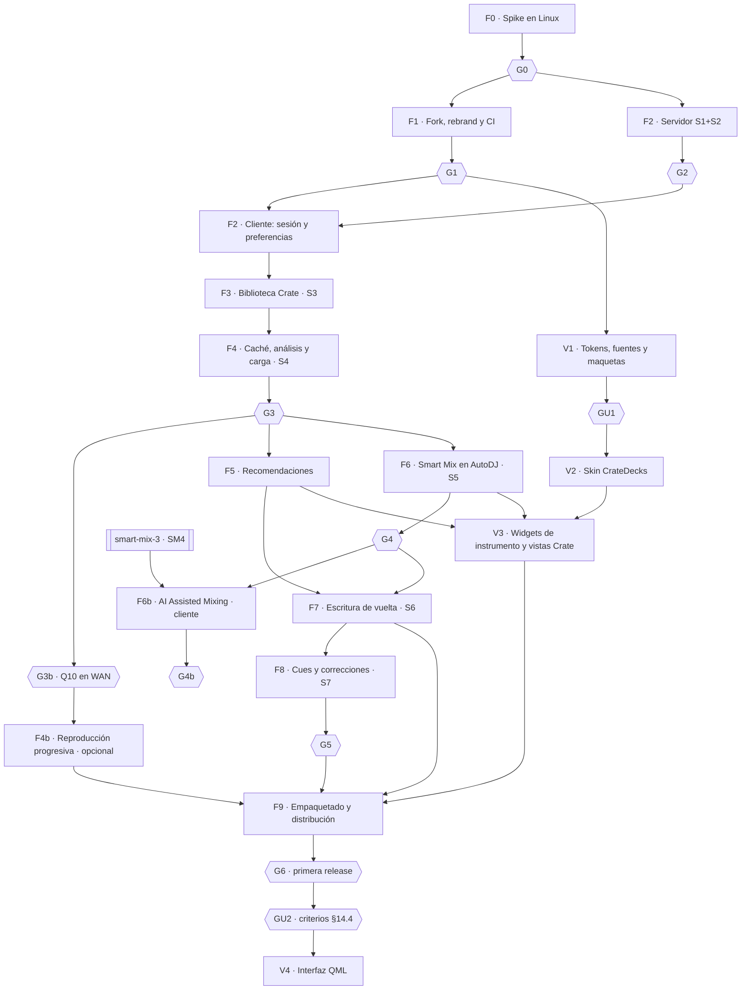

# Crate Decks — Plan de implementación

> **Para agentes:** ejecuta las fases en orden. Cada fase acaba en un gate o en PRs revisables.
> **No pases un gate humano (§13 del diseño) sin aprobación explícita de Diego.** Nada de
> producción sin autorización específica: los cambios de servidor se despliegan con el proceso de
> release normal de Crate y solo cuando Diego lo pida.
>
> Diseño: [2026-11-02-crate-decks-design.md](2026-11-02-crate-decks-design.md). Las decisiones D1–D13
> y los cambios de servidor S1–S7 se citan por su ID.

**Fecha:** 2026-11-02. **Máquina de desarrollo:** Linux (no el Mac de Diego, que va justo de disco).

---

## 0. Convenciones para todas las fases

### 0.1. Repositorios y ramas

| Repo | Contenido | Ramas |
|---|---|---|
| `thecrateapp/crate-decks` (fork de `mixxxdj/mixxx`, creado en F1) | Cliente de escritorio | `main` del fork = upstream + parches Crate. Ramas `feat/decks-<tema>`, `fix/decks-<tema>`. Rama `upstream` que sigue a `mixxxdj/mixxx` sin cambios |
| `thecrateapp/crate` (monorepo) | Cambios de servidor S1–S7 y documentación canónica | `feat/decks-server-<tema>` desde `main` en un worktree propio (`worktrees/decks-server-<tema>`) |

### 0.2. Reglas

- **Commits:** conventional commits sin atribución de IA, con la primera línea de menos de 72 caracteres y el cuerpo con el porqué.
- **Fork, estilo:** el de Mixxx. `pre-commit` con clang-format 19 (`.pre-commit-config.yaml` de upstream), C++20, Qt6, `parented_ptr`/`make_parented` para QObjects con padre y `kLogger` por fichero.
- **Fork, tests:** GoogleTest en `src/test/crate/`, añadidos a la lista de fuentes de `mixxx-test` en `CMakeLists.txt`. Red simulada con `src/test/mock_networkaccessmanager.h` (o un `QNetworkAccessManager` inyectado). Nunca dependas de un servidor real en los tests unitarios.
- **Monorepo:** todas las reglas de `AGENTS.md`:
  - `read_scope` y `transaction_scope` solo en `app/crate/db/`, y nada de `from crate.db import`.
  - `ANY(:ids)` y sin agregados sobre `library_tracks` en requests.
  - pytest por función pública cambiada, y documentación en `docs/technical/`.
- **Cada PR** declara qué parches de Mixxx toca y actualiza `CRATE_PATCHES.md` (desde F1).
- **TDD:** cada tarea empieza por el test en rojo indicado. Si algo no se puede testear, va con un `TEST_GAP:` y su motivo.
- **Interfaz (D11):**
  - La lógica de Crate vive en modelos (`QAbstractItemModel` u objetos con `Q_PROPERTY`) sin incluir `QWidget`, y las vistas QWidget son una capa fina por encima. Así la etapa QML (V4) no reescribe la lógica.
  - Desde que existe V1, ningún color, tamaño, radio ni fuente se escribe a mano en QSS, XML de skin ni C++: todo sale de `res/crate-design/tokens.json`.

### 0.3. Requisitos de la máquina Linux

Estimaciones a confirmar en F0:

| Recurso | Mínimo | Recomendado | Motivo |
|---|---|---|---|
| SO | Ubuntu 24.04 LTS (igual que el CI de Mixxx) | — | `tools/debian_buildenv.sh` asume Debian/Ubuntu |
| CPU | 4 núcleos | 8 o más | Compilar unas 343.000 líneas de C++ |
| RAM | 8 GB | 16 GB o más | Enlazado y tests |
| Disco libre | 30 GB | 60 GB | Unos 3 GB de dependencias, 8–12 GB del directorio de build con tests, 5 GB de ccache, el stack dev de Crate y `test-music`, y la caché de audio de Decks |
| Audio | Salida de audio real (ALSA, PipeWire o JACK) | Tarjeta con dos salidas o auriculares para PFL | Pruebas de escucha de F0, F4 y F6 |
| Pantalla | Escritorio X11 o Wayland | — | Mixxx es una app QWidget |

---

## Mapa de fases



La línea V corre en paralelo con F2–F8. Las vistas de F3–F6 se construyen con el estilo de LateNight
mientras V2 no esté lista y V3 las alinea. V2 tiene que estar terminada antes de F9: la primera release sale
con la skin `CrateDecks`.

| Fase | Resultado | PRs aproximados | Tamaño estimado |
|---|---|---|---|
| F0 | Informe del spike con respuestas medidas; código desechable | 0 (rama `spike/crate-decks` sin merge) | 7–10 días |
| F1 | Fork con marca propia, ajustes separados y CI Linux verde | 3 | 3–4 días |
| F2 | Cliente `decks` en el servidor; inicio de sesión y Keychain en Decks | 2 servidor + 3 cliente | 5–7 días |
| F3 | Sección Crate navegable y búsqueda DJ | 1 servidor + 3 cliente | 6–8 días |
| F4 | Cargar cualquier pista Crate en un deck con el análisis de Crate | 1 servidor + 4 cliente | 7–10 días |
| F4b | Reproducción progresiva (D14), solo si G3b la aprueba | 3 | 15–25 días |
| F5 | Compatibles, Radio y Paths | 3 cliente | 4–6 días |
| F6 | Modo AutoDJ "Crate Smart Mix" y asistente | 1 servidor + 4 cliente | 10–14 días |
| F6b | Planner v3 y AI Assisted Mixing en el cliente (servidor en el plan smart-mix-3) | 3 | 6–9 días |
| F7 | Historial, now playing, likes, valoraciones y playlists | 1 servidor + 3 cliente | 5–7 días |
| F8 | Cues y correcciones sincronizadas | 2 servidor + 2 cliente | 7–10 días |
| F9 | AppImage, `.deb`, DMG y MSI; aviso de actualización; documentación | 3–4 | 5–8 días |
| V1 | `tokens.json`, generador, fuentes y maquetas para GU1 | 2 | 4–6 días |
| V2 | Skin `CrateDecks` completa (decks, mezclador, efectos, muestras, biblioteca, toolbar, diálogos) | 5 | 20–30 días |
| V3 | Widgets de instrumento (rueda Camelot, plan de Smart Mix, anillo de nivel) y vistas de Crate con la skin | 3 | 8–12 días |
| V4 | Interfaz QML (etapa 2, solo tras GU2) | 4–6 | 30–50 días |

Tamaños en días de agente con revisión; sirven para ordenar, no son un compromiso.

---

## F0 · Spike en Linux

**Objetivo:** responder con medidas, no con lectura de código, las preguntas que deciden si Crate Decks
es viable tal como está diseñado. **Todo el código del spike es desechable**; lo que se entrega es el informe.

**Rama:** `spike/crate-decks` en el fork `thecrateapp/crate-decks` (creado el 2026-11-03). La rama lleva estos planes en `docs/plans/`; el código del spike se commitea encima y **nunca se mergea** a `main`.
**Servidor:** stack dev de Crate en la misma máquina Linux (`make dev`) con `test-music/`, o un
servidor de pruebas que Diego indique. **Nunca producción.**
**Restricción:** no se toca el servidor Crate. El spike usa un token `crv_`, cuyas rutas permitidas ya
cubren todo lo necesario: búsqueda, `mix-profile`, `compatible`, `stream`, `transition-plans` y `play-events`.

### F0.1. Preguntas que debe contestar el spike

| ID | Pregunta | Cómo se mide | Criterio de "sí" |
|---|---|---|---|
| Q1 | ¿Compila y pasa los tests en la máquina? ¿Cuánto tarda y ocupa? | `time` de build limpio y con ccache; `du -sh build ~/.ccache`; `mixxx-test` | Build y tests verdes; anotar tiempos y GB |
| Q2 | ¿Qué base usar: `main` (2.7-alpha) o la rama estable más reciente (2.6)? | Estado de ramas y tags, y fallos en una sesión de 30 min de uso en cada una | Recomendación argumentada |
| Q3 | ¿Se puede inyectar el beatgrid de Crate (`beatGridMs`) y bloquear el BPM sin que Mixxx reanalice? | Cargar 10 pistas con perfil `full`; revisar el log del analizador; comparar el grid visual con el de Crate | 10/10 sin reanálisis de beats; grid alineado (error ≤ 5 ms en 5 beats muestreados) |
| Q4 | ¿Se respeta la tonalidad inyectada? | `[ChannelN],key` y columna Key frente a `camelot` de Crate | 10/10 coinciden; `AnalyzerKey` no recalcula |
| Q5 | ¿Funcionan las cues de intro, outro y N60dBSound inyectadas, y evitan el análisis de silencio? | Cues visibles en la forma de onda; log de `AnalyzerSilence` | Cues en su sitio (±1 beat) y sin análisis de silencio |
| Q6 | ¿`[EqualizerRack1_[ChannelN]_Effect1],parameter1` son los graves? ¿`button_parameter1` es el kill de graves? | Tono de prueba de 60 Hz y de 5 kHz; mover el parámetro y medir el nivel de salida (o escuchar con auriculares) | Mapa de parámetros confirmado y escrito en el informe |
| Q7 | ¿Se puede ejecutar una transición de Smart Mix desde el hilo principal con `ControlProxy` y precisión suficiente? | Timer de 60 Hz ejecutando un plan real de `/api/playback/transition-plans`; registrar en cada tick la posición real de los decks frente a la prevista | Desviación de arranque del entrante ≤ 10 ms (p95) y sin clics audibles |
| Q8 | ¿Qué punto de enganche de AutoDJ es el mínimo para un modo de transición externo? | Prototipo de `TransitionMode::CrateSmartMix` en `autodjprocessor.cpp` | Lista de funciones tocadas y número de líneas del parche |
| Q9 | ¿`ExternalTrackCollection` o `library.cpp` para registrar la feature? | Probar ambas | Recomendación y tamaño de cada parche |
| Q10 | ¿Cuánto tarda descargar y cargar una pista por LAN con Range? | 20 descargas de FLAC (de 30 a 60 MB) y 20 de MP3; medir del clic al primer pintado de forma de onda | Mediana ≤ 1,5 s en LAN con FLAC de 40 MB |
| Q11 | ¿Funciona QtKeychain con Secret Service en el escritorio de la máquina, y qué pasa sin él? | Guardar y leer un secreto en GNOME o KDE, y en una sesión sin keyring | Comportamiento documentado |
| Q12 | ¿Se puede separar la configuración de un Mixxx instalado solo con nombre y organización, o hace falta tocar más? | Cambiar `applicationName` y `organizationName` y comprobar la ruta de `mixxx.cfg` y `mixxxdb.sqlite` | Ruta propia sin tocar `~/.mixxx` |
| Q13 | ¿Cuánto del aspecto del admin se consigue con QSS y SVG sobre LateNight? | Prototipo de 1 día: copiar LateNight a `res/skins/CrateSpike`, sustituir la paleta por los tokens de §14.1 del diseño (tokens de `main`, no de ramas viejas), cargar Roboto, Bricolage Grotesque y JetBrains Mono desde `res/fonts/`, y recolorear 5 iconos Solar. Hacer un knob con la gramática de StackMap: anillo de 1 px con 48 marcas y arco de 1,5 px; comprobar qué atributos de arco acepta `WKnobComposed`. Cabecera de deck con MonoLabel (`DECK A · 8A · 124.00 BPM`). Capturas de biblioteca, un deck y el mezclador junto a GenreWheel y StackMap del admin | Capturas que Diego reconozca como "admin"; lista de lo que no se pudo |
| Q14 | ¿Rinde la skin restilizada? | Scroll de la biblioteca con 10.000 pistas (contador de fps de Mixxx o `QSG_RENDER_TIMING`/`perf`) y tiempo de carga de la skin, frente a LateNight | Sin caída visible frente a LateNight; carga ≤ 1,5 s |
| Q15 | ¿Se leen JetBrains Mono a 10,5–11 px (metadatos y MonoLabel) y Roboto a 12–13 px (títulos de pista) en una cabina oscura? ¿Tiene Bricolage Grotesque cifras tabulares para el BPM y el tiempo del deck? | Pantalla a 1,5 m con el brillo bajo; probar 10,5, 11 y 12 px; comprobar `font-feature-settings: tnum` en Bricolage con `QFont::setFeature` (Qt ≥ 6.7) o con una muestra renderizada | Tamaño mínimo y fuente de las cifras grandes argumentados para GU1 |
| Q16 | ¿En qué estado real están las dos interfaces QML? | Arrancar con `--new-ui --settingsPath /tmp/qml-spike` y con `--developer` + skin LateNightQML. Comprobar si la feature del spike (S0.2) y AutoDJ aparecen en el puente `LegacyLibraryItem`. Medir fps de ondas en ambas y anotar fallos en 20 min de uso | Informe de estado con capturas, para tener una base real en GU2 |
| Q17 | ¿Es viable la reproducción progresiva (D14)? | Prototipo de `SoundSourceCrateProgressive`: FFmpeg con `AVIOContext` propio sobre un fichero que otro hilo rellena a velocidad limitada (1,5× y 0,8× el bitrate). Cargar en deck con 10 s descargados, dar play, hacer seek a una zona no descargada, expulsar a mitad de espera y cerrar la app a mitad de espera. Probar FLAC, MP3, M4A y Opus con la cola descargada primero. Comprobar con `ldd`/`otool -L` que los builds de Linux, macOS y Windows (artefactos del CI de upstream) incluyen FFmpeg | Sin cuelgues al expulsar o cerrar, ninguna lectura corta (ni truncado de la pista), los 4 formatos abren con cabecera y cola, y lista de plataformas con FFmpeg |

### F0.2. Preparación

```bash
# Máquina Linux (Ubuntu 24.04)
sudo apt update && sudo apt install -y git ccache
mkdir -p ~/src && cd ~/src
git clone git@github.com:thecrateapp/crate-decks.git
cd crate-decks
git remote add upstream https://github.com/mixxxdj/mixxx.git
git switch spike/crate-decks
tools/debian_buildenv.sh setup       # dependencias del sistema; revisar lo que instala antes de confirmar

# Build (comprobar antes si existe CMakePresets.json y usar el preset de Linux si lo hay)
cmake -S . -B build -G Ninja \
  -DCMAKE_BUILD_TYPE=RelWithDebInfo \
  -DBUILD_TESTING=ON \
  -DCMAKE_C_COMPILER_LAUNCHER=ccache -DCMAKE_CXX_COMPILER_LAUNCHER=ccache
time cmake --build build -j"$(nproc)"
time build/mixxx-test                 # anotar fallos preexistentes (base de referencia)
build/mixxx --settingsPath /tmp/spike-settings   # comprobar que arranca sin tocar ~/.mixxx
```

En el monorepo de Crate (en la misma máquina, si se usa el stack dev):

```bash
make dev
# Iniciar sesión en el admin local con admin@cratemusic.app / admin y crear un token:
curl -s -X POST http://localhost:8585/api/auth/access-tokens \
  -H "Authorization: Bearer <session-jwt>" -H 'Content-Type: application/json' \
  -d '{"name":"decks-spike","scopes":["vdj.catalog.read","vdj.media.read","vdj.smart_mix.read"]}'
```

Revisa el cuerpo exacto que espera `POST /api/auth/access-tokens` en `app/crate/api/auth.py` y su
esquema antes de lanzarlo. Comprueba también que el análisis y los perfiles de mezcla de `test-music/`
están completos: el admin muestra la cobertura de Smart Mix. Si no lo están, lanza el backfill de perfiles
desde el admin y espera a que termine.

### F0.3. Código del spike

Todo vive en `src/crate/spike/`. Se registra con un parche de pocas líneas en `library.cpp` y se
configura solo con variables de entorno (`CRATE_URL`, `CRATE_TOKEN`). Sin preferencias ni Keychain.

| Paso | Fichero | Qué hace | Pregunta |
|---|---|---|---|
| S0.1 | `src/crate/spike/cratespikeclient.{h,cpp}` | `QNetworkAccessManager` con `Authorization: Bearer $CRATE_TOKEN`; `search(q)` (siempre con `scope=local`: con token de acceso, `auto` y `federated` dan 403), `mixProfile(uid)`, `download(uid, path)` con Range y `transitionPlans(edges)` | Q10 |
| S0.2 | `src/crate/spike/cratespikefeature.{h,cpp}` | `LibraryFeature` mínima: nodo "Crate (spike)" con un buscador; resultados en un `QStandardItemModel` o un `BaseExternalTrackModel` con tabla `crateserver_spike` | Q9 |
| S0.3 | `src/crate/spike/cratespikeloader.{h,cpp}` | Cargar en deck: descargar a `~/.cache/crate-decks-spike/<uid>.<ext>`, después `getOrAddTrack`, después inyectar y emitir `loadTrackToPlayer` | Q3–Q5, Q10 |
| S0.4 | `src/crate/spike/cratespikeanalysis.{h,cpp}` | Conversión de `beatGridMs` a frames con la sample rate real, `Beats::fromBeatPositions`, `trySetBeats`, `setBpmLocked`, `setKeys` y `createAndAddCue` (Intro, Outro y N60dBSound) | Q3–Q5 |
| S0.5 | `src/crate/spike/cratespikedirector.{h,cpp}` | Botón "Smart Mix 1→2" que pide el plan de la arista Deck1→Deck2 y lo ejecuta con `ControlProxy` a 60 Hz (rate, play, pregain, EQ de graves y crossfader). Registra un CSV de tiempos previstos frente a reales | Q6, Q7 |
| S0.6 | `src/library/autodj/autodjprocessor.cpp` (parche del spike) | Modo `CrateSmartMix` que delega en S0.5 | Q8 |
| S0.7 | `src/util/versionstore.cpp`, `main.cpp` | Probar `applicationName` y `organizationName` propios | Q12 |
| S0.8 | `src/crate/spike/cratespikekeychain.cpp` | Escritura y lectura de un secreto con QtKeychain | Q11 |
| S0.9 | `src/crate/spike/cratespikeprogressive.{h,cpp}` | Fuente FFmpeg con `AVIOContext` que espera bytes de un fichero que otro hilo rellena a velocidad limitada; registrada con prioridad `Highest` y `Aborted` para cualquier otra ruta | Q17 |

**Notas de implementación para el spike:**

- **Momento de la inyección:** inyecta el análisis en el `Track` antes de emitir `loadTrackToPlayer`. Si la sample rate no se conoce todavía (pista nueva), usa `tryImportBeats` con un `BeatsImporter` propio, igual que los importadores de Serato y Rekordbox. Así la conversión ms→frames se hace cuando Mixxx abre el fichero.
- **`subVersion` del grid:** `crate-mix-profile-<rev>`. Comprueba en `analyzerbeats.cpp` (~131-191) qué hace `shouldAnalyze` con un grid bloqueado y con un `subVersion` desconocido.
- **Modo del timer:** los timers del director van en `Qt::PreciseTimer`. Para arrancar el entrante, programa con el *beat* del saliente leyendo `[ChannelN],beat_distance`, no con el reloj de pared.
- **Ruta del fichero:** la extensión del fichero de caché sale de `format` o de `Content-Type`. Mixxx elige el decoder por extensión.

### F0.4. Pruebas manuales del spike

1. **Q3–Q5:** busca `bpm:120-130`, carga 10 pistas variadas (house, techno, hip-hop con swing, pistas en vivo) y anota el grid, el BPM, la tonalidad, las cues y los logs del analizador.
2. **Q10:** con la caché vacía, carga 20 pistas FLAC y 20 MP3 midiendo los tiempos. Repite con la caché llena.
3. **Q6:** carga un tono de 60 Hz en Deck 1, mueve `parameter1`, `parameter2` y `parameter3` y `button_parameter1..3`, y anota cuál atenúa los graves. Repite con 5 kHz.
4. **Q7:**
   - Ejecuta 10 transiciones de pares beatmatch (Δ BPM ≤ 4 %).
   - Guarda los CSV y calcula la desviación p50 y p95 entre el arranque previsto y el real, más el error de fase en el primer downbeat compartido.
   - Escucha cada transición y anota clics, saltos de tempo y choques de bajos.
5. **Q8:** deja AutoDJ en modo `CrateSmartMix` con una cola de 8 pistas descargadas. Anota cualquier interferencia con la lógica de AutoDJ (fades dobles, saltos, pistas que vuelven a la cola).
6. **Q11–Q12:** según la tabla.
7. **Q13–Q15:** prototipo `CrateSpike`.
   - Capturas a 1920×1080 de la biblioteca (playlist Crate), un deck con onda y el mezclador.
   - Al lado, capturas de la tabla de pistas y la barra lateral del admin (`app/ui`), para comparar.
   - Anota cada elemento del admin que la skin no puede reproducir: animaciones (pestañas con muelle, transiciones de 300 ms de GenreWheel), recorte redondeado, el brillo de los pulsos.
8. **Q17:** prototipo de reproducción progresiva (desechable, en `src/crate/spike/cratespikeprogressive.{h,cpp}`).
   - Limitar la velocidad con un hilo que copia el fichero a trozos.
   - Registrar en un CSV los fallos de caché del motor (`CachingReader`) y el tiempo de cada espera.
   - Repetir la expulsión y el cierre 20 veces con la descarga detenida.
9. **Q16:** sesión con `--new-ui` y otra con LateNightQML.
   - Prueba concreta: ¿se ve "Crate (spike)" en la barra lateral del puente? ¿Abre AutoDJ?
   - Ten en cuenta el aviso de corrupción: usa siempre `--settingsPath` desechable.

### F0.5. Entregable

- **Informe:** `docs/plans/2026-11-XX-crate-decks-spike-report.md` en `crate-v3`, con:
  - Una respuesta por pregunta Q1–Q12 con datos (tablas y tiempos) y capturas de forma de onda, grid y cues.
  - El diff del spike resumido por fichero, con número de líneas tocadas en ficheros de Mixxx.
  - La recomendación de base de upstream (Q2) y de punto de registro (Q9).
  - La lista de sorpresas y riesgos nuevos.
  - Las propuestas de cambio al diseño (si las hay).
- **Diff del spike:** `git diff main...spike/crate-decks > crate-decks-spike.diff`, adjunto o enlazado. Push de la rama `spike/crate-decks` al fork, sin abrir PR.

### F0.6. Gate G0 (Diego)

Decide:
- Si se sigue.
- La base de upstream.
- D1: repo y nombre.
- D7: tipo de cliente `decks`.
- Los límites de D8 para Decks.
- D14: con el resultado de Q17, si la reproducción progresiva sigue siendo una opción (la decisión de construirla es G3b).
- D11: confirmar la estrategia mixta (skin QWidget ahora, QML con GU2) a la vista de Q13–Q16.
- Si se ajusta alguna fase según el informe.

**No empieces F1 ni F2 sin un "adelante" explícito.**

---

## F1 · Fork, marca y CI

**Objetivo:** un fork que compila, arranca como "Crate Decks" sin tocar una instalación de Mixxx, pasa
el CI de Linux y tiene un proceso de sincronía con upstream.

### F1.PR1 · Crear el fork y el proceso de upstream

- **Fork:** `thecrateapp/crate-decks` ya existe (creado el 2026-11-03). En F1 se crea la rama `upstream`, se ajusta la rama por defecto y se llevan los planes de `spike/crate-decks` a `main`.
- **Ramas:**
  - `upstream`, que sigue a `mixxxdj/mixxx` en la base elegida en G0.
  - `main` = `upstream` + parches.
- **Ficheros nuevos:**
  - `CRATE_PATCHES.md`: tabla de parches (fichero, motivo, PR de origen, ¿upstream?, estado). Al principio está vacía.
  - `CRATE.md`: qué es el fork, cómo compilar, cómo sincronizar y a quién reportar los bugs (a nosotros, no a Mixxx).
  - `.github/workflows/upstream-sync.yml`: job mensual (y manual) que hace `git fetch upstream`, intenta `git merge` en una rama `sync/upstream-<fecha>`, compila, ejecuta `mixxx-test` y abre un PR si va verde, o un issue con el conflicto si no.
- **Desactivar workflows de upstream** que no aplican (publicación en el PPA de Mixxx, subida a downloads.mixxx.org, firma de Azure) y dejar solo el build y los tests.
- **AGENTS.md del fork:** se respetan las reglas de upstream (no abrir PRs a `mixxxdj/mixxx` de forma autónoma) y se añaden las reglas de §0.2 de este plan.

**Tests:** el CI de upstream (Linux) en verde sobre el fork sin cambios.

### F1.PR2 · Marca e identidad (D2, D3)

| Fichero | Cambio |
|---|---|
| `src/util/versionstore.cpp` | `applicationName()` = "Crate Decks"; versión propia (`0.1.0`), con la de Mixxx de base en `About` |
| `src/main.cpp` / `src/mixxxapplication.cpp` | `setOrganizationName("Crate")`, `setOrganizationDomain("cratemusic.app")`, `setApplicationName("Crate Decks")` |
| `src/preferences/settingsmanager.cpp` o el que resuelva `settingsPath` | Directorio de ajustes por defecto `~/.cratedecks/` (Linux) y equivalentes con `QStandardPaths::AppLocalDataLocation`; respeta `--settingsPath` |
| `CMakeLists.txt` | `project(crate-decks …)`, nombre del ejecutable `crate-decks`, `CPACK_PACKAGE_NAME`, contacto y URL, opción `CRATE` (ON) |
| `res/linux/app.cratemusic.decks.desktop`, `res/linux/app.cratemusic.decks.metainfo.xml` | Nuevos (sustituyen a los de Mixxx en el empaquetado) |
| `res/images/`, `res/icons/` | Icono de Crate Decks (sin el logo de Mixxx) |
| `src/dialog/dlgabout*` | "Crate Decks se basa en Mixxx", con enlace al proyecto, la licencia GPL y el enlace al código fuente del tag |

La skin no se toca en F1: el rediseño visual es la línea V (V1–V4), que empieza tras G1.

Cadenas visibles: renombrar solo lo que ve el usuario en ventanas y diálogos principales (título, About,
asistente de primer arranque, diálogo de preferencias). **No** se reescriben las unas 627 apariciones de
"Mixxx" en el código: identificadores, grupos de control y nombres de ficheros se quedan como están para
no romper la sincronía con upstream ni los mapeos de controladoras.

**Tests (en rojo primero):**
- `src/test/crate/brandingtest.cpp`:
  - `applicationName() == "Crate Decks"`.
  - La ruta de ajustes por defecto no contiene `.mixxx`.
  - `--settingsPath` sigue funcionando.

**Manual:** con Mixxx instalado del sistema, arrancar ambos y comprobar que no comparten `mixxx.cfg` ni `mixxxdb.sqlite`.

### F1.PR3 · CI Linux y artefacto de desarrollo

- `.github/workflows/crate-decks-build.yml`: Ubuntu 24.04, ccache, build, `mixxx-test`, AppImage de desarrollo como artefacto (sin publicar release).
- `pre-commit` en el CI (clang-format) solo sobre ficheros cambiados.
- Badge y comandos en `CRATE.md`.

**Gate G1 (Diego):** marca, icono, identificadores y canal de distribución en Linux (AppImage, `.deb`; Flatpak más adelante).

---

## F2 · Sesión: cliente `decks` en el servidor y login en Decks

### F2.S-PR1 · Servidor: cliente nativo `decks` (S1)

**Worktree:** `worktrees/decks-server-auth` desde `main`.

**Localiza primero:**
```bash
grep -n "_is_listen_request\|listen-tauri\|listen-native" app/crate/api/auth.py app/crate/api/native_oauth_auth.py
grep -rn "X-Crate-App\|x-crate-app" app/crate/api | head
```

**Cambios:**

| Fichero | Cambio |
|---|---|
| `app/crate/api/auth.py` | Generalizar `_is_listen_request` a `_is_refresh_capable_client` (Listen **y** `decks/*` por `X-Crate-App`), sin cambiar el comportamiento de Listen. Login y refresh devuelven `refresh_token` para `decks` |
| `app/crate/api/native_oauth_auth.py` | Añadir el app ID `crate-decks` con `redirect_uri` de bucle `http://127.0.0.1:<puerto>/callback` (se valida el host exacto `127.0.0.1` y un puerto cualquiera; se rechaza `localhost` y cualquier otro host), PKCE S256 obligatorio y `state` obligatorio |
| `app/crate/api/schemas/auth*.py` | Si el app ID va en un `Literal` o enum, añadirlo |
| `docs/technical/` (documento de autenticación vigente) | Sección "Clientes nativos: Listen y Crate Decks" |

**Tests (pytest, en rojo primero), en `app/tests/test_auth_decks_client.py`:**
- `test_login_with_decks_app_header_returns_refresh_token`
- `test_login_without_known_app_header_does_not_return_refresh_token` (regresión)
- `test_refresh_with_decks_token_rotates`
- `test_native_oauth_accepts_crate_decks_loopback_redirect`
- `test_native_oauth_rejects_crate_decks_non_loopback_redirect` (casos con `localhost`, `127.0.0.2`, `https://evil`, `http://127.0.0.1.evil.com`)
- `test_native_oauth_requires_pkce_for_crate_decks`
- `test_listen_clients_unchanged` (parametrizado con los app IDs actuales)

```bash
cd app && ../.venv/bin/python -m pytest tests/test_auth_decks_client.py tests/ -k "auth or oauth" -q
```

### F2.S-PR2 · Servidor: `capabilities.decks` (S2)

| Fichero | Cambio |
|---|---|
| `app/crate/api/capabilities.py` | Sección `decks`: `available: true`, `contract_version: 1`, `min_client_version: "0.1.0"`, `features: []` (cada fase añade las suyas: `library_cursor`, `profiles_batch`, `beatmatch`, `bass_handoff`, `cues`) |
| Esquema de capacidades | Modelo Pydantic `DecksCapabilities` |
| `docs/technical/` | Contrato de capacidades `decks` |

**Tests**, en `app/tests/test_capabilities_decks.py`:
- `test_capabilities_includes_decks_section`
- `test_decks_features_reflect_settings` (si alguna depende de configuración)

**Gate G2 (Diego):** revisar el contrato S1 y S2 antes de mergear. El despliegue sigue el proceso
normal de release y solo cuando Diego lo pida.

### F2.C-PR1 · Cliente: `crate::Client` y `crate::Capabilities`

**Ficheros nuevos** (`src/crate/client/`):

| Fichero | Contenido |
|---|---|
| `crateclient.{h,cpp}` | Clase `crate::Client`: `QNetworkAccessManager` inyectable; `get/post/put/del(path, json, options)` que devuelven `crate::Reply` (señales `finished(Result)`, `progress`); cabeceras comunes; límite de 4 peticiones API concurrentes por servidor; reintentos con backoff exponencial y *jitter* (3 intentos, solo en métodos idempotentes y en 429/502/503/504, respetando `Retry-After`); refresh automático en 401 con una sola renovación en vuelo y las peticiones esperando en cola; deduplicación de GET idénticos en vuelo |
| `crateresult.h` | `Result<T>`: valor o error tipado (`Network`, `Http{status, code, message}`, `Auth`, `Decode`, `Cancelled`) |
| `cratejson.{h,cpp}` | Utilidades de parseo estricto (campos obligatorios, tipos y valores por defecto explícitos) |
| `cratecapabilities.{h,cpp}` | Parseo de `/api/capabilities` y `bool has(Feature)`; comparación semántica de `min_client_version` |

**Tests (GoogleTest, en rojo primero), en `src/test/crate/crateclient_test.cpp`:**
- `AddsAuthorizationAndAppHeaders`
- `RetriesIdempotentOn503WithBackoff` / `DoesNotRetryPost`
- `HonoursRetryAfter`
- `RefreshesOnceOn401AndReplaysQueuedRequests`
- `FailsWithAuthErrorWhenRefreshFails`
- `DeduplicatesIdenticalInFlightGets`
- `CancelsOnDestruction`
- `LimitsConcurrentRequestsPerServer`

En `cratecapabilities_test.cpp`:
- `ParsesDecksSection`
- `MissingDecksSectionMeansUnavailable`
- `MinClientVersionBlocksOlderClient`

### F2.C-PR2 · Cliente: `crate::Session` y QtKeychain

| Fichero | Contenido |
|---|---|
| `src/crate/session/cratesession.{h,cpp}` | Perfiles de servidor; `loginWithPassword`, `loginWithBrowser` (PKCE: `code_verifier` aleatorio de 64 bytes, `code_challenge` S256, `state` aleatorio, `QTcpServer` en `127.0.0.1:0` que acepta **una** petición `GET /callback`, valida `state`, responde con una página HTML simple y se cierra; tiempo máximo de 5 min); `refresh`, `logout` (revoca en el servidor y borra el Keychain) |
| `src/crate/session/cratesecretstore.{h,cpp}` | Interfaz `SecretStore` e implementación `KeychainSecretStore` (QtKeychain, servicio `app.cratemusic.decks`, clave `<server_id>:refresh`). Si no hay backend: `SessionOnlySecretStore` en memoria y aviso en la UI |
| `src/crate/db/crateserverschema.{h,cpp}` | Creación idempotente de `crateserver_servers` (y de las demás tablas en sus fases), envuelta en transacción |

**Tests:**
- `cratesession_test.cpp`:
  - `PasswordLoginStoresRefreshInSecretStore`
  - `RefreshUsesStoredToken`
  - `LogoutClearsSecretAndRevokes`
  - `BrowserLoginRejectsMismatchedState`
  - `BrowserLoginTimesOut`
  - `CallbackServerBindsLoopbackOnly`
- `crateserverschema_test.cpp`:
  - `CreatesTablesIdempotently`
  - `DoesNotTouchMixxxTables`

`TEST_GAP:` el backend real de Keychain del sistema solo se prueba a mano (F0 Q11): los tests usan un `SecretStore` falso.

### F2.C-PR3 · Cliente: preferencias y asistente

| Fichero | Contenido |
|---|---|
| `src/preferences/dialog/dlgprefcrate.{h,cpp,ui}` | Página "Crate": lista de servidores, añadir (URL, después comprobar capacidades, después login), cerrar sesión, estado (versión del servidor y funciones disponibles) |
| `src/preferences/dialog/dlgpreferences.cpp` | Registrar la página (parche anotado en `CRATE_PATCHES.md`) |
| `src/crate/ui/cratefirstrun.{h,cpp}` | En el primer arranque sin servidores, ofrecer conectar uno |

**Tests:**
- `dlgprefcrate_test.cpp` con un `Client` falso:
  - `AddServerRejectsServerWithoutDecksCapability`
  - `AddServerRequiresHttpsExceptLoopbackAndPrivate`
  - `PrivateHttpRequiresConfirmation`

**Manual:** login con contraseña y con navegador contra el stack dev; cerrar y abrir la app (sesión restaurada desde el Keychain); revocar el refresh en el servidor (la app pide login de nuevo sin colgarse).

---

## F3 · Biblioteca Crate navegable

### F3.S-PR1 · Servidor: navegación paginada para clientes (S3)

**Objetivo:** contenedores y pistas con los campos de DJ, paginados por cursor, sin N+1 y sin agregados sobre `library_tracks`.

| Endpoint | Respuesta |
|---|---|
| `GET /api/decks/containers` | Árbol: `playlists` (del usuario y compartidas), `crates`, `genres` (top N precomputado), `moods`, `recent`, `likes`. Cada nodo lleva `id`, `kind`, `name`, `parent_id`, `track_count` **si ya está precomputado** (si no, se omite) y `etag` |
| `GET /api/decks/containers/{kind}/{id}/tracks?cursor=&limit=500` | Pistas del contenedor en orden: `entity_uid`, `global_track_uid`, `title`, `artist`, `album`, `duration_ms`, `bpm`, `camelot`, `energy`, `genre`, `format`, `bitrate`, `sample_rate`, `bit_depth`, `byte_length`, `source_revision`, `profile_revision`, `profile_quality` y `cover_url`. Devuelve `next_cursor` y `ETag`; acepta `If-None-Match` |

- **Crates:** son de álbumes, así que se expanden a pistas en el orden de los álbumes (disco y número de pista).
- **Cursor:** opaco (base64 de `(position, id)`) y estable ante inserciones al final.

| Fichero | Contenido |
|---|---|
| `app/crate/api/decks.py` | Router `/api/decks`, solo usuarios con sesión (no tokens `crv_`) |
| `app/crate/api/schemas/decks.py` | Modelos Pydantic |
| `app/crate/db/queries/decks_library.py` | Una consulta por endpoint con CTE; *keyset pagination*; perfiles con `LEFT JOIN track_mix_profiles` en la misma consulta |
| Readplane | Comprobar si `app/readplane` necesita conocer las rutas nuevas (fallback a FastAPI) |
| `app/crate/api/capabilities.py` | `features += ["library_cursor"]` |

**Tests:**
- `app/tests/test_decks_library_api.py`:
  - `test_containers_tree_for_user`
  - `test_playlist_tracks_paginated_by_cursor`
  - `test_crate_expands_albums_in_disc_track_order`
  - `test_etag_not_modified`
  - `test_access_token_rejected`
  - `test_other_users_private_playlist_forbidden`
- `app/tests/test_decks_library_queries.py` (con `pg_db`):
  - `test_single_query_per_page` (contar sentencias con un *listener* de SQLAlchemy)
  - `test_no_aggregate_over_library_tracks`
  - `test_explain_uses_index` (opcional: `EXPLAIN` sobre 10.000 filas sintéticas sin `Seq Scan` en `library_tracks`)

**Rendimiento:** p95 ≤ 150 ms para 500 pistas en la base de producción (medir con datos dev y extrapolar; avisar si la consulta no usa índice).

### F3.C-PR1 · Cliente: tablas y sincronía de contenedores

| Fichero | Contenido |
|---|---|
| `src/crate/db/crateserverschema.cpp` | Tablas `crateserver_tracks`, `crateserver_containers` y `crateserver_container_tracks` con índices `(server_id, entity_uid)` y `(container_id, position)` |
| `src/crate/library/cratelibrarysync.{h,cpp}` | `syncContainers(server)`, `syncContainerTracks(container)`: descarga páginas, parsea en `QtConcurrent` y escribe en una transacción por página; respeta `ETag`; emite `containerUpdated(id)` |
| `src/crate/library/crateeventsubscriber.{h,cpp}` | SSE `/api/cache/events` con `Last-Event-ID`, reconexión con backoff y mapeo de los eventos de invalidación a `markDirty(container)`. Solo si las capacidades lo permiten |

**Tests:**
- `cratelibrarysync_test.cpp`:
  - `SyncsTreeIntoTables`
  - `PagesUntilCursorExhausted`
  - `NotModifiedKeepsRows`
  - `ReplacesContainerTracksAtomically`
  - `ParseRunsOffMainThread` (comprobar el hilo en el *callback*)
- `crateeventsubscriber_test.cpp`:
  - `ReconnectsWithLastEventId`
  - `MarksAffectedContainersDirty`

### F3.C-PR2 · Cliente: `CrateServerFeature` y modelos

| Fichero | Contenido |
|---|---|
| `src/library/crateserver/crateserverfeature.{h,cpp}` | `title()` = "Crate"; `sidebarModel()` (`TreeItemModel`: un nodo por servidor y, dentro, Biblioteca, Playlists, Crates, Géneros, Moods, Recientes y Likes); `activate()` y `activateChild()` muestran el modelo de pistas; carga perezosa (`onLazyChildExpandation`); menú contextual mínimo (Actualizar) |
| `src/library/crateserver/crateservertrackmodel.{h,cpp}` | Sobre `BaseExternalTrackModel`: vista TEMPORARY `crateserver_view_<container>` sobre `crateserver_container_tracks ⨝ crateserver_tracks`; columnas Camelot, Energía, Calidad del perfil y Estado de caché (`ColumnCache` / `TrackModel::Capabilities` como en Rekordbox); `getTrack()` sin implementar todavía (F4) |
| `src/library/crateserver/crateservercollection.{h,cpp}` | `ExternalTrackCollection`: `establishConnection` (sesión válida), `newLibraryFeature` (devuelve la feature) y el resto vacío hasta F7 |
| `src/library/trackcollectionmanager.cpp` | Registrar la colección cuando `CRATE` está activo. **Parche de Mixxx**: anotarlo |

Si F0/Q9 recomendó `library.cpp` en lugar de `ExternalTrackCollection`, se usa esa vía y se ajusta esta tabla.

**Tests:**
- `crateserverfeature_test.cpp` (fixture `LibraryTest`):
  - `SidebarShowsServerAndSections`
  - `ActivatingPlaylistShowsTracksInOrder`
  - `LazyExpansionFetchesOnce`
  - `NameDoesNotCollideWithMixxxCrates` (que no toca la tabla `crates`)

### F3.C-PR3 · Cliente: búsqueda DJ

- En la sección Crate, el buscador de la biblioteca envía `GET /api/search?fields=dj&q=…&limit=50` con debounce de 250 ms y cancela la búsqueda anterior.
- Los resultados van a un contenedor efímero `kind=search`.
- Fuera de la sección Crate, la búsqueda sigue siendo la local de Mixxx.

**Tests:**
- `cratesearch_test.cpp`:
  - `DebouncesAndCancelsPrevious`
  - `PassesDjFiltersVerbatim` (`bpm:120-128 key:8A`)
  - `ShowsResultsAsEphemeralContainer`

**Manual:** navegar una playlist de 2.000 pistas en el stack dev midiendo los tiempos de §9 del diseño.

---

## F4 · Caché de audio, análisis y carga en decks

### F4.S-PR1 · Servidor: perfiles en lote (S4)

- **Endpoint:** `POST /api/decks/mix-profiles` con `{entity_uids: [...≤200], detail: "full"}`. Devuelve `{profiles: {uid: MixProfile}, missing: [uid]}` con el **mismo esquema** que `GET /api/tracks/by-entity/{uid}/mix-profile?detail=full` (reutilizar el serializador).
- **Ficheros:**
  - `app/crate/api/decks.py`
  - `app/crate/db/queries/decks_profiles.py`: una consulta con `ANY(:uids)` y comprobación de acceso.
  - `capabilities`: `profiles_batch`.
- **Tests**, en `app/tests/test_decks_profiles_api.py`:
  - `test_batch_matches_single_endpoint` (paridad campo a campo)
  - `test_batch_limit_200`
  - `test_missing_uids_listed`
  - `test_single_query`

### F4.C-PR1 · `crate::AudioCache`

| Fichero | Contenido |
|---|---|
| `src/crate/cache/audiocache.{h,cpp}` | API: `ensure(server, uid, priority) -> CacheTicket` (señales `progress`, `ready(path)`, `failed(error)`); `pin(uid, reason)` y `unpin`; `setLimitBytes`; `usage()`. Cola con prioridades (deck > AutoDJ > prefetch > set offline), 2 descargas por servidor, `.part`, reanudación con `Range: bytes=<n>-` si `If-Range` (ETag) coincide, `rename` atómico, verificación de longitud con `Content-Length`/`byte_length` y LRU respetando los pines |
| `src/crate/cache/audiocacheindex.{h,cpp}` | SQLite propio (`<cache>/index.sqlite`): tabla `crateserver_cache`; arranque que reconcilia el índice con los ficheros del disco (borra `.part` huérfanos y entradas sin fichero) |
| `src/crate/cache/cachepaths.{h,cpp}` | Ruta estable `<cache>/<server_id>/<uid[0:2]>/<uid>.<ext>`; extensión a partir de `format`, o si no de `Content-Type` |

**Tests**, en `audiocache_test.cpp`:
- `DownloadsToPartThenRenames`
- `ResumesWithRangeWhenEtagMatches`
- `RestartsWhenEtagChanged`
- `RejectsShortDownload`
- `PrioritisesDeckOverPrefetch`
- `EvictsLruButNeverPinned`
- `KeepsTwoGiBFree` (inyectando un `StorageInfo` falso)
- `ReconcilesIndexOnStartup`
- `ConcurrentEnsureForSameUidSharesDownload`

### F4.C-PR2 · `crate::AnalysisImporter` y `ProfileStore`

| Fichero | Contenido |
|---|---|
| `src/crate/analysis/profilestore.{h,cpp}` | Tabla `crateserver_profiles`; `get(uids)` que usa el lote si `profiles_batch` está disponible y si no peticiones individuales con concurrencia limitada; invalidación por `profile_revision` |
| `src/crate/analysis/analysisimporter.{h,cpp}` | `apply(TrackPointer, MixProfile, Policy)`: (1) si la calidad es `full`, el beatgrid va por `BeatsImporter` (ms a frames con la sample rate real) con `subVersion` `crate-mix-profile-<rev>` y `setBpmLocked(true)`; (2) tonalidad con `setKeys`; (3) cues Intro, Outro y N60dBSound si no existen o si son de Crate con revisión antigua y el usuario no las editó; (4) `pregain` opcional desde LUFS (preferencia, apagada por defecto); (5) si la calidad no es `full`, no inyecta nada y marca la pista para análisis local |
| `src/analyzer/analyzerbeats.cpp` | Parche (si F0 lo pidió): tratar `crate-mix-profile-*` como importado |

**Tests**, en `analysisimporter_test.cpp` con fixtures JSON de perfiles reales anonimizados en `src/test/crate/data/`:
- `ImportsBeatGridAtFileSampleRate` (44,1 y 48 kHz)
- `LocksBpm`
- `SetsKeyFromCamelot` (todas las tonalidades, de 1A a 12B)
- `CreatesIntroOutroCues`
- `DoesNotOverwriteUserCues`
- `ReappliesCratesCuesOnNewRevision`
- `PartialProfileLeavesTrackForLocalAnalysis`
- `AnalyzerSkipsBeatsForCrateGrid` (integración con `AnalyzerBeats::shouldAnalyze`)

### F4.C-PR3 · Cargar en deck y AutoDJ

| Fichero | Contenido |
|---|---|
| `src/library/crateserver/crateservertrackmodel.cpp` | `getTrack(index)` / `getTrackLocation`: si está en caché, `getOrAddTrack(TrackRef::fromFilePath(path))` más `AnalysisImporter::apply`; si no, `nullptr` y arranca `ensure()` |
| `src/crate/library/crateloadcoordinator.{h,cpp}` | Intercepta "Cargar en Deck N" y doble clic desde la sección Crate: estado "descargando" en la fila; al terminar, `loadTrackToPlayer(track, group, play)`; si el usuario carga otra pista mientras tanto, se cancela la carga pendiente de ese deck |
| `src/library/autodj/autodjprocessor.cpp` | Parche "pending track" (diseño §5.2): no descartar entradas Crate pendientes de descarga, esperar hasta N segundos y si no, pasar a la siguiente disponible |
| `src/crate/library/crateprefetcher.{h,cpp}` | Observa la cola de AutoDJ (`PlaylistDAO`, playlist `PLHT_AUTO_DJ`) y pide `ensure()` de las 3 siguientes |
| Menú contextual | "Descargar", "Descargar contenedor (set offline)" (muestra el tamaño total antes), "Quitar de la caché" |

**Tests:**
- `crateloadcoordinator_test.cpp`:
  - `LoadsAfterDownloadCompletes`
  - `CancelsPendingLoadWhenDeckGetsAnotherTrack`
  - `DoesNotInterruptPlayingDeckWithoutConfirmation`
- `autodjcratepending_test.cpp` (sobre `autodjprocessor_test.cpp` de upstream):
  - `WaitsForPendingCrateTrack`
  - `SkipsToNextAvailableAfterTimeout`
  - `NonCrateBehaviourUnchanged`

### F4.C-PR4 · Vista de caché y preferencias

- `src/crate/ui/cachestatusview.{h,cpp}` (vista registrada con `WLibrary::registerView`): uso, límite, descargas en curso y sets offline.
- Preferencias: ruta y límite de la caché, prefetch on/off, ganancia por LUFS on/off.

**Tests:**
- `cachestatusview_test.cpp`:
  - `ShowsUsageAndQueue`
  - `ChangingLimitTriggersEviction`

**Gate G3 (Diego):** sesión de 1 h con el stack dev, o con un servidor real si Diego lo autoriza:
- Cargar desde playlists y búsqueda.
- Un set offline de 50 pistas.
- AutoDJ clásico (sin Smart Mix) con pistas Crate.

Medir contra los presupuestos de §9 del diseño.

---

## F4b · Reproducción progresiva (opcional, D14)

**No se empieza sin G3b.** G3b decide con el dato de F0 Q10 en WAN y con la sesión de G3. Si se aprueba, F4b
corre en paralelo con F5 y F6 y tiene que estar cerrada antes de F9 o quedar desactivada detrás de una preferencia.

### F4b.PR1 · `crate::ProgressiveDownload`

| Fichero | Contenido |
|---|---|
| `src/crate/cache/rangemap.{h,cpp}` | Conjunto de rangos de bytes `[start, end)` con unión, consulta (`contains(offset, len)`), primer hueco a partir de una posición y serialización compacta |
| `src/crate/cache/progressivedownload.{h,cpp}` | Reserva el fichero (`QFile::resize(byte_length)`) en la ruta estable de D4. **Orden de descarga:** cabecera (256 KiB), cola (1 MiB) y luego secuencial desde la cabeza de lectura. `prioritize(offset)` para seeks, máximo 2 conexiones, `If-Range` con ETag (si cambia, reinicia). Persiste los rangos en `crateserver_cache.ranges` cada 2 s y al pausar. API de espera: `waitFor(offset, len, CancelToken)`, que bloquea con un `QWaitCondition` hasta que el rango está o hasta cancelar o fallar; nunca vuelve antes con datos parciales. Al completarse, la entrada pasa a `ready` como cualquier descarga de F4 |
| `src/crate/cache/audiocache.cpp` | `ensureProgressive(uid)`: devuelve el `ProgressiveDownload` compartido. Una descarga completa normal y una progresiva de la misma pista son la misma descarga |

**Tests:**
- `rangemap_test.cpp`:
  - `MergesAdjacentAndOverlapping`
  - `ContainsAcrossBoundaries`
  - `FirstGapAfter`
  - `RoundTripsSerialisation`
- `progressivedownload_test.cpp`, con red simulada y velocidad controlada:
  - `FetchesHeadThenTailThenSequential`
  - `PrioritizeJumpsToSeekOffset`
  - `WaitForBlocksUntilRangeArrives`
  - `WaitForReturnsCancelledOnCancel` (en ≤ 50 ms)
  - `WaitForFailsWhenDownloadFails`
  - `NeverReturnsPartialData`
  - `ResumesFromPersistedRanges`
  - `RestartsWhenEtagChanges`
  - `CompletedDownloadBecomesReadyCacheEntry`

### F4b.PR2 · `SoundSourceCrateProgressive`

| Fichero | Contenido |
|---|---|
| `src/sources/soundsourcecrateprogressive.{h,cpp}` | `SoundSourceProvider` con prioridad `Highest` para las extensiones de FFmpeg. `tryOpen`: si la ruta no está en el registro de descargas progresivas activas, devuelve `OpenResult::Aborted` y Mixxx prueba el siguiente proveedor. Si lo está, abre con FFmpeg sobre un `AVIOContext` cuyo `read` y `seek` llaman a `ProgressiveDownload::waitFor`. Duración, sample rate y canales desde el perfil o el catálogo de Crate. Lee frames solo dentro del rango confirmado, sin lecturas cortas. La cancelación llega desde `close()` |
| `src/crate/cache/progressiveregistry.{h,cpp}` | Registro hilo-seguro `ruta → ProgressiveDownload` que consulta el proveedor |
| `src/sources/soundsourceproxy.cpp` | **Parche:** registrar el proveedor en `registerProviders()`, detrás de la opción `CRATE` y de `FFMPEG`. Anotado en `CRATE_PATCHES.md` |
| Importación de metadatos (localizar la llamada en `TrackCollectionManager` / `SoundSourceProxy::updateTrackFromSource`) | **Parche:** no leer tags de pistas registradas como progresivas; los metadatos vienen de `crateserver_tracks` |

**Tests:**
- `soundsourcecrateprogressive_test.cpp`, con ficheros de prueba de `src/test/id3-test-data/` y similares, rellenados a velocidad controlada:
  - `AbortsForNonProgressivePaths` (otro proveedor abre el fichero)
  - `OpensFlacMp3WithHeadOnly`
  - `OpensM4aOpusWithHeadAndTail`
  - `ReadsBlockUntilDownloaded`
  - `SeekBeyondDownloadedPrioritizesRange`
  - `CloseWhileWaitingReturnsWithinBudget` (≤ 200 ms)
  - `NoShortReads` (el rango legible del `AudioSource` no encoge durante toda la descarga)
  - `DecodedSamplesEqualFullFileDecode` (mismo checksum PCM que el fichero completo)
- `cachingreaderprogressive_test.cpp`, integración con `CachingReader`:
  - `EngineGetsCacheMissNotBlock`
  - `OtherDeckUnaffectedWhileOneWaits`
  - `EjectDuringWaitFreesDeck`
- `metadataimportskip_test.cpp`: `ProgressiveTrackSkipsTagImport`.

### F4b.PR3 · Reglas de reproducción e interfaz

| Fichero | Contenido |
|---|---|
| `src/crate/library/crateloadcoordinator.cpp` | Si la pista no está completa y la preferencia "Reproducir mientras descarga" está activa: `ensureProgressive`; carga en el deck cuando la cabecera, la cola y 10 s están listos |
| `src/crate/playback/progressiveguard.{h,cpp}` | Por deck: segundos descargados por delante de la cabeza y velocidad medida (media móvil de 3 s) frente al bitrate. Expone el control `[ChannelN],crate_buffering` (0/1) y `[ChannelN],crate_buffered_ahead` (s). Si no se cumple la regla de 10 s y 1,2×, intercepta `play` y pide confirmación una vez por carga. Un seek o hot cue a una zona no descargada activa `crate_buffering` |
| `src/crate/ui/widgets/downloadedranges.{h,cpp}` | Carril de 1 px bajo el overview con las zonas descargadas en `accentHi` (gramática StackMap) y MonoLabel `BUFFERING` en la cabecera del deck cuando `crate_buffering = 1` |
| `src/library/autodj/` | Sin cambios: AutoDJ sigue usando solo pistas completas (prefetch de F4) |
| Preferencias Crate | "Reproducir mientras descarga" (apagada por defecto hasta G3b) y "Segundos mínimos por delante" (10) |

**Tests:**
- `progressiveguard_test.cpp`:
  - `BlocksPlayBelowTenSecondsAhead`
  - `BlocksPlayWhenRateBelowOnePointTwo`
  - `AsksConfirmationOncePerLoad`
  - `SeekIntoGapSetsBuffering`
  - `ClearsBufferingWhenRangeArrives`
- `downloadedranges_test.cpp`: render de las zonas a `QImage`.
- `autodjcratepending_test.cpp` (F4): `AutoDjNeverUsesProgressiveTracks`.

**Manual:**
- Servidor real por WAN o con la red limitada (`tc qdisc … netem rate 20mbit`): 20 cargas con FLAC y MP3.
- Hot cues a zonas no descargadas.
- Expulsar y cerrar durante `BUFFERING`.
- Medir contra el presupuesto de §9 del diseño.

**Gate G3b, segunda parte (Diego):** tras F4b, si la reproducción progresiva se activa por defecto o queda como opción.

---

## F5 · Recomendaciones

### F5.C-PR1 · Vista Compatibles

| Fichero | Contenido |
|---|---|
| `src/crate/recs/compatiblesview.{h,cpp}` | Vista de biblioteca y nodo "Compatibles" en la barra lateral; sigue al deck maestro (`[Master]` / `PlayerInfo`) o a la selección (alternador); debounce de 400 ms; `GET /api/tracks/by-entity/{uid}/compatible?context=<auto\|beatmatch\|smooth>&limit=50`; columnas Puntuación, Relación armónica, Δ BPM y Δ energía (de `scoreBreakdown`); doble clic carga en el deck libre; precalienta la caché para las 5 primeras (preferencia) |
| `src/crate/recs/compatiblesmodel.{h,cpp}` | Modelo en memoria sobre `crateserver_tracks`. Los resultados se insertan o actualizan antes de mostrarse con los metadatos que ya trae la respuesta (`bpm`, `camelot`, `energy`, `duration`, `genre`, `coverUrl`), sin lecturas extra. Test: `UpsertsTrackMetadataFromResponse` |

Si el deck maestro no tiene una pista Crate, la vista muestra "Carga una pista de Crate para ver compatibles".

**Tests:**
- `compatiblesview_test.cpp`:
  - `FollowsMasterDeck`
  - `DebouncesRapidChanges`
  - `CancelsStaleRequest`
  - `PrewarmsTopFiveWhenEnabled`
  - `NonCrateTrackShowsHint`

### F5.C-PR2 · Radio como fuente de AutoDJ

- **Comprobar antes:** que `/api/radio/*` acepta la sesión `decks`. Si filtra por app, eso es un cambio de servidor que se añade como S-PR en esta fase.
- **Fichero:** `src/crate/recs/crateradiosource.{h,cpp}`:
  - "Iniciar radio desde esta pista o contenedor": `POST /api/radio/start`.
  - Rellena la cola de AutoDJ y mantiene 5 pistas por delante con `radio/next`.
  - Like y dislike van a `radio/feedback`.
- **Tests:**
  - `crateradiosource_test.cpp`:
    - `KeepsFiveAhead`
    - `SendsFeedback`
    - `StopsWhenUserClearsQueue`

### F5.C-PR3 · Music Paths

- **Fichero:** `src/crate/recs/cratepathsource.{h,cpp}`. Diálogo "Path desde A hasta B (N pistas)" que llama a `POST /api/paths` y mete el resultado en la cola de AutoDJ o en una playlist.
- **Tests:**
  - `cratepathsource_test.cpp`:
    - `EnqueuesPathInOrder`
    - `SavesPathAsPlaylist`

---

## F6 · Smart Mix en los decks

### F6.S-PR1 · Servidor: contexto `decks` en el planner (S5)

**Localiza primero:**
```bash
grep -rn "android_bass_handoff\|bass_handoff_enabled\|allowBassHandoff" app/crate | head -20
grep -rn "smart-mix-v2" app/crate | head
```

**Cambios:**
- `context.source` admite `"decks"`.
- El intercambio de bajos para `decks` se gobierna por `capabilities.decks.features ∋ "bass_handoff"` (ajuste propio y no la flag de Android).
- Si G0 lo aprobó: `context.assist=true` permite duraciones mayores para el modo asistente, sin tocar los límites de tempo.
- `capabilities.decks.features += ["beatmatch", "bass_handoff", "long_beatmatch"]` según la configuración.
- `docs/technical/smart-mix-design.md`: sección "Consumidor Crate Decks".

**Tests**, en `app/tests/test_smart_mix_decks_context.py`:
- `test_decks_context_enables_bass_handoff_independent_of_android_flag`
- `test_android_behaviour_unchanged` (parametrizado)
- `test_tempo_limits_unchanged_for_decks`
- `test_assist_context_allows_longer_duration` (solo si se aprueba)
- `test_plan_schema_unchanged`

### F6.C-PR1 · `crate::TransitionPlan` y cliente de planes

| Fichero | Contenido |
|---|---|
| `src/crate/smartmix/transitionplan.{h,cpp}` | Tipo de valor con todos los campos del plan; parseo estricto; `validate()` (rangos de tempo, duración y cues dentro de la pista) |
| `src/crate/smartmix/planclient.{h,cpp}` | `requestPlans(edges, context)`, que agrupa hasta 32 aristas por petición; caché por `(from_uid, to_uid, profile_revisions, context)`; reintento único |

**Tests:**
- `transitionplan_test.cpp`:
  - `ParsesAllModes` (fixtures reales de `gapless`, `adaptive` y `beatmatch`)
  - `RejectsOutOfRangeTempo`
  - `RejectsCueBeyondDuration`
  - `ParsesFallbackReason`
- `planclient_test.cpp`:
  - `BatchesEdges`
  - `CachesByRevision`
  - `InvalidatesOnProfileChange`

### F6.C-PR2 · `crate::SmartMixDirector` (motor de ejecución)

| Fichero | Contenido |
|---|---|
| `src/crate/smartmix/smartmixdirector.{h,cpp}` | Máquina de estados `Idle → Armed → Preparing → Running → Completed / Cancelled / FellBack`. **Preparing** (≥ 8 s antes): cue del entrante en `incomingCueMs`, `rate` desde `incomingTempoRatio` (o `sync_enabled` si el plan lo pide), `pregain`, EQ neutra, keylock según preferencia. **Running**: arranque del entrante en el beat calculado con `beat_distance` del saliente y `beatPhaseOffsetMs`; curva del crossfader; intercambio de bajos en `handoffProgress`; rampa de ganancias. Actualización a 60 Hz con `Qt::PreciseTimer` y como máximo un `set` por control y tick |
| `src/crate/smartmix/controlautomation.{h,cpp}` | Envoltorio de `ControlProxy` por control: registra el último valor escrito por el director; si el valor cambia por otra vía (DJ o controladora), marca *manual override*, deja de automatizar **ese** control y emite `overridden(control)` |
| `src/crate/smartmix/curves.{h,cpp}` | `equalPower(t)`, `djBlend(t)` y rampas de EQ y de ganancia, idénticas a las de Android. Comprobar el código fuente de Listen/Android para la paridad (buscar la implementación de las curvas en `app/listen` o en el reproductor nativo) |
| `src/crate/smartmix/eqmap.h` | Mapa de parámetros de EQ confirmado en F0 Q6 |

**Tests:**
- `smartmixdirector_test.cpp`, con controles falsos y reloj inyectable:
  - `PreparesIncomingDeckBeforeStart`
  - `StartsOnPredictedBeat`
  - `AppliesTempoRatio`
  - `AppliesGainRamps`
  - `BassHandoffAtProgress`
  - `CrossfaderFollowsCurve`
  - `FallsBackWhenPlanHasFallbackReason`
  - `FallsBackWhenPlanMissingAtDeadline`
  - `StopsAutomatingOverriddenControl`
  - `NeverWritesSameControlTwicePerTick`
- `curves_test.cpp`: `MatchesAndroidReferenceValues` (tabla de valores generada desde la implementación de Android)

`TEST_GAP:` la precisión real de audio solo se mide a mano (prueba de escucha y CSV de F0/G4).

### F6.C-PR3 · Modo de AutoDJ "Crate Smart Mix"

| Fichero | Contenido |
|---|---|
| `src/library/autodj/autodjprocessor.{h,cpp}` | **Parche:** `TransitionMode::CrateSmartMix`; interfaz `TransitionDirector` (`prepare(from, to)`, `shouldStart(position)`, `run`, `cancel`); si el modo está activo y hay director, `calculateTransition` y `playerPositionChanged` delegan en él y el resto de AutoDJ (cola, carga y retirada) sigue igual. Mínimo de líneas; anotado en `CRATE_PATCHES.md` como candidato a upstream |
| `src/library/autodj/dlgautodj.cpp` | Entrada "Crate Smart Mix" en el combo de modos (solo si hay servidor con `beatmatch`) |
| `src/crate/smartmix/autodjsmartmixadapter.{h,cpp}` | Implementa `TransitionDirector` con `SmartMixDirector` y `PlanClient`; pide planes de las 2 aristas siguientes al cambiar la cola o la pista |

**Tests:**
- `autodjsmartmix_test.cpp`, basado en el fixture de `autodjprocessor_test.cpp`:
  - `DelegatesTransitionToDirector`
  - `QueueAndEjectBehaviourUnchanged`
  - `FallsBackToFullIntroOutroWithoutPlan`
  - `OtherModesUnchanged` (parametrizado con los 5 modos de upstream)

### F6.C-PR4 · Modo asistente

| Fichero | Contenido |
|---|---|
| `src/crate/smartmix/assistpanel.{h,cpp}` | Panel (vista o widget en la skin) con el plan sugerido para "deck maestro → otro deck": modo, punto de entrada, ajuste de tempo, momento del intercambio de bajos y confianza. Botones "Preparar" (solo Preparing) y "Ejecutar" |
| `res/controllers/` | Controles `[CrateSmartMix],prepare`, `[CrateSmartMix],execute` y `[CrateSmartMix],cancel` para mapear en controladoras (creados con `ControlPushButton`) |

**Tests:**
- `assistpanel_test.cpp`:
  - `ShowsPlanForLoadedDecks`
  - `ExecuteRunsDirector`
  - `ControlsAreMappable`

**Gate G4 (Diego):** prueba de escucha A/B de 10 transiciones (Android Smart Mix frente a Decks AutoDJ) con los mismos pares, más los CSV de desviación. **No se sigue sin su aprobación.**

---

## F6b · AI Assisted Mixing en Decks (D15)

**Depende de smart-mix-3** ([plan](2026-11-02-smart-mix-3-implementation-plan.md)):
- F6b.PR1 necesita SM2 (planner v3 en la API).
- F6b.PR2 y PR3 necesitan SM4 (`refinement` y `smart_mix.ai_assisted`).

Todo el trabajo de servidor, prompts, proveedores y evaluación está en ese plan; aquí solo va el cliente. Para
desarrollar se usa el stack dev con la IA activada en local (Ollama con Qwen), nunca producción.

### F6b.PR1 · Planner v3 y contexto de set

| Fichero | Contenido |
|---|---|
| `src/crate/client/cratecapabilities.{h,cpp}` | Parseo de `smart_mix.planner_versions`, `smart_mix.structure` y `smart_mix.ai_assisted{available, provider_kind, model_label, prompt_version, typical_latency_ms, reason}` |
| `src/crate/smartmix/planclient.{h,cpp}` | `plannerVersion` = `smart-mix-v3` si el servidor lo anuncia, y v2 si no. `context.setHistory` con las 3 últimas transiciones ejecutadas por el director (modo, compases, Δ energía). La clave de caché local incluye la versión del planner |
| `src/crate/smartmix/transitionplan.{h,cpp}` | Campo `structureUsed` |

**Tests:**
- `cratecapabilities_test.cpp`:
  - `ParsesPlannerVersionsAndAiAssisted`
  - `MissingAiAssistedMeansUnavailable`
- `planclient_test.cpp`:
  - `UsesV3WhenAdvertised`
  - `FallsBackToV2`
  - `SendsSetHistoryFromDirector`
  - `CacheKeyIncludesPlannerVersion`

### F6b.PR2 · Petición y recogida del refinamiento

| Fichero | Contenido |
|---|---|
| `src/crate/smartmix/refinementtracker.{h,cpp}` | Por arista: estado (`none`, `pending`, `ready`, `unavailable`, `late`), plan refinado, `modelLabel`, motivo, confianza y `promptVersion`. Recogida: vuelve a pedir las aristas `pending` en un único lote, como mucho cada 5 s y nunca más de 32 aristas por petición. Si el servidor anuncia el evento SSE `smart_mix.refinement_ready` (SM6), lo usa en lugar del polling. Deja de seguir una arista cuando sale de la cola o cuando el director entra en `Preparing` |
| `src/crate/smartmix/planclient.cpp` | Con la opción activa y `ai_assisted.available`, pide `context.aiRefinement=true`. AutoDJ lo pide al entrar la arista en la cola (las 2 siguientes); el asistente, al cargar el otro deck |
| `src/crate/smartmix/autodjsmartmixadapter.cpp` y `smartmixdirector.cpp` | En `Armed`, toma el plan refinado si está `ready` y es válido en local (`TransitionPlan::validate`). Si no, el determinista. **Al pasar a `Preparing` el plan queda congelado:** un refinamiento posterior se marca `late` y no se aplica |
| `src/crate/writeback/historyreporter.cpp` | El play event incluye, si el servidor lo admite (S6), si la transición de entrada fue `ai` o `deterministic`, para poder medir en producción |

**Tests:**
- `refinementtracker_test.cpp`:
  - `PollsPendingInSingleBatch`
  - `RespectsFiveSecondInterval`
  - `StopsWhenEdgeLeavesQueue`
  - `UsesSseWhenAdvertised`
  - `MarksLateAfterPreparing`
- `smartmixdirector_test.cpp`, ampliado:
  - `UsesRefinedPlanWhenReadyBeforeArmed`
  - `NeverSwitchesPlanAfterPreparing`
  - `FallsBackToDeterministicWhenRefinedInvalid`
- `planclient_test.cpp`, ampliado:
  - `RequestsRefinementOnlyWhenOptionAndCapability`
  - `NoRefinementFlagWhenUnavailable`

### F6b.PR3 · Interfaz y preferencia

| Fichero | Contenido |
|---|---|
| `DlgPrefCrate` | Opción "AI Assisted Mixing" (apagada por defecto), visible solo con `ai_assisted.available`. Muestra `model_label`, si es local o cloud, y la latencia típica, con un texto: "La configuración del modelo es del servidor; Crate Decks solo envía la petición" |
| `src/crate/ui/widgets/transitionplanview.cpp` (V3) | Origen en MonoLabel (`SMART MIX` o `AI · <MODELO>`), motivo (una línea, truncada con tooltip) y confianza como anillo de nivel. Estado `pending` como MonoLabel `AI · PENDIENTE` en `textSubtle` |
| `src/crate/smartmix/assistpanel.cpp` | Si hay refinado, conmutador `AI` / `SMART MIX` antes de ejecutar; el elegido queda congelado al preparar |

**Tests:**
- `dlgprefcrate_test.cpp`: `AiOptionHiddenWithoutCapability`, `ShowsModelAndKind`.
- `transitionplanview_test.cpp`: `ShowsAiSourceAndReason`, `ShowsPendingState`.
- `assistpanel_test.cpp`: `TogglesBetweenRefinedAndDeterministic`, `FreezesChoiceOnPrepare`.

**Gate G4b (Diego):** prueba de cabina de 1 h con AutoDJ y asistente, con el refinamiento activo y el modelo
elegido en SG3 de smart-mix-3. Activarlo por defecto en el servidor es decisión de SG4 de ese plan.

---

## F7 · Escritura de vuelta

### F7.S-PR1 · Servidor: now playing con deck y `device_type=decks` (S6)

- Esquemas de `POST /api/me/now-playing`: campos opcionales `deck` (`1..4`) y `mix_session_id`.
- Play events: aceptar `device_type="decks"` y `play_source_type="decks"` (si hay enums o validación, ampliarlos).
- Play events: campo opcional `transition_source` (`ai`, `deterministic` o `none`) para medir AI Assisted Mixing en uso real (F6b.PR2). Test: `test_play_event_accepts_transition_source`.
- Sin migración si caben en las columnas actuales. Si hace falta, migración nueva (revisar el *head* actual de Alembic antes de numerar).
- **Tests**, en `app/tests/test_me_decks_events.py`:
  - `test_play_event_accepts_decks_device`
  - `test_now_playing_accepts_deck_fields`
  - `test_existing_clients_unchanged`

### F7.C-PR1 · `crate::Outbox` y `HistoryReporter`

| Fichero | Contenido |
|---|---|
| `src/crate/writeback/outbox.{h,cpp}` | Tabla `crateserver_outbox`; `enqueue(kind, payload)`; envío con backoff (1 s, 5 s, 30 s, 5 min, 30 min); descarte tras 7 días con log; vaciado al recuperar la red |
| `src/crate/writeback/historyreporter.{h,cpp}` | Se conecta a `PlayerInfo::currentPlayingTrackChanged`, mismo criterio que `SetlogFeature::slotPlayingTrackChanged`; al cambiar la pista que suena genera el play event de la anterior (`client_event_id` = UUID v4, `started_at`, `ended_at` y `played_seconds` medidos); umbral mínimo configurable (30 s por defecto); now playing cada 60 s mientras suena |

**Tests:**
- `outbox_test.cpp`:
  - `PersistsAcrossRestart`
  - `BacksOff`
  - `DropsAfterSevenDays`
  - `SendsInOrder`
- `historyreporter_test.cpp`:
  - `EmitsPlayEventOnTrackChange`
  - `SkipsBelowThreshold`
  - `IgnoresNonCrateTracks`
  - `NowPlayingEvery60s`
  - `UsesStableClientEventIdOnRetry`

### F7.C-PR2 · Likes y valoraciones

- **Like:** atajo, menú y columna. `POST/DELETE /api/me/likes` por la outbox.
- **Valoración:** la valoración de Mixxx (0–5) de una pista Crate se refleja en `POST /api/track/rate`. Se intercepta con `CrateServerCollection::saveTrack`, comparando la valoración anterior con la nueva.
- **Tests:**
  - `cratelikes_test.cpp`:
    - `LikeTogglesAndQueues`
    - `RatingChangeQueuesRate`
    - `NonRatingChangeDoesNotQueue`

### F7.C-PR3 · Editar playlists de Crate

- Arrastrar pistas Crate a una playlist Crate, quitar y reordenar, con los endpoints de `playlists.py` (revisar los contratos de añadir, quitar y mover).
- "Exportar playlist de Mixxx a Crate", solo con pistas Crate.
- Conflictos: si el `ETag` cambió, se recarga y se reintenta una vez; si falla, se avisa.
- **Tests:**
  - `crateplaylistedit_test.cpp`:
    - `AddRemoveReorder`
    - `RejectsNonCrateTracks`
    - `RefetchesOnConflict`

---

## F8 · Cues y correcciones sincronizadas

### F8.S-PR1 · Servidor: modelo y migración (S7)

**Diseño de datos** (detallar y aprobar en G5 *antes* del merge):
- `user_track_cues`: `user_id`, `entity_uid`, `cue_type` (`hotcue`, `loop`, `main`, `intro`, `outro`, `jump`), `slot`, `start_ms`, `end_ms`, `label`, `color`, `revision`, `updated_at`, `client_id`. Única por `(user_id, entity_uid, cue_type, slot)`.
- `user_track_corrections`: `user_id`, `entity_uid`, `bpm`, `beat_grid` (`delta-ms-v1`, igual que los perfiles), `key`, `revision`, `updated_at`.

**Ficheros:**
- Migración nueva (revisar el *head* actual).
- `app/crate/db/repositories/decks_cues.py`.
- `app/crate/db/queries/decks_cues.py`.

**Tests:**
- `app/tests/test_decks_cues_repository.py`:
  - `test_upsert_is_idempotent_by_slot`
  - `test_revision_conflict_detected`
  - `test_user_isolation`

### F8.S-PR2 · Servidor: API de cues y correcciones

- `POST /api/decks/cues/query` (lote ≤ 200 `entity_uid`).
- `PUT /api/decks/cues/{entity_uid}` (conjunto completo con `base_revision` y 409 si hay conflicto).
- Lo mismo para las correcciones.
- `capabilities.decks.features += ["cues"]`.
- Los perfiles de Smart Mix **no** cambian por correcciones de usuario en esta fase; anotarlo como decisión futura.

**Tests**, en `app/tests/test_decks_cues_api.py`:
- `test_batch_query`
- `test_put_with_stale_revision_returns_409`
- `test_access_token_rejected`
- `test_single_query_per_batch`

### F8.C-PR1 · Cliente: sincronía de cues

- **Al cargar:** pedir las cues del usuario (lote) y aplicarlas con `createAndAddCue`, teniendo prioridad sobre las de Crate.
- **Al editar:** con debounce de 2 s, `PUT` por la outbox; en un 409, la del servidor gana si es más reciente, y se avisa.
- **Tests:**
  - `cratecuesync_test.cpp`:
    - `AppliesUserCuesOverProfileCues`
    - `UploadsEditsDebounced`
    - `ResolvesConflictServerWins`

### F8.C-PR2 · Cliente: correcciones de grid, BPM y tonalidad

- Si el usuario desbloquea el BPM y corrige el grid o la tonalidad, se ofrece "Guardar corrección en Crate". En otros equipos se aplica la corrección por encima del perfil.
- **Tests:**
  - `cratecorrections_test.cpp`:
    - `OffersUploadAfterManualGridEdit`
    - `AppliesCorrectionOverProfile`

**Gate G5 (Diego):** contrato de cues y correcciones, más la decisión sobre si las correcciones alimentan los perfiles de Smart Mix.

---

## V · Rediseño visual con el lenguaje del admin

Diseño: D11 y §14 del documento de diseño. Empieza tras G1 y corre en paralelo con F2–F8.

### V1 · Tokens, generador, fuentes y maquetas

**V1.PR1 · `tokens.json` y generador**

| Fichero | Contenido |
|---|---|
| `res/crate-design/tokens.json` | Tokens de §14.1 del diseño, más las adaptaciones DJ de §14.3 como propuestas (marcadas `"pending": "GU1"`). Cabecera con el commit del monorepo del que se copiaron los valores de `app/shared/ui/tokens/` |
| `res/crate-design/README.md` | Qué es cada token, de dónde sale y cómo regenerar |
| `tools/crate-design/generate.py` | Python estándar, sin dependencias. Lee los tokens; rellena plantillas `*.qss.in` con `{{token}}`; escribe `generated/vars.xml` (`<SetVariable>`), `generated/Theme.qml` y SVG recoloreados desde `tools/crate-design/svg/` (iconos Solar y controles base con `currentColor`; anillos y marcas de knob y fader generados a partir de los tokens de geometría) para cada estado (idle, hover, active, disabled). Falla si una plantilla usa un token que no existe o si sobra un token que no usa nadie |
| `tools/crate-design/svg/solar/` | Subconjunto de iconos Solar (contorno; relleno para Play, Pause y Heart, como el admin) que necesita la skin. **Solar al 100 %:** sin lucide, ni siquiera para chevrons, X o loader. Con la licencia del paquete de origen y el texto de atribución CC BY 4.0. Un test del generador falla si aparece un SVG fuera de `svg/solar/` y `svg/controls/` |
| `res/crate-design/tokens.json` (geometría) | Tokens de geometría de §14.5 del diseño, copiados de GenreWheel y StackMap |
| `CMakeLists.txt` / CI | Paso de CI `python3 tools/crate-design/generate.py --check`, que regenera en un directorio temporal y compara con lo commiteado |

**Tests**, en `tools/crate-design/test_generate.py` (pytest en el CI del fork):
- `test_qss_placeholders_resolved`
- `test_unknown_token_fails`
- `test_unused_token_fails`
- `test_svg_recolor_per_state`
- `test_theme_qml_has_all_tokens`
- `test_check_mode_detects_drift`
- `test_only_solar_icons`
- `test_deck_colour_tokens` (`deckA`/`deckC` = `accentHi`, `deckB`/`deckD` = `textPrimary`)

**V1.PR2 · Fuentes**
- Las tres fuentes del admin, todas OFL 1.1:
  - Roboto variable (100–900), desde `app/shared/fonts/roboto/`.
  - Bricolage Grotesque variable (200–800, eje `opsz`), desde `app/shared/fonts/bricolage-grotesque/`.
  - JetBrains Mono 400, desde `app/shared/fonts/jetbrains-mono/`.
- Van a `res/fonts/` con sus `OFL.txt` y `LICENSE.txt`.
- El monorepo solo tiene woff2. Qt carga TTF/OTF de forma fiable (woff2 depende de la versión y la plataforma), así que se usan los TTF variables oficiales de cada proyecto, en la misma versión que los woff2 (anotarla en `res/crate-design/README.md`).
- Comprobar que `src/util/font.cpp` las registra al arrancar, y que los ejes variables (peso, `opsz`) funcionan con `QFont::setVariableAxis` (Qt ≥ 6.7). Si no, se generan instancias estáticas de los pesos usados (Roboto 400/500/600, Bricolage 700/800).
- **Test:** `src/test/crate/fontstest.cpp`, `RegistersAdminFonts` (`QFontDatabase::families()` contiene las tres) y `MonoHasTabularDigits`.

**V1.3 · Maquetas para GU1 (no es un PR del fork)**
- **Pantallas:**
  - Ventana principal con 2 y 4 decks, mezclador y biblioteca.
  - Biblioteca con la sección Crate desplegada y la vista Compatibles.
  - Asistente de Smart Mix.
  - Preferencias (página Crate).
  - Primer arranque.
- **Formato:** HTML estático en una carpeta desechable (`/tmp` o una rama sin merge), con los tokens CSS reales del admin y capturas PNG, o Figma si Diego lo prefiere. Es la forma más barata de iterar: no hace falta compilar Mixxx para discutir el aspecto.
- **Cada maqueta muestra las decisiones de §14.3**, con el color por deck y Solar ya decididos: rueda Camelot, knobs y faders de instrumento, vista del plan de Smart Mix, simplicidad, densidad, VU y paleta de onda.
- **Las maquetas reutilizan el código real del admin:** los mismos tokens, `MonoLabel`, el CSS de `genre-wheel.css` y `stack-map.css`, y los SVG de GenreWheel y StackMap como base de la rueda Camelot y del plan de Smart Mix. Así se compara a igualdad y la maqueta sirve de referencia de píxeles para V2 y V3.

**Gate GU1 (Diego):** aprueba las maquetas y cierra §14.3. Los valores `pending` de `tokens.json` pasan a definitivos.

### V2 · Skin `CrateDecks`

Base: copia de `res/skins/LateNight/` en `res/skins/CrateDecks/` (el commit de la copia queda anotado en
`CRATE_PATCHES.md`). LateNight queda intacta y seleccionable.

| PR | Alcance | Ficheros principales |
|---|---|---|
| V2.PR1 | Esqueleto y estilo global: `skin.xml` con un único esquema `Crate` (sin PaleMoon ni Classic), `style.qss.in`, `vars.xml` generado, fuentes, barra de herramientas de 64 px, skin `CrateDecks` por defecto | `res/skins/CrateDecks/skin.xml`, `style.qss.in`, `skin.ini`, la constante de skin por defecto en `src/skin/` |
| V2.PR2 | Decks, simples: cabecera MonoLabel (`DECK A · 8A · 124.00 BPM`), título en Roboto, BPM y tiempo restante en cifras grandes de display (o mono según Q15), botones de transporte con borde y estado activo relleno, hotcues como nodos numerados, overview y colores de onda de §14.3. Los controles poco usados (vinilo, slip, extras de bucle) van a un menú del deck | `res/skins/CrateDecks/deck_*.xml`, `generated/controls/`, `generated/vars.xml` |
| V2.PR3 | Mezclador con la gramática de StackMap (§14.3): knobs con anillo de 1 px, 48 marcas y arco de 1,5 px en `accentHi`; faders, pitch y crossfader con carril de 1 px, marcas y tirador de contorno; VU `accentHi` → `warning` → `danger`; MonoLabel en cada control. Efectos, muestras, mic y aux plegados por defecto (botón en la toolbar) | `mixer*.xml`, `fx*.xml`, `sampler*.xml`, `generated/controls/knob_*.svg` |
| V2.PR4 | Biblioteca: barra lateral de 240 px como la navegación del admin (elementos MonoLabel en mayúsculas de 11 px; activo en `textPrimary` con barra izquierda de 2 px en `accentHi`; hover en `accentHi`; cabeceras de sección MonoLabel en tono `accent`). Tabla con densidad "cabina" en lista con reglas de 1 px (sin cebra ni cajas), cabeceras MonoLabel, fila seleccionada con barra izquierda de 2 px y relleno cian al 8 %, hover cian al 4 %, BPM, tonalidad y duración en mono de 11 px en columnas fijas. Buscador de 40 px sin fondo propio, scrollbar de 8 px. Delegates para chips (Camelot, calidad, caché) en `src/crate/ui/delegates/` | `library.xml`, `style.qss.in` (sección biblioteca), `src/crate/ui/delegates/*.{h,cpp}` |
| V2.PR5 | Diálogos y preferencias: reescribir `res/skins/default.qss` desde una plantilla con los mismos tokens, más `About` y el asistente de primer arranque | `res/skins/default.qss.in`, `generated/default.qss` |

**Tests:**
- `src/test/crate/skinloadtest.cpp`:
  - `CrateDecksSkinLoadsWithoutParserWarnings`: carga la skin con `QT_QPA_PLATFORM=offscreen` y falla si el log tiene avisos de `LegacySkinParser`.
  - `IsDefaultSkin`.
  - `LateNightStillLoads`.
- `src/test/crate/delegatestest.cpp`: `PaintsCamelotChip`, `PaintsProfileQualityTones`, `PaintsCacheState` (render a `QImage` y comprobación de píxeles de color en posiciones clave).
- `TEST_GAP:` la fidelidad visual frente a las maquetas solo se revisa a ojo. Cada PR adjunta capturas a 1920×1080 y 1366×768 junto a la maqueta aprobada.

**Rendimiento** (presupuesto de §9 del diseño):
- Cada PR de V2 repite la medida de Q14 (scroll de 10.000 filas y carga de la skin).
- Las reglas QSS sobre `QTableView::item` y los selectores por propiedad dinámica se revisan en el PR: es lo que más cuesta en el scroll de Qt.

### V3 · Vistas de Crate con la skin y widgets de instrumento

**V3.PR1 · Widgets con la gramática de GenreWheel y StackMap** (`src/crate/ui/widgets/`)

| Fichero | Contenido |
|---|---|
| `instrumentpainter.{h,cpp}` | Utilidades comunes: plumas cosméticas de 1 px alineadas a medio píxel, anillos con marcas (48, una larga cada 4), ejes discontinuos, patrones de trazo por tipo, nodos (hueco, activo, seleccionado, contexto), flechas, MonoLabel pintado (mayúsculas, tracking 0,14 em, separador ` · `) y cifra de display. Todo desde los tokens de geometría |
| `camelotwheel.{h,cpp}` y `camelotwheelmodel.{h,cpp}` | Rueda Camelot de §14.3: el modelo (sin widgets) calcula activo, compatibles y contexto a partir de la tonalidad del deck maestro y de los compatibles de F5; el widget dibuja dos anillos de 12 nodos, aristas activas con flecha y un centro con la tonalidad en display. Clic en un nodo filtra la vista Compatibles por esa tonalidad |
| `transitionplanview.{h,cpp}` y `transitionplanviewmodel.{h,cpp}` | Plan de Smart Mix de §14.3: dos líneas de tiempo con marcas de beat, cues como nodos, ventana de transición, patrones por aspecto (tempo, bajos, ganancia, beatmatch largo) y leyenda MonoLabel. Durante la ejecución, cursor de progreso a 30 fps como máximo |
| `levelring.{h,cpp}` | Anillo de nivel (progreso de descarga, cobertura de un set offline) como `stack-map__level` |

**Tests:**
- `instrumentpainter_test.cpp`:
  - `HairlineIsCosmeticOnePixel`
  - `TickRingHasLongTickEveryFour`
  - `DashPatternsMatchTokens`
- `camelotwheelmodel_test.cpp`:
  - `MarksAdjacentAndRelativeKeysCompatible` (todas las tonalidades, de 1A a 12B)
  - `NoMasterTrackMeansAllRest`
  - `ContextOpacityForUnrelated`
- `camelotwheel_test.cpp`: render a `QImage` y comprobación de píxeles; nodo activo en `accent` y contexto con alfa ≈ 0,25.
- `transitionplanviewmodel_test.cpp`:
  - `MapsPlanToSegments` (con los fixtures de F6.C-PR1)
  - `BassHandoffUsesQueueDash`
  - `FallbackPlanRendersAsSimpleFade`
- `levelring_test.cpp`: `ArcProportionalToValue`.
- **Rendimiento:** `transitionplanview_test.cpp`, `RepaintsOnlyDirtyRegionDuringRun` y `CachesStaticScaleInPixmap` (presupuesto de §9 del diseño).

**V3.PR2 · Vistas de Crate**
- Compatibles (F5) con la rueda Camelot arriba y la lista con reglas debajo.
- Asistente de Smart Mix (F6) con `TransitionPlanView`.
- Estado de caché (F4) con `LevelRing`.
- Sección Crate de la barra lateral.
- Todas con tokens y delegates de V2.PR4, y ningún color literal en `src/crate/ui/`.
- **Tests:**
  - `src/test/crate/nohardcodedcolorstest.cpp`: recorre `src/crate/ui/` y falla si encuentra `QColor("#…")`, colores `Qt::` fijos o `setStyleSheet` con literales.
  - `NoGraphicsEffects`: falla si `src/crate/ui/` usa `QGraphicsEffect`.
  - Los tests de las vistas de F4–F6 siguen en verde.

**V3.PR3 · Preferencias y diálogos de Crate**
- La página de preferencias Crate (F2.C-PR3) y los diálogos propios usan los estilos de V2.PR5: secciones con MonoLabel, reglas de 1 px y sin cajas anidadas.

### V4 · Interfaz QML (etapa 2, solo tras GU2)

**No se empieza sin GU2.** GU2 se evalúa con los criterios de §14.4 del diseño, nunca antes de la primera release.

Esquema previsto (se detallará en un plan propio cuando GU2 lo apruebe):
1. **Skin QML:** derivar `res/skins/LateNightQML` en `res/skins/CrateDecksQML`; su tema sale del `Theme.qml` que V1 ya genera.
2. **Módulo `CrateDecks`:** `qt_add_qml_module(URI CrateDecks)`, que expone los modelos de Crate (contenedores, compatibles, plan sugerido, caché, sesión) con `QML_NAMED_ELEMENT`. No se reescribe lógica: es la razón de la regla de §0.2.
3. **Biblioteca:**
   - Puente `LegacyLibraryItem` con el QSS y el fondo de `CrateDecks`. Parche en `qmllegacylibraryitem.cpp` (~59, ~1576), para que se vean la sección Crate y AutoDJ.
   - Si upstream ya tiene una biblioteca QML con features externas, se usa esa.
4. **Lo que falte en la interfaz QML de upstream:** AutoDJ, preferencias de Crate y asistente de Smart Mix como vistas QML propias.
5. **Convivencia:** las dos skins conviven al menos una release; la QML es opcional hasta pasar una prueba de cabina.

---

## F9 · Empaquetado y distribución

### F9.PR1 · Linux

- AppImage (Ubuntu 22.04, igual que upstream) y `.deb` (Ubuntu 24.04) en el CI de tags `decks-vX.Y.Z`.
- `.desktop`, metainfo, iconos y asociación de tipo (ninguna por defecto).
- **Smoke test en CI:** arrancar con `QT_QPA_PLATFORM=offscreen --settingsPath /tmp/x` y comprobar que crea los ajustes y sale limpio (requiere un flag `--smoke-test` o similar; si no existe, añadirlo de forma mínima).

### F9.PR2 · macOS

- DMG firmado ad-hoc (sin secretos de Apple, como el desktop de Crate), en arm64 e Intel si el runner lo permite.
- `Info.plist` con `app.cratemusic.decks` y los permisos de micrófono (entradas de audio) y red.
- Documentar el aviso de Gatekeeper.

### F9.PR3 · Windows

- MSI sin firma o con la firma que haya disponible. Si no hay firma, documentar SmartScreen.

### F9.PR4 · Actualizaciones y documentación

- **Comprobación de versión:** al arrancar se consulta `https://api.github.com/repos/thecrateapp/crate-decks/releases/latest`, con un máximo de una vez al día y desactivable. Solo avisa; no instala nada.
- **Documentación:**
  - `docs/technical/crate-decks.md` en el monorepo: arquitectura, contrato S1–S7 y operación.
  - Página en `app/docs` y entrada en la web (solo cuando Diego lo pida).
- **Notas de release:** `docs/releases/decks-vX.Y.Z.md` en el repo del fork, usado como `body_path`.

**Gate G6 (Diego):** artefactos, notas, licencia (fuente enlazada, créditos a Mixxx; OFL de Roboto, Bricolage Grotesque y JetBrains Mono; atribución de Solar de los iconos Solar (CC BY 4.0) en About, `CRATE.md` y el paquete), canal de anuncio y skin `CrateDecks` (V2 y V3 completas) como predeterminada.

---

## Trabajo continuo

| Tarea | Frecuencia | Responsable |
|---|---|---|
| Sincronía con upstream (`upstream-sync.yml`) | Mensual o en cada release de Mixxx | Agente con revisión de Diego si hay conflictos en ficheros parcheados |
| Revisar `CRATE_PATCHES.md`: ¿algún parche puede ir upstream? | Trimestral | Diego decide; los PRs a Mixxx los abre una persona |
| Paridad de curvas y comportamiento de Smart Mix con Android | Cada cambio del planner o de las curvas en el monorepo | Test `MatchesAndroidReferenceValues` actualizado con la tabla nueva |
| Sincronía de tokens con `app/shared/ui/tokens/`, `MonoLabel`, GenreWheel y StackMap (siempre desde `origin/main`) | En cada cambio de esos ficheros en el monorepo | PR en el fork que actualiza `tokens.json`, regenera y adjunta capturas |
| Cambios de upstream en `res/skins/LateNight/` y en la interfaz QML | En cada sincronía mensual | Listar los cambios de LateNight a portar a `CrateDecks`; revisar los criterios de §14.4 del diseño |
| Contrato `capabilities.decks.contract_version` | En cada cambio incompatible de S1–S7 | El PR de servidor sube la versión; el cliente gestiona ambas durante una release |

## Riesgos de ejecución (además de §11 del diseño)

| Riesgo | Señal temprana | Acción |
|---|---|---|
| F0 muestra que `Beats` importados se reanalizan igualmente | Q3 en rojo | Parche en `analyzerbeats.cpp` (ya previsto) o preferencia `[BPM],BPMDetectionEnabled=0` para pistas Crate; reevaluar en G0 |
| Desviación de arranque > 10 ms desde el hilo principal | Q7 en rojo | Mover el disparo a un `EngineControl` propio en el hilo del motor (parche más grande; evaluar en G0) |
| El modo de AutoDJ externo necesita reescribir `AutoDJProcessor` | Q8 con más de 300 líneas de parche | Implementar el director como "AutoDJ paralelo" propio que usa la cola de Mixxx pero no su procesador |
| Conflictos mensuales en ficheros parcheados | Más de 2 conflictos por sincronía | Reducir parches moviendo lógica a señales y slots externos; priorizar subir hooks upstream |
| Q13 muestra que QSS no llega al aspecto del admin | Capturas que no se reconocen como Crate | Ampliar los controles SVG propios y los delegates (sin tocar el motor); si aun así no basta, reevaluar en G0 adelantar QML con LateNightQML, aceptando el riesgo de §14.2 |
| El QSS de la biblioteca degrada el scroll | Q14 o una medida de V2 por debajo del presupuesto | Sacar estilos de las reglas `::item` a delegates; simplificar selectores |
| Divergencia entre `tokens.json` y el admin | El admin cambia de paleta y Decks no | Revisión en el trabajo continuo: cada cambio en `app/shared/ui/tokens/` abre un issue en el fork |
| Q17 muestra cuelgues al expulsar o lecturas cortas inevitables en algún formato | Prototipo inestable | Limitar D14 a FLAC y MP3 (cabecera al principio), o descartarla en G0; la base D4 no cambia |
| FFmpeg ausente en algún build de plataforma | Q17 | D14 solo donde exista FFmpeg; el resto usa la descarga completa |
| smart-mix-3 se retrasa o SG3 es no-go | F6b bloqueada o sin IA | F6b.PR1 (v3) sigue siendo útil por sí solo; PR2 y PR3 se aparcan sin afectar al resto de Decks |
| El stack dev en Linux no tiene perfiles `full` suficientes | Pocos perfiles en el admin | Backfill de perfiles antes de F0; usar un subconjunto analizado de `test-music` |
