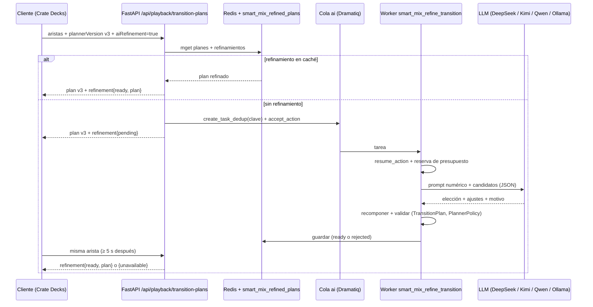

# Smart Mix 3 — Documento de diseño

> **Para agentes:** este documento fija el *qué* y el *por qué*. El *cómo* y el orden están en
> [2026-11-02-smart-mix-3-implementation-plan.md](2026-11-02-smart-mix-3-implementation-plan.md).
> Ninguna decisión marcada como **(pendiente SG0)** se implementa sin aprobación explícita de Diego.
> Nada de producción sin autorización específica.

**Fecha:** 2026-11-02. **Estado:** propuesta para revisión; no implementada.
**Base inspeccionada:** Crate `origin/main` en `a0fa13aaa` (release 3.1.2). Hay que revalidar rutas y números
de línea al empezar cada fase.

**Relación con otros planes:**
- **Crate Decks** ([diseño](2026-11-02-crate-decks-design.md), [plan](2026-11-02-crate-decks-implementation-plan.md)) es el primer cliente que consume esta capacidad (Decks F6b). Todo lo de servidor está aquí; en el plan de Decks solo queda lo del cliente.
- **Smart Mix v2** (`docs/technical/smart-mix-design.md`, `-implementation-plan.md` y `-operations.md`) es la base. Este plan no rompe su contrato: los clientes de v2 (Android, Listen y el plugin de VDJ) siguen funcionando sin cambios.

---

## 1. Objetivo

Smart Mix 3 añade tres cosas:

1. **Análisis estructural de las pistas:** frases, curva de energía y, opcionalmente, presencia de voz. El planner determinista lo usa para mezclar por estructura y no solo contando compases.
2. **Planner `smart-mix-v3`:** sobre esa estructura genera un **menú de candidatos válidos** por transición y elige uno de forma determinista.
3. **AI Assisted Mixing:** un LLM configurado por el admin (DeepSeek, Kimi, Qwen en la nube o Qwen en local) recibe el análisis de las dos pistas y el menú de candidatos, y **elige y ajusta** dentro del menú.
   - El servidor valida la elección y guarda el plan refinado.
   - Los clientes que lo pidan (Crate Decks primero) reciben el plan refinado cuando está listo, y el determinista mientras tanto.

**Criterio de éxito:**
- La IA solo se activa por defecto si, en una evaluación a ciegas, las transiciones refinadas superan a las deterministas de `smart-mix-v3` en las métricas de §10 y en la escucha de Diego (SG3).
- Si no las supera, el análisis estructural y el planner v3 se quedan igualmente: mejoran Smart Mix para todos los clientes.

## 2. Qué existe hoy (origin/main)

### 2.1. Capa de IA (`app/crate/ai/`)

- **Proveedores:** `Literal["gemini", "deepseek", "ollama"]` (`ai/contracts.py:7`), con la misma lista cerrada en:
  - `ai/configuration.py:36`;
  - el CHECK de `db/schema_sections/ai_configuration_v120.py:10`;
  - la UI `ui/src/components/ai-models/AddProviderDialog.tsx:19-24`.
- **Orígenes:** Gemini y DeepSeek tienen origen fijo (`ai/discovery.py:35-38`, `ai/transport.py:29-32`). Ollama acepta una URL del admin, también en red privada; se bloquean metadatos y link-local (`discovery.py:51-66,106-121`). Se rechazan URLs base con ruta (`discovery.py:98`).
- **Acciones:** 11 cerradas, cada una con timeout y límite de salida (`ai/actions.py:36-161`). `ai_action_bindings` asocia acción, versión de perfil y conexión.
  - El patrón asíncrono es `accept_action` en la API y `resume_action` en el worker (`api/genres.py:253-261`, `worker_handlers/analysis.py:838-845`).
- **Transporte:** httpx en un subproceso que se puede matar, sin reintentos ni fallback, respuestas de 2 MB como máximo y timeout de 1–90 s (`ai/transport.py`, `contracts.py:48`).
  - DeepSeek: `/chat/completions` con `response_format=json_object`.
  - Ollama: `/api/chat` con `format=schema`.
  - El esquema JSON va en el prompt de sistema (`transport.py:221-225`).
- **Capacidades de modelo:** `structured_output`, niveles de razonamiento, ventana de contexto y máximo de salida (`contracts.py:53-72`). `validate_profile` rechaza modelos sin salida estructurada (`capabilities.py:201-202`).
- **Presupuesto** (`db/repositories/ai_usage.py`):
  - **Reserva previa** de entrada y salida máxima, con `max_concurrent` (2), `daily_calls` (1.000) y `daily_tokens` (1M) por conexión, e `idempotency_key`.
  - **Coste:** no se calcula (`estimated_cost` siempre nulo, sin manifiesto de precios).
- **Privacidad:** no se guarda ni el prompt ni la respuesta; el razonamiento se descarta y los errores son códigos cerrados.
- **Admin:** `ui/src/pages/AiModels.tsx`, con uso (`UsageChart.tsx`) y actividad.
- **Legado:** `app/crate/llm/provider.py` (litellm por variables de entorno) solo actúa si la configuración nueva no está activa.

### 2.2. Precedente: refinamiento de Music Paths

`music_paths_refinement.refine_music_path_with_llm` (`music_paths_refinement.py:31-102`):
- **Propuesta acotada:** el LLM propone sustituciones dentro de una lista de alternativas permitidas.
- **Revisión determinista:** `_apply_replacements` revisa cada una (confianza ≥ 0,55, IDs permitidos, anclas, género, artistas, `can_replace_path_track`).
- **Fallback:** ante cualquier fallo se queda la ruta determinista.
- **Caché:** 7 días, con una clave que incluye las huellas del prompt y del esquema.
- **Lo que no se copia:**
  - Llama al LLM **dentro de la petición HTTP** (tope de 8 s).
  - Envía títulos y artistas.
  - No tiene una versión de prompt explícita.

### 2.3. Smart Mix v2

- **Planner:** `smart_mix/planner.py:144-263` (`plan_transition`).
- **Política:** `smart_mix/policy.py:40-90` (`smart-mix-v2`, `rules_revision=7`):
  - tempo con confianza ≥ 0,75 y estabilidad ≥ 0,80, ajuste máximo 0,04 (duro 0,06);
  - transiciones de 1–12 s, o beatmatch largo de hasta 48 s con estabilidad ≥ 0,90;
  - ganancia ±6 dB y true peak combinado ≤ −1 dBFS.
- **`TransitionPlan`** (`smart_mix/models.py:337-407`): valida el rango de tempo 0,94–1,06, `curve ∈ {equal-power, dj-blend}` y `bass_handoff ∈ {none, balanced}`.
- **Intercambio de bajos:** sujeto a `allowBassHandoff` y a `CRATE_ANDROID_BASS_HANDOFF_ENABLED` (`api/smart_mix.py:447-448`).
- **Perfiles** (`models.py:130-178`, tabla `track_mix_profiles` en `db/schema_sections/library_catalog.py:328`):
  - **Contienen:** BPM y confianzas, beat y downbeat ancla, compás, grid completo (`delta-ms-v1`), tonalidad y Camelot. De intro y outro: cue, BPM, beat, downbeat, estabilidad, LUFS, energía y densidad espectral. Del conjunto: energía, danceability, valence, LUFS integrado y true peak.
  - **No contienen:** frases ni secciones, curva de energía ni voz. "Frase" solo es la heurística de compases (32/16/8) del planner (`planner.py:532-565`).
- **Doble analizador:** Python (`smart_mix/analyzer.py:54`, `analyze_mix_profile`) y Rust (`tools/crate-cli/src/mix_profile.rs`), con test de paridad (`app/tests/test_smart_mix_rust_parity.py`).
- **Versiones** (`smart_mix/versions.py`): `API_CONTRACT_VERSION="2026-08"`, `PROFILE_SCHEMA_VERSION=1`, `ANALYZER_VERSION="smart-mix-audio-v5"`.
- **API:** `POST /api/playback/transition-plans` (`api/smart_mix.py:327-378`), de 1 a 32 aristas, con `plannerVersion: Literal["smart-mix-v2"]`.
  - **Caché:** L1 en memoria (5 min) más Redis `cache:smart-mix:transition-plan:v1:<sha>` (6 h, `mget` en lote).
  - **Rendimiento:** p95 < 50 ms en caché y < 150 ms sin caché.
- **Tareas:** `compute_smart_mix_profile` (heavy), `backfill_smart_mix_profiles` (heavy) y `refresh_smart_mix_coverage` (maintenance) (`actors.py:187-189`). Las tareas de IA existentes van a `maintenance` (`actors.py:192,241`).

## 3. El límite real del LLM

El LLM no oye el audio: razona sobre números. Con los perfiles actuales aportaría poco frente al planner
determinista, porque le falta lo que un DJ usa para decidir: dónde empieza y acaba cada frase, cómo evoluciona
la energía y dónde hay voz.

Por eso el orden es:
1. Estructura.
2. Planner v3 con candidatos.
3. Evaluación del determinista.
4. Solo entonces, el LLM.

Si el LLM no mejora el resultado (SG3), no se activa, y el trabajo de estructura y v3 no se pierde.

**Dónde puede aportar un LLM sobre buenos datos:**
- Elegir entre candidatos igualmente válidos según convenciones de género: mezclas largas en techno, cortes en hip-hop, double drop en drum & bass.
- Respetar el arco de energía del set (contexto de las transiciones anteriores).
- Evitar choques de voces.
- Explicar la decisión en una frase.

## 4. Decisiones

**SM3-D1. El LLM elige y el motor garantiza.**
- **El LLM no escribe milisegundos, ratios ni ganancias.**
- **Elige** un candidato del menú por índice y, como mucho, aplica ajustes discretos: desplazar la entrada o la salida una frase (−1, 0, +1) o cambiar la longitud a la siguiente o la anterior permitida.
- **Devuelve** un motivo (≤ 240 caracteres), una confianza de 0 a 1 y hasta 4 notas cortas.
- **El servidor** recompone el plan desde el candidato y los ajustes, y lo vuelve a validar con `TransitionPlan` y `PlannerPolicy`.
- **Por qué:**
  - Elimina posiciones inventadas fuera del grid.
  - Hace la evaluación comparable: el espacio de decisión del LLM y del determinista es el mismo.
  - Reutiliza el patrón ya probado en Music Paths.

**SM3-D2. Primero, análisis estructural.** (pendiente SG0)
- **Qué se añade al perfil de mezcla:**
  - **Frases:** límites cada 8, 16 o 32 compases sobre los downbeats. Cada frase lleva su posición en beats y ms, su longitud en compases, su energía media y su cambio respecto a la anterior, y un tipo heurístico (`intro`, `build`, `peak`, `break`, `outro`, `body`).
  - **Curva de energía:** un valor por compás, cuantizado a 8 bits.
  - **Presencia de voz por frase (opcional y aparte):** la calcula un modelo pequeño de audio (SM3-D13). La heurística espectral que se probó primero no alcanzó §10 y se quedó apagada en SG1. Sigue sin meterse un modelo de separación de fuentes en el camino del análisis.
- **Implementación:**
  - En Python y en Rust, con paridad comprobada como hoy.
  - `ANALYZER_VERSION` pasa a `smart-mix-audio-v7` (S8 de Crate Decks ya usó v6) y `PROFILE_SCHEMA_VERSION` a 2.
  - El backfill reutiliza `backfill_smart_mix_profiles` (cola heavy).
  - Los perfiles v1 siguen siendo válidos: v3 degrada a la heurística de compases si no hay estructura.

**SM3-D3. Planner `smart-mix-v3` con menú de candidatos.**
- **Qué hace:** `plan_transition_candidates` genera de 4 a 8 candidatos válidos por arista, combinando frase de salida, frase de entrada, longitud (8, 16 o 32 compases, dentro de la política), intercambio de bajos sí o no y curva. Ordena con una puntuación determinista que tiene en cuenta la estructura.
- **El plan v3** es el primer candidato. `smart-mix-v2` se mantiene sin cambios y es el valor por defecto de la API hasta que los clientes migren.
- **Contrato:**
  - La API acepta `plannerVersion: "smart-mix-v2" | "smart-mix-v3"`.
  - `API_CONTRACT_VERSION` pasa a `"2026-11"`.
  - La política se copia en `smart-mix-v3` con su propio `rules_revision`; los límites de seguridad (tempo, ganancia, true peak) **no cambian**.

**SM3-D4. Refinamiento siempre asíncrono.**
- **La API** de transition plans sigue siendo determinista y rápida.
- **Si el cliente lo pide** (`context.aiRefinement=true`) y la capacidad está disponible, la respuesta incluye `refinement.status`:
  - `ready`, con el plan refinado si ya está en caché o en tabla;
  - `pending`, si se ha encolado;
  - `unavailable`, con un motivo cerrado: desactivado, presupuesto, sin perfil o sin modelo.
- **Encolado:** con `create_task_dedup`, deduplicado por la clave de refinamiento (SM3-D5), con `accept_action` en la API y `resume_action` en el worker, y `max_retries=0` porque es trabajo de pago.
- **Recogida:** el cliente vuelve a pedir la misma arista (lectura en caché, p95 < 50 ms), como mucho cada 5 s por arista, hasta `ready` o `unavailable`. Un evento SSE `smart_mix.refinement_ready` en `/api/cache/events` queda como mejora (SM6), no como requisito.
- **Nunca** se llama al LLM dentro de una petición HTTP.

**SM3-D5. Almacenamiento y clave.**
- **Clave de refinamiento:** `sha256(planner_identifier, rules_revision, from_profile_revision, to_profile_revision, contexto normalizado, prompt_version, schema_fingerprint, config_fingerprint de la acción)`. El `config_fingerprint` cambia al cambiar de modelo o perfil.
- **Tabla nueva `smart_mix_refined_plans`** (§6) como fuente de verdad, más caché Redis `cache:smart-mix:refined-plan:v1:<key>` leída en el mismo `mget` en lote que los planes.
- **Una transición se paga una vez** por combinación de perfiles y configuración.
- **Retención:** 180 días sin lecturas, con limpieza en maintenance.

**SM3-D6. Minimización de datos.**
- **Se envían solo números y etiquetas estructurales:** BPM, confianzas, Camelot, energía, danceability, valence, LUFS, frases, curva de energía submuestreada y candidatos.
- **Nunca** se envían títulos, artistas, álbumes, rutas, `entity_uid`, usuario ni IP.
- **El género** (slug de la taxonomía) solo si el admin lo permite en el binding de la acción. Por defecto se envía, porque sin él no hay convenciones de género. En la UI se explica qué sale.
- **Contexto de set:** las 3 transiciones anteriores, solo como números (modo, longitud, Δ energía).

**SM3-D7. Proveedor `openai_compatible`.** (pendiente SG2)
- **Para qué:** para usar Kimi (Moonshot), Qwen en la nube (DashScope internacional), OpenRouter y vLLM o LM Studio locales, se añade un tipo de proveedor `openai_compatible`:
  - **Origen:** HTTPS con un prefijo de ruta (`/v1`, `/compatible-mode/v1`, `/api/v1`), con fijado de dirección como Ollama si es privado.
  - **Plantillas de origen predefinidas** para Moonshot, DashScope internacional y OpenRouter. Un origen arbitrario requiere confirmación del admin.
  - **Manifiesto de modelos declarado por el admin** (contexto, salida máxima, `structured_output: json_object | json_schema`, controles de razonamiento), porque `/v1/models` no trae esos metadatos.
  - **Usage** normalizado (`prompt_tokens`, `completion_tokens`, `reasoning_tokens`).
- **Controles de razonamiento por proveedor:**
  - DeepSeek: `thinking`.
  - Qwen: `enable_thinking`.
  - Kimi: `reasoning_effort` o el modo del modelo.
- **Sin cambiar las reglas de la capa de IA:** ni reintentos ni fallback de transporte, igual que hoy.
- **Disponibilidad hoy:** DeepSeek y Ollama (Qwen en local) funcionan sin este cambio. SM3 puede salir con ellos y añadir `openai_compatible` como mejora independiente.

**SM3-D8. Cola `ai` propia para toda la inferencia.** (decidido por Diego, 2026-11-02; el reparto en carriles, pendiente SG0)
- **Regla:** toda operación que llame a un proveedor de IA va a la familia de colas `ai`.
  - Incluye inferencia y también el catálogo de modelos (`ai_catalog_refresh`).
  - **Ninguna llamada a un modelo se hace dentro de una petición HTTP.**
  - **Ninguna tarea de IA se ejecuta en `fast`, `default`, `heavy` ni `maintenance`.**
- **Por qué:**
  - Aísla la latencia variable (5 s–2 h) y los límites de los proveedores del resto del trabajo.
  - Da un único sitio para dimensionar concurrencia y ver la cola en el admin.
  - Cumple la regla del monorepo de no hacer trabajo pesado en un request.
- **Dos carriles** (recomendado):
  - **`ai`, interactivo y corto:** refinamiento de Smart Mix, propuesta de EQ, descripción de playlist, refinamiento de Music Paths, candidatos de hero, borrador i18n, investigación de bio y extracción de un cartel. Tiene un `time_limit_seconds` de 300 s como máximo.
  - **`ai_bulk`, por lotes y largo:** `infer_genre_taxonomy`, `rebuild_genre_taxonomy_proposals`, `enrich_genre_descriptions`, `ai_catalog_refresh` y cualquier backfill futuro.
  - **Motivo del reparto:** las tareas de taxonomía duran hasta 2 h (`actors.py:192-194`). En una cola única ocuparían los hilos y el refinamiento de Smart Mix (que necesita respuesta en segundos) se quedaría sin servicio.
  - **Despliegue:** ambos los consume `crate-worker`, cada uno con su propio pool de hilos. `CRATE_AI_WORKER_THREADS` vale 2 por defecto y `CRATE_AI_BULK_WORKER_THREADS` vale 1.
- **Concurrencia por proveedor:** el `max_concurrent` de cada conexión (`ai_usage.reserve_invocation`) sigue siendo el límite real. Si la reserva se rechaza por concurrencia, la tarea **se vuelve a encolar con retraso** (no es un reintento de transporte, porque no se ha transmitido nada) en lugar de fallar.
- **Prioridad:** dentro de `ai`, las aristas próximas de AutoDJ y las acciones lanzadas por una persona van antes que los precalentados. Comprueba en SMQ cómo respeta el broker la prioridad de `TaskPoolConfig`. Si no la respeta, el carril interactivo se queda solo con trabajo de prioridad alta.
- **Inventario actual** (`origin/main` `a0fa13aaa`) y su destino (plan SMQ):

| Operación | Hoy | Acción | Destino |
|---|---|---|---|
| `infer_genre_taxonomy` | tarea, `maintenance` (3.600 s) | `genres.description.generate` / taxonomía | `ai_bulk` |
| `rebuild_genre_taxonomy_proposals` | tarea, `maintenance` (7.200 s) | `genres.taxonomy.propose` | `ai_bulk` |
| `enrich_genre_descriptions` | tarea, `maintenance` | `genres.description.generate` (verificar) | `ai_bulk` |
| `ai_catalog_refresh` | tarea, `maintenance` | catálogo de proveedores | `ai_bulk` |
| `research_artist_bio` | tarea, `default` | `artists.bio.research` | `ai` |
| `draft_i18n_translation` | tarea, `maintenance` | i18n | `ai` |
| `show_extract` | tarea, `maintenance` | `shows.extract.*` | `ai` |
| Propuesta de EQ (`api/genres.py:1101`) | **síncrono en HTTP** | `genres.eq.propose` | tarea en `ai` + polling |
| Descripción de playlist (`api/system_playlists.py:766`) | **síncrono en HTTP** | `playlists.description.generate` | tarea en `ai` + polling |
| Refinamiento de Music Paths (`music_paths.py:62`) | **síncrono en HTTP** (8 s) | `music_paths.refine` | tarea en `ai`; la ruta determinista se devuelve al momento (pendiente SG0, cambia la UX) |
| Candidatos de hero (`api/artwork.py:705`) | síncrono en HTTP (verificar si llama al modelo) | `artwork.hero.analyze` | tarea en `ai` si llama al modelo |
| Refinamiento de Smart Mix (nuevo) | — | `smart_mix.transition.refine` | `ai` |

- **Garantía:** un test de arquitectura impide que vuelva a aparecer una llamada a un modelo fuera de un handler de la familia `ai` (SMQ.PR1).

**SM3-D9. Capacidad anunciada.**
- **`GET /api/capabilities` → `smart_mix`** gana:
  - `planner_versions: ["smart-mix-v2", "smart-mix-v3"]`;
  - `structure: bool`, que indica si hay perfiles v2 suficientes;
  - `ai_assisted`, con:
    - `available`;
    - `provider_kind` (`cloud` o `local`);
    - `model_label` (texto de presentación, sin secretos);
    - `prompt_version`;
    - `typical_latency_ms` (p50 de las últimas 24 h);
    - `reason` si no está disponible.
- **Cálculo:** desde `runtime.action_availability("smart_mix.transition.refine")` (`ai/runtime.py:39-70`) y el ajuste `smart_mix_ai_enabled`.
- **Uso por los clientes:** deciden si muestran la opción. Crate Decks la muestra; Android, Listen y VDJ pueden adoptarla después sin cambios de servidor.

**SM3-D10. Activación en tres niveles.**
1. **Admin:** ajuste `smart_mix_ai_enabled` (apagado por defecto) más binding de la acción con un modelo.
2. **Cliente:** opción del usuario ("AI Assisted Mixing").
3. **Petición:** `context.aiRefinement=true`.

Solo hay refinamiento si los tres están activos. El admin puede limitar la acción a usuarios con un permiso nuevo `smart_mix.ai` (por defecto, todos los que tienen `library.view`).

**SM3-D11. Proveedores chinos, jurisdicción y modelo local.**
- **Proveedores admitidos:** DeepSeek y Kimi procesan bajo jurisdicción china; Qwen en la nube, según la región de DashScope (internacional en Singapur). Se pueden usar, pero:
  - con la minimización de SM3-D6;
  - con un aviso de jurisdicción en la UI al asignar un proveedor cloud a esta acción, que el admin confirma una vez y que queda registrado en la configuración.
- **Recomendación por defecto:** Qwen3.8-27B (Apache 2.0) en Ollama local. Nada sale del servidor, el coste por llamada es cero y encaja con un Crate autoalojado.
- **Para quien quiera la mejor calidad:** DeepSeek o Kimi; se decide con los datos de SM5.

**SM3-D12. Evaluación antes de activar.** (SG3)
- Hay un arnés de evaluación offline desde la primera fase (SM0). Mide v2, v3 determinista y v3 + IA sobre el mismo conjunto de aristas.
- La IA se activa por defecto solo si mejora las métricas de §10 sin violaciones y pasa la escucha a ciegas de Diego.

**SM3-D13. Voz por frase con un modelo pequeño de audio.** (decidido por Diego en SG1, 2026-11-04; el modelo concreto, pendiente SG1b)
- **Por qué:** la heurística espectral de SM1.PR4 marcó como voz 13 de 322 frases en 28 pistas spike. No encontró voz en pistas claramente cantadas (Boy Harsher, Joy Division, Marilyn Manson). Diego la dejó apagada sin etiquetar.
- **Qué hace:** un clasificador de audio puntúa ventanas cortas de cada frase con sus clases de voz cantada o hablada. El byte de la frase es la fracción de ventanas con voz (0–255). `vocal_presence` sigue siendo un byte por frase, y nulo si no hay frases o no hay modelo.
- **Candidatos**, medidos en SMV.PR1:
  - **YAMNet** (AudioSet, unos 3,7 M de parámetros, Apache-2.0): el pequeño de referencia, con clases de canto, habla y rap. Pesos del repositorio original para conservar la licencia.
  - **PANNs CNN14** (AudioSet): ya va en la imagen del worker de análisis para mood y energía, así que no añade modelo ni licencia, pero es grande (unos 80 M de parámetros) y más lento.
  - **Voz/instrumental de Essentia** (MusiCNN o EffNet-Discogs): pequeño y entrenado para esto, pero con licencia CC BY-NC-SA 4.0, no comercial. Solo entra si Diego acepta esa licencia. El proyecto ya retiró de la imagen los clasificadores de Essentia.
- **Dónde corre:** en el worker de análisis, como paso de Python después del perfil, venga de Rust o de Python, sobre las frases ya calculadas. No toca la paridad Python/Rust. Si el modelo no está en la imagen (ARM sin runtime), `vocal_presence` queda nulo. Si la voz falla, el perfil se guarda sin ella.
- **Aceptación:** la de §10, frente a las frases etiquetadas a mano. El umbral de cada modelo se elige con validación cruzada sobre ese conjunto, no sobre todo él.
- **Lo usan:** la métrica de choque de voces (§10), el prompt (§8) y una penalización en la puntuación de candidatos de v3 (SM3-D3) cuando las dos frases que se solapan tienen voz.
- **Versión:** la voz entra en `smart-mix-audio-v7`, que aún no está desplegado, para que el backfill final la calcule en la misma pasada. Si SG1b dice que ningún modelo vale, v7 se despliega sin voz. Si cuando llegue ya hay perfiles v7 fuera de desarrollo, sube a v8.

## 5. Arquitectura

## 6. Datos

**Perfil de mezcla, schema 2** (columnas nuevas en `track_mix_profiles`, todas nulas en perfiles v1):

| Columna | Tipo | Contenido |
|---|---|---|
| `phrases` | `jsonb` | `[{start_beat, start_ms, bars, energy, delta_energy, kind}]`, con 120 frases como máximo |
| `energy_curve` | `bytea` | Un byte por compás (energía 0–255), con un máximo de 2.048 compases |
| `vocal_presence` | `bytea` o nulo | Un byte por frase (0–255) del modelo de voz (SM3-D13); nulo sin modelo o sin frases |
| `vocal_detector` | `text` o nulo | Modelo y versión que calcularon la voz, por ejemplo `yamnet-1`; nulo si no hay voz |
| `structure_confidence` | `real` | Confianza global de la segmentación |

**Tabla `smart_mix_refined_plans`:**

| Columna | Tipo | Notas |
|---|---|---|
| `refinement_key` | `text` PK | SM3-D5 |
| `from_entity_uid`, `to_entity_uid` | `uuid` | Índice compuesto, para invalidar cuando cambia un perfil |
| `from_profile_revision`, `to_profile_revision` | `int` | |
| `planner_identifier`, `rules_revision` | `text`, `int` | |
| `prompt_version`, `config_fingerprint` | `text` | |
| `model_label` | `text` | Solo presentación |
| `status` | `text` | `ready`, `rejected` (la validación lo descartó) o `failed` |
| `candidate_index`, `adjustments` | `int`, `jsonb` | Lo que eligió el LLM |
| `plan` | `jsonb` | Plan recompuesto y validado (solo si `ready`) |
| `deterministic_plan_hash` | `text` | Para medir cuánto difiere |
| `reason`, `confidence` | `text`, `real` | Motivo ≤ 240 caracteres |
| `latency_ms`, `input_tokens`, `output_tokens` | `int` | Para el arnés y la capacidad |
| `created_at`, `last_read_at` | `timestamptz` | Retención (SM3-D5) |

No se guarda el prompt ni la respuesta cruda, igual que el resto de la capa de IA.

## 7. Contrato de API

**Petición** (`POST /api/playback/transition-plans`):
- `plannerVersion`: `"smart-mix-v2"` (por defecto) o `"smart-mix-v3"`.
- `context.aiRefinement`: `bool` (por defecto `false`); solo tiene efecto con v3.
- `context.setHistory`: hasta 3 objetos `{mode, durationBars, deltaEnergy}` (opcional; mejora el arco de energía).

**Respuesta**, por plan:
- Los campos actuales sin cambios, más `structureUsed: bool`.
- `refinement` (solo si se pidió):
  - `status`: `ready`, `pending` o `unavailable`;
  - `reasonCode`, si es `unavailable`;
  - `plan` (`TransitionPlan`), `source: "ai"`, `modelLabel`, `reason`, `confidence`, `promptVersion` y `candidateIndex`, si es `ready`.

**Compatibilidad:** los clientes de v2 no ven ningún cambio. Se regeneran `/openapi-app.json` y `/openapi-crate.json`.

**Acceso:**
- Sesiones de usuario con `library.view` y el permiso `smart_mix.ai` (SM3-D10).
- Tokens `crv_` con `vdj.smart_mix.read`: pueden leer v3, pero `aiRefinement` exige además el alcance nuevo `vdj.smart_mix.ai`, para que el plugin de VDJ no dispare gasto sin que el usuario lo autorice al crear el token.

## 8. Prompt y esquema

**Módulo:** `app/crate/llm/prompts/smart_mix_transition.py`, con `PROMPT_VERSION = "sm3-refine-1"`.

**Entrada** (JSON compacto, 3–6 K tokens):
- `outgoing` e `incoming`:
  - BPM y confianzas, Camelot, energía, danceability, valence y LUFS;
  - las frases alrededor de la ventana de mezcla (las 6 últimas de la saliente y las 6 primeras de la entrante);
  - la curva de energía de esas frases, a 1 valor por compás;
  - la voz por frase, si existe.
- `genre`: el slug de la taxonomía de cada pista, si está permitido (SM3-D6).
- `setHistory`: el contexto de set de §7, si llega.
- `candidates`: de 4 a 8 candidatos, cada uno con:
  - índice;
  - frase de salida y de entrada (índices sobre las listas anteriores);
  - longitud en compases, modo e intercambio de bajos;
  - curva, Δ tempo y la puntuación determinista con su desglose.

**Salida** (Pydantic, `extra="forbid"`):
- `candidate_index`: int del menú.
- `outgoing_phrase_shift` e `incoming_phrase_shift`: −1, 0 o 1.
- `length_step`: −1, 0 o 1, hacia la longitud permitida anterior o siguiente.
- `bass_handoff`: `"keep"`, `"none"` o `"balanced"`.
- `reason`: str, ≤ 240 caracteres.
- `confidence`: 0–1.
- `notes`: ≤ 4 cadenas de ≤ 120 caracteres.

**Prompt de sistema:**
- Explica la tarea como un DJ que elige entre opciones válidas, y deja claro que no puede inventar valores.
- Incluye las convenciones de género como guía, sin reglas duras.
- Pide la respuesta en JSON con el esquema.

## 9. Validación determinista

`smart_mix/refinement.py::apply_refinement(candidates, response, profiles, policy)`:
1. El `candidate_index` existe.
2. Los desplazamientos caen dentro de las frases disponibles y la longitud resultante está permitida por la política (8, 16 o 32 compases, y como mucho 48 s en beatmatch largo con estabilidad ≥ 0,90).
3. Se recompone el plan con el mismo código que genera los candidatos y se construye `TransitionPlan`, que valida tempo, curva y bajos.
4. `PlannerPolicy` valida duraciones, cuerpos mínimos, ganancia ±6 dB y true peak ≤ −1 dBFS.
5. Si `bass_handoff` pide `balanced`, solo vale si el contexto lo permite. Para Crate Decks, lo controla la capacidad de decks del plan de Decks (S5).
6. Confianza mínima de 0,55 (igual que Music Paths).
7. Cualquier fallo → `status=rejected`: el cliente se queda con el plan determinista y la razón se registra como código cerrado.

## 10. Evaluación

**Conjunto:**
- 300 aristas reales generadas con el planner de compatibles sobre la biblioteca de desarrollo (`test-music/`), estratificadas por género y por Δ BPM.
- Un conjunto mayor sobre la biblioteca de producción solo con autorización explícita de Diego.

**Métricas objetivas** (calculadas desde el plan y los perfiles, sin audio):

| Métrica | Definición | Objetivo de v3 + IA frente a v3 determinista |
|---|---|---|
| Violaciones de política | Planes que no pasan la validación de §9 | 0 (son rechazos y se cuentan aparte) |
| Alineación de frases | % de transiciones cuyo inicio y fin caen en límite de frase | ≥ igual |
| Solape de graves | ms con los dos bajos a nivel completo | ≤ igual |
| Choque armónico | ms de solape con tonalidades no compatibles | ≤ igual |
| Continuidad de energía | Δ de energía entre la frase de salida y la de entrada | Más suave o igual |
| Choque de voces (si hay detector) | ms de solape voz con voz | ≤ igual |
| Tasa de rechazo | % de respuestas rechazadas por la validación | ≤ 10 % |
| Latencia | p50 y p95 por modelo | p95 ≤ 30 s en cloud y ≤ 20 s en local |
| Coste | Tokens por transición y coste estimado con el precio público del día | Informativo |

**Escucha a ciegas (SG3):**
- 30 pares renderizados offline: v3 frente a v3 + IA, en orden aleatorio y sin etiqueta.
- **Render:** script de evaluación con FFmpeg, siguiendo el plan (cues, ratio, ganancia, curva y bajos). Vive en `tools/smart-mix-eval/`, fuera del camino de producción.
- **Criterio:** Diego puntúa del 1 al 5; la IA tiene que ganar o empatar en ≥ 60 % de los pares sin que ninguno sea peor que 2.

**Detector de voz:** precisión ≥ 0,8 y recall ≥ 0,7 frente a al menos 100 frases etiquetadas a mano (`tools/smart-mix-eval/vocals_labels.csv`). Si ningún modelo de SM3-D13 lo alcanza, la voz se omite.

## 11. Presupuestos

| Área | Presupuesto |
|---|---|
| API de transition plans | Sin cambio: p95 < 50 ms en caché y < 150 ms sin caché. Los refinamientos se leen en el mismo `mget`; ninguna consulta extra a PostgreSQL en el camino caliente salvo un fallo de caché, que es una lectura por clave primaria `ANY(:keys)` |
| Análisis estructural | ≤ 10 % más de tiempo que `smart-mix-audio-v6` por pista; el backfill en cola heavy no compite con la reproducción |
| Voz por frase | El tiempo de CPU por pista que apruebe Diego en SG1b con la medición de SMV.PR1, aparte del presupuesto anterior |
| Familia `ai` | `ai`: 2 hilos por defecto, ≤ 300 s por tarea, espera en cola p95 ≤ 5 s para refinamientos de Smart Mix con la conexión libre. `ai_bulk`: 1 hilo y lotes largos. Ninguna tarea de IA en `fast`, `default`, `heavy` ni `maintenance`; ninguna llamada a modelo en HTTP |
| Coste | Estimación: 3–6 K tokens de entrada y ~500 de salida por transición; con modelos tipo `deepseek-flash`, del orden de $0,001 por transición antes de caché. Verificar precios oficiales al configurar; cambiaron varias veces en 2026. Los presupuestos diarios de la conexión (llamadas y tokens) se respetan |
| Base de datos | Una fila por refinamiento; índice por `(from_entity_uid, to_entity_uid)` para invalidar; limpieza a 180 días sin lectura |

## 12. Riesgos

| Riesgo | Impacto | Mitigación |
|---|---|---|
| El LLM no mejora al determinista | Trabajo de IA sin valor | Estructura y v3 primero (útiles por sí mismos); SG3 decide; menú de candidatos para que el coste de probar sea bajo |
| Segmentación de frases mala en géneros sin compás regular | Candidatos malos | `structure_confidence`; por debajo del umbral, v3 usa la heurística de v2 |
| Latencia de modelos de razonamiento | Refinamientos tarde | Razonamiento bajo por defecto; petición anticipada desde el cliente; el determinista siempre está |
| Saturación de colas | Trabajo interactivo lento | Familia `ai` aislada, con carril `ai_bulk` para los lotes largos (SM3-D8) |
| Migrar las llamadas síncronas cambia la UX del admin y de Music Paths | Pantallas que esperaban la respuesta en la misma petición | Una PR por operación, con estado `pending` y polling o SSE en la UI; Music Paths devuelve la ruta determinista al momento y se actualiza al llegar el refinamiento (decisión en SG0) |
| Coste descontrolado | Factura | Reserva previa existente, límites diarios, caché por combinación, `aiRefinement` explícito por petición |
| Privacidad o jurisdicción | Datos fuera del servidor | Solo números (SM3-D6), aviso y confirmación del admin, local por defecto (SM3-D11) |
| Paridad Python/Rust en el análisis nuevo | Perfiles distintos según el camino | Extender `test_smart_mix_rust_parity.py` y los tests de `tools/crate-cli` antes del merge |
| Ningún modelo de voz alcanza §10 con voces distorsionadas o sintes en la banda de la voz | Sin voz por frase | La voz se queda apagada; v3 y el refinamiento funcionan sin ella (SM3-D13) |
| La voz alarga el backfill final | Más horas de CPU en la cola heavy | Medir en SMV.PR1; si no cabe, muestrear ventanas dentro de cada frase; decide SG1b |
| Proveedor `openai_compatible` como vector de SSRF | Seguridad | Plantillas de origen, confirmación de orígenes arbitrarios, fijado de dirección como Ollama, sin redirecciones; revisión en SG2 |
| Cambios de ID de modelo (Moonshot retira alias) | Acción rota | Manifiesto declarado con IDs fijos; `ai_catalog_refresh` avisa en el admin si desaparece |

## 13. Gates humanos

| Gate | Cuándo | Qué decide Diego |
|---|---|---|
| SG0 | Antes de SM1 | Este diseño: estructura primero, menú de candidatos, minimización y activación en tres niveles. Familia `ai` ya decidida; se confirman los carriles `ai`/`ai_bulk` y la UX asíncrona de Music Paths |
| SG1 | Tras SM1 | Calidad de la segmentación (revisión visual en el admin sobre 30 pistas variadas) y si se incluye el detector de voz. Decidido el 2026-11-04: la heurística se queda apagada y la voz pasa a un modelo (SM3-D13) |
| SG1b | Tras SMV.PR1 | Modelo de voz: candidato, licencia, coste por pista y precisión y recall frente a las frases etiquetadas |
| SG2 | Tras SM3 | Seguridad del proveedor `openai_compatible` y plantillas de origen |
| SG3 | Tras SM5 | Go/no-go de la IA con las métricas y la escucha a ciegas |
| SG4 | Tras SM6 | Activar por defecto y modelo recomendado; despliegue en producción con el proceso normal de release |

## 14. Fuera de alcance

- La implementación en los clientes: Crate Decks F6b en su plan; Android, Listen y VDJ más adelante.
- Que el LLM genere audio, efectos o automatizaciones fuera del `TransitionPlan`.
- Proveedores o claves por usuario: la configuración de IA es del admin.
- Fine-tuning, embeddings de audio o modelos multimodales que escuchen la pista.
- Planificar sets completos con LLM (ordenar pistas): solo se refina la transición entre dos pistas ya elegidas.
