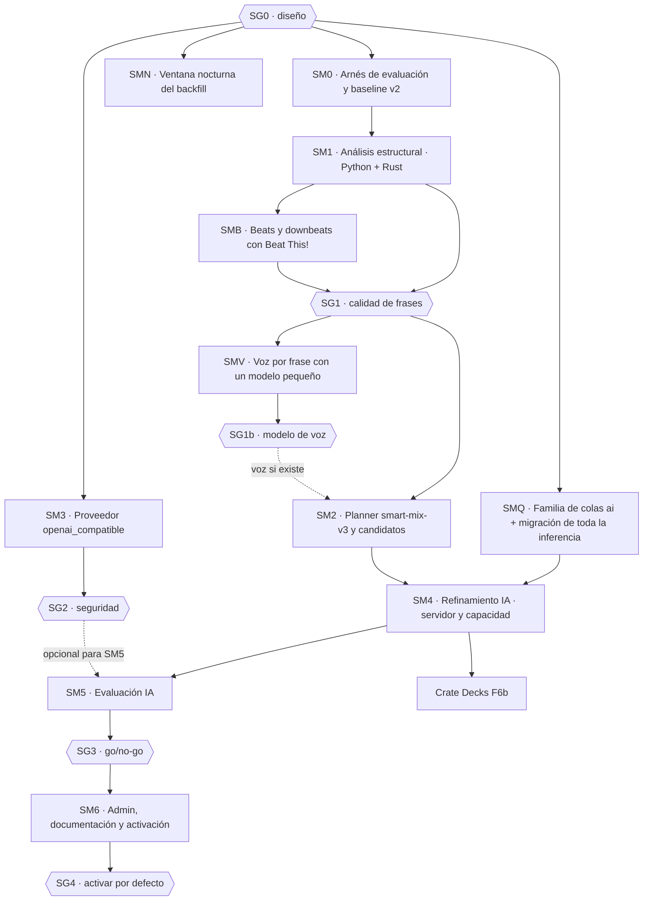

# Smart Mix 3 — Plan de implementación

> **Para agentes:** ejecuta las fases en orden. **No pases un gate humano (SG0–SG4, §13 del diseño) sin
> aprobación explícita de Diego.** Nada de producción sin autorización específica: los cambios se despliegan
> con el proceso normal de release de Crate y solo cuando Diego lo pida.
>
> Diseño: [2026-11-02-smart-mix-3-design.md](2026-11-02-smart-mix-3-design.md). Las decisiones se citan como
> SM3-D1…D15. Cliente que lo consume primero: Crate Decks F6b
> ([plan](2026-11-02-crate-decks-implementation-plan.md)).

**Fecha:** 2026-11-02. **Base:** `origin/main` en `a0fa13aaa` (3.1.2). La última migración es la 142: revalida
el *head* antes de numerar cada migración nueva.

---

## 0. Convenciones

- **Worktrees** desde `main`: `worktrees/sm3-<tema>`. Ramas `feat/sm3-<tema>`. Un PR por apartado `SMn.PRm`.
- **Reglas del monorepo (`AGENTS.md`):**
  - SQL solo en `app/crate/db/` (queries, repositories, jobs), sin `from crate.db import` fuera del paquete.
  - `read_scope` y `transaction_scope`.
  - `ANY(:ids)` y nada de agregados sobre `library_tracks` en requests.
  - Nada se reconstruye en un request.
- **Tareas (`app/crate/worker_handlers/AGENTS.md`):** idempotentes, con las claves de `TASK_HANDLERS` y `TASK_POOL_CONFIG` emparejadas, `max_retries=0` en trabajo de pago y `time_limit_seconds` realista.
- **IA (`docs/technical/ai-agents.md`):** reserva antes de transmitir, sin reintentos ni fallback de transporte, sin guardar prompt ni respuesta.
- **Tests:** pytest por función pública cambiada, PostgreSQL con `pg_db`, Rust con `cargo test` en `tools/crate-cli`, y frontend admin con Vitest y Testing Library.

  ```bash
  cd app && ../.venv/bin/python -m pytest tests/<fichero>.py -q
  cd tools/crate-cli && cargo test
  npm run --workspace=app/ui test -- <patrón>
  ```
- **Documentación canónica:** al cerrar cada fase, `docs/technical/smart-mix-design.md`, `-operations.md` y `ai-agents.md`. Notas de versión en `docs/releases/` cuando se publique.
- **Commits:** conventional commits sin atribución de IA; el cuerpo explica el porqué.

## Mapa de fases



| Fase | Resultado | PRs | Tamaño estimado |
|---|---|---|---|
| SM0 | Conjunto de aristas, métricas objetivas, render offline y baseline de v2 | 2 | 4–6 días |
| SM1 | Frases, curva de energía y voz opcional en Python y Rust; perfil schema 2; backfill | 4 | 10–15 días |
| SMV | Voz por frase con un modelo pequeño de audio (SM3-D13): medición de candidatos, voz en el análisis y en el perfil, y vista en el admin | 3 | 5–8 días |
| SMB | Beats y downbeats de Beat This! con DBN en Python y Rust, columna `beat_tracker`, señales guardadas por pista y nueva medición de SG1 (SM3-D14, SM3-D16) | 5 | 6–8 días |
| SMN | Ventana nocturna del backfill configurable en Admin (SM3-D15) | 1 | 2–3 días |
| SM2 | Planner v3 con menú de candidatos; la API acepta v3 | 3 | 7–10 días |
| SM3 | Proveedor `openai_compatible` (Kimi, DashScope, OpenRouter, vLLM) | 3 | 6–9 días |
| SMQ | Colas `ai` y `ai_bulk`, migración de todas las tareas de IA y paso a asíncrono de las llamadas síncronas en HTTP | 5–6 | 8–12 días |
| SM4 | Acción `smart_mix.transition.refine`, prompt, validación, cola `ai`, tabla, API `refinement` y capacidad | 4 | 10–14 días |
| SM5 | Evaluación de v3 frente a v3 + IA con varios modelos, e informe | 1 | 4–6 días |
| SM6 | Admin (binding, aviso de jurisdicción, estadísticas), SSE opcional, documentación y activación | 3 | 5–8 días |

SM3 es independiente: SM4 y SM5 funcionan con DeepSeek y Ollama sin ella. SMQ corre en paralelo a SM1–SM3 y tiene que estar terminada antes de SM4.

SMB y SMN tienen que llegar antes del backfill de v7. SMN no depende de v7 y sale de `main`, como SMQ.

SMV corre en paralelo a SM2. Tiene que llegar antes del despliegue de `smart-mix-audio-v7` y de su backfill final, para no pagar dos pasadas por la biblioteca (SM3-D13).

---

## SM0 · Arnés de evaluación y baseline

**Objetivo:** medir antes de cambiar nada. Cada fase posterior se compara con este baseline.

### SM0.PR0 · Calidad del análisis de base (S8 de Crate Decks)

**Por qué:** el spike de Crate Decks (2026-11-03, [informe](2026-11-03-crate-decks-spike-report.md)) comparó 10 perfiles `full` con los analizadores de Mixxx sobre los mismos ficheros. Smart Mix 3 planifica sobre esos mismos perfiles, así que hay que medirlos y corregirlos antes de que el baseline de SM0 los dé por buenos.

| Medida | Resultado |
| --- | --- |
| Grid frente al de Mixxx | Diferencias de 30 a 350 ms; ninguna pista dentro de 5 ms |
| BPM | Decimales que la pista no tiene (128,346 frente a 128); usado como tempo constante deriva casi medio segundo en 3 minutos |
| Fase | Algunas pistas van medio beat desplazadas |
| Tonalidad | Coincide con el detector de Mixxx (Queen Mary) en 3 de 10; el 81 % de todos los perfiles cae en 7B, 8A o 7A |
| `activeEndMs` | Cae entre 1 y 6 s antes que el final por silencio de Mixxx (−60 dB); es un final musical |

**Tareas:**

1. Cuantizar el BPM y comprobar la fase del grid frente a los onsets.
2. Encontrar la causa del sesgo de tonalidad: preprocesado, perfil de tonalidades o mapeo a Camelot.
3. Documentar en el contrato qué significan `activeEndMs` y `beatPhaseOffsetMs`. El spike aplicó este último al revés hasta leer `NativeTransitionPlan.startIncomingCueMs()`.

**Hecho (2026-11-03):** rama `feat/decks-s8-analysis-quality` del monorepo, analizador `smart-mix-audio-v6` en Rust y en el respaldo Python.

| Causa en v5 | Arreglo en v6 |
| --- | --- |
| Tonalidad: sumaba bins de FFT de 2048 puntos (10,77 Hz) desde 20 Hz. Por debajo de unos 180 Hz un bin es más ancho que un semitono, y el bombo y el bajo se leían como fa | FFT de 8192 puntos sobre bandas de semitono de la1 a sol#6, normalizadas para que ninguna clase de nota tenga más bins, y blanqueadas frente a las bandas vecinas |
| BPM con decimales: pendiente de índice de beat frente a tiempo, sin redondeo; cada vez que el detector se pasaba a los contratiempos ganaba o perdía un beat | Periodo ajustado al doble de la frecuencia de beat, para que un cambio de fase no lo deforme; grid constante si la pista mantiene el tempo; BPM entero o medio si encaja en 25 ms en toda la pista |
| Jitter de ±50 ms y secciones desplazadas medio beat: cada beat se movía a la subida de energía más cercana, y en mezclas densas caía en sonidos distintos según la sección | La mayoría de los beats detectados elige la fase. `full` solo si la fase es clara: con grid constante, al menos el 70 % de los beats en la fase publicada; sin él, ningún desplazamiento de medio beat |

| Medida | v5 | v6 |
| --- | --- | --- |
| Tonalidad donde Queen Mary y KeyFinder coinciden (36 pistas) | 8 % | 83 % |
| Tres tonalidades más frecuentes, sobre el total | 95 % | 27 % |
| BPM igual al de Mixxx en pistas de tempo entero (49) | 1 | 29 |
| Grid frente a Mixxx en las 10 pistas del spike (mediana del peor beat de cada pista) | 107 ms | 23 ms |
| Tiempo de análisis por pista | 1,17 s | 0,91 s |

- El grid de Mixxx va 20–30 ms adelantado respecto al golpe del bombo en las pistas electrónicas, así que "≤ 5 ms frente a Mixxx" no sirve como criterio.
- 14 de 83 perfiles pasan de `full` a `partial` por desplazamientos reales de medio beat (entre ellos, Ceremony y Crows). Diego confirma de oído en F0.4 qué fase de Ceremony es la buena.
- Desplegar v6 marca como desactualizados todos los perfiles v5. Recalcularlos es una campaña de backfill manual; hasta entonces, las reglas que exigen perfil `full` ven menos pistas.
- Pendiente: el respaldo Python sigue unos 17 ms por detrás del bombo, como en v5.

**Criterio de aceptación** (decidido por Diego, 2026-11-03), sobre un conjunto etiquetado a mano de al menos 30 pistas (house y techno con caja de ritmos, hip-hop, rock en directo y pistas con breaks), guardado solo por `entity_uid`. Por pista: BPM, 5 transitorios de beat marcados con el zoom máximo de la forma de onda, si el tempo es constante y la tonalidad de oído.
- **Grid:** en al menos el 90 % de las pistas de tempo constante, los 5 beats a 5 ms o menos. Las pistas de tempo entero dan exactamente ese BPM. Ningún perfil `full` tiene un beat etiquetado a más de un cuarto de beat.
- **Tonalidad:** acierto exacto y ponderado (MIREX) al menos iguales a los de KeyFinder sobre los mismos ficheros. Tras un backfill de al menos 1.000 pistas, ningún código Camelot pasa del 15 % (en v5, 7B tenía el 39,9 %).

**Mientras no esté:** Crate Decks deja los beats y la tonalidad a Mixxx y usa de Crate las cues, los planes y los compatibles.

### SM0.PR1 · Conjunto de aristas y métricas

**Punto de partida:** las herramientas con las que S8 midió v6, en la rama `feat/smart-mix-eval-tools` del monorepo (`tools/smart-mix-eval/reference/`): una referencia offline con el Queen Mary y el KeyFinder de Mixxx, `evaluate.py` y `kick_reference.py`.

| Fichero | Contenido |
|---|---|
| `tools/smart-mix-eval/README.md` | Qué mide, cómo se ejecuta y que nunca se lanza contra producción sin autorización |
| `tools/smart-mix-eval/labels/` | El conjunto etiquetado de SM0.PR0 (solo `entity_uid`, nunca títulos) y el script que puntúa un analizador contra él |
| `tools/smart-mix-eval/build_dataset.py` | Genera N aristas (por defecto 300) desde la biblioteca de la base de datos configurada, con el servicio de compatibles. Estratifica por género raíz y por Δ BPM (0–2 %, 2–4 %, 4–6 %) y guarda `dataset.jsonl` con los `entity_uid` y las revisiones de perfil (nunca títulos) |
| `app/crate/smart_mix/evaluation.py` | Métricas sobre plan y perfiles, sin audio: `phrase_alignment`, `bass_overlap_ms`, `harmonic_clash_ms`, `energy_step`, `vocal_clash_ms` (si hay datos) y `policy_violations`. Funciones puras, testeables y sin acceso a la base de datos |
| `tools/smart-mix-eval/run_eval.py` | Planifica el conjunto con un planner o variante, calcula las métricas y escribe `report.json` y `report.md` (medias, p50/p95 y diferencias por estrato) |

**Tests**, en `app/tests/test_smart_mix_evaluation.py`:
- `test_phrase_alignment_counts_boundaries`
- `test_bass_overlap_zero_without_handoff_overlap`
- `test_harmonic_clash_uses_camelot_compatibility`
- `test_energy_step_symmetric`
- `test_policy_violations_detects_out_of_range_plan`
- `test_metrics_are_pure` (sin acceso a la base de datos)

### SM0.PR2 · Render offline para escucha

- **Fichero:** `tools/smart-mix-eval/render_pair.py`.
  - A partir de un plan y las dos rutas de audio, genera con FFmpeg (filtros `atempo`, `volume`, `afade` y EQ de graves con `equalizer`) un WAV de 30–60 s alrededor de la transición.
  - Script de escucha a ciegas: `blind_session.py` baraja pares A/B, guarda la puntuación de 1 a 5 en `ratings.csv` y desvela al final.
- **Tests:** `tools/smart-mix-eval/tests/test_render_pair.py`, con `test_render_respects_cues_and_duration` (sobre tonos sintéticos, igual que `test_smart_mix_rust_parity.py`).
- **Baseline:** `run_eval.py --planner smart-mix-v2` sobre la biblioteca de desarrollo. Se adjunta `report.md` al PR.

---

## SM1 · Análisis estructural (SM3-D2)

### SM1.PR1 · Segmentación en Python

| Fichero | Contenido |
|---|---|
| `app/crate/smart_mix/structure.py` | `segment_phrases(beat_grid, downbeats, energy_frames, sample_rate) -> StructureDraft`. Novedad de energía y espectro por compás, con picos preferentes en múltiplos de 8 compases. Une y parte para que cada frase mida 8, 16 o 32 compases. Etiqueta el tipo con reglas sobre la energía relativa y la posición. Calcula `structure_confidence`. Curva de energía de 1 byte por compás |
| `app/crate/smart_mix/analyzer.py` | `analyze_mix_profile` llama a `segment_phrases` reutilizando los frames de energía que ya calcula |
| `app/crate/smart_mix/models.py` | `TrackMixProfileDraft` y el modelo de perfil ganan `phrases`, `energy_curve`, `vocal_presence` y `structure_confidence` |
| `app/crate/smart_mix/versions.py` | `ANALYZER_VERSION = "smart-mix-audio-v7"` (S8 ya usó v6) y `PROFILE_SCHEMA_VERSION = 2` |

**Tests**, en `app/tests/test_smart_mix_structure.py`, con pistas sintéticas generadas como en el test de paridad (clics más bloques de energía):
- `test_segments_on_eight_bar_multiples`
- `test_detects_break_and_peak_kinds`
- `test_low_confidence_on_irregular_meter`
- `test_energy_curve_one_byte_per_bar`
- `test_caps_phrase_count`
- `test_runtime_overhead_under_ten_percent` (marcado como benchmark y saltado en CI si no hay `--benchmark`)

### SM1.PR2 · Paridad en Rust

- `tools/crate-cli/src/structure.rs` y su integración en `mix_profile.rs`, con el mismo algoritmo y las mismas constantes.
- `tools/crate-cli/tests/smart_mix_structure.rs`: casos espejo de SM1.PR1.
- `app/tests/test_smart_mix_rust_parity.py`: compara `phrases` (límites ±1 beat), `kind` y `energy_curve` (±2 por byte) entre Python y Rust.

### SM1.PR3 · Persistencia y backfill

| Fichero | Contenido |
|---|---|
| `app/crate/db/migrations/versions/<NNN>_smart_mix_structure.py` | Columnas `phrases jsonb`, `energy_curve bytea`, `vocal_presence bytea`, `structure_confidence real` en `track_mix_profiles`, todas nulas |
| `app/crate/db/schema_sections/library_catalog.py` | Las mismas columnas en el DDL de referencia |
| `app/crate/db/repositories/` (el repositorio actual de perfiles; localizar con `grep -rn "track_mix_profiles" app/crate/db/repositories`) | Escritura y lectura de los campos nuevos. La lectura de planes solo carga `phrases` y `energy_curve` cuando el planner es v3 |
| Backfill | `backfill_smart_mix_profiles` (heavy) recalcula los perfiles con `ANALYZER_VERSION` antiguo, en lotes y con la prioridad actual. Sin cambios de cola |

**Tests:**
- `test_smart_mix_analysis_storage.py`, ampliado:
  - `test_persists_structure_fields`
  - `test_v1_profile_reads_with_null_structure`
- `test_smart_mix_migration.py`, ampliado: `test_structure_migration_up_down`.
- `test_smart_mix_backfill.py`, ampliado: `test_backfill_targets_old_analyzer_version`.

### SM1.PR4 · Detector de voz opcional y vista en el admin

- **Fichero:** `app/crate/smart_mix/vocals.py`.
  - Heurística espectral barata por frase: energía en 300–3.400 Hz frente al total, más la planitud espectral.
  - Solo se activa si alcanza el umbral de §10 del diseño sobre el conjunto etiquetado (`tools/smart-mix-eval/vocals_labels.csv`, 100 frases etiquetadas a mano por Diego o con su aprobación).
  - Si no lo alcanza, la PR deja la función y los tests, y el analizador no la llama.
- **Admin:** en la ficha de pista (Smart Mix), una franja de frases con la gramática de StackMap (líneas de 1 px, MonoLabel con el tipo y la longitud) y la curva de energía como carril de 1 px. Es solo para revisar en SG1.
  - Ficheros: `app/ui/src/components/SmartMixStructure.tsx` y su test.
- **Tests:**
  - `test_smart_mix_vocals.py`: `test_precision_recall_on_labelled_set` (salta si no existe el CSV).
  - `SmartMixStructure.test.tsx`: `renders phrase boundaries and kinds`.

**Gate SG1 (Diego):**
- Revisión visual de 30 pistas variadas en el admin.
- Informe de `run_eval.py` con v2 y estructura disponible.
- Decisión sobre el detector de voz.

**Decisión de voz en SG1 (Diego, 2026-11-04):**
- La heurística espectral se queda apagada sin etiquetar. Marcó como voz 13 de 322 frases de 28 pistas spike y ninguna en pistas claramente cantadas.
- La voz pasa a un modelo pequeño de audio: fase SMV (SM3-D13).
- La revisión visual de las frases sigue pendiente.

**Comparación con modelos de referencia (Diego, 2026-11-05):**
- Diego no puede escuchar las frases, así que la revisión visual se sustituye por una comparación con All-In-One (`allin1` 1.1.0, MIT, solo offline, ensemble `harmonix-all`).
- **Muestra:** pistas spike más 64 de producción de la calibración de SG1b, 4 por cada uno de los 16 géneros de mezcla por frases.
- **Crossfade:** el metal extremo (black metal, death metal, metalcore y metal industrial) va a crossfade casi siempre, así que no cuenta.
- **El downbeat lo arbitran All-In-One y madmom** (modelos CC BY-NC-SA, válidos porque Crate es libre y gratuito, pero solo como árbitro). En 25 pistas en las que los dos coinciden en al menos el 90 % de los downbeats:

  | Detector | Acierta el downbeat |
  |---|---:|
  | v7 (heurística, igual en Python y Rust) | 10 |
  | v7 con la fase elegida por Beat This! | 14 |
  | Beat This! `final0` | 21 |

- **Secciones:** las frases encuentran el 52 % de los cambios de sección de All-In-One a ±1 compás (al azar, un 17 %) y el 60 % de los cambios de etiqueta. Un 20 % de las pistas de mezcla por frases se queda sin frases, y All-In-One ve al menos tres secciones en todas ellas.
- **Decisión:** el downbeat no pasa. Los beats y los downbeats pasan a Beat This! (fase SMB, SM3-D14) y SG1 se cierra con la misma comparación sobre el v7 corregido.
- **Material:** scripts en `tools/smart-mix-eval/structure/` desde SMB.PR3. Hasta entonces, en el scratchpad de la sesión: `compare_structure.py`, `diag_structure.py`, `madmom_downbeats.py`, `beat_this_run.py` y `bench_beatthis.py`.

---

## SMV · Voz por frase con un modelo pequeño (SM3-D13)

**Objetivo:** una voz por frase lo bastante fiable para no solapar voces, con un modelo que quepa en el análisis.

### SMV.PR1 · Medición y elección del modelo

| Fichero | Contenido |
|---|---|
| `tools/smart-mix-eval/vocals/compare_models.py` | Para las pistas de un fichero de `entity_uid`, decodifica el audio a la frecuencia de cada candidato y puntúa cada frase guardada. Escribe `vocals_scores_<modelo>.csv`, con el mismo formato que `export_phrases.py --score`, y el tiempo de CPU por pista y por frase. Fuera del camino de producción y solo contra una base de datos local |
| `tools/smart-mix-eval/vocals/README.md` | Cómo descargar cada candidato con su checksum y su licencia, y cómo medir |

- **Candidatos:** YAMNet, PANNs CNN14 y, solo si Diego acepta la licencia CC BY-NC-SA 4.0, voz/instrumental de Essentia (SM3-D13).
- **Verdad de referencia:** al menos 100 frases etiquetadas a mano en `tools/smart-mix-eval/vocals_labels.csv`, repartidas entre pistas con voz e instrumentales. Se etiquetan con la página de etiquetado del material de SG1.
  - En SG1b se sustituyó por una calibración con letras sincronizadas sobre pistas de producción, porque Diego no podía revisar las frases a mano (ver «Estado de SMV»).
- **Por cada candidato:**
  - precisión y recall con el umbral elegido por validación cruzada en 5 partes;
  - tiempo de CPU por pista, con su p50 y p95;
  - memoria del proceso;
  - tamaño del modelo.
- **Informe:** en `docs/plans/` de Crate Decks, con la recomendación.
- **Tests**, en `tools/smart-mix-eval/tests/test_compare_models.py`:
  - `test_phrase_byte_is_fraction_of_voiced_windows`
  - `test_threshold_chosen_by_cross_validation`
  - `test_scores_csv_matches_export_format`

**Prueba previa (2026-11-04):**
- Hecha fuera del repositorio, con las 64 pistas spike y las letras sincronizadas de LRCLIB como referencia.
- Gana YAMNet: AUC 0,86 y 3,5 s de CPU por pista. Los resultados están en SM3-D13.
- Diego elige YAMNet.
- **La referencia definitiva:**
  - Diego revisa una cola de 135 frases: las 71 en que YAMNet y la letra discrepan, las 24 de letra ambigua y una muestra de 40 coincidencias.
  - La página le sugiere la etiqueta de la letra, sin enseñarle lo que dice el modelo.
  - Las etiquetas finales son las revisadas y, para el resto, la de la letra cuando coincide con el modelo.
- **Cola en el repositorio:** SMV.PR1 sube el script de medición, con YAMNet como modelo y los otros dos como comparación.

**Gate SG1b (Diego):**
- Modelo, licencia, coste por pista y precisión y recall. Modelo ya elegido: YAMNet.
- Si ningún candidato alcanza el umbral de §10 del diseño, la voz se queda apagada y SMV.PR2 y SMV.PR3 no se hacen.

**Decisión de SG1b (Diego, 2026-11-05): aprobado.**
- La voz se enciende con YAMNet, detector `yamnet-2`.
- El byte es la media geométrica de las puntuaciones de voz de la frase en escala logarítmica (de 10⁻⁴ a 1). No graba ningún umbral, así que el corte se puede mover sin volver a analizar la biblioteca.
- El corte de lectura es `VOCAL_THRESHOLD = 90` (una puntuación media de unos 0,0026). Lo aplica el servidor.

### SMV.PR2 · Voz en el análisis y en el perfil

| Fichero | Contenido |
|---|---|
| `app/crate/smart_mix/vocals.py` | Retira la heurística espectral y puntúa las frases con YAMNet: `score_phrases(audio, sample_rate, phrases) -> bytes`. Usa las clases de voz de AudioSet (habla, canto, coro, cántico y rap) y el umbral de SG1b. Define `VOCAL_DETECTOR = "yamnet-1"` |
| `app/crate/smart_mix/voice_model.py` | Carga perezosa del modelo, una vez por proceso, como PANNs en `audio_analysis.py`. Nunca descarga nada en ejecución: el fichero viene en la imagen |
| `app/crate/worker_handlers/analysis.py` | `_handle_compute_smart_mix_profile` añade la voz al borrador después de `analyze_mix_profile`, si hay frases y modelo. Si la voz falla, el perfil se publica sin ella y queda un aviso en el log; la tarea no falla |
| `app/scripts/download_models.sh` y `app/Dockerfile` | YAMNet en la imagen del worker de análisis (x86_64), con checksum y su licencia junto al resto de terceros. Se ejecuta con `essentia-tensorflow`, que ya está instalado. Antes del merge hay que confirmar la licencia del grafo: Essentia distribuye uno convertido (`audioset-yamnet-1.pb`), y si no es Apache-2.0 se convierte el original |
| `app/crate/db/migrations/versions/<NNN>_smart_mix_vocal_detector.py` y el DDL de referencia | Columna `vocal_detector text` nula en `track_mix_profiles` |
| Repositorio de perfiles | Escribe y lee `vocal_detector`. Entra en el hash de revisión del perfil, igual que `vocal_presence` |

- **Versión:** la voz entra en `smart-mix-audio-v7` sin subir la versión, porque v7 aún no está desplegado. En desarrollo, los perfiles v7 sin voz se recalculan forzando la tarea, porque si no el almacén los da por `unchanged`.
- **Tests:**
  - `test_smart_mix_vocals.py`:
    - `test_no_voice_without_phrases`
    - `test_missing_model_leaves_voice_null`
    - `test_precision_recall_on_labelled_set` (salta si no existe el CSV)
  - `test_smart_mix_analysis_storage.py`, ampliado: `test_persists_vocal_detector`.
  - Test del handler: `test_profile_publishes_without_voice_when_the_model_fails`.
  - `test_voice_overhead_within_budget`, marcado como benchmark, con el presupuesto aprobado en SG1b.
  - El test que hoy comprueba que el analizador no llama al detector pasa a comprobar que solo lo llama el handler.

### Estado de SMV (2026-11-04)

Las tres PRs están hechas en commits locales, sin subir, y unidas en `integ/sm3-sg1` (`fbcc1cc5`), que es lo que corre el stack dev.

- **SMV.PR1** (`feat/sm3-voice-eval`). Respecto a lo previsto:
  - `score` guarda las puntuaciones de cada ventana (`vocals_windows_<backend>.csv`, con seis cifras significativas) en lugar de un byte por frase, para que `evaluate` pueda elegir el umbral de ventana sin decodificar de nuevo.
  - El par de umbrales recomendado se ajusta con todas las etiquetas y se marca como no validado aparte. Los pares de cada fold se listan para ver lo estable que es la elección. Esto viene de la revisión.
  - Reproduce exactamente los AUC de la prueba previa.
- **SMV.PR2** (`feat/sm3-voice`):
  - **Port a PyTorch.** El grafo de YAMNet que distribuye Essentia tiene su licencia no comercial y la imagen no lleva TensorFlow, así que YAMNet es un port a PyTorch con los pesos originales de Google (Apache-2.0).
  - **Fidelidad:** frente a la referencia de Google en TensorFlow la diferencia máxima es de 5·10⁻⁶.
  - **Coste:** unos 0,7 s de CPU por minuto de audio.
  - **Imagen:** una etapa de la imagen descarga y convierte los pesos, con checksums.
  - **Base de datos:** la migración 144 añade `vocal_detector`. Un borrador que trae un detector nuevo reemplaza el perfil de la misma versión y calidad, y uno sin voz nunca la borra.
  - **Dónde corre:** el paso va en `compute_smart_mix_profile`, después del análisis.
- **SMV.PR3** (en la misma rama): el endpoint del admin sirve el detector, la franja de frases dibuja el carril de voz, y `smart-mix-operations.md` documenta modelo, licencia, coste, umbrales y recálculo.
- **Resultado en dev:**
  - Las 64 pistas spike con frases guardan voz.
  - Frente a la referencia de las letras de LRCLIB y con los umbrales provisionales (ventana 0,003 y byte 64), consigue AUC 0,895, precisión 0,92, recall 0,88 y especificidad 0,76.
- **Calibración de SG1b (2026-11-05):**
  - **Sin revisión a mano.** Diego no podía revisar las 135 frases y autorizó leer audio de producción (solo lectura, por SSH) para calibrar con letras sincronizadas.
  - **Muestra:** 358 pistas de producción con letra sincronizada de LRCLIB, de 20 géneros, como mucho una por álbum. Se analizaron con v7 fuera de la base de datos. Quedan fuera 23 pistas cuya letra es de otra versión (la duración difiere más de 2 s).
  - **Etiqueta:** una frase tiene voz si las líneas de la letra cubren al menos un 25 %, y no tiene si ninguna la toca. Las intermedias se descartan.
  - **Resultado:** 2.721 frases de 275 pistas, un 76 % con voz. La fracción de ventanas, la media aritmética y la media geométrica separan igual (AUC 0,79–0,80), y sus umbrales son estables entre folds. Con la media geométrica y byte ≥ 90: precisión 0,88, recall 0,78 y especificidad 0,66. Cumple §10 del diseño. La letra no recoge coros ni ad-libs, así que estas cifras son una cota inferior.
  - **Por género:** YAMNet va bien en rock alternativo, post-punk, new wave, pop y hip-hop (AUC 0,86–1,0) y flojo en black y death metal, metal industrial, post-hardcore, synthpop y trip-hop (0,64–0,67).
  - **Dato para SG1:** v7 no encontró frases en 66 de las 358 pistas, sobre todo de metal extremo e industrial.
  - **Material:** `~/Code/Ninja/crate-main/sg1-2026-11-04/calibration/` (`report.md`, `labels.csv`, scripts y audio). En el monorepo, la sección de voz de `docs/technical/smart-mix-operations.md`.

### SMV.PR3 · Admin y documentación

- **Admin:** carril de voz en `SmartMixStructure.tsx`, de 1 px por frase, y el detector en la ficha. Tras SG1b, el endpoint sirve `voiced` por frase con el corte calibrado: el carril enciende las frases con voz y deja tenues las demás, y la tabla dice sí o no. Su test: `lights the voice lane on phrases with voice and dims the rest`.
- **Documentación:** `docs/technical/smart-mix-design.md` y `-operations.md`: modelo, licencia, coste y cómo se recalcula la voz.

---

## SMB · Beats y downbeats con Beat This! (SM3-D14)

**Objetivo:** que las frases empiecen en el «1» real del compás. Va dentro de `smart-mix-audio-v7`, antes del backfill.

**Rama:** `feat/sm3-beats`, encima de `feat/sm3-audio-profile-ui`, que es la punta de la pila de Smart Mix 3. La migración va detrás de la 144.

### SMB.PR1 · Beat This! en el worker y en el analizador de Python

| Fichero | Contenido |
|---|---|
| `app/crate/smart_mix/beat_model.py` | `track_beats(audio, sample_rate) -> BeatTrack \| None`, con `beats_ms` y `downbeats_ms`. Carga perezosa del checkpoint, una vez por proceso, como `voice_model.py`. Nunca descarga en ejecución: los pesos vienen en la imagen (`CRATE_BEAT_THIS_WEIGHTS`). Usa `torch.set_num_threads` según `TORCH_NUM_THREADS`. Devuelve `None` sin torch, sin pesos, si falla o si la pista pasa de `BEAT_MODEL_MAX_SECONDS` (600). Define `BEAT_TRACKER = "beat-this-small0"` (con DBN desde SMB.PR2b: `beat-this-small0-dbn`) |
| `app/crate/smart_mix/analyzer.py` | `analyze_mix_profile(filepath, beats=None)`. Con `beats`, usa `beats_ms` como beats seguidos en lugar de `librosa.beat.beat_track`, mantiene `fit_tempo` y elige el downbeat con `downbeat_anchor_from_model`. Sin `beats`, el comportamiento de antes |
| `app/crate/smart_mix/beat_grid.py` o `phrase_grid.py` | `downbeat_anchor_from_model(beat_grid_ms, downbeats_ms, *, tolerance_ms=70, min_share=0.6) -> int \| None`: la fase módulo 4 de la rejilla que recoge más downbeats del modelo, o `None` si no llega a `min_share` |
| `app/crate/audio_analysis.py` y `app/crate/worker_handlers/analysis.py` | `compute_smart_mix_profile` decodifica y ejecuta `track_beats` antes del análisis y pasa los beats a Rust (SMB.PR2) y al analizador de Python. Si el modelo no da beats, el análisis de siempre y un aviso en el log |
| Migración `<NNN>_smart_mix_beat_tracker.py`, el DDL de referencia y el repositorio de perfiles | Columna `beat_tracker text` nula en `track_mix_profiles`. Entra en el hash de revisión. Un borrador con tracker sustituye a un perfil de la misma versión y calidad que no lo tiene, como `vocal_detector` |
| `app/Dockerfile` y `requirements-worker-analysis.txt` (o donde se instale torch) | Etapa `beat-this-weights` que descarga el checkpoint con sha256, y `beat-this` con sus dependencias (`einops`, `rotary-embedding-torch`, `soxr`) sin actualizar torch. Licencia MIT junto al resto de terceros |

**Tests:**
- `test_smart_mix_beat_model.py`:
  - `test_missing_weights_returns_none`
  - `test_long_track_skips_model`
  - `test_returns_milliseconds`, con el modelo sustituido por un doble.
- `test_smart_mix_downbeat_anchor.py`:
  - `test_picks_phase_with_most_model_downbeats`
  - `test_no_anchor_below_min_share`
  - `test_tolerates_jitter_within_tolerance`
- `test_smart_mix_audio_analysis.py`, ampliado: `test_external_beats_replace_tracker_and_pick_downbeat`.
- Test del handler: `test_profile_falls_back_when_beat_model_fails`.
- `test_smart_mix_analysis_storage.py`, ampliado: `test_persists_beat_tracker` y `test_draft_with_tracker_replaces_same_version`.
- `test_beat_model_overhead_within_budget`, marcado como benchmark, con un presupuesto de 25 s por pista de 240 s y 1 hilo.

### SMB.PR2 · Beats externos en Rust

- `tools/crate-cli`: `analyze --beats <fichero JSON>`, con `{"beats_ms": [...], "downbeats_ms": [...]}`. `beat_tracking.rs` usa esos beats como seguidos y elige el downbeat con la misma regla que Python (mismas constantes). Sin `--beats`, todo igual.
- `app/crate/crate_cli.py`: `run_analyze(..., beats_path=None)` escribe el JSON temporal y pasa la opción solo si el binario la soporta (`supports_command`/ayuda), para no romper con un `crate-cli` antiguo.
- **Tests:**
  - En `cargo test`: `external_beats_replace_tracker`, `downbeat_phase_from_model_downbeats` y `no_downbeat_below_min_share`.
  - `test_smart_mix_rust_parity.py`: los dos analizadores reciben los mismos beats externos, y las frases y los downbeats coinciden como hoy.

### SMB.PR2b · Post-proceso DBN y arreglos de la revisión

Viene de la primera medición de SMB.PR3 (Diego, 2026-11-05: «con DBN»; SM3-D14).
- `app/crate/smart_mix/beat_model.py`: `Audio2Beats(..., dbn=True)` y `BEAT_TRACKER = "beat-this-small0-dbn"`. Si madmom no se puede importar, el modelo cuenta como ausente, con un aviso en el log. Nunca vuelve a `dbn=False`.
- `app/Dockerfile`: una etapa compila la rueda de madmom desde el commit `27f032e8947204902c675e5e341a3faf5dc86dae`, con el mismo numpy que la imagen, y la instala en `worker-analysis-deps` sin mover torch ni numpy. La imagen final no lleva compiladores. La licencia de madmom va junto a las demás.
- **Arreglos de la revisión:**
  - torch y torchaudio con versiones coherentes, para que la imagen no deje de construirse cuando cambie torch;
  - con un `crate-cli` que no soporta `--beats`, aviso en el log y el analizador de Python usa los beats, en lugar de perderlos en silencio;
  - un `False` debido a una excepción o a un timeout no se cachea;
  - los pesos ausentes se avisan con *warning*.
- **Tests:** los de cada punto, en rojo primero. Comprobación de la imagen: versiones de torch y numpy sin cambios, madmom instalado y los beats coinciden con los de la medición en dos pistas. Suite completa en cuatro partes.

### SMB.PR2c · Señales de los modelos guardadas y compás del DBN (SM3-D16)

Va detrás de SMB.PR2b. La migración es la siguiente a la 145.

| Fichero | Contenido |
|---|---|
| Migración `<NNN>_smart_mix_track_signals.py`, DDL de referencia y repositorio | Tabla `smart_mix_track_signals`, nombre a revalidar con las convenciones del monorepo. Una fila por pista: `track_id` (clave y FK con borrado en cascada), `source_revision`, `beat_tracker`, `beats_ms integer[]`, `downbeats_ms integer[]`, `beats_per_bar smallint`, `vocal_detector`, `voice_hop_ms smallint`, `voice_scores bytea` (un byte por ventana, la misma escala logarítmica que las frases) y `updated_at`. Creación idempotente, como el resto de migraciones |
| `app/crate/smart_mix/beat_model.py` | `BeatTrack` gana `beats_per_bar`: los beats que hay entre downbeats consecutivos, que con DBN son constantes (3 o 4). Si no son constantes (no debería pasar con DBN), es `None` |
| `app/crate/worker_handlers/analysis.py` (`_smart_mix_beats`) | Antes de ejecutar el modelo, busca las señales de la pista. Si coinciden `source_revision` y `beat_tracker` con los actuales, usa los beats guardados sin ejecutar Beat This!. Si no, ejecuta el modelo y guarda el resultado. Si falla al guardar, aviso en el log y el perfil sigue |
| `app/crate/smart_mix/vocals.py` (`add_vocal_presence`) | Lo mismo con las ventanas de voz: reutiliza las guardadas si coinciden `source_revision` y `vocal_detector`; si no, ejecuta YAMNet y las guarda. Solo se calculan cuando la pista tiene frases, como ahora |
| `app/crate/smart_mix/analyzer.py`, `phrase_grid.py`, `tools/crate-cli` (`beat_tracking.rs`, `analyze.rs`) y `crate_cli.py` | `--beats` acepta `beats_per_bar` opcional. Con 3, el perfil sale con `time_signature = 3`, sin downbeat ni frases, en Python y en Rust. Con 4 o sin el campo, como ahora (`time_signature = 4` si hay downbeat). Hay que reconstruir el binario de `crate-cli` |

**Tests:**
- `test_smart_mix_track_signals.py`:
  - `test_reuses_stored_beats_when_source_and_tracker_match`, con el modelo sustituido por un doble que falla si se llama;
  - `test_recomputes_when_source_revision_changes`;
  - `test_recomputes_when_tracker_changes`;
  - `test_reuses_stored_voice_windows`;
  - `test_signal_store_failure_keeps_profile`.
- `test_smart_mix_beat_model.py`: `test_beats_per_bar_from_downbeats`, con 3, 4 y downbeats irregulares.
- `test_smart_mix_audio_analysis.py` y `cargo test`: `test_three_four_meter_gets_no_phrases` y `three_four_meter_gets_no_phrases`.
- `test_smart_mix_rust_parity.py`: los dos analizadores coinciden con `beats_per_bar` 3 y 4.
- Migración: creación idempotente y borrado en cascada con la pista.

**Tamaño:** se comprueba en dev con las pistas spike. Debe quedar en unos 3–4 KB por pista.

### SMB.PR3 · Medición y documentación

- **Medición:** reanalizar con el v7 corregido las pistas spike y las de la muestra de producción, y repetir la comparación con All-In-One y madmom, por downbeat y por secciones. Compara `small0` con `final0` y elige `final0` solo si acierta claramente más (Diego, 2026-11-05). Mide también el coste por pista y la memoria del proceso.
- **Primera medición (2026-11-05), 127 pistas de mezcla por frases con referencia de All-In-One:**

  | | v7 anterior | `small0` sin DBN | `small0` con DBN |
  |---|---:|---:|---:|
  | Con frases | 104 | 84 | 115 |
  | Downbeat correcto (≥90 % de los de All-In-One) | — | 65 | 86 |
  | Fronteras de frase sobre un downbeat de All-In-One (≥90 %) | 28 | 48 | 55 |
  | Cambios de sección encontrados a ±1 compás | 42 % | 50 % | 48 % |
  | Con árbitro (37 pistas): downbeat correcto | — | 27 de 31 | 34 de 35 |

  - `final0` no acierta más que `small0`: se queda `small0`.
  - La regla del 60 % se mantiene: con DBN, las 12 pistas que rechaza estarían todas mal ancladas.
  - Falta repetir la medición con la imagen de SMB.PR2b y SMB.PR2c.
- **Métricas** (Diego, 2026-11-05, tras una revisión externa):
  - **Límites de sección:** precisión, recall y F1 con `mir_eval.segment.detection`, con emparejamiento uno a uno, sin los límites triviales de inicio y fin, a ±0,5 s, ±3 s y ±1 compás. El recall solo puede inflarse añadiendo cortes, así que no basta.
  - **Downbeat:** acierto condicionado a la cobertura, es decir, cuántas pistas tienen downbeat y cuántas de ellas aciertan. Cuenta igual de bien abstenerse (crossfade) que no publicar uno erróneo.
  - **Lectura:** All-In-One es una referencia automática. El subconjunto con árbitro (All-In-One y madmom de acuerdo) es una selección y no demuestra un acierto general. El informe lo dice así.
  - **Compás:** cuántas pistas salen con `time_signature = 3`, y en qué géneros.
- **Scripts:** suben a `tools/smart-mix-eval/structure/` como herramienta offline, fuera del camino de producción.
- **Documentación:** `docs/technical/smart-mix-operations.md` (modelo, licencia, coste, procedencia, recálculo y señales guardadas: qué se reutiliza y cómo lo aprovecha una versión posterior sin repetir los modelos) y `smart-mix-design.md`.
- **Gate SG1:** Diego cierra SG1 con esa comparación.

---

## SMN · Ventana nocturna del backfill (SM3-D15)

**Rama:** `feat/backfill-night-window`, desde `origin/main`. No depende de v7.

### SMN.PR1 · Límite de análisis en vuelo por franja horaria

- **Ajustes del backfill** (Admin y API de backfill), junto a `batchSize` y `maxAttempts`, validados y con valores por defecto:
  - `nightWindow`: `{start: "01:00", end: "08:00", timezone: "Europe/Madrid"}`, que puede cruzar la medianoche;
  - `nightConcurrency`: 8;
  - `dayConcurrency`: 4.
- **Coordinador:** `backfill_smart_mix_profiles` calcula el límite de la hora actual y nunca deja en vuelo más hijos del backfill que ese límite. Los análisis que no son del backfill no cuentan. El cambio de franja se aplica en el siguiente lote, sin cancelar nada.
- **Admin:** muestra la franja activa y el límite vigente junto al estado del backfill.
- **Despliegue:** en `docker-compose.yaml`, `ANALYSIS_WORKER_PROCESSES` documentado como máximo nocturno, con los límites de CPU y memoria de `crate-analysis-worker` acordes. El runbook del backfill de v7 explica cómo fijarlo en producción (4 núcleos y 8 hilos: 8 procesos).
- **Tests:**
  - `test_backfill_limit_follows_night_window`, incluida la ventana que cruza la medianoche y el horario de verano;
  - `test_non_backfill_analysis_not_counted`;
  - `test_settings_validation_rejects_bad_window`;
  - el test del componente de Admin para los ajustes nuevos.

---

## SM2 · Planner `smart-mix-v3` (SM3-D3)

### SM2.PR1 · Generador de candidatos

| Fichero | Contenido |
|---|---|
| `app/crate/smart_mix/policy.py` | `PLANNER_POLICY_V3`: copia de v2 con su propio `identifier="smart-mix-v3"` y `rules_revision=1`. Mismos límites de seguridad; añade `phrase_lengths=(8,16,32)` y `max_candidates=8` |
| `app/crate/smart_mix/candidates.py` | `plan_transition_candidates(outgoing, incoming, context, policy) -> list[TransitionCandidate]`. Combina frases de salida (las 4 últimas válidas) × frases de entrada (las 3 primeras) × longitud × bajos × curva; filtra con la política; puntúa (alineación de frases, Δ energía, compatibilidad armónica, estabilidad y, si los dos perfiles tienen voz, una penalización por solapar frases con voz; SM3-D13); deduplica; devuelve como máximo 8. Sin estructura usa la heurística de compases de v2 |
| `app/crate/smart_mix/planner.py` | `plan_transition_v3` devuelve el mejor candidato como `TransitionPlan`, más la lista de candidatos para SM4. `plan_transition` (v2) no cambia |
| `app/crate/smart_mix/models.py` | `TransitionCandidate` (índice, frases, longitud, modo, bajos, curva, puntuación y desglose) con `to_plan()`, que pasa por el constructor de `TransitionPlan` |

**Tests**, en `app/tests/test_smart_mix_candidates.py`:
- `test_all_candidates_pass_policy`
- `test_at_most_eight_candidates`
- `test_falls_back_to_bar_heuristic_without_structure`
- `test_best_candidate_prefers_phrase_aligned`
- `test_vocal_overlap_penalised_only_with_voice_on_both_sides`
- `test_v2_planner_unchanged` (los mismos planes que antes para un conjunto fijo)
- `test_candidates_deterministic` (misma entrada, misma salida)

### SM2.PR2 · API y caché

| Fichero | Contenido |
|---|---|
| `app/crate/api/schemas/smart_mix.py` | `plannerVersion: Literal["smart-mix-v2","smart-mix-v3"]` (por defecto v2); `structureUsed` en la respuesta; `context.setHistory` opcional |
| `app/crate/api/smart_mix.py` | Elige el planner según la versión. La clave de caché incluye el identificador del planner (ya lo hace) |
| `app/crate/smart_mix/versions.py` | `API_CONTRACT_VERSION = "2026-11"` |
| `app/crate/api/capabilities.py` y su esquema | `smart_mix.planner_versions` y `smart_mix.structure` (si el porcentaje de perfiles con estructura supera un umbral; leído de `refresh_smart_mix_coverage`, nunca calculado en el request) |
| OpenAPI | Regenerar `/openapi-app.json` y `/openapi-crate.json`; `test_smart_mix_openapi.py` |

**Tests:**
- `test_smart_mix_api.py`, ampliado:
  - `test_v2_default_unchanged`
  - `test_v3_returns_structure_used`
  - `test_v3_cache_key_differs_from_v2`
  - `test_set_history_validated`
- `test_capabilities_smart_mix_v3.py`: `test_planner_versions_listed`, `test_structure_flag_from_coverage_snapshot`.

**Rendimiento:** con un benchmark local, p95 en caché < 50 ms y sin caché < 150 ms para 32 aristas v3. Si v3 sin caché supera el presupuesto, los candidatos se precalculan en el worker de perfiles (no en el request).

### SM2.PR3 · Evaluación de v3 determinista

- `run_eval.py --planner smart-mix-v3`, con informe comparado con el baseline de SM0 y 10 pares de escucha a ciegas de v2 frente a v3.
- **Sin gate propio:** el resultado se adjunta a SG3, y si v3 empeora frente a v2 en alguna métrica, se corrige antes de SM4.

---

## SM3 · Proveedor `openai_compatible` (SM3-D7)

Independiente. Puede ir en paralelo a SM1 y SM2.

### SM3.PR1 · Modelo, configuración y migración

| Fichero | Contenido |
|---|---|
| `app/crate/ai/contracts.py` | `Provider` añade `"openai_compatible"`; `ModelManifestEntry` (id, contexto, salida máxima, `structured_output`, controles de razonamiento) |
| `app/crate/ai/configuration.py` | `_PROVIDERS` y `_KEYS`; una conexión `openai_compatible` guarda `origin`, `path_prefix`, `template` (`moonshot`, `dashscope_intl`, `openrouter` o `custom`) y el manifiesto declarado |
| `app/crate/db/migrations/versions/<NNN>_ai_openai_compatible.py` | Amplía el CHECK de proveedor (`ai_configuration_v120`) y añade `path_prefix`, `template` y `model_manifest jsonb` a `ai_provider_connections` |
| `app/crate/db/schema_sections/ai_configuration_v120.py` | El DDL de referencia, coherente con la migración |

**Tests:**
- `test_ai_openai_compatible_config.py`:
  - `test_template_origins_fixed`
  - `test_custom_origin_requires_confirmation`
  - `test_manifest_validated`
  - `test_secret_stored_encrypted`
- Migración: `up` y `down`.

### SM3.PR2 · Descubrimiento, endpoint y transporte

| Fichero | Contenido |
|---|---|
| `app/crate/ai/discovery.py` | Una conexión `openai_compatible` admite el prefijo de ruta de su plantilla. Si el origen es `custom`: HTTPS obligatorio salvo en red privada, fijado de dirección y bloqueo de metadatos y link-local como Ollama. Sin redirecciones |
| `app/crate/ai/transport.py` | Rama `openai_compatible` con `/chat/completions`, `response_format` según el manifiesto (`json_schema` con el esquema si se admite; si no, `json_object` con el esquema en el sistema), `max_tokens`, y controles de razonamiento por plantilla (`enable_thinking` en DashScope, `reasoning_effort` u otro en Moonshot). `usage` normalizado |
| `app/crate/ai/capabilities.py` | Los modelos del manifiesto declarado se validan como `validated=True` si declaran salida estructurada |

**Tests:**
- `test_ai_openai_compatible_transport.py`, con un servidor HTTP falso:
  - `test_json_schema_request_body`
  - `test_json_object_fallback_body`
  - `test_reasoning_controls_per_template`
  - `test_usage_normalised`
  - `test_no_redirect_follow`
  - `test_response_cap_2mb`
- `test_ai_discovery.py`, ampliado:
  - `test_openai_compatible_rejects_metadata_ip`
  - `test_path_prefix_only_for_openai_compatible`

### SM3.PR3 · Admin

- `AddProviderDialog.tsx`: tipo "Compatible con OpenAI", con selector de plantilla (Moonshot/Kimi, DashScope internacional/Qwen, OpenRouter, Personalizado) y editor del manifiesto de modelos.
  - Texto de ayuda: los IDs de modelo cambian y no hay alias "latest" en Moonshot.
  - Iconos Solar y MonoLabel, como el resto del admin.
- **Tests:** `AddProviderDialog.test.tsx`:
  - `shows template origins`
  - `requires manifest entry with structured output`
  - `custom origin asks confirmation`

**Gate SG2 (Diego):** revisión de seguridad (SSRF, secretos, plantillas) antes del merge de PR2.

---

## SMQ · Familia de colas `ai` para toda la inferencia (SM3-D8)

**Regla:**
- Toda llamada a un proveedor de IA va a `ai` (interactivo, ≤ 300 s) o a `ai_bulk` (lotes largos).
- Ninguna llamada a un modelo dentro de una petición HTTP.

El inventario y el destino de cada operación están en SM3-D8 del diseño. Revalida el inventario al empezar:

```bash
git grep -l -E "execute_structured|resume_action|from crate\.llm" origin/main -- app/crate | grep -v "^origin/main:app/crate/\(ai\|llm\)/"
```

### SMQ.PR1 · Colas, despliegue y test de arquitectura

| Fichero | Contenido |
|---|---|
| `app/crate/actors.py` | Comentario de colas (`actors.py:56-63`) con `ai` y `ai_bulk`. Cambia la cola de `infer_genre_taxonomy`, `rebuild_genre_taxonomy_proposals`, `enrich_genre_descriptions` y `ai_catalog_refresh` (a `ai_bulk`), y de `research_artist_bio`, `draft_i18n_translation` y `show_extract` (a `ai`, con un `time_limit_seconds` de 300 s como máximo; si alguna necesita más, a `ai_bulk` justificándolo) |
| Comando de los workers (`docker-compose*.yaml`, manifiesto de despliegue e imagen) | `crate-worker` consume `ai` (`CRATE_AI_WORKER_THREADS`, 2 por defecto) y `ai_bulk` (`CRATE_AI_BULK_WORKER_THREADS`, 1 por defecto) en pools separados. El resto de workers no consume ninguna de las dos |
| `app/crate/ai/runtime.py` / `consumers.py` | Si `reserve_invocation` rechaza por concurrencia de la conexión, la tarea se vuelve a encolar con retraso (5–30 s con jitter, hasta 10 veces) en lugar de fallar. No es un reintento de transporte: no se ha transmitido nada |
| Estado del despliegue (`make deploy-preflight` y salud de los workers) | Comprobar que hay consumidor de `ai` y `ai_bulk`; si no, el preflight falla |
| Admin (página de colas o de sistema) | Mostrar `ai` y `ai_bulk` con la longitud de la cola y la tarea más antigua |

**Tests:**
- `test_actor_config.py`, ampliado:
  - `test_ai_tasks_only_in_ai_queues`, que recorre `TASK_POOL_CONFIG` y la lista de tareas que usan `resume_action` o `execute_structured`.
  - `test_ai_interactive_time_limit_cap`.
- `test_ai_architecture.py`, nuevo:
  - `test_no_model_calls_in_api_modules`: análisis de imports y llamadas en `app/crate/api/` que falla si un router importa `crate.llm.prompts.*` generadores, `execute_structured` o el proveedor legado. La lista de excepciones arranca vacía y solo se rellena con justificación.
  - `test_model_calls_only_in_ai_handlers`.
- `test_ai_concurrency_requeue.py`:
  - `test_concurrency_refusal_requeues_with_delay`
  - `test_requeue_gives_up_after_limit`
- Despliegue: `test_preflight_requires_ai_consumers` (o el equivalente en los tests del Makefile o del script de despliegue).

### SMQ.PR2 · Propuesta de EQ por género, asíncrona

- **API:** `api/genres.py:1101` (`generate_genre_eq`) pasa a `accept_action("genres.eq.propose")` + `create_task_dedup("propose_genre_eq", dedup_key=genre)` y devuelve `202` con `task_id`.
- **Worker:** el handler llama a `generate_eq_preset` y guarda la propuesta.
- **Admin:** el editor de EQ (`GenreEqEditor.tsx`) muestra un estado pendiente y consulta la tarea, o usa el SSE de tareas si existe, hasta tener la propuesta.
- **Tests:**
  - `test_genre_eq_async.py`:
    - `test_returns_202_and_enqueues_once`
    - `test_worker_stores_proposal`
    - `test_unavailable_when_action_disabled`
  - `GenreEqEditor.test.tsx`: `shows pending then proposal`.

### SMQ.PR3 · Descripción de playlist, asíncrona

- **Cambio:** `api/system_playlists.py:766` (`admin_generate_playlist_description`), con el mismo patrón que PR2.
- **Tests:** `test_playlist_description_async.py` y el test del componente del admin.

### SMQ.PR4 · Refinamiento de Music Paths, asíncrono (UX decidida en SG0)

- **Comportamiento nuevo** en `music_paths.py:62`:
  - Al crear o regenerar, se devuelve la ruta determinista al momento y se encola `refine_music_path` (carril `ai`, dedup por `path_id` y huella del contexto).
  - Al terminar, el worker aplica `_apply_replacements` y guarda la ruta refinada como nueva revisión de la Music Path.
  - Publica el evento de invalidación que ya usan Listen y el admin, para que la vuelvan a pedir.
- **Clientes:** Listen y el admin muestran la ruta inicial y se actualizan solos. Hasta que llegue la revisión, un MonoLabel `AI · REFINANDO`.
- **Caché de 7 días:** se mantiene. Si hay acierto de caché, el refinamiento se aplica en la misma petición sin llamar al modelo, porque es una lectura.
- **Tests:**
  - `test_paths_llm_refinement.py`, adaptado:
    - `test_create_returns_deterministic_and_enqueues`
    - `test_worker_applies_refinement_as_new_revision`
    - `test_cache_hit_applies_inline_without_model_call`
    - `test_invalidation_event_published`
  - Listen: test del componente de la ruta con el estado de refinamiento.

### SMQ.PR5 · Candidatos de hero de artista (si llaman al modelo)

- **Primero, verificar** si `discover_artist_hero_candidates` (`api/artwork.py:705-719`) invoca `artwork.hero.analyze`.
  - Si lo hace, se aplica el mismo patrón asíncrono, con la tarea `analyze_artist_hero_candidates` en `ai` y el estado pendiente en el admin.
  - Si no lo hace, el PR solo añade su ruta a la lista blanca del test de arquitectura, con una nota que lo justifique.
- **Tests:** `test_artist_hero_candidates_async.py` (o la justificación).

### SMQ.PR6 · Documentación

- `docs/technical/ai-agents.md` (colas, regla de "nada de modelos en HTTP", reencolado por concurrencia).
- `smart-mix-operations.md` (dimensionado de `CRATE_AI_WORKER_THREADS`).
- Runbook de despliegue (consumidores nuevos).

---

## SM4 · Refinamiento con IA (SM3-D1, D4–D6, D8–D10)

### SM4.PR1 · Acción, prompt y validación

| Fichero | Contenido |
|---|---|
| `app/crate/ai/actions.py` | Acción `smart_mix.transition.refine`: entrada texto, permiso `smart_mix.ai` (nuevo; por defecto concedido con `library.view`), timeout de 45 s, 1.024 tokens de salida y razonamiento bajo por defecto |
| Migración `<NNN>_ai_action_smart_mix_refine.py` | Amplía los CHECK de acciones (`ai_action_bindings`, `ai_invocations`) |
| `app/crate/llm/prompts/smart_mix_transition.py` | `PROMPT_VERSION = "sm3-refine-1"`; `build_refinement_input(...)` (solo números y estructura, SM3-D6), `SYSTEM_PROMPT` y la respuesta Pydantic de §8 del diseño con `extra="forbid"` |
| `app/crate/smart_mix/refinement.py` | `apply_refinement(candidates, response, profiles, policy) -> RefinementOutcome` con las reglas de §9 del diseño; códigos de rechazo cerrados |
| Admin y documentación de acciones | Fixtures de la UI (`hooks/use-llm.tsx`) y la tabla de límites en `docs/technical/ai-agents.md` |

**Tests:**
- `test_smart_mix_refinement_prompt.py`:
  - `test_input_contains_no_titles_artists_uids_paths`, que recorre el JSON buscando cadenas de la pista de prueba.
  - `test_genre_omitted_when_binding_disallows`
  - `test_input_size_within_budget` (menos de 6 K tokens estimados en la arista más larga del conjunto)
  - `test_response_schema_forbids_extra`
- `test_smart_mix_refinement_apply.py`:
  - `test_unknown_candidate_rejected`
  - `test_shift_out_of_range_rejected`
  - `test_length_step_respects_policy`
  - `test_balanced_bass_requires_context`
  - `test_low_confidence_rejected`
  - `test_valid_refinement_builds_transition_plan`
  - `test_refined_plan_never_violates_policy`, con propiedades sobre 1.000 respuestas aleatorias.

### SM4.PR2 · Tabla, caché y tarea

| Fichero | Contenido |
|---|---|
| Migración `<NNN>_smart_mix_refined_plans.py` | Tabla de §6 del diseño, con índice `(from_entity_uid, to_entity_uid)` e índice por `last_read_at` |
| `app/crate/db/repositories/smart_mix_refinements.py` | `get_many(keys)` (`ANY(:keys)`), `save(outcome)`, `touch(keys)` (en lote y diferido) e `invalidate_for_tracks(uids)` |
| `app/crate/db/cache_store.py` | Prefijo `cache:smart-mix:refined-plan:v1:`, con lectura en el mismo `mget` en lote que los planes |
| `app/crate/worker_handlers/smart_mix_refinement.py` | `_handle_smart_mix_refine_transition`:
1. `resume_action`.
2. Recalcula los candidatos (mismos perfiles y revisiones; si cambiaron, termina como `stale`).
3. Construye la entrada y llama a `execute_structured`.
4. `apply_refinement`.
5. Guarda `ready`, `rejected` o `failed` y escribe la caché. |
| `app/crate/actors.py` | `"smart_mix_refine_transition": TaskPoolConfig("ai", 0, 60, 0)`, con prioridad máxima dentro de `ai`; la cola ya existe desde SMQ.PR1 |
| Invalidación | Al recalcular un perfil (`compute_smart_mix_profile`), `invalidate_for_tracks([uid])` |
| Limpieza | `"cleanup_smart_mix_refinements": TaskPoolConfig("maintenance", 3, 600, 0)` programada a diario: borra lo que lleve 180 días sin leer |

**Tests:**
- `test_smart_mix_refinements_repository.py` (`pg_db`):
  - `test_get_many_single_query`
  - `test_save_idempotent_by_key`
  - `test_invalidate_for_tracks`
  - `test_cleanup_respects_last_read`
- `test_smart_mix_refine_worker.py`:
  - `test_ready_on_valid_response`
  - `test_rejected_on_invalid_response`
  - `test_failed_on_transport_error_without_retry`
  - `test_stale_when_profile_revision_changed`
  - `test_budget_refusal_marks_unavailable`
  - `test_never_logs_prompt_or_response`
- `test_actor_config.py`, ampliado: `test_ai_queue_task_registered`.

### SM4.PR3 · API `refinement`

| Fichero | Contenido |
|---|---|
| `app/crate/api/schemas/smart_mix.py` | `context.aiRefinement: bool = False`; `refinement` en la respuesta (§7 del diseño) |
| `app/crate/api/smart_mix.py` | Si v3 llega con `aiRefinement` y la acción está disponible:
1. Calcula las claves.
2. Lee en lote (Redis y, si falla, la tabla con una sola consulta).
3. Para las que faltan, `create_task_dedup` con `accept_action`, con prioridad para las 2 primeras aristas del lote, que son las más próximas.
4. Devuelve `pending`.

Sin disponibilidad: `unavailable` con `reasonCode` |
| `app/crate/api/auth.py` | Alcance `vdj.smart_mix.ai` para tokens `crv_`; `aiRefinement` sin ese alcance → `unavailable` (`scope_missing`), sin 403, para no romper clientes |
| Limitación | Como máximo 64 encolados por usuario y minuto; por encima, `unavailable` (`rate_limited`) |

**Tests:**
- `test_smart_mix_api_refinement.py`:
  - `test_without_flag_no_refinement_field`
  - `test_pending_enqueues_once_dedup`
  - `test_ready_served_from_cache`
  - `test_unavailable_when_disabled`
  - `test_unavailable_when_budget_exhausted`
  - `test_access_token_needs_ai_scope`
  - `test_rate_limit_per_user`
  - `test_v2_ignores_ai_flag`
  - `test_hot_path_query_count` (en caché: 0 consultas a PostgreSQL; sin caché: 1)

### SM4.PR4 · Capacidad

- **`app/crate/api/capabilities.py` y su esquema:** `smart_mix.ai_assisted{available, provider_kind, model_label, prompt_version, typical_latency_ms, reason}`.
  - Sale de `runtime.action_availability` y del ajuste `smart_mix_ai_enabled` (nuevo, apagado por defecto).
  - `typical_latency_ms` sale de un resumen precalculado por `refresh_smart_mix_coverage`, nunca de una agregación en el request.
- **`app/crate/api/settings.py`:** `smart_mix_ai_enabled` y `smart_mix_ai_send_genre` (verdadero por defecto).
- **Tests**, en `test_capabilities_smart_mix_ai.py`:
  - `test_unavailable_when_setting_off`
  - `test_unavailable_without_binding`
  - `test_available_reports_local_or_cloud`
  - `test_no_secrets_in_capabilities`
  - `test_latency_from_snapshot`

**Desde aquí, Crate Decks F6b puede empezar.** El servidor mantiene la IA apagada por defecto hasta SG4.

---

## SM5 · Evaluación de la IA (SM3-D12)

- **`run_eval.py --planner smart-mix-v3 --refine <conexión>`** sobre el conjunto de SM0, con al menos:
  - Qwen3.8-27B en Ollama local;
  - DeepSeek (`deepseek-flash`, razonamiento bajo).
  - Kimi y Qwen en la nube, si SG2 ya está aprobado y Diego lo autoriza (coste).
- **El informe por modelo** incluye:
  - todas las métricas de §10 del diseño y la tasa de rechazo;
  - latencia p50 y p95;
  - tokens por transición y coste estimado con el precio público del día, citando la fuente;
  - diferencias frente al determinista por estrato de género y Δ BPM.
- **Escucha a ciegas:** 30 pares (v3 frente a v3 + mejor modelo) con `blind_session.py`.
- **Entregable:** `docs/plans/2026-11-XX-smart-mix-3-eval-report.md` (fuera del repo, como el resto de planes) con la recomendación de modelo y razonamiento.

**Gate SG3 (Diego):** go/no-go con los criterios de §10 del diseño.
- **Si es no-go:** se cierra la línea de IA (SM6 solo documenta) y v3 determinista sigue adelante.

---

## SM6 · Admin, documentación y activación

### SM6.PR1 · Admin

- **Binding de la acción** `smart_mix.transition.refine` en la página de modelos de IA:
  - **Aviso de jurisdicción** al elegir una conexión cloud. Lo confirma una vez el admin y queda guardado como `jurisdiction_ack_at` en el binding (migración pequeña).
  - **Interruptor** de "enviar género" (`smart_mix_ai_send_genre`).
- **Pestaña Smart Mix:**
  - refinamientos por estado;
  - tasa de rechazo;
  - latencia p50 y p95;
  - tokens al día;
  - con datos de una instantánea de `refresh_smart_mix_coverage` (nunca agregados en vivo).

  Gráficas con Nivo, con la gramática del admin.
- **Tests:**
  - `SmartMixAiPanel.test.tsx`:
    - `asks jurisdiction ack for cloud`
    - `local connection needs no ack`
    - `shows rejection rate`
  - `test_ai_binding_jurisdiction_ack.py`.

### SM6.PR2 · Evento SSE opcional

- `smart_mix.refinement_ready` en `/api/cache/events`, publicado por el worker al guardar `ready`, con las claves.
- Los clientes que lo usen dejan de hacer polling de esas aristas.
- **Tests:** `test_cache_events_refinement_ready.py`.

### SM6.PR3 · Documentación y activación

- Actualizar `docs/technical/smart-mix-design.md` (v3, estructura y refinamiento), `smart-mix-operations.md` (cola `ai`, backfill, limpieza, costes) y `ai-agents.md` (`openai_compatible` y acción nueva).
- Página en `app/docs` si Diego lo pide.

**Gate SG4 (Diego):**
- Si `smart_mix_ai_enabled` pasa a encendido por defecto en instalaciones nuevas, y con qué recomendación de modelo (local frente a cloud).
- Despliegue con el proceso normal de release, solo cuando Diego lo pida.

---

## Riesgos de ejecución

| Riesgo | Señal | Acción |
|---|---|---|
| La segmentación no alcanza calidad en SG1 | Frases visiblemente mal en el admin | Iterar SM1 antes de SM2; si un género falla, `structure_confidence` bajo y fallback a la heurística |
| La paridad Python/Rust se rompe con el algoritmo nuevo | `test_smart_mix_rust_parity.py` en rojo | No mergear SM1.PR3 sin paridad; ajustar tolerancias solo con justificación |
| Ningún modelo de voz alcanza el umbral | Informe de SMV.PR1 | Voz apagada; SM2 y SM4 funcionan sin ella |
| La voz no llega antes del despliegue de v7 | SMV.PR2 sin mergear cuando Diego pide desplegar | Desplegar v7 sin voz y rellenarla después con una tarea aparte, que vuelve a decodificar el audio; lo decide Diego |
| v3 sin caché supera 150 ms | Benchmark de SM2.PR2 | Precalcular candidatos en el worker de perfiles |
| La familia `ai` no se despliega bien | Tareas `ai` o `ai_bulk` sin consumir | El preflight de despliegue falla sin consumidores (SMQ.PR1) |
| Los lotes de taxonomía ocupan `ai` | Refinamientos de Smart Mix tardan | Van a `ai_bulk` con su propio pool; un test impide tareas de más de 300 s en `ai` |
| El broker no respeta la prioridad de `TaskPoolConfig` | Precalentados delante de aristas próximas | Comprobarlo en SMQ.PR1; si no la respeta, solo el trabajo de prioridad alta va a `ai` y los precalentados a `ai_bulk` |
| Pasar a asíncrono rompe pantallas del admin o de Listen | Formularios que esperaban la respuesta | Una PR por operación con test de UI; Music Paths con la ruta determinista inmediata |
| Los modelos cloud cambian de ID o de precio | Fallos de binding o coste distinto | Manifiesto con IDs fijos, aviso del catálogo, coste recalculado en SM5 con fecha |
| El LLM no mejora (SG3 no-go) | Informe SM5 | Cerrar la línea de IA sin perder SM1 y SM2 |
