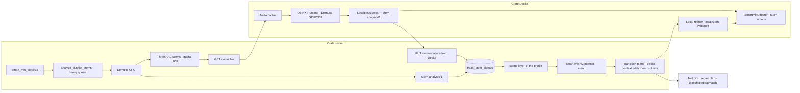

# Smart Mix Stems — Design

**Date:** 2026-11-08. **Decided by Diego:** build both paths below, including local GPU inference in Crate Decks, "however little it adds".

**Gate STEM-G0 passed (2026-11-08)** with the [ST0 spike report](2026-11-08-smart-mix-stems-spike-report.md): `htdemucs` and its weights accepted; ONNX Runtime in Decks and on the server; server separation goes ahead; stems play from a lossless sidecar (STEM-D9). STEM-D3, D6, D7, D8 and D9 below carry those decisions.

**Repositories:**
- Server work: the Crate monorepo (`thecrateapp/crate`).
- Client work: Crate Decks (this repository).

**Related:**
- [Crate Decks design](2026-11-02-crate-decks-design.md): D4–D8, D15, §12.
- [Smart Mix 3 design](2026-11-02-smart-mix-3-design.md): SM3-D1, D3, D13, D16 and §9.
- [Implementation plan](2026-11-08-smart-mix-stems-implementation-plan.md).

## 1. Goal

Use source separation (stems) where it pays for itself, without separating the whole library.

**Path A, Smart Mix playlists on the server.**
- A user marks a playlist (a set of 30–300 tracks prepared for a show) as a Smart Mix playlist.
- For those tracks only, the server separates stems and analyses them.
- It stores the results, and the Smart Mix planner uses them.
- Android and Crate Decks both get better plans from it.

**Path B, local inference in Crate Decks.**
- Decks separates stems and analyses them on the DJ's GPU (CPU as fallback).
- It plays the stems in the decks and refines its transition plans locally.
- It shares the stem analysis with the server in a common format, and can upload it.

**Roles of the two clients (Diego, 2026-11-08).**
- **Android is a listening app with automatic mixing as an extra.** It plays server plans with crossfade or beatmatch, as today, and never uses stems.
- **Crate Decks is mixing software.** Its plans may drift from Android's.

## 2. Starting point

**Server.**
- Hardware: i7-7700 (4 cores, 8 threads), 62 GB of RAM, no GPU.
- The analysis worker already ships PyTorch 2.15 (CPU), Beat This! + madmom DBN, the YAMNet port and FFmpeg.
- Profiles are `smart-mix-audio-v8`.
- Model outputs are stored per track in `track_mix_signals`, reused while the source revision and the model names match (SM3-D16).
- The `smart-mix-v3` planner builds a menu of 4–8 valid candidates per edge (SM3-D3). `apply_refinement` recomposes and validates a chosen candidate (SM3 §9).
- That SM4 code stays in the tree after the SG3 no-go, with AI refinement off.

**Measured gaps that stems can address.**

| Gap | Evidence |
|---|---|
| Voice per phrase in industrial metal, trip-hop and black metal | YAMNet AUC 0.64–0.66 there, against 0.92–0.94 in pop and post-punk (SG1b) |
| Beats in intros without a kick drum; drum and bass jumping metrical level | 23 windows where madmom follows the grid and Beat This! does not (v8 investigation) |
| Beat phase between decks with live drums | Median 40 ms on rendered beatmatches of rock, 20 ms on electronic (SM5) |
| Two basslines or two vocals overlapping | Planner proxies: voice bytes, energy curve; no bass information at all |

**Disk.**
- Music lives on `/mnt/music`: 5.5 TB, about 1.1 TB free. The root disk has 12 GB free.
- Stems for the whole library would be about 139,000 × 40 MB ≈ 5.5 TB, which is not viable.
- A 300-track Smart Mix playlist is about 9 GB as three AAC stems per track (STEM-D6), which is viable.

**Mixxx.** The Crate Decks fork already contains Mixxx's NI STEM support behind the `__STEM__` build flag.

**Crate Decks design today.**
- §12 lists stems as out of scope.
- D8 keeps one planner so that Android and Decks sound the same.
- D15 depended on SG3, which closed as no-go.

**Development machine.** RTX 4060 Laptop (8 GB), used for the ST0 measurements.

## 3. Decisions

**STEM-D1. Two producers, one format.**
- Stem analysis has one versioned format, `stem-analysis/1` (§5).
- Two producers can write it: the server (CPU, Smart Mix playlists) and Crate Decks (GPU or CPU).
- The server stores it per track and producer. The planner and Decks read it.
- **What it holds:**
  - per-stem level curves;
  - optional beats tracked on the drum stem;
  - the separator model and version, the producer, and the server's source revision.
- **What it never holds:** audio.
- **Size:** 2–4 KB per track.

**STEM-D2. Smart Mix playlists (path A; named by Diego, 2026-11-08).**
- **One concept for every client.** A Smart Mix playlist is a playlist its owner marks for Smart Mix. The same mark serves Listen, the web app and Crate Decks, and it replaces Decks' offline sets (D4 of the Crate Decks design).
- **Every client lists all of the user's playlists.** Smart Mix playlists stand out with a chip or icon from the design tokens, plus their analysis state.
- **Model:** its own table, `smart_mix_playlists`, one row per playlist (§5), rather than more columns on `playlists`. It carries the playlist's Smart Mix state: owner, on or off, when it was turned on, last use and a revision for client sync.
- **Caps: admin settings of each instance** (Diego, 2026-11-08), in the Smart Mix settings:
  - `stems.max_tracks_per_playlist`: 300 by default;
  - `stems.max_tracks_per_user`: across a user's Smart Mix playlists, off by default.
- **Turning it on** queues `analyze_playlist_stems` for the tracks that lack a current server stem analysis.
  - The task runs on the `heavy` queue, ahead of the library backfill. Its priority is above `backfill_smart_mix_profiles` and below interactive work.
  - The resource governor applies. Night windows do not.
- **Work is per track, not per playlist.** `track_stem_jobs` holds one row per track with its state (`pending`, `analyzing`, `ready`, `failed`), attempts and last error. A track in two Smart Mix playlists is separated once.
- **Status:** a per-playlist endpoint reports each track's state and an estimate.
- **In Crate Decks** a Smart Mix playlist is also an offline set:
  - Decks downloads its tracks, after showing the size, and pins them in the cache;
  - it fetches the server's stems or separates locally.
- **Turning it off** keeps the analyses, which are small and shared by track. It releases the stem files (STEM-D6) to the LRU and unpins the tracks in Decks.

**STEM-D3. Separation model.**
- **Baseline:** Demucs v4 `htdemucs`, four stems (drums, bass, other, vocals). The code is MIT. The weights have no stated licence of their own and were trained partly on research-only data; Diego accepted them at STEM-G0, because Crate is free and non-commercial.
- **One graph for both producers:** the `htdemucs` network exported to ONNX (opset 17, fp32), with STFT, iSTFT, segmentation and overlap-add outside the graph. The export is published as a Crate Decks release asset with attribution and a note on the training data.
- **Server:** that graph on ONNX Runtime CPU, with the DSP in numpy. No PyTorch in the worker for separation.
- **Decks:** `htdemucs` by default, or `htdemucs_ft` (a bag of four fine-tuned models, about 4× the cost) when the GPU allows it.
- The six-stem model is out: guitar and piano stems do not feed any planner signal.
- A different model needs a new separator identifier and a gate.

**STEM-D4. The stems layer of a profile.**
- From `stem-analysis/1`, the server derives per-phrase levels (§5).
- **It does not change the v8 grid, downbeats or phrases.** Drum-stem beats are stored and measured, but they replace nothing until a later analyzer version decides so with evidence.
- **Vocal presence per phrase comes from the vocal stem when one exists** (detector `stem-vocals-1`). It falls back to YAMNet (`yamnet-2`) otherwise.
- **Which producer wins** when both exist for a track and match its source revision:
  - the analysis from the stronger separator wins (`htdemucs_ft` over `htdemucs`);
  - on a tie, the server's own analysis wins.
- **API and capability:** profiles expose the layer as an optional `stems` object; capabilities expose `smart_mix.stems`.

**STEM-D5. The planner uses the stems layer.**
- When both tracks of an edge have a stems layer, `smart-mix-v3` scores candidates with:
  - vocal overlap from the vocal stems;
  - bass overlap, avoiding two basslines at once;
  - drums-only or vocal-free intros and outros as preferred mix points;
  - drums plus bass as the energy proxy around the cue.
- The safety limits (tempo, gain, true peak, durations) do not change.
- Plans say `stemsUsed: true`.
- **Evaluation:** with the SM5 harness and automatic listening metrics. Gate STEM-G1 decides whether the layer is on by default. Diego's position is to keep it unless it measures worse.

**STEM-D6. Stem audio on the server, for Smart Mix playlists only.**
- The server may keep separated audio for the tracks of Smart Mix playlists:
  - format: one MP4 per track with three AAC streams at 256 kbps (drums, bass, vocals). `other` is not stored: Decks rebuilds it as the residual against its own decode (STEM-D9);
  - location: a dedicated directory on the music volume, never on the root disk;
  - quota: 50 GiB by default (admin setting), evicted by LRU over the last use of the playlists that hold the track.
- Decks can download these files instead of separating locally.
- Android never downloads stems.

**STEM-D7. Local inference in Crate Decks.**
- **Runtime:** ONNX Runtime (MIT) behind a CMake option `CRATE_INFERENCE`.
- **The graph is the `htdemucs` network only.** Decks implements the STFT, iSTFT, segmentation and overlap-add in C++, with the parameters measured in ST0 (§5 of the spike report).
- **Execution providers:**
  - CUDA on Linux and Windows with NVIDIA, used only when the system has the CUDA and cuDNN libraries ONNX Runtime needs; the CUDA provider library is an optional download;
  - DirectML on Windows;
  - CoreML on macOS;
  - WebGPU, evaluated in ST4 as the driver-only GPU path on Linux;
  - CPU always, as the fallback.
- **Memory:** peak VRAM under 1.5 GB per separation, so 4 GB GPUs work. The export uses memory-efficient attention; when free VRAM is short, the runtime picks CPU.
- **GPU runtimes are loaded from the user's system.** Proprietary NVIDIA libraries are never bundled with a GPL program.
- **Models** are not in the installer. They download on first use from pinned URLs, are checked by SHA-256 and stored in the Decks data directory.
- **Threads:** inference runs in its own worker, never on the main thread or the engine thread.
- **While a deck is playing,** separation pauses by default. A preference allows it, at the lowest GPU and CPU priority.

**STEM-D8. What Decks separates and shares.**
- **Which tracks:** those of Smart Mix playlists (which are also Decks' offline sets, STEM-D2), and any track on demand.
- **For each track, Decks:**
  - writes a lossless stem sidecar next to the cached file (STEM-D9);
  - computes `stem-analysis/1`;
  - uploads it with `PUT /api/decks/tracks/{uid}/stem-analysis` when the server allows it (permission `smart_mix.stems.contribute`, granted to admins by default).
- **Before separating,** Decks downloads what the server already has (analysis or stem file).

**STEM-D9. Stems playback in Crate Decks: lossless sidecar (decided at STEM-G0).**
- **Build:** the fork turns `__STEM__` on.
- **The original file stays the track's file and identity.** Library rows, cues, beats and Mixxx's own analysis keep reading it. Samplers and the preview deck play it.
- **The sidecar:**
  - an 8-channel FLAC beside the cached file (drums, bass, other, vocals, in that order), at the original's sample rate;
  - drums, bass and vocals are resampled back to the original's rate and quantised;
  - `other` is the integer residual: original − drums − bass − vocals. The four stems add up to the original, so a deck with no stem touched sounds like the original.
- **Alignment:**
  - Demucs reads the original decoded by Decks' own `SoundSourceProxy`.
  - The sidecar stores the sample rate, the frame count and a PCM fingerprint of that decode. Decks ignores a sidecar that does not match them.
- **Server stems** (STEM-D6): Decks decodes the three downloaded stems, computes `other` against its own decode and writes its sidecar.
- **Playback:** a main deck loading a track with a valid sidecar reads it through the fork's 8-channel stem path. Patches to Mixxx files (listed in `CRATE_PATCHES.md`):
  - a hook after `openAudioSource` in the caching reader worker that swaps in the sidecar source;
  - a public `StemInfo` setter on `Track`;
  - an analyser hook, so the waveform is not redone on every load.
- **Stems that finish while the track is in a deck** apply on the next load. A stopped deck reloads by itself and keeps its position.
- **With keylock,** a stem deck sounds like the sum of four stretched stems. STEM-G2 includes a listening check with keylock on.
- **NI STEM export** (`.stem.mp4`) is an optional action for other software. It is not the playback format.
- **Controls:** stem volume and mute on the CrateDecks skin, following the fork's stem controls.

**STEM-D10. Local plan refinement in Crate Decks (amends D8).**
- **The server plan is the baseline for both clients.** In the `decks` context the transition-plan response adds:
  - the candidate menu (SM3-D3);
  - the policy limits that bound it.
- **Decks may, locally:**
  - choose another candidate;
  - apply the discrete adjustments of SM3-D1 (shift a phrase −1, 0 or +1; step the length);
  - add stem actions: mute the outgoing vocals across the overlap, start the incoming track on drums only, or hand off the bass on the bass stems instead of the EQ.
- **How it chooses:** a deterministic local scorer, with evidence measured on the local stems (actual vocal and bass overlap).
- **Validation:** Decks checks the result against the returned limits before use. The timing rule of D15 stays: a refinement is accepted only before the director enters `Preparing`.
- **Drift from Android is accepted.**
- **Reporting:** Decks reports the executed origin as `transition_source = "decks_local"` (S6). It may send the chosen candidate and adjustments back for history, but the server does not apply them to other clients.

**STEM-D11. What this supersedes.**
- Crate Decks §12 no longer lists stems as out of scope.
- D15 (AI Assisted Mixing) is obsolete after SG3. F6b is replaced by the local refinement phase of this design.
- D8 is amended by STEM-D10.
- SM3-D2 ("no source separation in the analysis path") still holds for the library-wide analysis. Separation only runs for Smart Mix playlists and in Decks.

## 4. Architecture

## 5. Data and contracts

**`stem-analysis/1`** (JSON over the API; binary columns in storage):

| Field | Content |
|---|---|
| `schema` | `"stem-analysis/1"` |
| `producer` | `"crate-server/<version>"` or `"crate-decks/<version>"` |
| `separator` | `{model: "htdemucs" \| "htdemucs_ft", version, sources: ["drums","bass","other","vocals"]}` |
| `sourceRevision` | The server's `smart_mix_source_revision` that the producer received with the track. A mismatch is rejected |
| `hopMs` | 250 |
| `levels` | Per stem, one byte per 250 ms window: RMS in dBFS mapped linearly from −60 dB (0) to 0 dB (255), base64 |
| `drumBeatsMs` | Optional: beats tracked on the drum stem (Beat This! + DBN on the client or the server) |
| `durationMs` | Duration of the analysed audio |

**Table `track_stem_signals`.**
- Key: `(track_id, producer_kind)`, where `producer_kind` is `server` or `decks`.
- Columns: `producer`, `separator_model`, `separator_version`, `source_revision`, `hop_ms`, one `bytea` per stem, an optional `drum_beats_ms` (`int4[]`), `duration_ms`, `created_at`, `updated_at` and `contributed_by` (user id, decks only).
- Rows are replaced when their source revision changes.

**Stems layer** (derived on read, never stored). For each phrase of the profile:
- `vocals`, `drums`, `bass`, `other`: the mean level byte over the phrase;
- `vocalPresent`: a cut calibrated in ST3 against lyrics labels where they exist, and against the YAMNet byte;
- `bassPresent` and `drumsPresent`: from levels relative to the track. ST0 showed that an absolute −35 dB cut contradicts what tracks contain, so ST3 calibrates it.

**Smart Mix playlists and stem work.**
- `smart_mix_playlists`:
  - `(playlist_id PK → playlists ON DELETE CASCADE, user_id → users, enabled, enabled_at, disabled_at, last_used_at, revision, updated_at)`;
  - `revision` comes from a per-user sequence, so Decks syncs with "changes since revision N";
  - turning a playlist off keeps its row with `enabled = false`, so the LRU and clients see the change.
- `track_stem_jobs`: `(track_id PK → library_tracks ON DELETE CASCADE, state, attempts, last_error, requested_at, started_at, finished_at, source_revision)`.
- The table `track_stem_files` holds `(track_id, path, bytes, separator_model, source_revision, last_used_at)`.

**API.**
- `PUT /api/smart-mix/playlists/{playlistId}` with `{enabled: bool}`: owner only, with the caps of STEM-D2.
- `GET /api/smart-mix/playlists?sinceRevision=N`: the user's Smart Mix playlists changed since a revision, including those turned off. This is what Decks syncs.
- `GET /api/smart-mix/playlists/{playlistId}` returns the counts per state, per-track states and the estimated time left.
- Playlist list and detail responses gain `smartMix: {enabled, ready, total}`, so every client can mark them without another request.
- `GET` and `PUT /api/decks/tracks/{uid}/stem-analysis`:
  - `PUT` needs `smart_mix.stems.contribute`;
  - the body is at most 64 KiB;
  - the source revision must match the current file.
- `GET /api/decks/tracks/{uid}/stems` serves the three-stem MP4 (drums, bass, vocals) with Range support. It answers 404 when the file is not stored.
- `POST /api/playback/transition-plans` in the `decks` context with `features.local_refinement` returns `candidates` (the v3 menu with each candidate's score breakdown) and `policyLimits`.
- **Capabilities:**
  - `smart_mix.stems{available, playlists, storage}`;
  - `decks.features` gains `stems`, `stem_upload` and `local_refinement`.
- **S6:** `transition_source` gains `decks_local`.

**Crate Decks local data.**
- `crateserver_stems (entity_uid, path, separator_model, source_revision, created_at, uploaded_at)`;
- `crateserver_models (name, version, sha256, path, provider_hint)`.
- Both are created idempotently, like the other `crateserver_` tables.

## 6. Budgets

| Area | Budget |
|---|---|
| Server separation | Estimated in ST0 at 3–5 h per 50-track Smart Mix playlist on the i7-7700 with ONNX Runtime CPU, and measured on the server in ST2.PR1. A 50-track Smart Mix playlist must finish within one night (8 h) next to the backfill |
| Server storage | Stem file quota of 50 GiB by default on the music volume; nothing on the root disk; analysis rows ≤ 4 KB |
| Decks separation | GPU target ≤ 30 s per 5-minute track with `htdemucs` (ST0: about 8 s on a laptop RTX 4060) and peak VRAM ≤ 1.5 GB; CPU fallback allowed and reported |
| Decks UI and engine | Main thread never blocked > 16 ms; no inference on the engine thread; separation paused while a deck plays unless the preference says otherwise |
| Decks disk | Stems counted in the cache quota (D4) with pin rules for Smart Mix playlists (D4's offline sets); a size estimate shown before downloading or separating one |
| API | New endpoints p95 ≤ 150 ms and at most 3 bounded queries; uploads ≤ 64 KiB |

## 7. Security and licensing

**Uploads are untrusted input.**
- They need the contribute permission and a valid schema, size and value ranges.
- The source revision must match.
- Every upload is audited (`contributed_by`). An admin can turn uploads off.
- A decks analysis never replaces a server analysis from an equal or stronger separator (STEM-D4).

**Licences.**
- ONNX Runtime (MIT) is compatible with Decks' GPL-2.0-or-later.
- Demucs code is MIT. The weights state no licence of their own and were trained partly on research-only data (MUSDB18). Diego accepted them at STEM-G0 for a free, non-commercial project. The ONNX export ships with attribution and a note on the training data.
- NVIDIA runtime libraries are never bundled. The CUDA provider loads them from the system.
- Models download over HTTPS with pinned hashes.

**Privacy.** Stems and analyses describe the user's own library and never leave their server and machines.

## 8. Risks

| Risk | Impact | Mitigation |
|---|---|---|
| Exported graph needs 3 GB of VRAM (ST0: materialised attention) | 4 GB GPUs fall back to CPU | Memory-efficient attention in the export (ST4.PR2), VRAM check before choosing a provider |
| DirectML, CoreML or WebGPU miss ops or parity | No GPU on that platform | Measured in ST4.PR1 with the same parity test; CPU fallback always |
| GPU runtime packaging across Linux, Windows and macOS | Users without inference | CPU fallback always; providers detected at runtime; clear status in preferences |
| Separation competes with a live set | Dropouts on stage | Paused while decks play by default; lowest priority; never on the engine thread |
| Server CPU: Smart Mix playlists against the backfill | One starves the other | Playlist work ahead of the backfill, capped per user; the governor applies to both |
| Sidecar out of step with the original (decoder delay, sample rate) | Comb filtering when a stem is muted | Separation reads Decks' own decode; sidecar stores rate, frames and a PCM fingerprint and is ignored on mismatch; alignment test with a click |
| Small quality gain | Work with little effect | Diego chose to build anyway; the gains are measured (ST0, ST3) and defaults set by gates |
| Disk exhaustion (server root, DJ disk) | Failures | Server stems only on the music volume with a quota; Decks counts stems in its cache quota |

## 9. Gates

| Gate | When | What Diego decides |
|---|---|---|
| STEM-G0 | After ST0 | Separator model and weights licence; Decks inference path (ONNX Runtime providers or alternative); server feasibility from the measured times. **Passed 2026-11-08** (see the header) |
| STEM-G1 | After ST3 | Whether the planner uses the stems layer by default, from the automatic listening metrics |
| STEM-G2 | After ST7 | Stems playback and local refinement in Decks, tested with a real DJ setup (Crate Decks AGENTS.md: changes to audio, engine, AutoDJ or Smart Mix are tested by Diego before merge) |

## 10. Out of scope

- Stems or local refinement on Android.
- Separating the whole library.
- Training or fine-tuning models.
- LLMs in this loop.
- Uploading stem audio from Decks to the server: only analyses are uploaded.
