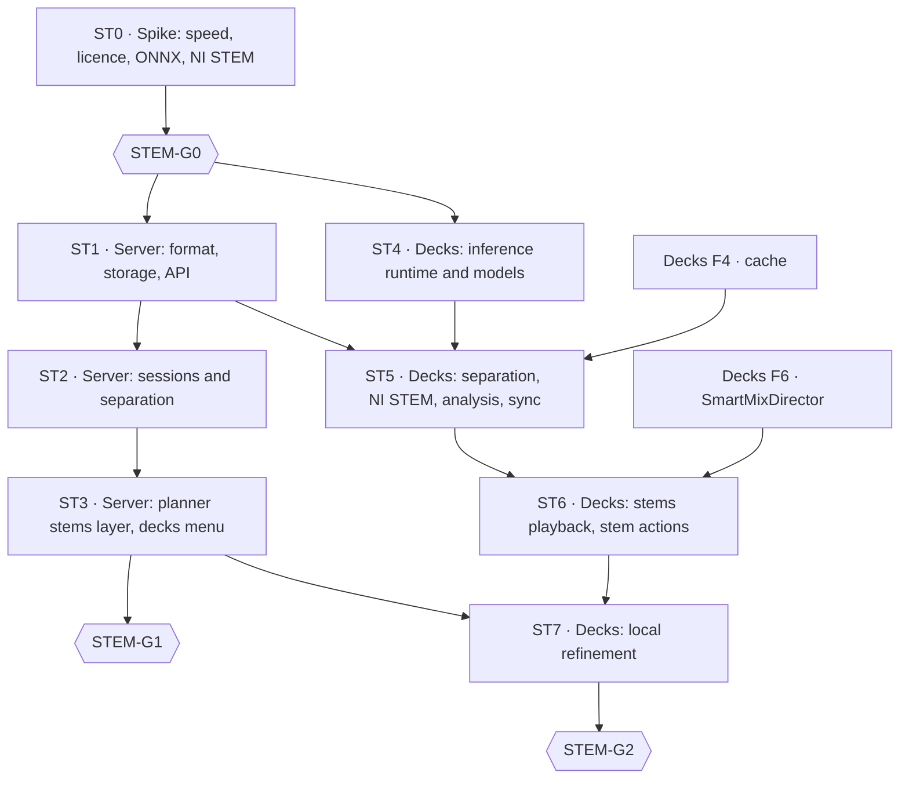

# Smart Mix Stems — Implementation Plan

> **For agents:** execute the phases in order. Each PR starts with the failing tests it names. Do not pass a gate (STEM-G0, G1, G2) without Diego's explicit approval. If the code does not match this plan (paths, APIs), stop, report and propose the change to the plan.

**Goal:** stems for Smart Mix in two places.
- On the server, for the tracks of playlists marked as Smart Mix sessions.
- In Crate Decks, on the local GPU, with stems playback and local plan refinement.

Both producers share the `stem-analysis/1` format.

**Architecture:**
- Separation produces small per-stem level curves (and optional drum-stem beats), stored per track and producer in the server.
- The server derives a per-phrase stems layer that `smart-mix-v3` scores with.
- Crate Decks separates with ONNX Runtime, plays NI STEM files, and refines the server's candidate menu locally.

**Tech stack:**
- Server: Python 3.13, FastAPI, PostgreSQL, Dramatiq `heavy` queue, PyTorch CPU and Demucs v4 in the analysis worker.
- Client: C++20 and Qt 6 in the Mixxx fork, ONNX Runtime (CUDA, DirectML, CoreML, CPU), FFmpeg for NI STEM files.

**Spec:** [Smart Mix Stems design](2026-11-08-smart-mix-stems-design.md). Decisions are cited by ID (STEM-D1–D11).

## Global constraints

- **Server code** (`thecrateapp/crate`) follows the monorepo AGENTS.md:
  - writes through `app/crate/db/repositories/`, reads with `read_scope` and `ANY(:ids)`;
  - tests next to the code, canonical docs in `docs/technical/`;
  - OpenAPI regenerated;
  - migrations numbered after the head of `origin/main` at integration time (153 when this plan was written, plus whatever the pending v8 release adds).
- **Client code** follows Crate Decks AGENTS.md:
  - own code only in `src/crate/`, `src/library/crateserver/`, `src/test/crate/` and `res/skins/CrateDecks/`;
  - every patched Mixxx file listed in `CRATE_PATCHES.md`;
  - UI values only from `res/crate-design/tokens.json`;
  - secrets only in QtKeychain;
  - GoogleTest files added by hand to `mixxx-test`;
  - network mocked in unit tests.
- **Push, PRs, deploys and releases** only when Diego asks. Server changes ship in bundled releases, not one deploy per PR. No production access during development.
- **Fixed values:**
  - `hopMs` 250;
  - levels map −60 dBFS → 0 and 0 dBFS → 255;
  - session caps of 300 tracks per playlist and 600 per user;
  - server stem quota 50 GiB by default, on the music volume only;
  - uploads ≤ 64 KiB;
  - new endpoints p95 ≤ 150 ms with ≤ 3 bounded queries;
  - Decks GPU target ≤ 30 s per 5-minute track with `htdemucs`.
- **Licences:** ONNX Runtime MIT; Demucs code MIT, with the weights' licence confirmed at STEM-G0. Proprietary GPU runtimes are never bundled.
- **Never print secrets.** Never commit audio, stems or model weights.

## Review focus

1. **A track file changes after its stems were analysed.** The old analysis must stop applying: it is ignored on read, and a stale upload is rejected (tests in ST1.PR1 and ST1.PR2).
2. **A hostile or malformed upload from a client** (levels longer than the track, wrong sources, a track the user cannot see, a weaker separator overwriting a stronger one) must be rejected without affecting other users' plans (ST1.PR2).
3. **Disk.** Server stems never land on the root disk and stay within the quota. Decks counts stems in its cache quota and never evicts pinned session tracks (ST2.PR2, ST5.PR2).
4. **A live set while Decks separates.** Separation must pause when a deck plays (unless the preference allows it) and never touch the engine thread (ST5.PR2).
5. **Switching a known track to its `.stem.mp4`** must not duplicate it in the Mixxx library nor lose local cues and loops (ST6.PR1).
6. **A 300-track session while the backfill runs.** The session goes first, and the backfill still progresses when the session ends (ST2.PR2).

## Phase map

**Dependencies on Crate Decks phases.**
- ST4 and the separation core of ST5 are standalone modules with their own tests. They can be built while Decks F2–F4 progress.
- Integrating them with the cache needs F4, and ST6–ST7 need F6.
- ST7 replaces F6b (STEM-D11).

---

## ST0 · Spike (local, throwaway code)

**Questions:**
1. **Speed of `htdemucs` and `htdemucs_ft`** per 5-minute track:
   - on the development GPU (RTX 4060 Laptop);
   - on CPU limited to 8 threads, as a proxy for the server's i7-7700. Extrapolate to a 50-track session.
2. **The licence of the published Demucs weights.**
3. **Do the stem levels say what the planner needs?** On one track per genre, compare:
   - vocal stem activity against YAMNet windows, especially in industrial metal, where YAMNet fails;
   - bass and drums presence against what the track obviously contains.
4. **ONNX export of `htdemucs`** (network core, STFT and iSTFT outside or as opset ≥ 17 ops): parity with PyTorch (maximum absolute difference and SDR on 30 s) and speed with ONNX Runtime CPU and CUDA.
5. **An NI STEM file written with FFmpeg** (AAC 256 kbps, `stem` metadata atom) loads in the fork built with `__STEM__`. Name the stem control groups and keys it exposes.
6. **Converting a Mixxx track to another file:** which internal path (TrackDAO relocation) keeps cues and loops, and whether it needs a patch.

**Deliverable:** `docs/plans/2026-11-XX-smart-mix-stems-spike-report.md` with the numbers and a recommendation per question.

**Gate STEM-G0 (Diego):** separator model and weights licence, Decks inference path, and server feasibility.

---

## ST1 · Server: format, storage and API

### ST1.PR1 · Format and storage

| File | Content |
|---|---|
| `app/crate/smart_mix/stems.py` | Model `StemAnalysis` (Pydantic, `extra="forbid"`) for `stem-analysis/1`; `encode_levels(rms_db: np.ndarray) -> bytes`; `choose_analysis(rows, *, source_revision: str) -> StemAnalysis \| None` (STEM-D4 precedence); `stem_phrase_layer(profile: TrackMixProfile, analysis: StemAnalysis) -> StemsLayer \| None` |
| `app/crate/db/migrations/versions/<next>_smart_mix_stems.py` and `app/crate/db/schema_sections/smart_mix_stems_v<next>.py` | Table `track_stem_signals` (§5 of the design), unique on `(track_id, producer_kind)`, `ON DELETE CASCADE` from `library_tracks` |
| `app/crate/db/orm/smart_mix.py` | ORM row |
| `app/crate/db/repositories/smart_mix_stems.py` | `upsert_stem_analysis(track_id: int, analysis: StemAnalysis, *, producer_kind: Literal["server","decks"], contributed_by: int \| None = None, session=None) -> Literal["stored","replaced","kept_stronger"]`; `get_stem_analyses(track_ids: Sequence[int], *, session=None) -> dict[int, list[StemAnalysis]]` |

**Tests:**
- `test_smart_mix_stems_model.py`:
  - `rejects unknown schema`;
  - `rejects sources other than the four`;
  - `rejects levels longer than duration plus one window`;
  - `encodes -60 dB as 0 and 0 dB as 255`.
- `test_smart_mix_stems_repository.py`:
  - `replaces a row whose source revision changed`;
  - `decks row never replaces a server row from an equal or stronger separator`;
  - `reads many tracks in one query`.
- `test_stem_phrase_layer.py`:
  - `mean level per phrase`;
  - `no layer when the analysed duration differs from the profile by more than 2 %`;
  - `no layer for a stale source revision`.

### ST1.PR2 · API, permission and capability

**Files:**
- `app/crate/api/decks_stems.py`: `GET` and `PUT /api/decks/tracks/{uid}/stem-analysis`.
- The permission catalogue: `smart_mix.stems.contribute`, granted to admins by default.
- The profile serialization: optional `stems` layer.
- `app/crate/api/capabilities.py`: `smart_mix.stems{available, sessions, storage}` and `decks.features += stems, stem_upload, local_refinement`, each as the phase that delivers it lands.
- The regenerated OpenAPI documents.

**Tests:**
- `test_decks_stem_analysis_api.py`:
  - `put requires the contribute permission`;
  - `put rejects a source revision that is not current`;
  - `put rejects bodies over 64 KiB`;
  - `put rejects a track the user cannot see`;
  - `put then get round-trips`;
  - `uploads can be turned off by an admin`.
- `test_capabilities_stems.py`.
- Update `test_vdj_contract_baseline.py` so earlier fields keep their values.

---

## ST2 · Server: sessions and separation

### ST2.PR1 · Demucs in the analysis worker

**Files:**
- `app/requirements-demucs.txt` (pinned Demucs, under the torch constraint that Beat This! uses).
- A weights stage in `app/Dockerfile` with pinned SHA-256, like `beat-this-weights`.
- `app/crate/smart_mix/separation.py`:
  - `separate(path: Path, *, model: str = "htdemucs", threads: int, scratch: Path) -> SeparatedStems`;
  - `analyze_stems(stems: SeparatedStems, *, hop_ms: int = 250) -> StemAnalysis`;
  - `drum_beats(stems: SeparatedStems) -> list[int]` (Beat This! + DBN on the drum stem; stored, not used for the grid, STEM-D4).
- Scratch audio goes to a configured directory on the music volume, never to `/tmp` or the root disk.

**Tests:**
- `test_smart_mix_separation.py` with an injected fake separator:
  - `levels follow each stem`;
  - `scratch files are removed on success and on failure`.
- `test_smart_mix_separation_demucs.py`: separates 10 s of fixture audio in the analysis image; skipped unless `CRATE_REQUIRE_DEMUCS=1`.

### ST2.PR2 · Sessions, task, stem files and quota

**Files:**
- Migration: `playlists.smart_mix_session`, `smart_mix_session_at`, table `track_stem_files`.
- `app/crate/api/playlists.py` and its schema: `smartMixSession` with the caps (STEM-D2).
- `app/crate/api/smart_mix_sessions.py`: `GET /api/smart-mix/sessions/{playlistId}`.
- `app/crate/worker_handlers/smart_mix_stems.py`: `analyze_session_stems`, registered in `TASK_POOL_CONFIG` on `heavy`, with a priority above `backfill_smart_mix_profiles`.
- `app/crate/smart_mix/stem_files.py`:
  - `write_ni_stem(master: Path, stems: SeparatedStems, out: Path) -> int` (FFmpeg, AAC 256 kbps, `stem` atom);
  - `enforce_stem_quota(limit_bytes: int) -> int` (LRU over `last_used_at`).
- `GET /api/decks/tracks/{uid}/stems` with Range support.

**Tests:**
- `test_smart_mix_sessions_api.py`:
  - `only the owner turns a session on`;
  - `caps at 300 per playlist and 600 per user`;
  - `turning off keeps analyses and releases files to the LRU`.
- `test_analyze_session_stems.py`:
  - `skips tracks with a current server analysis`;
  - `session tasks run before the backfill coordinator`;
  - `the backfill resumes when the session ends`.
- `test_stem_files.py`:
  - `files are written under the music volume only`;
  - `quota evicts least recently used session files`;
  - `range download`.

### ST2.PR3 · Interfaces

- **Listen:** a "Smart Mix session" toggle in the playlist menu and a status chip. This is a client change shipped with a tagged release.
- **Admin:** a sessions panel (states per session) and the quota setting.
- **Tests:** next to each component, following the existing patterns.

---

## ST3 · Server: planner stems layer and decks menu

### ST3.PR1 · Scoring with stems

**Files:**
- `app/crate/smart_mix/candidates.py` gains score terms used only when both profiles have a stems layer:
  - `stem_vocal_overlap_ms`;
  - `stem_bass_overlap_ms`;
  - `drums_only_entry`;
  - `vocal_free_exit`.
- `app/crate/smart_mix/policy.py`: new `rules_revision` for `smart-mix-v3`.
- `stemsUsed` on the plan.
- Calibrate the presence cuts of the design (§5) on the session evaluation set before fixing them.

**Tests:**
- `test_candidates_stems.py`:
  - `identical candidates and scores without stems` (golden);
  - `prefers an overlap where the stem vocals do not collide`;
  - `avoids two basslines when another candidate exists`.

### ST3.PR2 · Menu and limits for decks

- `POST /api/playback/transition-plans` in the `decks` context with `features.local_refinement` returns `candidates` and `policyLimits` (STEM-D10).
- **Tests:** `test_transition_plans_decks_menu.py`:
  - `menu only for the decks context`;
  - `limits match the policy`;
  - `android and vdj responses unchanged`.

### ST3.PR3 · Evaluation

- Extend the SM5 harness (`tools/smart-mix-eval`) with stems on a session-like set: the 120 electronic tracks plus a non-electronic set.
- Compare v3 with v3 plus the stems layer using the automatic listening metrics.
- Report in `docs/plans/`.

**Gate STEM-G1 (Diego):** whether the stems layer is on by default.

---

## ST4 · Crate Decks: inference runtime and models

### ST4.PR1 · Runtime

**Files:**
- `CMakeLists.txt`: option `CRATE_INFERENCE`, on when ONNX Runtime is found and off otherwise. Listed in `CRATE_PATCHES.md`.
- `src/crate/inference/inferenceruntime.{h,cpp}`:
  - `crate::InferenceRuntime::availableProviders() -> QList<Provider>`, detected at runtime, with GPU libraries loaded from the system;
  - `createSession(const QString& modelPath, Provider preferred) -> std::unique_ptr<InferenceSession>`, falling back to CPU with the reason reported.

**Tests:**
- `src/test/crate/inferenceruntime_test.cpp`:
  - `runs a tiny ONNX fixture on CPU`;
  - `falls back to CPU when the preferred provider is missing`.
- GPU tests run only when `CRATE_TEST_GPU=1`.

### ST4.PR2 · Model store

- `src/crate/inference/modelstore.{h,cpp}`: `crate::ModelStore`.
  - A manifest of name, version, URL, SHA-256 and size. The ONNX exports from ST0 are published as release assets of this repository.
  - Download with resume, verification, and table `crateserver_models`.
- **Tests:** `modelstore_test.cpp` with a mocked network:
  - `rejects a file whose hash differs`;
  - `resumes a partial download`;
  - `never stores outside the data directory`.

---

## ST5 · Crate Decks: separation, NI STEM, analysis and sync

### ST5.PR1 · Separation core

- `src/crate/stems/stemseparator.{h,cpp}`: `crate::StemSeparator`, which owns its worker thread.
  - It decodes to float stereo at the model's rate.
  - It processes overlapping segments, applies STFT and iSTFT around the ONNX core (as decided at STEM-G0), and overlap-adds.
  - The result is four stems.
- **Tests:**
  - `stemseparator_test.cpp` with an identity mock model: `overlap-add reconstructs the input`, and `cancels promptly`.
  - A golden test against the PyTorch reference from ST0 on a 10 s fixture, within the ST0 tolerance.

### ST5.PR2 · Files, analysis, sync and scheduling

**Files:**
- `src/crate/stems/stemfilewriter.{h,cpp}`: NI STEM via FFmpeg.
- `src/crate/stems/stemanalyzer.{h,cpp}`: `stem-analysis/1`, with the same encoding as the server. A shared fixture checks that both sides produce identical bytes.
- `src/crate/stems/stemsync.{h,cpp}`: download the server analysis and stem file first; upload our own analysis when the server allows it.
- `src/crate/stems/stemjobs.{h,cpp}`: the scheduling.
  - Session playlists and offline sets are separated before their tracks' first load, plus any track on demand.
  - Jobs pause while any deck plays, unless the preference allows it.
- Table `crateserver_stems`.
- `DlgPrefCrate`: provider, model and "separate while playing".

**Tests:**
- `stemanalyzer_test.cpp`: `matches the server fixture byte for byte`.
- `stemsync_test.cpp`:
  - `prefers the server stem file`;
  - `does not upload without the capability`;
  - `discards results for a changed source revision`.
- `stemjobs_test.cpp`:
  - `pauses while a deck plays`;
  - `stems count in the cache quota and pinned session tracks are never evicted`.

---

## ST6 · Crate Decks: stems playback and stem actions

### ST6.PR1 · Playback and identity

**Files:**
- Turn `__STEM__` on for `CRATE` builds.
- The identity rule of STEM-D9: a track separated before its first load uses the stem file as its cache file. A "convert to stems" action moves local cues and loops, through the path chosen in ST0.
- Stem controls on the CrateDecks skin, from tokens.
- Update `CRATE_PATCHES.md`.

**Tests:**
- `stemidentity_test.cpp`:
  - `separated before first load keeps a single library row`;
  - `conversion keeps cues and loops`.
- The skin loads without parser warnings.

### ST6.PR2 · Stem actions in the director

- `crate::SmartMixDirector` executes the stem actions:
  - mute the outgoing vocals across the overlap;
  - start the incoming track on drums only;
  - hand off the bass on the stems.
- It uses the stem controls named in ST0 and updates no control above 60 Hz.
- **Tests:** `smartmixdirector_stems_test.cpp` with fake controls:
  - `ramps stem volume within the overlap`;
  - `restores stems when a transition is cancelled`.

---

## ST7 · Crate Decks: local refinement

**Files:**
- `src/crate/smartmix/localrefiner.{h,cpp}`: `crate::LocalRefiner`.
  - It scores the server menu with local stem evidence (measured vocal and bass overlap).
  - It picks a candidate, discrete adjustments and stem actions.
- `src/crate/smartmix/planvalidator.{h,cpp}`: `crate::PlanValidator`, which checks a plan against `policyLimits`.
- The D15 timing rule: accepted only before `Preparing`.
- The plan view shows `SMART MIX · LOCAL`.
- `transition_source = "decks_local"` in play events (S6).

**Tests:**
- `localrefiner_test.cpp`:
  - `prefers a candidate whose stem vocals do not collide`;
  - `keeps the server plan when no candidate scores better`.
- `planvalidator_test.cpp`:
  - `rejects tempo, gain and duration outside the limits`.
- `smartmixdirector_refinement_test.cpp`:
  - `never switches plans in Preparing or Running`.

**Gate STEM-G2 (Diego):** stems playback and local refinement in a real set, with a real DJ setup.
