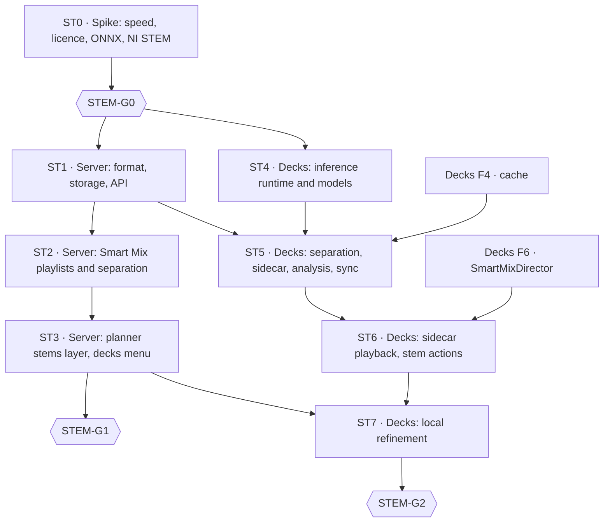

# Smart Mix Stems — Implementation Plan

> **For agents:** execute the phases in order. Each PR starts with the failing tests it names. Do not pass a gate (STEM-G0, G1, G2) without Diego's explicit approval. If the code does not match this plan (paths, APIs), stop, report and propose the change to the plan.

**Goal:** stems for Smart Mix in two places.
- On the server, for the tracks of Smart Mix playlists (playlists their owner marks for Smart Mix).
- In Crate Decks, on the local GPU, with stems playback and local plan refinement.

Both producers share the `stem-analysis/1` format.

**Architecture:**
- Separation produces small per-stem level curves (and optional drum-stem beats), stored per track and producer in the server.
- The server derives a per-phrase stems layer that `smart-mix-v3` scores with.
- Crate Decks separates with ONNX Runtime, plays stems from a lossless sidecar beside the original, and refines the server's candidate menu locally.

**Tech stack:**
- Server: Python 3.13, FastAPI, PostgreSQL, Dramatiq `heavy` queue, PyTorch CPU and Demucs v4 in the analysis worker.
- Client: C++20 and Qt 6 in the Mixxx fork, ONNX Runtime (CUDA, DirectML, CoreML, WebGPU, CPU), FLAC sidecars, libav for the optional NI STEM export.

**Spec:** [Smart Mix Stems design](2026-11-08-smart-mix-stems-design.md). Decisions are cited by ID (STEM-D1–D11).

## Global constraints

- **Server code** (`thecrateapp/crate`) follows the monorepo AGENTS.md:
  - writes through `app/crate/db/repositories/`, reads with `read_scope` and `ANY(:ids)`;
  - tests next to the code, canonical docs in `docs/technical/`;
  - OpenAPI regenerated;
  - migrations numbered after the head of `origin/main` at integration time (153 when this plan was written, plus whatever the pending v8 release adds).
- **Client code** follows Crate Decks AGENTS.md:
  - own code only in `src/crate/`, `src/library/crateserver/`, `src/test/crate/` and `res/skins/CrateDecks/`;
  - every patched Mixxx file listed in `CRATE_PATCHES.md`;
  - UI values only from `res/crate-design/tokens.json`;
  - secrets only in QtKeychain;
  - GoogleTest files added by hand to `mixxx-test`;
  - network mocked in unit tests.
- **Push, PRs, deploys and releases** only when Diego asks. Server changes ship in bundled releases, not one deploy per PR. No production access during development.
- **Fixed values:**
  - `hopMs` 250;
  - levels map −60 dBFS → 0 and 0 dBFS → 255;
  - Smart Mix playlist limits are admin settings of each instance: `stem_max_tracks_per_playlist` (300 by default) and `stem_max_tracks_per_user` (off by default);
  - server stem quota 50 GiB by default, on the music volume only;
  - uploads ≤ 64 KiB;
  - new endpoints p95 ≤ 150 ms with ≤ 3 bounded queries;
  - Decks GPU target ≤ 30 s per 5-minute track with `htdemucs`, peak VRAM ≤ 1.5 GB;
  - separator identifier `htdemucs-onnx-1` on both producers;
  - sidecar: 8-channel FLAC, drums, bass, other, vocals, `other` as the integer residual.
- **Licences:** ONNX Runtime MIT; Demucs code MIT; `htdemucs` weights accepted at STEM-G0 and shipped with attribution. Proprietary GPU runtimes are never bundled.
- **Never print secrets.** Never commit audio, stems or model weights.

## Review focus

1. **A track file changes after its stems were analysed.** The old analysis must stop applying: it is ignored on read, and a stale upload is rejected (tests in ST1.PR1 and ST1.PR2).
2. **A hostile or malformed upload from a client** (levels longer than the track, wrong sources, a track the user cannot see, a weaker separator overwriting a stronger one) must be rejected without affecting other users' plans (ST1.PR2).
3. **Disk.** Server stems never land on the root disk and stay within the quota. Decks counts stems in its cache quota and never evicts pinned Smart Mix playlist tracks (ST2.PR3, ST5.PR2).
4. **A live set while Decks separates.** Separation must pause when a deck plays (unless the preference allows it) and never touch the engine thread (ST5.PR2).
5. **Switching a known track to its `.stem.mp4`** must not duplicate it in the Mixxx library nor lose local cues and loops (ST6.PR1).
6. **A 300-track Smart Mix playlist while the backfill runs.** The playlist goes first, and the backfill still progresses when its work ends (ST2.PR3).

## Phase map

**Dependencies on Crate Decks phases.**
- ST4 and the separation core of ST5 are standalone modules with their own tests. They can be built while Decks F2–F4 progress.
- Integrating them with the cache needs F4, and ST6–ST7 need F6.
- ST7 replaces F6b (STEM-D11).

---

## ST0 · Spike (local, throwaway code)

**Questions:**
1. **Speed of `htdemucs` and `htdemucs_ft`** per 5-minute track:
   - on the development GPU (RTX 4060 Laptop);
   - on CPU limited to 8 threads, as a proxy for the server's i7-7700. Extrapolate to a 50-track playlist.
2. **The licence of the published Demucs weights.**
3. **Do the stem levels say what the planner needs?** On one track per genre, compare:
   - vocal stem activity against YAMNet windows, especially in industrial metal, where YAMNet fails;
   - bass and drums presence against what the track obviously contains.
4. **ONNX export of `htdemucs`** (network core, STFT and iSTFT outside or as opset ≥ 17 ops): parity with PyTorch (maximum absolute difference and SDR on 30 s) and speed with ONNX Runtime CPU and CUDA.
5. **An NI STEM file written with FFmpeg** (AAC 256 kbps, `stem` metadata atom) loads in the fork built with `__STEM__`. Name the stem control groups and keys it exposes.
6. **Converting a Mixxx track to another file:** which internal path (TrackDAO relocation) keeps cues and loops, and whether it needs a patch.

**Deliverable:** `docs/plans/2026-11-XX-smart-mix-stems-spike-report.md` with the numbers and a recommendation per question.

**Gate STEM-G0 (Diego):** separator model and weights licence, Decks inference path, and server feasibility. **Passed 2026-11-08** with the [spike report](2026-11-08-smart-mix-stems-spike-report.md); the decisions are in the design header and STEM-D3, D6, D7 and D9.

---

## ST1 · Server: format, storage and API

### ST1.PR1 · Format and storage

| File | Content |
|---|---|
| `app/crate/smart_mix/stems.py` | Model `StemAnalysis` (Pydantic, `extra="forbid"`) for `stem-analysis/1`; `encode_levels(rms_db: np.ndarray) -> bytes`; `choose_analysis(rows, *, source_revision: str) -> StemAnalysis \| None` (STEM-D4 precedence); `stem_phrase_layer(profile: TrackMixProfile, analysis: StemAnalysis) -> StemsLayer \| None` |
| `app/crate/db/migrations/versions/<next>_smart_mix_stems.py` and `app/crate/db/schema_sections/smart_mix_stems_v<next>.py` | Table `track_stem_signals` (§5 of the design), unique on `(track_id, producer_kind)`, `ON DELETE CASCADE` from `library_tracks` |
| `app/crate/db/orm/smart_mix.py` | ORM row |
| `app/crate/db/repositories/smart_mix_stems.py` | `upsert_stem_analysis(track_id: int, analysis: StemAnalysis, *, producer_kind: Literal["server","decks"], contributed_by: int \| None = None, session=None) -> Literal["stored","replaced","kept_stronger"]`; `get_stem_analyses(track_ids: Sequence[int], *, session=None) -> dict[int, list[StemAnalysis]]` |

**Tests:**
- `test_smart_mix_stems_model.py`:
  - `rejects unknown schema`;
  - `rejects sources other than the four`;
  - `rejects levels longer than duration plus one window`;
  - `encodes -60 dB as 0 and 0 dB as 255`.
- `test_smart_mix_stems_repository.py`:
  - `replaces a row whose source revision changed`;
  - `decks row never replaces a server row from an equal or stronger separator`;
  - `reads many tracks in one query`.
- `test_stem_phrase_layer.py`:
  - `mean level per phrase`;
  - `no layer when the analysed duration differs from the profile by more than 2 %`;
  - `no layer for a stale source revision`.

### ST1.PR2 · API, permission and capability

**Files:**
- `app/crate/api/decks_stems.py`: `GET` and `PUT /api/decks/tracks/{uid}/stem-analysis`.
- The permission catalogue: `smart_mix.stems.contribute`, granted to admins by default.
- The profile serialization: optional `stems` layer.
- `app/crate/api/capabilities.py`: `smart_mix.stems{available, playlists, storage}` and `decks.features += stems, stem_upload, local_refinement`, each as the phase that delivers it lands.
- The regenerated OpenAPI documents.

**Tests:**
- `test_decks_stem_analysis_api.py`:
  - `put requires the contribute permission`;
  - `put rejects a source revision that is not current`;
  - `put rejects bodies over 64 KiB`;
  - `put rejects a track the user cannot see`;
  - `put then get round-trips`;
  - `uploads can be turned off by an admin`.
- `test_capabilities_stems.py`.
- Update `test_vdj_contract_baseline.py` so earlier fields keep their values.

---

## ST2 · Server: Smart Mix playlists and separation

### ST2.PR1 · Smart Mix playlists

**Files:**
- Migration and schema section: tables `smart_mix_playlists` and `track_stem_jobs` (§5 of the design), plus the per-user revision sequence.
- `app/crate/db/orm/smart_mix.py`: ORM rows.
- `app/crate/db/repositories/smart_mix_playlists.py`:
  - `set_smart_mix_playlist(playlist_id: int, *, user_id: int, enabled: bool, session=None) -> SmartMixPlaylistState`, which enforces owner only and the two admin limits, bumps the revision and queues `track_stem_jobs` rows for tracks without a current server analysis;
  - `list_smart_mix_playlists(user_id: int, *, since_revision: int | None, session=None) -> list[SmartMixPlaylistState]`;
  - `smart_mix_playlist_status(playlist_id: int, *, session=None) -> SmartMixPlaylistStatus` (counts per state, per-track states, estimate);
  - `smart_mix_summaries(playlist_ids: Sequence[int], *, session=None) -> dict[int, SmartMixSummary]` for playlist responses, in one query.
- `app/crate/api/smart_mix_playlists.py`:
  - `PUT /api/smart-mix/playlists/{playlistId}` with `{enabled}`;
  - `GET /api/smart-mix/playlists?sinceRevision=N`;
  - `GET /api/smart-mix/playlists/{playlistId}`.
- Playlist list and detail schemas gain `smartMix: {enabled, ready, total}`.
- `stem_max_tracks_per_playlist` (300 by default) and `stem_max_tracks_per_user` (off by default) in the existing Smart Mix settings (`/api/settings/smart-mix`), where ST2.PR3's stem quota also goes.
- Adding tracks to a Smart Mix playlist queues jobs for the new tracks. Removing them leaves analyses alone.
- OpenAPI regenerated; docs in `docs/technical/`.

**Tests:**
- `test_smart_mix_playlists_repository.py`:
  - `only the owner turns a playlist on`;
  - `caps at 300 tracks per playlist by default`;
  - `the admin per-playlist limit replaces the default`;
  - `no per-user limit by default`;
  - `the admin per-user limit applies across the user's playlists when set`;
  - `turning on queues jobs only for tracks without a current analysis`;
  - `a track in two playlists has one job`;
  - `revision grows on every change and lists changes since a revision, including turned off`;
  - `deleting the playlist removes its row`.
- `test_smart_mix_playlists_api.py`:
  - `put toggles and returns the state`;
  - `status lists per-track states`;
  - `playlist responses carry the smartMix summary without extra queries per playlist`;
  - `adding tracks to an enabled playlist queues them`.

### ST2.PR2 · Separation in the analysis worker (ONNX Runtime CPU)

**Files:**
- `app/requirements.txt`: pinned `onnxruntime` (CPU build). No PyTorch for separation.
- A model stage in `app/Dockerfile` that downloads the `htdemucs` ONNX export from the Crate Decks release `models-htdemucs-onnx-1` (ST4.PR2) with a pinned SHA-256, like `beat-this-weights`.
- `app/crate/smart_mix/separation.py`:
  - `separate(path: Path, *, threads: int, scratch: Path) -> SeparatedStems`, running the graph on ONNX Runtime CPU;
  - the DSP around the graph in numpy, with the parameters of §5 of the spike report: normalisation by the mono mix, segments of 343,980 samples with a stride of 257,985, STFT/iSTFT (n_fft 4096, hop 1024, periodic Hann, normalised, reflect padding, centre), triangular overlap-add, `shifts=0`;
  - `analyze_stems(stems: SeparatedStems, *, hop_ms: int = 250) -> StemAnalysis`;
  - `drum_beats(stems: SeparatedStems) -> list[int]` (Beat This! + DBN on the drum stem; stored, not used for the grid, STEM-D4).
- Scratch audio goes to a configured directory on the music volume, never to `/tmp` or the root disk.
- Separator identifier: `htdemucs-onnx-1`, the same string Decks uses for the same graph.

**Tests:**
- `test_smart_mix_separation.py` with an injected fake graph:
  - `levels follow each stem`;
  - `overlap-add with an identity graph reconstructs the input`;
  - `scratch files are removed on success and on failure`.
- `test_smart_mix_separation_dsp.py`: STFT and iSTFT match the reference fixture of ST4.PR2 within 1e-5.
- `test_smart_mix_separation_onnx.py`: separates 10 s of fixture audio in the analysis image; skipped unless `CRATE_REQUIRE_SEPARATION=1`.
- **Measurement:** time a 50-track Smart Mix playlist on the server after deploy, inside the night window, and record it in `docs/technical/smart-mix-operations.md`.

### ST2.PR3 · Task, stem files and quota

**Files:**
- Migration: table `track_stem_files`.
- `app/crate/worker_handlers/smart_mix_stems.py`: `analyze_playlist_stems`, which claims `track_stem_jobs` rows. It is registered in `TASK_POOL_CONFIG` on `heavy`, with a priority above `backfill_smart_mix_profiles`.
- `app/crate/smart_mix/stem_files.py`:
  - `write_stem_file(stems: SeparatedStems, out: Path) -> int`: one MP4 with three AAC streams at 256 kbps (drums, bass, vocals; STEM-D6). `other` is not stored;
  - `enforce_stem_quota(limit_bytes: int) -> int` (LRU over `last_used_at`).
- `GET /api/decks/tracks/{uid}/stems` with Range support.

**Tests:**
- `test_analyze_playlist_stems.py`:
  - `claims pending jobs and marks them ready or failed with attempts`;
  - `playlist work runs before the backfill coordinator`;
  - `the backfill resumes when no playlist work is pending`.
- `test_stem_files.py`:
  - `files are written under the music volume only`;
  - `quota evicts least recently used files of disabled playlists first`;
  - `range download`.

### ST2.PR4 · Interfaces

- **Listen and the web app:**
  - all playlists stay listed; Smart Mix playlists carry a chip or icon from the design tokens, with their analysis state (`ready` of `total`);
  - a "Smart Mix" toggle in the playlist menu.
  - Listen is a client change shipped with a tagged release.
- **Admin:** a Smart Mix playlists panel (states per playlist), the stem quota and both track limits.
- **Track Audio profile dialog, Stems tab** (design §3; `app/ui/src/components/album/AudioProfileCard.tsx`, opened from `TrackTable.tsx`):
  - shown only when the track has a stem analysis or stem files, like the Phrases tab;
  - stem levels over time with phrase boundaries, in the grammar of the Phrases tab and StackMap; the per-phrase stems layer; the source; the server stem files and job state;
  - data: the mix profile with `detail=full` already carries the `stems` layer (ST1); a new read endpoint `GET /api/smart-mix/tracks/{trackId}/stems` returns files, job state and the Smart Mix playlists that hold the track, with `last_error` only for `library.analysis.manage`, in ≤ 3 bounded queries;
  - no audio playback of stems in the admin for now (Diego, 2026-11-09);
  - mocked up first with the admin components and shown to Diego; the approved mockup is the spec.
- **Tests:** next to each component, following the existing patterns.
  - Stems tab: `the stems tab appears only with stem data`, `levels draw one lane per stem`, `the source says server or Decks upload`, `admins see the last error and other users don't`.

---

## ST3 · Server: planner stems layer and decks menu

### ST3.PR1 · Scoring with stems

**Files:**
- `app/crate/smart_mix/candidates.py` gains score terms used only when both profiles have a stems layer:
  - `stem_vocal_overlap_ms`;
  - `stem_bass_overlap_ms`;
  - `drums_only_entry`;
  - `vocal_free_exit`.
- `app/crate/smart_mix/policy.py`: new `rules_revision` for `smart-mix-v3`.
- `stemsUsed` on the plan.
- Calibrate the presence cuts of the design (§5) on the evaluation set (below) before fixing them.

**Tests:**
- `test_candidates_stems.py`:
  - `identical candidates and scores without stems` (golden);
  - `prefers an overlap where the stem vocals do not collide`;
  - `avoids two basslines when another candidate exists`.

### ST3.PR2 · Menu and limits for decks

- `POST /api/playback/transition-plans` in the `decks` context with `features.local_refinement` returns `candidates` and `policyLimits` (STEM-D10).
- **Tests:** `test_transition_plans_decks_menu.py`:
  - `menu only for the decks context`;
  - `limits match the policy`;
  - `android and vdj responses unchanged`.

### ST3.PR3 · Evaluation

- Extend the SM5 harness (`tools/smart-mix-eval`) with stems on a set shaped like a Smart Mix playlist: the 120 electronic tracks plus a non-electronic set.
- Compare v3 with v3 plus the stems layer using the automatic listening metrics.
- Report in `docs/plans/`.

**Gate STEM-G1 (Diego):** whether the stems layer is on by default.

---

## ST4 · Crate Decks: inference runtime and models

### ST4.PR1 · Runtime

**Files:**
- `CMakeLists.txt`: option `CRATE_INFERENCE`, on when ONNX Runtime is found and off otherwise; `ONNXRUNTIME_ROOT` points at a release package for development. Listed in `CRATE_PATCHES.md`.
- `src/crate/inference/inferenceruntime.{h,cpp}`:
  - `crate::InferenceRuntime::availableProviders() -> QList<Provider>`, detected at runtime;
  - CUDA only when the system has the CUDA and cuDNN libraries the ONNX Runtime build needs (checked with `dlopen`/`LoadLibrary`), never bundled; the CUDA provider library is an optional download;
  - `createSession(const QString& modelPath, Provider preferred, qint64 requiredVramBytes) -> std::unique_ptr<InferenceSession>`, falling back to CPU with the reason reported, also when free VRAM is short;
  - session options from ST0: `enable_mem_pattern=false` on GPU, intra-op threads from the preference.

**Tests:**
- `src/test/crate/inferenceruntime_test.cpp`:
  - `runs a tiny ONNX fixture on CPU`;
  - `falls back to CPU when the preferred provider is missing`;
  - `falls back to CPU when free VRAM is below the requirement`.
- GPU tests run only when `CRATE_TEST_GPU=1`.

**Measurements in the PR** (same parity and speed test as ST0 §5, on real machines): CUDA, DirectML, CoreML and WebGPU. Each provider that misses ops or parity stays off and is reported.

### ST4.PR2 · Model export and model store

- **Export tool:** `tools/crate-stems/export_htdemucs.py` (Python, outside the app).
  - It exports the `htdemucs` network as in ST0 (inputs `mix` and `spec`, outputs per-stem spectrogram and waveform), with memory-efficient attention so peak VRAM stays ≤ 1.5 GB.
  - It writes reference fixtures for the C++ and server tests: a 10 s input, its STFT, the graph outputs and the four stems, from a numpy reference of the DSP.
  - Its check: SDR ≥ 60 dB per stem against PyTorch on CPU, and the measured peak VRAM.
  - The `.onnx` file is a release asset of this repository, with attribution and a note on the training data. The release is `models-htdemucs-onnx-1` (name approved by Diego, 2026-11-09), with the `.onnx`, its JSON manifest and the attribution. It is published only when Diego asks, before ST2 is integrated. Fixtures go to the tests only if they are small; otherwise they are a release asset too.
- `src/crate/inference/modelstore.{h,cpp}`: `crate::ModelStore`.
  - A manifest of name, version, URL, SHA-256 and size.
  - Download with resume, verification, and table `crateserver_models`.
- **Tests:** `modelstore_test.cpp` with a mocked network:
  - `rejects a file whose hash differs`;
  - `resumes a partial download`;
  - `never stores outside the data directory`.

---

## ST5 · Crate Decks: separation, sidecar, analysis and sync

### ST5.PR1 · Separation core

- `src/crate/stems/stemseparator.{h,cpp}`: `crate::StemSeparator`, which owns its worker thread.
  - It decodes the original with Decks' own `SoundSourceProxy` and resamples to 44.1 kHz stereo float.
  - It implements the DSP of §5 of the spike report around the graph: normalisation, segments with a stride of 257,985 samples, STFT and iSTFT (n_fft 4096, hop 1024, periodic Hann, normalised, reflect padding, centre), triangular overlap-add.
  - The result is four stems at 44.1 kHz.
- **Tests:**
  - `stemseparator_test.cpp` with an identity mock model: `overlap-add reconstructs the input`, and `cancels promptly`.
  - `stft matches the reference fixture` and `istft matches the reference fixture` (1e-5).
  - A golden test against the ST4.PR2 reference stems on the 10 s fixture: SDR ≥ 60 dB per stem.

### ST5.PR2 · Files, analysis, sync and scheduling

**Files:**
- `src/crate/stems/stemsidecar.{h,cpp}`: the lossless sidecar of STEM-D9.
  - It resamples drums, bass and vocals back to the original's rate, quantises them, and writes `other` as the integer residual against Decks' decode of the original.
  - It writes an 8-channel FLAC (drums, bass, other, vocals) with the sample rate, frame count and PCM fingerprint of that decode.
  - `isValidFor(const TrackPointer&) -> bool` checks rate, frames and fingerprint.
- `src/crate/stems/nistemexport.{h,cpp}`: optional NI STEM export for other software (libav: five AAC streams, `stem` atom written as the first child of `moov/udta`, compressor and limiter off, colours from tokens).
- Patch `src/track/steminfoimporter.cpp`: read 64-bit box sizes in big-endian order. Listed in `CRATE_PATCHES.md`.
- `src/crate/stems/stemanalyzer.{h,cpp}`: `stem-analysis/1`, with the same encoding as the server. A shared fixture checks that both sides produce identical bytes.
- `src/crate/stems/stemsync.{h,cpp}`: download the server analysis and stem file first; upload our own analysis when the server allows it.
- `src/crate/stems/stemjobs.{h,cpp}`: the scheduling.
  - Smart Mix playlists (which are Decks' offline sets, STEM-D2) are synced with `GET /api/smart-mix/playlists?sinceRevision=N`, downloaded after a size check, pinned, and separated before their tracks' first load, plus any track on demand.
  - The Crate library view marks Smart Mix playlists with the chip from the tokens and their state.
  - Jobs pause while any deck plays, unless the preference allows it.
- Table `crateserver_stems`.
- `DlgPrefCrate`: provider, model and "separate while playing".

**Tests:**
- `stemanalyzer_test.cpp`: `matches the server fixture byte for byte`.
- `stemsidecar_test.cpp`:
  - `stems add up to the original exactly`;
  - `a 48 kHz original gets a 48 kHz sidecar`;
  - `a sidecar with another fingerprint is not valid`.
- `nistemexport_test.cpp`: `the exported file opens as a stem file with four stems and our colours`.
- `stemsync_test.cpp`:
  - `prefers the server stem file and rebuilds other as the residual against the local decode`;
  - `does not upload without the capability`;
  - `discards results for a changed source revision`.
- `stemjobs_test.cpp`:
  - `pauses while a deck plays`;
  - `stems count in the cache quota and pinned Smart Mix playlist tracks are never evicted`;
  - `turning a playlist off on the server unpins its tracks`.

---

## ST6 · Crate Decks: stems playback and stem actions

### ST6.PR1 · Sidecar playback

**Files:**
- Turn `__STEM__` on for `CRATE` builds.
- `src/crate/stems/sidecarsource.{h,cpp}`: an `AudioSource` that serves the sidecar's 8 channels for a track whose sidecar is valid.
- Patches to Mixxx files (STEM-D9), each listed in `CRATE_PATCHES.md` and §5.2 of the Crate Decks design:
  - `src/engine/cachingreader/cachingreaderworker.cpp`: a hook after `openAudioSource` that swaps in the sidecar source on main decks;
  - `src/track/track.{h,cpp}`: a public `StemInfo` setter;
  - the analyser hook (`analyzerthread.cpp` or `analyzerwaveform.cpp`) so the waveform is not redone on every load.
- `src/crate/stems/stemreload.{h,cpp}`: stems that finish while the track is in a deck apply on the next load; a stopped deck reloads by itself and keeps its position.
- Stem controls on the CrateDecks skin, from tokens. The skin already lays out the rails (2 decks) and chips (4 decks) since V2.PR2.
- A level control per stem (`[ChannelN_StemM],vu_meter` or the name Mixxx's stem groups suggest), computed in the engine like the channel VU: no allocation or locks on the engine thread. Mixxx has no per-stem level, and the rails and chips need one.

**Tests:**
- `sidecarplayback_test.cpp`:
  - `a deck with no stem touched plays the original within -120 dBFS`;
  - `an invalid sidecar falls back to the original`;
  - `samplers and the preview deck play the original`;
  - `the waveform is not reanalysed on every load`;
  - `a click lands on the same frame ±1 in the original and the sidecar`.
  - `each stem reports its own level`.
- `stemreload_test.cpp`:
  - `stems apply on the next load`;
  - `a stopped deck reloads keeping its position`;
  - `a playing deck is never reloaded`.
- The skin loads without parser warnings.

### ST6.PR2 · Stem actions in the director

- `crate::SmartMixDirector` executes the stem actions:
  - mute the outgoing vocals across the overlap;
  - start the incoming track on drums only;
  - hand off the bass on the stems.
- It uses the stem controls listed in §6 of the spike report (`[ChannelN_StemM]` `volume` and `mute`) and updates no control above 60 Hz.
- **Tests:** `smartmixdirector_stems_test.cpp` with fake controls:
  - `ramps stem volume within the overlap`;
  - `restores stems when a transition is cancelled`.

---

## ST7 · Crate Decks: local refinement

**Files:**
- `src/crate/smartmix/localrefiner.{h,cpp}`: `crate::LocalRefiner`.
  - It scores the server menu with local stem evidence (measured vocal and bass overlap).
  - It picks a candidate, discrete adjustments and stem actions.
- `src/crate/smartmix/planvalidator.{h,cpp}`: `crate::PlanValidator`, which checks a plan against `policyLimits`.
- The D15 timing rule: accepted only before `Preparing`.
- The plan view shows `SMART MIX · LOCAL`.
- `transition_source = "decks_local"` in play events (S6).

**Tests:**
- `localrefiner_test.cpp`:
  - `prefers a candidate whose stem vocals do not collide`;
  - `keeps the server plan when no candidate scores better`.
- `planvalidator_test.cpp`:
  - `rejects tempo, gain and duration outside the limits`.
- `smartmixdirector_refinement_test.cpp`:
  - `never switches plans in Preparing or Running`.

**Gate STEM-G2 (Diego):** stems playback and local refinement in a real set, with a real DJ setup.
